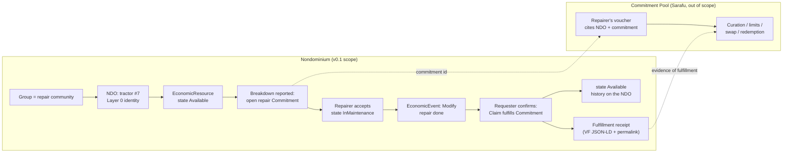
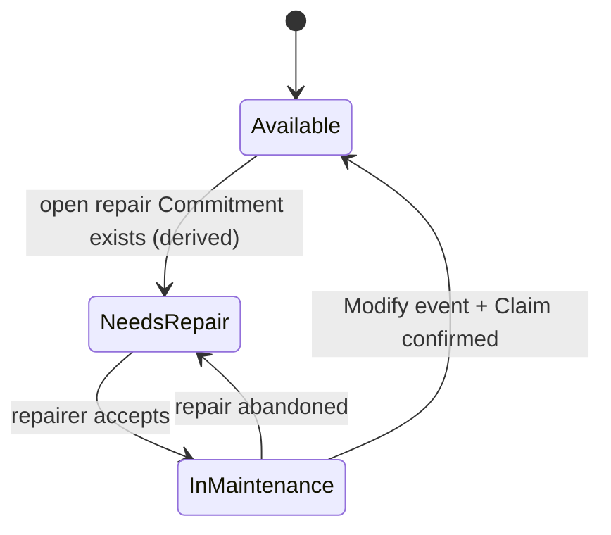
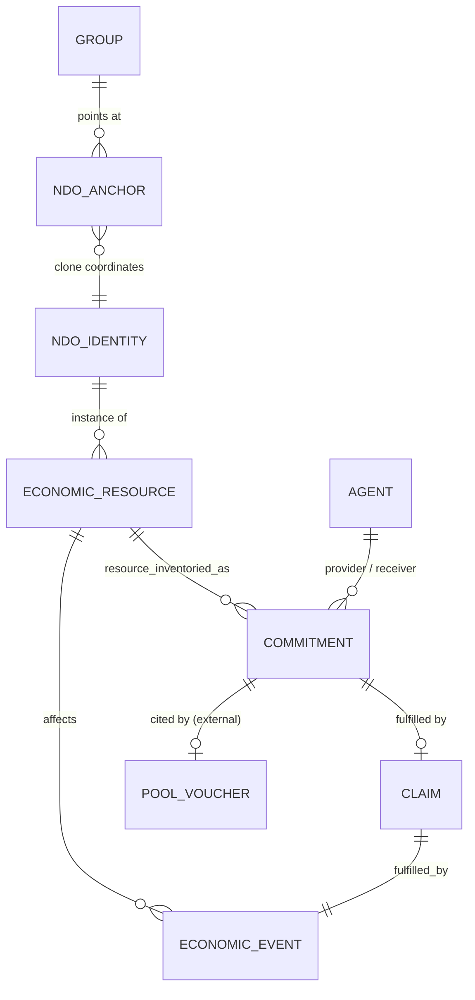

# Nondominium × *Commitment Pooling*: what v0.1 must ship

Source: the "Nondominium × Commitment Pooling" proposal (Grassroots Economics), pasted 2026-10-06. Goal of this round: isolate the features this use case actually needs, and draw a release boundary tight enough to ship something clear, useful and valuable.

The proposal's own test is three questions: can a pool use persistent Nondominium identities without losing its simplicity, can fulfillment emit Valueflows events that change the state of a real object, and does that information improve pooling, settlement or provenance. An MVP is the smallest thing that answers all three on one real case.

```board-idea
headline: |
  Nondominium grounds the commitment.
  The pool stays theirs.
detail: "The MVP is the half CPP lacks: a persistent object, a commitment pointing at it, a validated event that changes its state, and a receipt a pool can cite. Curation, valuation, limits and swaps stay in Sarafu."
```

## What the proposal asks for {wide}

The proposal's chain is Agent → Resource → Process → Commitment → Pool → Economic Event → Validated State Change. Read against the code, most links already exist as data; what is missing is the path a person walks through them.

```board-stickies
- title: The strongest phrase
  body: "\"Persistent economic identity and objects\" is what separates Layer 0 from yet another accounting or currency system."
  so: "The demo must make the machine's identity outlive the commitment: same NDO before, during and after, with its history attached."
  kind: idea
- title: CPP has four functions
  body: "Curation, Valuation, Limitation, Exchange (Swap Limiter, Value Index, Treasury), live on Sarafu.Network."
  so: "None of the four is Nondominium's job in v0.1. Reimplementing them would be a second, worse Sarafu."
  kind: model
- title: The proposal says reciprocal
  body: "\"When does a collection of resources and commitments become an actual pool with joint consequences?\" is asked of Nondominium."
  so: "A fair question for v0.2+, not a v0.1 feature. Record it, do not build it."
  kind: idea
- title: Repair example is our best fit
  body: "Repairer identity, machine identity, commitment, NeedsRepair → repair → Operational, validation, fulfillment, settlement."
  so: "Every noun maps to something we already model: Physical NDO, EconomicResource, Commitment, EconomicEvent, Claim, InMaintenance."
  kind: works
- title: Tomatoes are the weak example
  body: "100 kg of tomatoes is a consumable: quantity, not identity. A pool already handles it fine without us."
  so: "It does not exercise Layer 0. Keep it out of the first case."
  kind: risk
```

## What already exists in the code

Grounded in `documentation/IMPLEMENTATION_STATUS.md` and `dnas/ndo/workdir/dna.yaml` (read 2026-10-06). Each NDO is its own cell carrying `zome_resource` and `zome_gouvernance`, so a commitment about the machine can live in the machine's own DHT.

```board-tally
- n: "✅"
  label: "NDO Layer 0: identity, lifecycle, per-NDO cell, Group anchor"
  pct: 95
- n: "✅"
  label: "EconomicResource + OperationalState (InMaintenance, Available…)"
  pct: 75
- n: "✅"
  label: "Commitment / EconomicEvent / Claim entries and APIs"
  pct: 70
- n: "🔄"
  label: "Validation receipts (exist, partly stubbed)"
  pct: 45
- n: "🔄"
  label: "PPR (placeholder counterparty signature)"
  pct: 30
- n: "❌"
  label: "UI: create EconomicResource (#141), commitments, events"
  pct: 5
- n: "❌"
  label: "Economic processes, governance-as-operator funnel (#41–#45)"
  pct: 0
```

```board-stickies
- title: The gap is a path, not a model
  body: "Backend entries exist. No screen creates a resource (#141), proposes a commitment, logs an event or confirms a claim."
  so: "Most of the MVP's cost is UI and one coherent flow, not new zomes."
  kind: gotcha
- title: v0.1.0 already said OUT
  body: "Issue #123 lists OUT: governance-as-operator, PPR issuance, economic processes, role promotion, hREA phase 2+, capability private-data flows."
  so: "This use case pulls economic processes back in. That is the scope call to make first (card 1)."
  kind: risk
- title: No zome_person in the NDO cell
  body: "Inside an NDO cell an agent is an AgentPubKey; the name comes from the Lobby profile."
  so: "Good enough for a pilot: the repairer is identified by key plus Lobby handle. No Person entry needed."
  kind: model
```

## Against the prototypes and Tibi's Perspectives {wide}

Read 2026-10-06: the six v0.1 directions in `nondominium-design-system` (`src/lib/prototypes/directions.ts`, shared store `src/lib/prototypes/store/`), and Tibi's Perspectives in `documentation/requirements/ui_design.md` and `ui_architecture.md` §16 (commits 92c69f5, 38f9fc8, d91fe28, 2026-09-30). No direction is chosen yet: all six are `candidate`.

```board-compare
left:
  title: Converges
  who: already designed or mocked
  items:
    - "Shared store A–E already mocks the whole loop: addInstance, setOpState, propose, fulfil, validate; commitments are open / claimed"
    - "Seed data already has a refrigerated van InMaintenance and MaintenanceSchedule rules with a Repair role"
    - "D Signal Board: Needs hands / Available now / Needs eyes, derived from data = the read-only pool view (card 3)"
    - "F Flow Graph: Valueflows lanes (promises, what happened, receipts) seen from two conductors = the two-machine demo and the receipt"
    - "Resource Perspective: expanded view lists linked Agents with capacity (Custodian, Repair agent)"
    - "Work Perspective: commit to work, take a task, log contributions, stigmergic needs-attention signals"
    - "Community dictionary: per-community terms over the VF base, the place for GE's voucher / redemption vocabulary"
right:
  title: Diverges
  who: this board must correct or decide
  items:
    - "An open request with no repairer is a VF Intent, not a Commitment; prototypes fix the provider at propose, and Nondominium has no Intent"
    - "In CPP the repairer issues the voucher and the requester redeems it; redemption should create the commitment, not the voucher cite it (diagram 1 is backwards)"
    - "Prototypes issue PPRs on fulfil; card 7 leaves them out"
    - "Tibi plans to replace the Lobby → Group → NDO shell with a Perspective switcher (imminent work); a slice built in today's shell gets rebuilt"
    - "No target direction yet, so the slice has no visual language to land in"
between: "same loop, two framings"
```

```board-stickies
- title: The Intent gap is real
  body: "Valueflows: an Intent is a want or offer with one side open; a Commitment has both provider and receiver. \"Tractor needs repair, who can do it?\" is an Intent."
  so: "Card 5's lean (needs-repair derived from an open commitment) only holds if the requester names the repairer up front."
  kind: risk
- title: The voucher flows the other way
  body: "CPP: the repairer issues a voucher (\"I will do 5 repairs\"), the requester holds and redeems it."
  so: "Redemption is the moment a Commitment on a specific machine is born. The receipt then proves the voucher was honoured on that object."
  kind: model
- title: The slice is a Work Perspective seed
  body: "Opening, taking and fulfilling a repair is exactly \"what do I engage in today\"; the machine with its Repair agent is the Resource Perspective."
  so: "Building it as a thin first Work Perspective avoids building it twice."
  kind: idea
- title: D and F are the demo
  body: "D shows the pool's view of need; F shows the same facts as VF entries per conductor."
  so: "Whichever direction wins, these two views are what to show GE."
  kind: works
```

```board-decisions
- q: How is an unassigned repair request modelled?
  context: "Prototypes and zome_gouvernance only have Commitment, which names both provider and receiver. A breakdown with no repairer yet is a Valueflows Intent, which Nondominium does not implement."
  options:
    - pick: Add a minimal Intent (receiver set, provider open)
      effect: "One new entry in zome_gouvernance; accepting it creates the Commitment. VF-correct, and it is what a pool's open demand looks like."
    - pick: Requester names the repairer, Commitment only
      effect: "No new entry; the requester picks a repairer first (e.g. by redeeming their voucher). Card 5's derived state holds."
    - pick: Commitment with a placeholder provider
      effect: "No new entry, but it bends VF and integrity validation to allow an empty party."
  lean: 1
  lean_why: "It matches CPP's real flow (redeem a specific repairer's voucher) and keeps v0.1 schema-free; Intent becomes the v0.2 step for open calls."
- q: Where does the slice's UI live?
  context: "ui_design.md § Perspectives ToDos makes the Perspective switcher the next UI work; today's shell is Lobby → Group → NDO with no commitment screens."
  options:
    - pick: A tab in today's NDO view
      effect: "Fastest; reworked when Perspectives land."
    - pick: First thin Work Perspective (+ Resource expanded view)
      effect: "Starts Tibi's ToDos 1, 4 and 7 with a real use case; needs the switcher skeleton first."
    - pick: Only in the design-system prototype for GE
      effect: "Shows the flow on the mock store, no hApp change; answers none of the proposal's three questions on real peers."
  lean: 1
  lean_why: "The repair loop is the first concrete content Work and Resource Perspectives can carry, so the work counts twice."
- q: Choose the target direction before or after the slice?
  context: "All six directions (A Mycelium to F Flow Graph) are candidate; issue #147 wants design-system improvements in the app before v0.1.0."
  options:
    - pick: Choose first
      effect: "The slice is built once, in its final look; the choice (Tibi's) gates the slice."
    - pick: Build on current tokens, restyle later
      effect: "No wait, but a second pass on every new screen."
    - pick: Let the repair flow decide
      effect: "Run the repair scenario through D and F (and one more) and pick the one where it reads best."
  lean: 2
  lean_why: "A real scenario is a better selection criterion than taste, and it needs no new code: the shared store already mocks the loop."
```

## The repair case, end to end {wide}

One machine, one repairer, one requester, one pool. The large box is Nondominium; the small one is the pool on Sarafu, out of scope.







## In, out, and the line between {wide}

The release boundary as I would draw it. The cards below decide the contested items.

```board-compare
left:
  title: IN v0.1 (repair slice)
  who: Nondominium ships it
  items:
    - "Create a Physical NDO + its EconomicResource from the UI (closes #141)"
    - "Report a breakdown: open a repair Commitment on the machine"
    - "Accept the commitment: resource goes InMaintenance"
    - "Log the repair as an EconomicEvent (Modify)"
    - "Receiver confirms: Claim links event to commitment, resource back to Available"
    - "Machine history panel: every commitment, event, claim on the NDO"
    - "Stable permalink + exportable fulfillment receipt (VF JSON-LD)"
    - "Two-machine dogfood of the whole loop (#125)"
right:
  title: OUT (stays in CPP or later)
  who: Sarafu, or v0.2+
  items:
    - "Curation, valuation, swap limits, treasury, settlement"
    - "Vouchers, tokens, any chain integration"
    - "PPR issuance (prototype signatures)"
    - "Governance-as-operator funnel (#41–#45, #145)"
    - "Role-gated Repair credential (#34)"
    - "EconomicProcess entries, multi-step process chains"
    - "Cross-pool routing, pool-level capacity from resource state"
    - "hREA as the event store"
between: "the receipt"
```

## Decisions waiting on you {wide}

Ten calls (three more in the prototypes zone). Card 1 frames the rest: if the slice goes into v0.1.0 itself, the release date moves.

```board-decisions
- q: Where does the repair slice ship?
  context: "Milestone \"v0.1.0 peer-mesh\" (#123) is Lobby + Group + NDO Layer 0 and lists economic processes as OUT. This use case needs commitments, events and claims in the UI, roughly #141 plus three new screens."
  options:
    - pick: Fold it into v0.1.0
      effect: "v0.1.0 becomes the Commitment Pooling demo; #123's OUT list is rewritten and the release slips by the slice's size."
    - pick: Ship v0.1.0 as scoped, then v0.1.1 / v0.2 = repair slice
      effect: "peer-mesh releases first and gives a stable base; the repair slice gets its own milestone and its own release note for Grassroots Economics."
    - pick: A demo branch outside the release line
      effect: "fastest to show GE, but the code never lands as a supported release and drifts from dev."
  lean: 1
  lean_why: "peer-mesh is nearly done and is the substrate the slice stands on. A separate milestone gives GE a release that is about their case, with nothing else in its notes."
- q: Which Grassroots Economics case?
  context: "The proposal lists repair, agricultural, transport or service pools. The choice decides which existing primitives get exercised."
  options:
    - pick: Repair pool (agricultural machine)
      effect: "Exercises Physical NDO, custody, InMaintenance, Modify event, MaintenanceFulfillment vocabulary; identity persists across the repair."
    - pick: Agricultural produce (tomatoes)
      effect: "Quantity and consumption, CommonPool regime; identity barely matters, so Layer 0 is not demonstrated."
    - pick: Transport
      effect: "Exercises InTransit and location, needs two custodians and a Move event; more moving parts than repair."
    - pick: Ask GE which pool has a real candidate
      effect: "Grounds the demo in a live community; the decision waits on their answer."
  lean: 0
  lean_why: "It is the proposal's own worked example and the one where persistent identity visibly matters. Confirm with GE that a real repair pool exists, in a note."
- q: How much of the pool lives in Nondominium?
  context: "CPP's four functions (curation, valuation, limitation, exchange) run on Sarafu. Something must make the pool visible in the demo."
  options:
    - pick: None, the Group is the community
      effect: "The Group membrane holds repairers and requesters; the pool exists only on Sarafu and cites our ids. Zero pool code here."
    - pick: Read-only pool view in the Group
      effect: "A list of open and fulfilled repair commitments across the Group's NDOs, labelled as what a pool would curate. UI only, no new entries."
    - pick: Minimal curation entry (PoolListing)
      effect: "A new entry type for accepted commitments; starts duplicating Sarafu's curation and its governance."
  lean: 1
  lean_why: "It answers question 3 of the proposal visually (does our info improve pooling?) without a single pool rule living here."
- q: How does a pool reference our objects?
  context: "The integration contract is the receipt: what Sarafu (or a human curator) holds that points back into Nondominium."
  options:
    - pick: Permalink + hashes, copied by a human
      effect: "Curator pastes the NDO and commitment links into the voucher's metadata. Works today, no format promise."
    - pick: Permalink + VF JSON-LD fulfillment receipt
      effect: "A downloadable receipt (agent, resource, commitment, event, claim, validators) in Valueflows JSON-LD. A format GE can parse later."
    - pick: Live bridge to Sarafu
      effect: "Needs their contracts or API, chain work and a joint spec; months, not a slice."
  lean: 1
  lean_why: "The receipt is the one artefact both sides can test against, and Valueflows is the common language the proposal names."
- q: How is "needs repair" represented?
  context: "OperationalState has Available, Reserved, InTransit, InStorage, InMaintenance, InUse, PendingValidation (crates/shared/src/types.rs). No NeedsRepair, and OperationalState means \"the process acting on it\", not condition."
  options:
    - pick: Derived from an open repair Commitment
      effect: "No schema change: a resource with an unfulfilled repair commitment shows as Needs repair in the UI."
    - pick: Add NeedsRepair to OperationalState
      effect: "One enum variant and its transitions; blurs process-state with condition and touches integrity validation."
    - pick: New condition field on EconomicResource
      effect: "Clean semantics (Operational / NeedsRepair / OutOfService) but a new integrity field and migration on a fresh model."
  lean: 0
  lean_why: "The commitment already says the machine needs repair; deriving it keeps the data model untouched for v0.1."
- q: Who validates that the repair happened?
  context: "The proposal leans on peer validation. ValidationReceipt and ResourceValidation exist, partly stubbed."
  options:
    - pick: Receiver confirms (the Claim)
      effect: "The requester who opened the commitment confirms; one counter-signature, no new workflow."
    - pick: Receiver + one Group witness
      effect: "Adds a ValidationReceipt from another member; the receipt lists two validators."
    - pick: N-of-M ResourceValidation
      effect: "Configurable scheme; needs the stubbed validation path finished and a UI for reviewers."
  lean: 1
  lean_why: "One witness is the smallest thing that is honestly peer validation rather than a two-party handshake, and it uses an entry that exists."
- q: PPRs in the slice?
  context: "MaintenanceFulfillmentCompleted is one of the 16 PPR categories, but issuance inserts a placeholder counterparty signature and claims are DHT-linked despite the privacy goal."
  options:
    - pick: Leave PPRs out
      effect: "Claim + event is the public record; reputation waits for authenticated bilateral issuance (#14)."
    - pick: Issue prototype PPRs
      effect: "Shows the reputation story to GE, on signatures we know are placeholders."
  lean: 0
  lean_why: "Shipping known-weak signatures in the first external demo would cost more trust than the feature earns."
- q: Who may accept a repair commitment?
  context: "Specialized role validation (#34) auto-approves today; the Repair role exists in zome_person, which is not in the NDO cell."
  options:
    - pick: Any Group member
      effect: "Membership is the gate; competence is the requester's judgment, as in a real repair circle."
    - pick: Self-declared Repair skill in the Group profile
      effect: "A tag shown on the commitment, not enforced."
    - pick: Validated Repair role
      effect: "Requires #34 finished and a cross-cell role check; out of slice size."
  lean: 0
  lean_why: "Gating adds work and no evidence for the three proposal questions."
- q: Do write paths go through evaluate_state_transition?
  context: "Issue #145 is open: propose_commitment and log_economic_event write directly; the operator is advisory."
  options:
    - pick: Keep direct writes, call evaluate as dry-run
      effect: "Soft warnings show in the UI; no refactor of the write paths in this slice."
    - pick: Funnel through the operator now
      effect: "Settles #145 inside the slice; correct architecture, larger and riskier change."
  lean: 0
  lean_why: "#145 is a design decision of its own; the slice should not decide it by accident."
- q: Where do commitments and events live?
  context: "Each NDO cell has zome_gouvernance, so the machine's commitments can sit in the machine's own DHT. The shared nondominium cell and hREA are alternatives."
  options:
    - pick: In the NDO's own cell
      effect: "History travels with the object; anyone who joins the NDO sees it; cross-NDO queries need one call per cell."
    - pick: In the shared nondominium cell
      effect: "One place to query everything; the object's history no longer travels with its identity."
    - pick: In hREA
      effect: "Canonical VF store; blocked by the Holochain 0.7 / hREA work (#134) and phase 2+ bridge."
  lean: 0
  lean_why: "It is the literal claim of the proposal: events accumulate around the persistent object."
```

## What done looks like

The slice is done when a demo answers the proposal's three questions on two physical machines, without a sentence of hand-waving.

```board-stickies
- title: Q1, simplicity kept
  body: "A GE curator creates nothing in Nondominium beyond pasting a link or loading a receipt."
  so: "Falsifier: any step requires a pool operator to learn our data model."
  kind: works
- title: Q2, fulfillment changes the object
  body: "After the Claim, the machine's NDO shows the repair in its history and its resource is Available again, seen from the other machine."
  so: "Falsifier: the state or history differs between the two peers after sync."
  kind: works
- title: Q3, information improves pooling
  body: "The Group's pool view shows which machines are down and which commitments are open; the receipt names validators."
  so: "Ask GE directly whether this changes a curation or settlement decision. Their answer is the result."
  kind: idea
```

## Sketch it

Drag the pieces, redraw the boundary, add what is missing.

```board-sketch
height: "34rem"
hint: "Move pieces across the ND / Sarafu line; anything you add or retype goes into your answers."
seed:
  - text: "Tractor #7 (NDO)"
    shape: rectangle
  - text: "Repair Commitment"
    shape: rectangle
  - text: "Modify event"
    shape: rectangle
  - text: "Claim + witness"
    shape: diamond
  - text: "Fulfillment receipt"
    shape: ellipse
  - text: "Sarafu voucher"
    shape: ellipse
  - text: "Curation / limits / swap"
    shape: text
library:
  - name: Out of scope
    text: "OUT"
    shape: ellipse
  - name: Question for GE
    text: "Ask GE"
    shape: diamond
```
