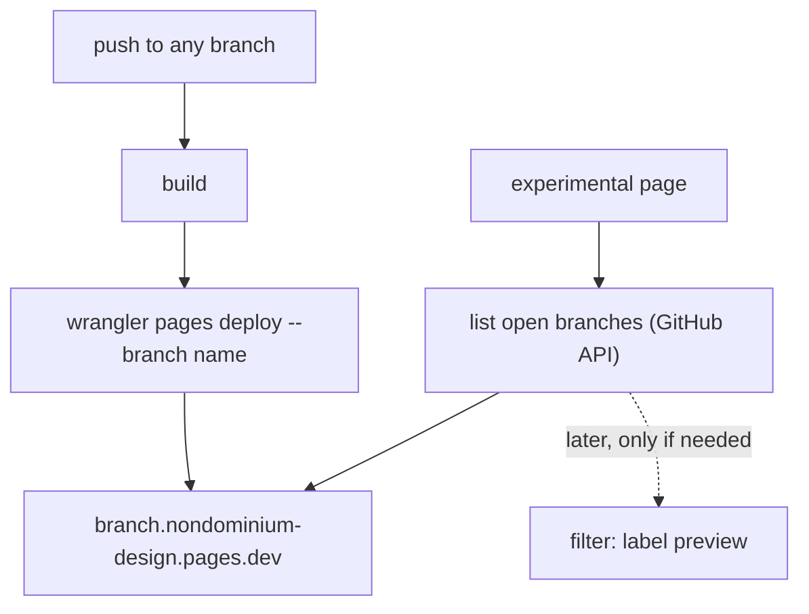
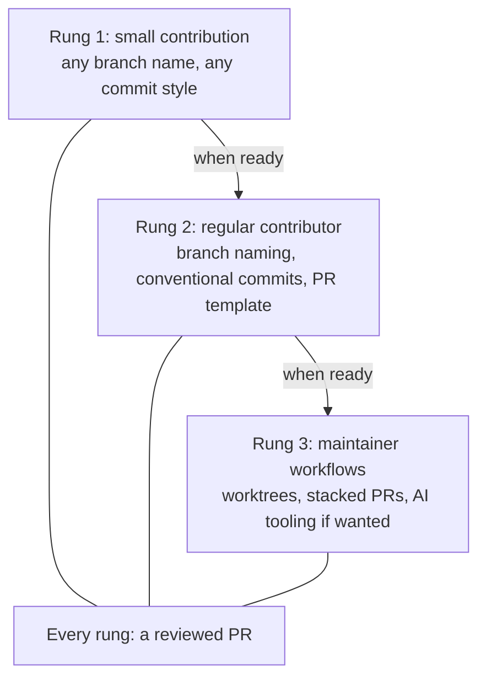
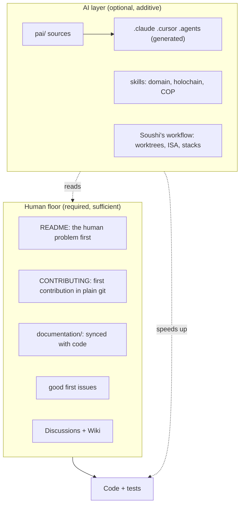
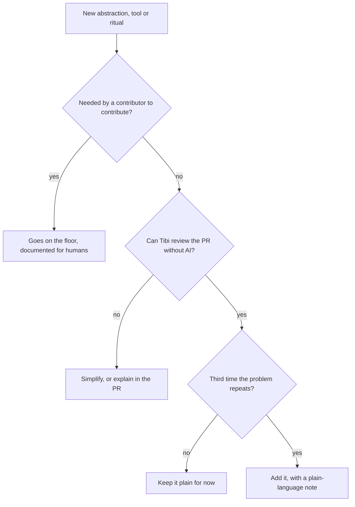

# Human-first, *AI-optional*

> **SoushAI analysis.** Drafted by Soushi's AI assistant, reviewed and shared by Soushi.

Tibi, this page picks up our discussion about branch previews in the design system and the broader point you raised: that Soushi tends to think as an engineer and build for AI more than for humans, when Nondominium should stay simple and open to contributors who are less technical or who work without AI. Soushi agrees with most of it and still sees value in clean, idiomatic workflows. The page puts both views side by side and ends on questions for the two of us.

Soushi has answered the questions first: ★ marks his pick, with his reasons. Every card is still open for yours: pick an option, add a note, pin a comment on anything with "comment on…", and use the closing box for anything else. "copy my answers" exports only what you changed, ready to send back. Your answers stay in your browser until you send them.

```board-idea
headline: |
  Humans are the floor.
  AI is a floor above it.
detail: "Everything needed to understand, run, review and merge Nondominium should work with git, a browser and a text editor. AI tooling (pai/, skills, agent files) reads from that floor and speeds it up; nothing on the floor depends on it."
```

## Links {wide}

- [Sensorica/nondominium on GitHub](https://github.com/Sensorica/nondominium) · [Discussions](https://github.com/Sensorica/nondominium/discussions) · [Wiki](https://github.com/Sensorica/nondominium/wiki)
- [nondominium-design-system PR #10](https://github.com/Sensorica/nondominium-design-system/pull/10): Cloudflare Pages deploy, still a draft, deploys `master` only.
- [Cloudflare Pages: preview aliases](https://developers.cloudflare.com/pages/configuration/preview-deployments/#preview-aliases): every deployed branch gets `<branch>.<project>.pages.dev`.
- Repo files discussed: [CONTRIBUTING.md](https://github.com/Sensorica/nondominium/blob/dev/CONTRIBUTING.md), [README.md](https://github.com/Sensorica/nondominium/blob/dev/README.md), [AGENTS.md](https://github.com/Sensorica/nondominium/blob/dev/AGENTS.md), [CLAUDE.md](https://github.com/Sensorica/nondominium/blob/dev/CLAUDE.md), [GEMINI.md](https://github.com/Sensorica/nondominium/blob/dev/GEMINI.md), [pai/](https://github.com/Sensorica/nondominium/tree/dev/pai).
- [Stigmergic Co-Creation in the Age of AI](https://docs.google.com/document/d/1kzJDmDkcXRVIvYcNzdu74jh3fMnWr3L_g-SZTadJBlQ/), Tibi's paper (2026).
- "L'Accueil Inclusif", Soushi's onboarding methodology draft for Nondominium (May 2026): not published yet, Soushi can send it.

## The case: branch previews {wide}

Where the disagreement became concrete. Tibi proposed an experimental page in the design system that shows work in progress on other branches; Soushi proposed showing several chosen branches, not one, and Tibi agreed. They split on how a branch gets chosen.

```board-compare
left:
  title: Soushi, a label on the PR
  who: "opt-in: tag a PR to deploy its branch"
  items:
    - clean, explicit, idiomatic GitHub workflow
    - only curated work shows up
    - a starting design worth exploring for a clean integration
right:
  title: Tibi, list every branch
  who: "no new concept: all branches, sort it out later"
  items:
    - nothing new for a contributor to learn
    - "we may never need a whitelist"
    - add complexity only once it is needed
between: "same page"
```

```board-stickies
- title: The platform already does half of it
  body: "Cloudflare Pages gives every deployed branch its own alias, `<branch>.nondominium-design.pages.dev`. PR #10's workflow deploys only `master` with `--branch master`; widening the trigger to every branch and passing the branch name gives each one a preview URL with no label and no new term."
  so: "Tibi's version costs a few lines in a workflow that already exists."
  kind: works
- title: '"All branches" is not free either'
  body: "The repo squash-merges and `delete_branch_on_merge` is off. Six of the eight non-master branches on origin belong to PRs already merged, and git cannot tell (squash leaves no ancestry). A naive list shows six finished branches as work in progress."
  so: "The simple version needs one GitHub setting turned on, plus deleting six stale branches once. Still no new vocabulary."
  kind: gotcha
- title: The label becomes a filter, not a rewrite
  body: "If the page lists branches from the GitHub API, a later whitelist is one `label:preview` filter on the same list. Starting simple does not close the door on the clean design; it postpones it to the day someone needs it."
  so: "The idiomatic version stays on paper, the seam for it stays in the code."
  kind: idea
- title: Where Soushi hesitates
  body: "Setting aside a clean, idiomatic practice for contributors who are not here yet feels like a loss, and a PR label is basic git. The narrower point to weigh: not whether labels are hard, but whether this one solves a problem we have had."
  kind: habit
- title: Exploring is not shipping
  body: "A starting design is worth having. It can live as a short design note or an ADR in the repo, ready to apply, without being the thing that ships. Both instincts get their due: the exploration is kept, the code stays minimal."
  kind: model
```

```board-stickies
- title: What wrangler already does
  body: "`wrangler pages deploy build --project-name nondominium-design --branch master` uploads the built site as a deployment tagged with a branch. `master` is the production branch, so it serves `nondominium-design.pages.dev` and the custom domain. Any other `--branch` value becomes a preview with its own alias. Per-branch previews need two changes: run the workflow on every branch, and pass the branch name instead of `master`."
  kind: works
- title: design.sensorica.co for previews?
  body: "Cloudflare can pin a custom domain to a branch only through a proxied Cloudflare DNS record; through an external DNS the alias falls back to production. `sensorica.co` stays at GoDaddy (PR #10), so `branch.design.sensorica.co` would show production. What works today: the experimental page lives on design.sensorica.co and links to each `<branch>.nondominium-design.pages.dev`."
  so: "Per-branch subdomains under sensorica.co would mean moving its DNS to Cloudflare."
  kind: gotcha
```



## Progressive workflow adoption {wide}

Soushi's answer to your point, from his first-round comments: good engineering practice is not over-engineering, but nobody has to adopt all of it on day one.

> I don't consider good engineer practices as overengineering, but I understand that not all contributors have the technical level to follow them. Having a progressive workflows adoption learning curve would be nice. (Soushi, 2026-10-09)



```board-stickies
- title: The invariant
  body: "Whatever the rung, a change lands through a reviewed PR. Soushi named this as the one thing a lighter workflow keeps."
  kind: works
- title: Same shape as Sensorica's content rules
  body: "Tibi's paper restates them: add without permission (Rule 3), polish style without permission (Rule 4), never delete, negotiate in discussion. Low friction to add, care where it matters."
  kind: model
- title: Open to training
  body: "Soushi wants contributors open to good practice. The ladder makes that a path with steps, not a test at the door."
  kind: idea
- title: A ladder can read as a rank
  body: "If rungs look like status, newcomers feel second-class. Name them by the tools they add, never by the person."
  kind: risk
```

## Your paper: stigmergic co-creation {wide}

[Stigmergic Co-Creation in the Age of AI](https://docs.google.com/document/d/1kzJDmDkcXRVIvYcNzdu74jh3fMnWr3L_g-SZTadJBlQ/) uses the Nondominium merges as its case: local AI agents resolving conflicts silently subtracted each other's work. Several of its points touch this board directly.

```board-stickies
- title: Agent files are shared governance too
  body: "Principle 1: repositories carry AGENTS.md, CLAUDE.md or .rules files so that every contributor's local agent loads the network's rules. The root agent file is where shared rules reach other people's AI, not only Soushi's tooling."
  so: "Supports one real AGENTS.md that everyone's agent reads."
  kind: model
- title: ADRs in both
  body: "Principle 2 lists Architecture or Agent Decision Records as a signal file. The label ADR Soushi picked below is the same practice."
  kind: works
- title: Documentation-first precedence
  body: "At a merge, specifications and planning docs take precedence over transient code, citing Nondominium's documentation-first workflow."
  kind: model
- title: Structure, placed where nobody has to learn it
  body: "The paper proposes three git gates and shared signal servers: real machinery. The gates run in shared CI, so a contributor meets them only when a change subtracts. Same test as the ladder: complexity is fine where newcomers do not have to carry it."
  kind: idea
```

## Two views

Both are partly right. The onboarding methodology already named the meeting point in May, for the docs; it was never applied to code and workflows.

```board-stickies
- title: Tibi's point
  body: "The project reads as built for an engineer with an AI agent: hundreds of lines of agent instructions at the root, worktrees, stacked PRs, generated rule trees. A Sensorica member who is not a developer, or a developer without an AI assistant, bounces."
  so: "The cost is contributors who never arrive, so nobody sees them leave."
  kind: risk
- title: Soushi's point
  body: "Idiomatic structure, strong types and AI workflows help two part-time volunteers keep a Holochain codebase sane. Making the code look simple by making it worse would hurt everyone."
  so: "Simplicity should not mean removing the advanced workflow for those who use it."
  kind: model
- title: Where they meet
  body: "From the methodology draft: *réduire la friction, pas le contenu.* Several doors in, with the real complexity still reachable behind them."
  so: "Layering and a complexity budget, not a downgrade."
  kind: works
- title: The NRP lesson, in Tibi's words
  body: "On 2026-09-29: NRP's universal language \"polluait un peu, les gens se trouvaient aliénés\". The vocabulary of our tooling can alienate the same way the vocabulary of the ontology does."
  kind: habit
- title: Too opinionated about workflows?
  body: "Soushi's own question. Branch model, worktrees, stacked PRs, PR template sections and commit scopes are all opinions a newcomer has to adopt before a first contribution. Being opinionated for oneself is fine; what matters is how much of it the project requires of others."
  so: "Split how each of us works from what the project requires, and keep the second list short."
  kind: idea
```

## What the repo looks like today

Counted on `dev` at d91fe28 (2026-09-30) and on GitHub on 2026-10-09.

```board-tally
- n: 860
  label: lines of agent-facing docs at the root (AGENTS, CLAUDE, GEMINI, REVIEW)
  pct: 66
- n: 438
  label: lines of human-facing docs at the root (README, CONTRIBUTING)
  pct: 34
- n: 0
  label: open issues labelled good first issue, out of 61 open
  pct: 0
```

```board-stickies
- title: Already in place
  body: |
    - Discussions and Wiki are both enabled on GitHub.
    - `CONTRIBUTING.md` already says worktrees are optional and plain `git checkout` works.
    - AI files are generated from `pai/` by `nix develop` and gitignored, so they never show up in diffs.
  kind: works
- title: Where the AI layer leaks into the floor
  body: |
    - `CONTRIBUTING.md` has a full section on AI tooling conventions and none on "your first contribution".
    - Three near-identical agent files (`CLAUDE.md`, `GEMINI.md`, `AGENTS.md`) sit beside the README.
    - The README opens on "ValueFlows-compliant multi-DNA Holochain hApp", not on the human problem.
  kind: gotcha
```

## The layer model

The floor is what any contributor needs. The AI layer is what lets whoever uses it go faster. The arrow only goes one way.





## Principles to test

Candidates, not decisions. Each should survive the question "does this stop either of us from working the way we work?"

```board-stickies
- title: The deletion test
  body: "Delete `pai/`, `.claude/`, `.cursor/`, `AGENTS.md`, `CLAUDE.md`, `GEMINI.md`. The project must still be understandable, buildable, reviewable and mergeable."
  so: "A concrete, checkable definition of AI-optional."
  kind: idea
- title: Idiomatic is not a reason on its own
  body: "An idiom earns its place when it removes a real, repeated problem. \"It's how it's done\" names the norm, not the need."
  kind: idea
- title: The reviewer test
  body: "If a co-maintainer cannot review a PR without an AI explaining it, the PR is too clever or too big. The PR body carries the explanation, not the AI."
  kind: idea
- title: Root is for humans
  body: "Top-level files are the front door. Agent files there should be short pointers, not long manuals."
  kind: idea
- title: Two layers drift
  body: "If the AI layer documents things the human docs do not, knowledge moves to where only agents read it."
  so: "Facts live on the floor; `pai/` only points at them."
  kind: risk
- title: Personal tools stay personal
  body: "Each contributor's own workflow (worktrees, AI planning notes, stacked PRs) is welcome, as long as it never becomes a requirement for others."
  kind: risk
```

## Engineer-idiomatic vs contributor-first

```board-compare
left:
  title: Engineer-idiomatic
  who: what the repo leans toward today
  items:
    - abstractions set up before the third repeat
    - process encoded for agents (rules, skills)
    - PR context lives in ISA and Plans
    - README opens on architecture
right:
  title: Contributor-first
  who: what Tibi asks for
  items:
    - plain code until a pattern repeats
    - process written for humans, mirrored for agents
    - PR body explains itself to a reviewer
    - README opens on the human problem
between: "same code"
```

## Questions for us {wide}

The first three are about branch previews, then the project in general, then three new questions from Soushi's answers. ★ marks Soushi's pick; pick freely and say why in the note.

```board-decisions
- q: First version of the branch preview page?
  context: "nondominium-design-system: PR #10 deploys master to Cloudflare Pages. The experimental page shows work in progress on other branches. Tibi prefers no new label or term; Soushi first proposed an opt-in PR label."
  options:
    - pick: Every open branch, no label
      effect: "The workflow deploys every push under its branch name; the page lists open branches and links each preview. Nothing new to learn; noisy only if branches pile up."
    - pick: Opt-in label from day one
      effect: "Only PRs with a preview label deploy; a curated page, but one more convention to learn before your work shows up."
    - pick: Every branch now, label filter written down for later
      effect: "Ships the simple version; the label idea is kept as a short design note, ready the day the list gets noisy."
  lean: 2
  lean_why: "Soushi's pick: the simple floor now, the label idea kept in writing."
- q: Turn on delete-branch-on-merge in the design-system repo?
  context: "The setting is off and PRs are squash-merged, so 6 of the 8 non-master branches on origin are finished work that still looks open."
  options:
    - pick: Turn it on, delete the 6 stale branches once
      effect: "The branch list shows only live work; a GitHub setting does the cleanup, nothing new for contributors."
    - pick: Leave it, filter by open PR on the page
      effect: "Branches pile up; the page has to ask GitHub which branches still have an open PR."
  lean: 0
  lean_why: "Soushi's pick: removes the main reason for a whitelist, at no cost to anyone."
- q: Where does the label idea live?
  context: "Soushi sees the label version as a clean starting design worth exploring; Tibi sees it as premature."
  options:
    - pick: A short design note in the design-system repo
      effect: "Visible to both of us and to future contributors; says when to switch to labels and how. No code."
    - pick: Soushi's private notes only
      effect: "Kept, but invisible to the team."
    - pick: Drop it
      effect: "Simplest; the idea gets rediscovered if the need comes."
  lean: 0
  lean_why: "Soushi's pick: a short ADR in the design-system repo."
- q: Write "human-first, AI-optional" into CONTRIBUTING?
  context: "Today the principle exists only in conversation. Nondominium is the first case; R&O and hREA could follow."
  options:
    - pick: Yes, a short principle in CONTRIBUTING
      effect: "Newcomers see the commitment, and either of us can point at it in review."
    - pick: Keep it as an informal habit
      effect: "No doc change; it holds as long as we both remember it."
  lean: 0
  lean_why: "Soushi's pick, and he also wants it as a rule for his own AI assistant in every public repo."
- q: What happens to the agent files at the root?
  context: "AGENTS.md, CLAUDE.md and GEMINI.md are 236 lines each and largely duplicate one another; REVIEW.md adds 152. They sit beside README.md."
  options:
    - pick: AGENTS.md only, the others point to it
      effect: "One agent file (the cross-tool standard); CLAUDE.md and GEMINI.md become one-line pointers. The root reads lighter and every tool still finds its instructions."
    - pick: Move all agent docs under pai/
      effect: "Cleanest root, but some tools only look at the root and lose their context."
    - pick: Leave as is
      effect: "No churn; the front door keeps reading as built for agents."
  lean: 0
  lean_why: "Soushi's pick, with a question: keep one source and make the others symlinks to it? See the first new card."
- q: Which test defines "complexity only when needed"?
  context: "A test makes it checkable in review instead of a matter of taste."
  options:
    - pick: The reviewer test
      effect: "A PR passes when the other maintainer can review it from code and PR body alone; otherwise it gets simpler or better explained."
    - pick: Rule of three
      effect: "No new abstraction before the third repetition; mechanical, but blind to process complexity."
    - pick: Both, reviewer test first
      effect: "The reviewer test gates every PR; the rule of three guides when to refactor."
  lean: 2
  lean_why: "Soushi's pick: the reviewer test gates every PR, the rule of three guides refactoring."
- q: First concrete move on Nondominium?
  context: "The onboarding methodology's roadmap is still on paper. Discussions and Wiki are on. 0 of 61 open issues are labelled for newcomers."
  options:
    - pick: README human-first + good first issues
      effect: "Rewrite the README's first half around the human problem and label 3 to 5 newcomer issues; a few hours, visible right away."
    - pick: The full methodology weekend
      effect: "Crash course, persona paths, glossary, wiki home; the strongest result, but a weekend we may not have."
    - pick: Apply it only to future PRs
      effect: "No upfront work; the front door stays as it is."
  lean: 0
  lean_why: "Soushi's pick: the smallest step a newcomer actually meets."
- q: Change the PR template?
  context: "The template has Intent, Changes, Decisions, How to test, Documentation, Related, all at the same level."
  options:
    - pick: A plain summary on top, the rest folded under Details
      effect: "A new first section says clearly what the PR does; the existing sections sit in a collapsible Details block. The new section's name says nothing about AI."
    - pick: No change
      effect: "The template stays as it is; clarity relies on habit."
  lean: 0
  lean_why: "Soushi's pick: introduce the PR clearly first, everything else in a collapsible Details section."
- q: Where does the single agent-instructions file live?
  context: "Decided: one AGENTS.md, the others point to it. Soushi's open question: the source should sit in pai/ with symlinks. Git's docs: with core.symlinks false (set on some Windows checkouts) a symlink is checked out as a small text file holding the path."
  options:
    - pick: AGENTS.md at the root, CLAUDE.md and GEMINI.md symlink to it
      effect: "Newcomers and every tool find real content at the root; the two others follow it. On a checkout without symlinks they become one-line files naming AGENTS.md."
    - pick: Source in pai/, root files symlink to it
      effect: "Matches the existing rule that pai/ is the source; but the front door shows links, and on GitHub the root file is a pointer."
    - pick: AGENTS.md at the root, CLAUDE.md imports it
      effect: "No symlinks: CLAUDE.md holds one line, @AGENTS.md. Works on every checkout; GEMINI.md needs its own pointer."
- q: How many rungs on the contribution ladder?
  context: "Progressive adoption, with a reviewed PR at every rung."
  options:
    - pick: Two, light and full
      effect: "Small contributions, then the project workflow; simplest to explain."
    - pick: Three, light, regular, maintainer
      effect: "Separates the shared conventions (naming, commits, template) from personal power tools (worktrees, stacks, AI)."
- q: How does someone move up a rung?
  context: "The ladder must invite, not gatekeep."
  options:
    - pick: They choose
      effect: "Anyone adopts the next rung's habits when they want; reviewers nudge in comments."
    - pick: A maintainer invites them
      effect: "After a few reviewed PRs, a maintainer suggests the next step; mentoring is explicit but slower."
    - pick: Both
      effect: "Self-chosen by default, with an invitation when a reviewer sees someone ready."
```
