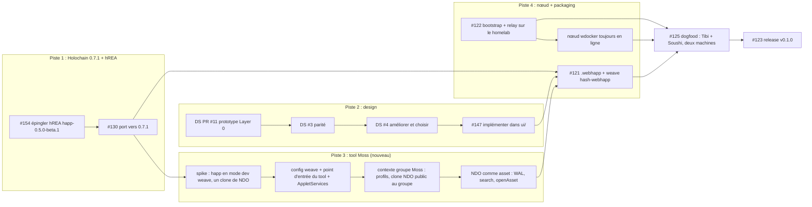

# Nondominium v0.1.0 : le plan de release *Moss*

Plan de la première release, réorientée : au lieu d'un .webhapp autonome sur un bootstrap public, un Tool Moss avec un nœud toujours en ligne. Mesuré le 2026-10-27 sur `Sensorica/nondominium` dev à `01f21b1`, le design system à `c78ce8c`, et le dépôt et les releases de lightningrodlabs/moss. Rien n'a encore été modifié sur GitHub : chaque changement ci-dessous attend les cartes de décision.

```board-idea
headline: |
  Moss sur Holochain 0.7.1 n'existe aujourd'hui qu'en build de test.
  Le mode dev marche pour Tibi et toi si vous pointez tous deux vers un serveur bootstrap que nous hébergeons.
detail: "Moss 0.15.8 (la dernière stable) tourne sur Holochain 0.6.1. La ligne 0.16 sur 0.7.1 sort en builds rc, coupés exprès de toute autre installation Moss. Pour un pilote à deux, ça ne gêne pas."
```

## Liens

- Milestone : [v0.1.0 peer-mesh](https://github.com/Sensorica/nondominium/milestone/11) (échéance 2026-10-25, dépassée, 10 ouvertes / 10 fermées)
- Port Holochain 0.7 : [PR #130](https://github.com/Sensorica/nondominium/pull/130), suivi [#134](https://github.com/Sensorica/nondominium/issues/134) ; épinglage hREA [#154](https://github.com/Sensorica/nondominium/issues/154)
- Holochain [release 0.7.1](https://github.com/holochain/holochain/releases/tag/holochain-0.7.1) (2026-10-14) ; hREA [happ-0.5.0-beta.1](https://github.com/h-REA/hREA/releases/tag/happ-0.5.0-beta.1) (2026-09-10, Holochain 0.7)
- Chaîne design : [DS #3 parité](https://github.com/Sensorica/nondominium-design-system/issues/3), [DS #4 améliorer et choisir](https://github.com/Sensorica/nondominium-design-system/issues/4), [DS PR #11 prototype Layer 0](https://github.com/Sensorica/nondominium-design-system/pull/11), [ND #147 port dans ui/](https://github.com/Sensorica/nondominium/issues/147)
- Moss : [v0.16.0-rc.3-test.26](https://github.com/lightningrodlabs/moss/releases/tag/v0.16.0-rc.3-test.26), [v0.15.8](https://github.com/lightningrodlabs/moss/releases/tag/v0.15.8), [config du CLI dev](https://github.com/lightningrodlabs/moss/blob/main-0.7/docs/build/configure-cli.md), [publier un tool](https://github.com/lightningrodlabs/moss/blob/main-0.7/docs/build/publishing-a-tool.md), [wdocker](https://github.com/lightningrodlabs/moss/blob/main-0.7/wdocker/README.md), [curation des tools](https://github.com/lightningrodlabs/weave-tool-curation)
- Nœuds toujours en ligne : [Sensorica/nixos-holochain](https://github.com/Sensorica/nixos-holochain), [Holo-Host/edgenode](https://github.com/Holo-Host/edgenode/blob/main/USAGE.md)

## Tes trois questions

```board-stickies
- title: "La v0.1.0 peut-elle tourner en mode dev Moss ? Oui."
  kind: works
  body: |
    Le CLI `weave` (`@theweave/cli`, tag `next` = 0.16.0-rc.4) lance Moss en mode dev à partir d'un `weave.dev.config.ts` : des groupes avec un `networkSeed` fixe, un agent créateur, des agents qui rejoignent, et notre tool chargé depuis `localhost` (chemin du happ + port de l'UI) ou depuis un .webhapp compilé.
    - Rien n'est publié dans la bibliothèque d'outils, donc l'absence de Moss 0.16 stable ne bloque pas.
    - Le prix : Nondominium n'a aucun code Moss aujourd'hui. `workdir/moss.yaml` est une ébauche et `ui/` n'a aucune dépendance `@theweave/*`.
- title: "Tibi et toi dans le même groupe ? Oui, à trois conditions."
  kind: gotcha
  body: |
    Tel quel, le mode dev démarre un `kitsune2-bootstrap-srv` local pour l'agent 1, et l'agent 2 lit son adresse dans un fichier local (`src/main/cli/devSetup.ts`). Ça, c'est une seule machine. Sur deux machines :
    1. Vous utilisez tous deux la **même version du CLI**, donc le même Holochain (la ligne rc est isolée du reste du réseau, par conception).
    2. Vous passez tous deux `--bootstrap-url` et `--relay-url` vers **un serveur que nous hébergeons** (c'est le travail du nœud, plus bas).
    3. Vous utilisez la **même config dev**, donc le même `networkSeed` de groupe. Le seed du tool est tiré par celui qui l'installe et parvient à l'autre par le DHT du groupe.
    Personne n'a documenté de test sur deux machines : la première session de dogfood en sera la preuve.
- title: "Le même lobby ? Pas tel qu'il existe aujourd'hui."
  kind: model
  body: |
    Dans Moss, chaque instance de tool dans chaque groupe est son propre réseau : installer un tool écrit une entrée Applet avec un `network_seed` neuf (`group-store.ts`). Le Lobby DNA de Nondominium, avec son seed global `nondominium-lobby-v1`, ne survit donc pas comme lobby inter-groupes dans Moss.
    - **Le groupe Moss est le groupe.** Notre Group DNA et ses codes d'invitation y deviennent redondants, exactement comme la carte Moss de la spec du lobby le prévoyait (REQ-XCUT-02).
    - La vue inter-groupes de Moss (`openCrossGroupMain`) est ce qui se rapproche le plus d'un lobby.
- title: "Les NDO dans les groupes Moss : l'API est là."
  kind: works
  body: |
    `@theweave/api` 0.7 expose `createCloneCell(req, publicToGroupMembers)` : une cellule clone par NDO, annoncée au groupe, c'est notre modèle de cellule par NDO (ADR-010) presque mot pour mot.
    - Identité : `profilesClient` lit le profil Moss du groupe et remplace `LobbyAgentProfile`.
    - Les NDO deviennent des **assets** : un WAL chacun, `getAssetInfo`, `search`, `openAsset`, pour que d'autres tools puissent pointer vers un NDO.
    - Rôles : `myAccountabilitiesPerGroup()` donne Member, Steward, Progenitor.
- title: "Holochain 0.7.1 est la bonne cible"
  kind: fact
  body: |
    Sortie le 2026-10-14. La ligne rc de Moss 0.16 embarque déjà 0.7.1, et les notes de la rc.1 disent que les tools ne marchent « qu'une fois recompilés pour Holochain 0.7.1 ». La PR #130 épingle `hdk =0.7.0`, `hdi =0.8.0`, `holochain =0.7.0` : passer à 0.7.1 / 0.8.1 / 0.7.1, holonix sur la révision 0.7.1, relancer les 39 Sweettest.
- title: "Risque : Moss n'a aucune release stable sur 0.7"
  kind: risk
  body: |
    `main` indique encore Holochain 0.6.1-rc.7 ; la branche `main-0.7` tourne sur 0.7.0 ; les builds rc tournent sur un 0.7.1-mdns patché qui ne voit que le même build. Aucune date pour une 0.16 stable trouvée.
    - Un pilote entre personnes connues tient sur la rc.
    - Publier dans la bibliothèque publique attend Moss 0.16 stable. C'est la v0.2, pas la v0.1.0.
- title: "Non vérifié : rôles différés et limite de 512 clones dans Moss"
  kind: risk
  body: "Notre happ déclare `group` et `ndo` en rôles différés avec des limites de 64 et 512 clones. Je n'ai rien trouvé qui dise que Moss refuse, ni rien qui dise qu'il accepte. Le premier spike installe le happ en mode dev `weave` et crée un clone de NDO : un après-midi qui tranche la question avant de construire le reste."
```

## Le brainstorm du 27 octobre avec Tibi

Séance de 53 minutes devant un tableau blanc, de 22 h 06 à 22 h 59 ; le journal complet est dans les rencontres du design system. Ce qu'elle change pour ce plan :

```board-stickies
- title: "Dans Moss, le groupe Moss est la couche fédérative"
  kind: model
  body: |
    Au tableau : les groupes Moss A et B sont l'espace fédératif ; les groupes actuels de Nondominium deviennent les **contextes de travail** (affichés « projets ») ; les NDO restent dessous. Hors de Moss, le standalone garde trois DNA : groupes, contexte de travail, NDO.
    - Confirme la mesure de ce soir : il n'y a pas de lobby commun dans Moss, et notre Group DNA y devient redondant.
- title: "Pas de contexte de travail dans la v0.1.0"
  kind: fact
  body: "Décidé en séance : la v0.1.0 est une intégration Moss de base, groupe Moss plus NDO, utilisable par Grassroots Economics. Le contexte de travail (couche projet, tableaux de contributions, plusieurs à plusieurs avec les groupes, cas Catmaster) vient après, en passant par requirements puis architecture."
- title: "Le standalone suit, avec un vrai packaging"
  kind: works
  body: "Moss d'abord, le standalone ensuite, « ça dépend combien de temps ça prend ». L'app tourne dans le navigateur sans Electron, et aucun vrai DHT n'a encore existé hors sandbox : le standalone a besoin de son propre packaging et d'un réseau qui dure, c'est le rôle du nœud ci-dessous."
- title: "Moss et standalone ne se parleront pas tout de suite"
  kind: gotcha
  body: "En séance : « normalement oui », par les NDO. Mesuré : la ligne Moss 0.16 sur 0.7.1 tourne un protocole patché (`HCP2P_PROTO_VER=1002`) coupé de tout Holochain standard, et chaque instance de tool Moss a son propre network seed. Le pont par les NDO demande le même protocole des deux côtés et les mêmes coordonnées de clone ; à tester au dogfood, pas à promettre dans la v0.1.0."
- title: "Le contexte de travail aura sans doute son propre DNA"
  kind: idea
  body: "Pour que Moss et standalone gardent la même architecture, les contextes de travail vivraient dans leur DNA, et la notion de groupe serait déléguée à Moss dans un cas, au Group DNA dans l'autre. Penché en fin de séance, pas tranché : c'est la première question du board d'architecture."
```

## Le nœud toujours en ligne

```board-stickies
- title: "Dans Moss, le nœud toujours en ligne c'est wdocker"
  kind: fact
  body: "`@theweave/wdocker` (`next` 0.16.0-rc.3) fait tourner un conductor sans interface qui rejoint un groupe par invitation (`join-group`) et active les nouveaux tools toutes les 5 minutes. La 0.16.x ne rejoint que des groupes 0.16. Il garde le groupe et chaque cellule NDO joignables quand Tibi et toi êtes hors ligne."
- title: "Notre serveur bootstrap et relay"
  kind: works
  body: "La condition 2 plus haut demande un `kitsune2-bootstrap-srv` public (il sert le relay sur `/relay` depuis 0.4.0-dev.7). C'est #122 reformulée. On l'héberge sur le homelab à côté de wdocker, derrière nginx avec un certificat, comme les services NixOS qu'on y ajoute déjà."
- title: "nixos-holochain est la maison déclarative"
  kind: model
  body: "`Sensorica/nixos-holochain` fait déjà tourner un conductor et des hApps au démarrage, testé en VM sur 0.7.0 et 0.6.3. Deux ajouts en font le nœud Nondominium : une ligne 0.7.1, et soit un module wdocker (voie Moss), soit le happ Nondominium directement (voie autonome). L'image Docker edgenode de Holo est le plan B ; elle embarque Holochain 0.7.0."
- title: "Non vérifié : nœuds 0.7.0 et pairs 0.7.1"
  kind: gotcha
  body: "On ne sait pas si un conductor 0.7.0 (edgenode de Holo, nixos-holochain aujourd'hui) parle à des pairs 0.7.1, et le protocole patché de la rc Moss (`HCP2P_PROTO_VER=1002`) rejette carrément les pairs standard. Même build partout : le nœud tourne la même version de wdocker que le Moss de la cohorte."
```

## Comment la release s'assemble



La piste 1 passe en premier parce que tout ce qui touche Moss doit être construit sur 0.7.1. La piste 2 avance en parallèle avec Tibi. La piste 3 commence par le spike, qui répond au seul risque capable d'en changer le design.

## Ce qui manque pour la release

| Élément | État aujourd'hui | Prochaine étape |
|---|---|---|
| #154 hREA vers happ-0.5.0-beta.1 | Ouverte, débloquée depuis le 2026-09-10 | Épingler le submodule, appliquer les notes consuming-a-release |
| #130 / #134 Holochain 0.7 | Draft, CI 7/7 verte sur 0.7.0 | Recibler sur 0.7.1, merger avec #154 |
| DS #3 parité | Ouverte, 16/30 identiques à l'octet, 30/30 mêmes classes (2026-09-17) | Remesurer contre le dev actuel (Effect 4, shell mobile) |
| DS PR #11 prototype Layer 0 | Draft, mise à jour aujourd'hui | Revue et merge (Tibi) |
| DS #4 améliorer et choisir | Ouverte, dettes listées, aucun choix encore | Choisir l'ensemble pour v0.1.0 |
| #147 implémenter dans ui/ | Ouverte, attend DS #4 | Porter l'ensemble choisi |
| PR #158 shell mobile | Draft | Finir ou reporter en v0.2 |
| Tool Moss | Rien dans le dépôt | Nouvelle epic, quatre issues (piste 3) |
| #122 bootstrap + relay | Ouverte | Reformuler pour Moss, héberger sur le homelab |
| Nœud wdocker | Aucune issue | Nouvelle issue |
| #121 package | Ouverte | Ajouter `weave hash-webhapp` et une liste de tools dev |
| #127 durcissement des tests | Ouverte | Garder la partie Sweettest, limiter le e2e au flux de la release |
| #124 guide d'installation | Ouverte | Réécrire en « rejoindre le pilote dans Moss » |
| #125 dogfood | Ouverte | Tibi et Soushi, deux machines, mode dev Moss |
| #123 release | Ouverte | Tag, notes de release, le CHANGELOG existe maintenant |

## Décisions

```board-decisions
- q: La v0.1.0 sort sous quelle forme ?
  context: "La description du milestone parle d'un .webhapp autonome sur un bootstrap public. Tu veux maintenant Moss d'abord. La voie autonome (Lobby DNA, Group DNA, codes d'invitation) existe et marche ; la voie Moss n'a aucun code."
  options:
    - pick: Moss seulement pour la v0.1.0
      effect: "La release est un tool Moss pour la cohorte pilote. Le build autonome compile toujours mais n'est ni publié, ni documenté, ni dogfoodé. #124 et #125 sont réécrites pour Moss."
    - pick: Moss d'abord, l'autonome comme second artefact
      effect: "Les deux artefacts sortent ; le dogfood et le guide couvrent les deux, environ un tiers de travail de release en plus."
    - pick: v0.1.0 autonome, Moss en v0.2
      effect: "Le plan actuel, redaté. Moss attend derrière."
  lean: 0
  lean_why: "Un artefact, un guide, un dogfood. Le Lobby DNA et le Group DNA restent dans le dépôt pour plus tard, donc rien n'est jeté."
- q: Quel build Moss pour le pilote ?
  context: "Holochain 0.7.1 n'existe que dans les builds rc de Moss 0.16, qui ne voient personne en dehors du même build. Moss 0.15.8 stable est sur Holochain 0.6.1, ce qui voudrait dire ne pas upgrader."
  options:
    - pick: Mode dev du CLI weave pour la v0.1.0
      effect: "Tibi et toi lancez `weave` avec une config dev partagée et notre bootstrap. Aucune liste de tools à publier, boucle la plus rapide, réservé aux développeurs."
    - pick: App Moss 0.16 rc plus notre propre liste de curation
      effect: "Les membres du pilote installent l'app Moss et ajoutent l'URL de notre liste de curation. Plus proche d'un vrai usage ; on héberge une liste de tools et le .webhapp."
  lean: 0
  lean_why: "Tu as demandé le mode dev d'abord et les deux membres du pilote sont développeurs. La liste de curation devient la tâche de la v0.2 quand Moss 0.16 sera stable."
- q: Sur quelle ligne Holochain de Moss on construit ?
  context: "Tu as demandé 0.7.1. Moss main-0.7 est sur 0.7.0, la rc et le tag next de `@theweave/cli` sont sur 0.7.1-mdns. Un DNA compilé pour 0.7.1 est un nouveau réseau dans tous les cas."
  options:
    - pick: Holochain 0.7.1, tag next du CLI Moss
      effect: "Conforme à ta demande et à la direction annoncée pour Moss 0.16. #130 passe à hdk 0.7.1 / hdi 0.8.1."
    - pick: Holochain 0.7.0, Moss main-0.7
      effect: "Conforme à la branche Moss non patchée et à la PR #130 actuelle, mais il faut recompiler quand Moss 0.16 arrivera sur 0.7.1."
  lean: 0
  lean_why: "Un seul port, aligné sur la direction de Moss 0.16."
- q: Où tourne le nœud toujours en ligne ?
  context: "Le pilote a besoin d'un bootstrap et d'un relay publics, et d'un pair toujours en ligne pour que les NDO survivent quand vous êtes tous deux hors ligne."
  options:
    - pick: Notre serveur NixOS, via nixos-holochain
      effect: "Bootstrap, relay et wdocker en services NixOS derrière nginx. Déclaratif ; ajoute une ligne 0.7.1 et un module wdocker à nixos-holochain."
    - pick: Image Docker edgenode de Holo sur un VPS
      effect: "Plus rapide à démarrer, mais elle embarque Holochain 0.7.0, pas le build rc de la cohorte."
  lean: 0
  lean_why: "Le nœud doit tourner le build exact de la cohorte ; seule une installation qu'on épingle nous-mêmes le garantit, et nixos-holochain est à nous."
- q: Nouvelle date du milestone ?
  context: "Le milestone est en retard depuis le 2026-10-25, son deuxième glissement après 2026-09-08 et 2026-10-05. Nondominium a peu d'heures par semaine, et l'équipe sera moins disponible à partir de la mi-janvier."
  options:
    - pick: "Point d'étape mode dev 2026-11-24, release 2026-12-15"
      effect: "La piste 1 et le spike Moss bouclés mi-novembre, première session sur deux machines le 2026-11-24, trois semaines de corrections et de port du design, release avant les fêtes."
    - pick: "Release 2027-01-15, avant la mi-janvier"
      effect: "Plus de marge pour le port du design et le tool Moss ; le dogfood arrive début janvier."
  lean: 0
  lean_why: "Un point d'étape à un mois garde la date crédible, et si le spike tourne mal la release glisse en janvier avec une raison connue."
- q: Comment organiser le milestone ?
  context: "Aujourd'hui un seul milestone contient tout. La convention de board prévoit un champ Epic et des milestones comme roadmap."
  options:
    - pick: Un milestone, quatre epics
      effect: "Renommer le milestone 11 en `v0.1.0 Moss pilot`, réécrire sa description, champ Epic = Holochain 0.7.1, Design, Tool Moss, Nœud et packaging. Nouvelles issues : epic Moss + 4 enfants, nœud wdocker."
    - pick: Deux milestones
      effect: "`v0.1.0-dev Moss dev mode` (point d'étape) et `v0.1.0 Moss pilot` (release). Plus de tenue de comptes, un mi-parcours visible."
  lean: 0
  lean_why: "Les quatre epics montrent déjà le mi-parcours ; un second milestone serait déplacé à chaque glissement."
- q: Le contexte de travail, quand et où ?
  context: "La séance du 27 octobre le sort de la v0.1.0 et penche pour un DNA propre, afin que Moss et standalone gardent la même architecture. Le brainstorm du 20 octobre le plaçait dans le DHT du groupe."
  options:
    - pick: "Après la v0.1.0, dans son propre DNA"
      effect: "Une epic v0.2 : requirements, puis un board d'architecture qui tranche DNA propre contre DHT du groupe, la cardinalité plusieurs à plusieurs et le project management. La v0.1.0 ne bouge pas."
    - pick: "Après la v0.1.0, dans le DHT du groupe"
      effect: "Garde la découvrabilité simple du 20 octobre, mais la version Moss, sans Group DNA, n'aurait plus où le mettre."
    - pick: Dans la v0.1.0
      effect: "Ajoute une piste entière à la release ; la date de décembre ne tient plus."
  lean: 0
  lean_why: "La séance l'a sorti de la v0.1.0, et seul un DNA propre fonctionne aussi dans Moss, où notre Group DNA disparaît."
- q: Qu'est-ce qui sort de la v0.1.0 ?
  context: "Les éléments ouverts dont le lien avec la release est faible."
  options:
    - pick: "Reporter la PR #158 (shell mobile) et la moitié e2e de #127 en v0.2"
      effect: "Moins d'éléments ouverts ; le durcissement Sweettest reste, la stabilisation Playwright part."
    - pick: Tout garder
      effect: "Le milestone reste aussi large qu'aujourd'hui."
  lean: 0
  lean_why: "Moss affiche notre UI dans son propre cadre sur desktop ; le shell mobile et le e2e autonome servent la voie autonome."
```
