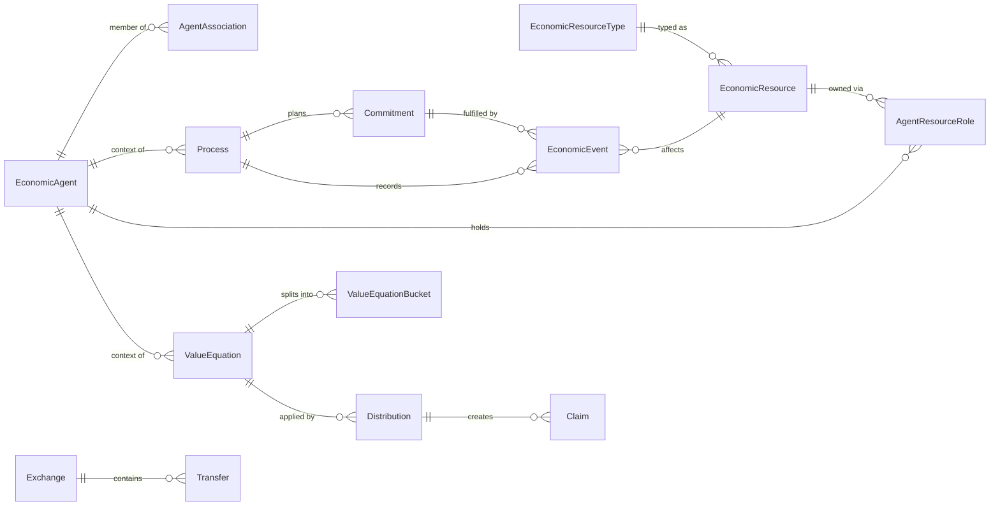
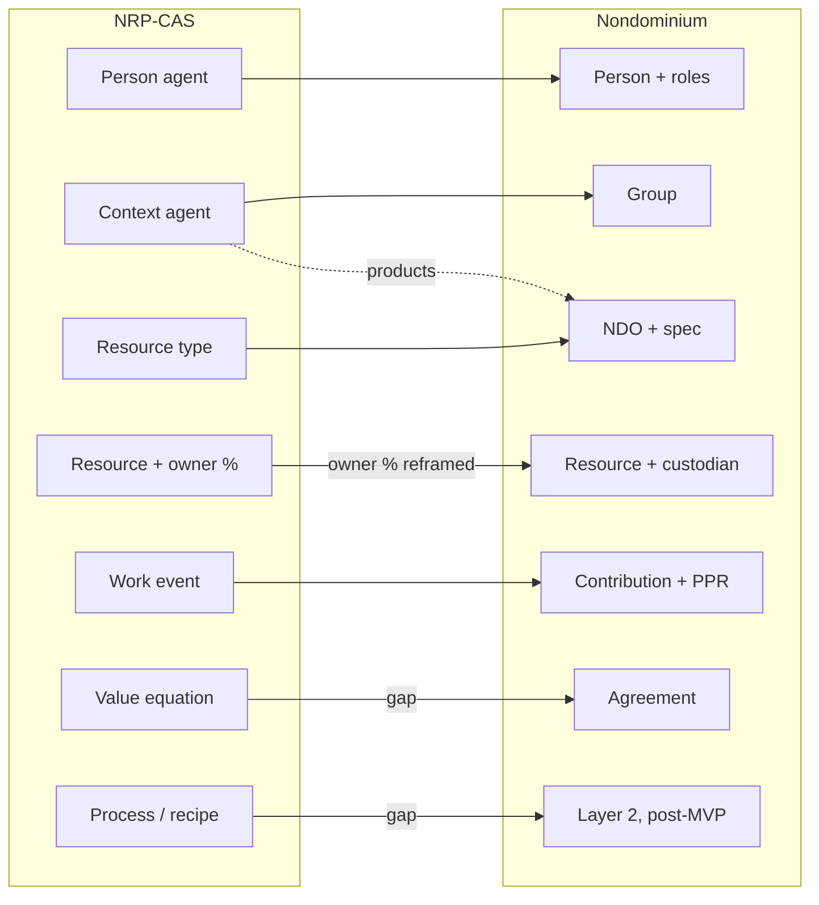
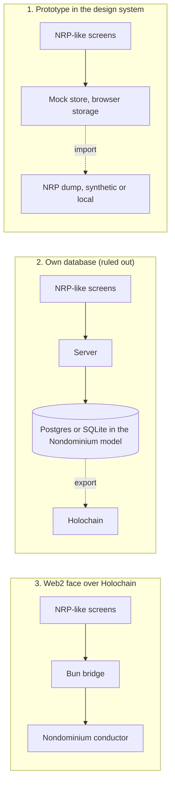
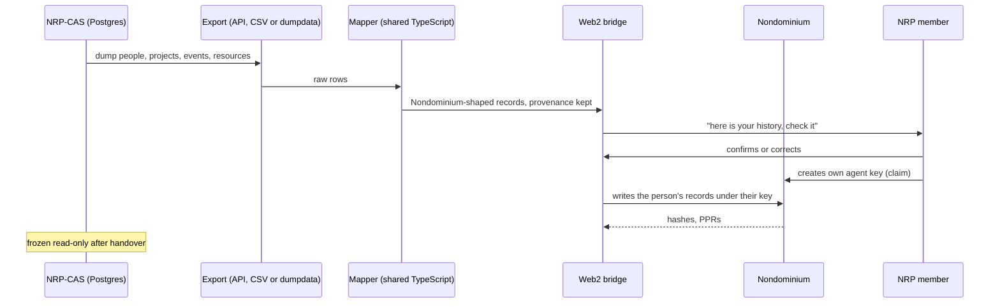

# NRP-bridge: a *Web2 Nondominium* for NRP users

> **SoushAI analysis.** Drafted by Soushi's AI assistant, reviewed and shared by Soushi.

NRP-CAS (Network Resource Planning and Contribution Accounting System) is the Django app Sensorica built with Lynn Foster and Bob Haugen in 2013; Valueflows came out of it, and Nondominium is its Holochain successor. The idea on this board: a full, working Web2 prototype that keeps what NRP users already do every day, but rebuilt on Nondominium's model (NDOs, custodians, governance rules, participation receipts). It serves three ends at once: a bridge for people who know NRP and not Holochain, a dry run of the migration of historic NRP data, and a clean handover from the old system to the new one.

Settled on 2026-11-03. Soushi set two rules: stay as faithful as possible to Nondominium's data structure and to Valueflows 1.0, and build the bridge, not an intermediate backend. The remaining calls were taken on SoushAI's lean while he was away, at his instruction to carry the work through the V; each says so, and any of them can be reopened at requirements. The findings come from reading [Sensorica/VerdunNRP](https://github.com/Sensorica/VerdunNRP), the ERP-bridge, Nondominium's own docs and the [Valueflows 1.0 TTL](https://codeberg.org/valueflows/pages/src/branch/main/assets/all_vf.TTL).

```board-idea
headline: |
  Same daily work,
  new ground underneath.
detail: "An NRP user logs hours, opens a project, checks inventory, exactly as before. Each record shows, beside it, what it becomes in Nondominium. The Web2 app is the bridge they walk across; the migration is the same mapping run on the history."
```

## Links {wide}

- [Sensorica/VerdunNRP](https://github.com/Sensorica/VerdunNRP): the last Sensorica NRP fork, "old NRP improvement to be used in the Verdun project" (Django 1.4, Python 2).
- [Sensorica/NRP-VAS](https://github.com/Sensorica/NRP-VAS) and [Sensorica/next-gen-nrp](https://github.com/Sensorica/next-gen-nrp) (archived): earlier and Holochain-era NRP repos.
- [Sensorica/nondominium](https://github.com/Sensorica/nondominium): `documentation/development-report.md` (NRP-CAS history), `documentation/specifications/protocol-bridge-specifications.md` (the generic bridge), `documentation/Applications/erp_holochain_bridge.md`.
- [Sensorica/nondominium-erp-bridge](https://github.com/Sensorica/nondominium-erp-bridge): the ERP to Nondominium proof of concept this board takes as its sibling.
- This repo: [prototype directions contract](https://github.com/Sensorica/nondominium-design-system/blob/master/src/lib/prototypes/README.md), [docs/prototypes/BACKEND.md](https://github.com/Sensorica/nondominium-design-system/blob/master/docs/prototypes/BACKEND.md) (UI action to zome call table).

## What NRP-CAS is, read from its source

VerdunNRP is one Django app doing almost everything: an 11,825-line `valueaccounting/models.py`, 328 named screens, a small REST API. Read at its only commit on GitHub (`7d047ff`).

```board-stickies
- title: One app, the whole REA model
  body: "`valuenetwork.valueaccounting` owns every model and view; `equipment`, `board` (a farm inventory kanban) and `api` add screens and endpoints but no models of their own."
  so: "The model to map is one file, which makes the concept map tractable."
  kind: fact
- title: A project is an agent
  body: "There is no Project model. A project is an `EconomicAgent` with `is_context=True`, and `context_agent` foreign keys run through processes, commitments, events, exchanges and value equations."
  so: "Projects and organisations are the same thing in NRP; Nondominium splits them (Group vs NDO)."
  kind: model
- title: Contribution is a flag on an event
  body: "Work, cash and material contributions are all `EconomicEvent` rows with `is_contribution` and `is_to_distribute`. The daily screens are `log_past_work`, `work_now`, `labnotes`, `contributions`, `contribution_history`."
  so: "The work log is the heart of NRP use; the bridge must make it at least as easy."
  kind: fact
- title: Value equations distribute income
  body: |
    `ValueEquation` → `ValueEquationBucket` (percentage, filters) → `ValueEquationBucketRule` (per event type, a claim formula). A `Distribution` snapshots the formulas it used and creates `Claim` rows per agent.
  so: "This is the OVN benefit-redistribution logic, and Nondominium has no live equivalent yet."
  kind: model
- title: Ownership is a percentage
  body: "`AgentResourceRole.owner_percentage` records who owns how much of a resource. Nondominium's property regime is built to make that uncapturable."
  so: "The one concept that should not cross the bridge as it is."
  kind: gotcha
- title: Exits for historic data exist
  body: |
    - REST: `/api/people`, `contexts`, `economic-events`, `contributions`, `resource-types`, `resources`, `units`
    - CSV: `contribution_events_csv`, `exchange_events_csv`, `cash_events_csv`
    - JSON-LD views for agents and relationships
    - Django `dumpdata` on PostgreSQL, 70 South migrations documenting the schema
  so: "A migration can read an API or a dump; no scraping needed."
  kind: works
- title: The repo holds no history
  body: "The fixtures (`verdun.json`, `starters.json`) are seed types only: event types, use cases, units. No agents, events or resources."
  so: "Real migration needs a database dump from whichever instance people actually used."
  kind: risk
- title: Never production-stable
  body: "Nondominium's development report says the NRP-CAS prototype had stability and security limits that kept it from production deployment. The stack (Django 1.4, Python 2, DRF 2.4) is long out of support."
  so: "Who still uses an NRP today, and on which instance, is the first fact to pin down."
  kind: risk
```



## The concept map {wide}

Every core NRP concept beside its Nondominium counterpart, from `crates/shared/src/types.rs` and each zome's integrity `lib.rs`. "Gap" means Nondominium has no counterpart wired today; those are where the bridge has to choose.

| NRP-CAS | Nondominium | Fit |
|---|---|---|
| `EconomicAgent` (person) + `AgentUser` | `Person` + `PrivatePersonData` (`zome_person`), a key per person | direct |
| `EconomicAgent` with `is_context` (project) | `GroupProfile` (`zome_group`), its products as NDOs | split, see card 4 |
| `AgentAssociation` | `GroupMembership`, `PersonRole` (Simple, Accountable, Primary Accountable) | direct |
| `EconomicResourceType` | `ResourceSpecification` | direct |
| `EconomicResource` | `EconomicResource` (custodian, operational state) + `NondominiumIdentity` (Layer 0) | direct, richer |
| `AgentResourceRole.owner_percentage` | custodian + `GovernanceRule` + `Agreement` benefit clauses | reframed |
| `EconomicEvent` with `is_contribution` (work) | `Contribution` (effort hours, validated by an Accountable Agent) + `WorkLog` | direct, adds validation |
| `EconomicEvent` (other) | `EconomicEvent` (VfAction) | direct |
| `Commitment` | `Commitment` + `Claim` on fulfilment | direct |
| `ProcessType`, `Process`, recipes | NDO Layer 2 (Process): post-MVP, not wired | gap |
| `ValueEquation`, `Distribution`, `Claim` | `Agreement` (versioned `BenefitClause`s); automation waits on Unyt | gap |
| `Exchange`, `Transfer`, `Order` | transfer events, `transfer_custody` | partial |
| (none) | `PrivateParticipationClaim` (PPR), reputation | new to NRP users |
| (none) | `LifecycleStage` (Ideation to End of life), `PropertyRegime` | new to NRP users |



## ERP-bridge and NRP-bridge

The ERP-bridge is the precedent: a Python proof of concept that pushes an organisation's ERP inventory into Nondominium through hc-http-gw, one way, the organisation signing as one agent. The NRP-bridge looks the same from far and differs where it matters.

```board-compare
left:
  title: ERP-bridge
  who: nondominium-erp-bridge, odoo-addons-nondominium
  items:
    - "Source: an organisation's ERP (ERPLibre, Odoo; ERPNext planned)"
    - "Data: products and stock, published on purpose"
    - "Identity: the organisation is one Holochain agent, signing server-side"
    - "Direction: ERP to Nondominium, live sync; bidirectional in phase 2"
    - "The ERP stays: the bridge is permanent"
right:
  title: NRP-bridge
  who: this board
  items:
    - "Source: NRP-CAS, a Valueflows ancestor, plus its users"
    - "Data: people, projects, work history, resources, value equations"
    - "Identity: every person has their own history and should end up with their own key"
    - "Direction: one migration of history, plus a period where both run"
    - "The NRP goes: the bridge is a passage, with an end"
between: "same mapping problem, opposite endings"
caption: "The ERP-bridge connects a system that stays; the NRP-bridge retires one."
```

```board-stickies
- title: Reuse the protocol-bridge spec
  body: "`protocol-bridge-specifications.md` already defines a Bun bridge (REST over the Holochain WebSocket, cache, job queue, signals) with a per-platform integration layer. NRP can be one more platform beside ERPLibre."
  so: "One bridge codebase, two adapters, instead of a second bridge."
  kind: idea
- title: The mapper is the shared piece
  body: "The ERP-bridge's `bridge/mapper.py` turns products into `ResourceSpecificationInput` and stock into `EconomicResourceInput`. The NRP mapper is the same shape, much wider."
  so: "Write the NRP mapping once, in TypeScript, and use it in the prototype, the migration and the live bridge."
  kind: idea
- title: Organisation-as-agent breaks contribution accounting
  body: "If the bridge signs everything as Sensorica, every contribution and PPR lands on one key, and the reputation that governance reads is lost for the people who did the work."
  so: "The ERP identity model cannot be copied as it is."
  kind: risk
```

## Three shapes the Web2 version could take {wide}

"Web2 version" could mean three builds. Soushi ruled out shape 2: no intermediate backend, the bridge is the work. Shape 3 is the target, and the design system prototype is shape 1 running the bridge's own code against an in-browser stand-in for the conductor.



```board-stickies
- title: Shape 1 is what this repo does well
  body: "Directions A to F already run on a shared mock store with localStorage, surface keys, comments and the screen map. A seventh surface with its own store (as F has) costs no new infrastructure and deploys with the site."
  so: "Fastest to something people can click, fully functional in the browser, no server."
  kind: works
- title: Shape 2 is a second backend to keep alive
  body: "A real database in Nondominium's model is useful for people who will not run a conductor, but it duplicates the zome logic (validation, custody, PPRs) in a server."
  so: "Worth it only if the Web2 app is meant to live for years."
  kind: risk
- title: Shape 3 is the true bridge
  body: "Same screens, the data in a real conductor through the protocol bridge. Users never install Holochain; their records are Holochain records from day one."
  so: "The end state, and it depends on the Bun bridge existing."
  kind: model
```

## Migration and handover

The same mapping, run on the history. The picture below assumes a one-way import that can be replayed, with each person claiming their own key at handover; the cards decide whether that holds.



```board-stickies
- title: Keep provenance on every migrated record
  body: "Each record carries the NRP table and id it came from, so a member can see \"this contribution is NRP event 4123\" and a replay never duplicates."
  so: "Makes the import idempotent and the handover auditable."
  kind: idea
- title: History needs a validator
  body: "In Nondominium a `Contribution` is validated by at least one Accountable Agent. Ten years of NRP work events have no such validation."
  so: "Either mark migrated work as legacy-validated, or ask current Accountable Agents to re-validate in bulk."
  kind: gotcha
- title: Historic data stays out of this repo
  body: "This design system is public. Member names, hours and money from a real NRP must never be committed here."
  so: "The public prototype runs on synthetic data shaped like NRP; a real dump is imported only on a local machine."
  kind: risk
```

## Two fidelity targets: Nondominium and Valueflows 1.0 {wide}

Soushi's rule: the bridge is as faithful as possible to Nondominium's data structure and Valueflows 1.0 compliant. Read against `crates/shared/src/types.rs`, `zome_resource/src/lib.rs` and the Valueflows 1.0 TTL, the two agree on most of the model and disagree in four places.

| NRP-CAS | Nondominium entry | Valueflows 1.0 |
|---|---|---|
| `EconomicAgent` (person) | `Person` | `vf:Person` |
| `EconomicAgent` with `is_context` | `GroupProfile` | `vf:Organization`; projects' processes `vf:inScopeOf` it |
| `AgentAssociation` | `GroupMembership`, `PersonRole` | none: Valueflows 1.0 has no agent relationship class |
| `EconomicResourceType` | `ResourceSpecification` | `vf:ResourceSpecification` |
| `EconomicResource` | `EconomicResource` + `NondominiumIdentity` | `vf:EconomicResource` (`vf:conformsTo`, `vf:onhandQuantity`, `vf:primaryAccountable`) |
| work `EconomicEvent` | `EconomicEvent` (`Work`) + `Contribution` | `vf:EconomicEvent` with `vf:action` `vf:work`, `vf:effortQuantity` |
| other `EconomicEvent` | `EconomicEvent` (`VfAction`) | `vf:EconomicEvent` |
| `Commitment` | `Commitment` | `vf:Commitment` |
| `Claim` | `Claim` | `vf:Claim` (`vf:triggeredBy`) |
| `ValueEquation`, `Distribution` | `Agreement` (`BenefitClause`) | `vf:Agreement` (`vf:stipulates`); the equation itself has no Valueflows class |
| `ProcessType`, `Process` | NDO Layer 2, not wired | `vf:ProcessSpecification`, `vf:Process` |
| `Unit` | `unit: String` | `vf:Unit` (`vf:omUnitIdentifier`) |

```board-stickies
- title: Actions differ at the edges
  body: "Nondominium's `VfAction` has `InitialTransfer` and `AccessForUse`, which Valueflows 1.0 lacks, and lacks `transferAllRights`, `pickup`, `dropoff`, `deliverService` and `copy`, which it has."
  so: "The bridge writes Nondominium's actions and exports the two extras under a Nondominium namespace."
  kind: gotcha
- title: One quantity, one custodian
  body: "Nondominium's `EconomicResource` has `quantity` and `custodian`; Valueflows 1.0 splits `accountingQuantity` from `onhandQuantity` and names `primaryAccountable`. Under the nondominium regime nobody holds the rights, so custody is the on-hand side."
  so: "Export `custodian` as the holder of `vf:onhandQuantity`, and leave `vf:primaryAccountable` empty for nondominium resources."
  kind: model
- title: Membership has no Valueflows class
  body: "Valueflows 1.0 dropped agent relationships from the core TTL. NRP's `AgentAssociation` and Nondominium's `GroupMembership` both sit outside it."
  so: "Membership stays a Nondominium entry; the export says so instead of inventing a Valueflows term."
  kind: fact
- title: Units are strings
  body: "Nondominium stores `unit: String`; Valueflows wants a `vf:Unit` with an OM-2 identifier. NRP's `Unit` rows carry names and abbreviations."
  so: "The bridge keeps a small unit table mapping NRP units to OM-2 ids and writes the symbol Nondominium expects."
  kind: gotcha
```

## Settled calls {wide}

Each call below is now a fact for the requirements stage. "Soushi" marks his own words; "lean" marks a call taken on SoushAI's lean while he was away, open to reversal.

```board-stickies
- title: 1. The bridge, no intermediate backend (Soushi)
  body: "Shape 2 is out. The target is shape 3, NRP-like screens over a real conductor through the bridge. Until the conductor is wired, the design system runs the same bridge code against an in-browser port that mirrors the zome calls of `docs/prototypes/BACKEND.md`."
  kind: works
- title: 2. Fidelity first (Soushi)
  body: "Records are Nondominium entries, shaped as the zomes define them, and every one exports as Valueflows 1.0 JSON-LD. Where the two disagree, Nondominium's entry is what the bridge writes and the difference is named as a Nondominium extension in the export."
  kind: works
- title: 3. Its own section, /nrp (lean)
  body: "A section of the design system with its own store, beside the hub's other surfaces, using the tokens, ndo-ui, comments and the screen map."
  kind: works
- title: 4. First round covers work, contributions, projects, resources (lean)
  body: "Work log, my contributions, projects and members, resource types and inventory with custody, and the migration view. Value equations are shown as what they become (an Agreement) and get their own brainstorm."
  kind: works
- title: 5. A project becomes a Group (lean)
  body: "Its outputs become NDOs inside it."
  kind: works
- title: 6. Each member claims a key (lean)
  body: "History is written under a person's key only after they claim it; unclaimed history stays visible in the bridge as pending."
  kind: works
- title: 7. Repeatable one-way import until cutover (lean)
  body: "Idempotent by NRP provenance; NRP goes read-only at cutover."
  kind: works
- title: 8. Synthetic data in public (lean)
  body: "A synthetic NRP dataset shaped like VerdunNRP's tables; real dumps only on a local machine."
  kind: works
- title: 9. NRP is an adapter of the protocol bridge (lean)
  body: "The NRP mapper and identity policy are one adapter; transport and zome calls are the protocol bridge's."
  kind: works
```

## Open facts to pin down

```board-stickies
- title: Who uses NRP today?
  body: "The request speaks of current NRP users. Which instance (Sensorica's, Verdun's, another), how many people, and whether it still runs, are unknown here."
  kind: risk
- title: Does a Holochain-era NRP already exist?
  body: "`Sensorica/next-gen-nrp` (archived, 2026-02) describes a Holochain NRP on hREA. What it built, and whether any of it carries into the bridge, is not read yet."
  kind: fact
- title: Value equations need their own board
  body: "Mapping `ValueEquation` onto `Agreement` and Unyt is a design of its own, and it is Sensorica's core OVN logic."
  kind: idea
```
