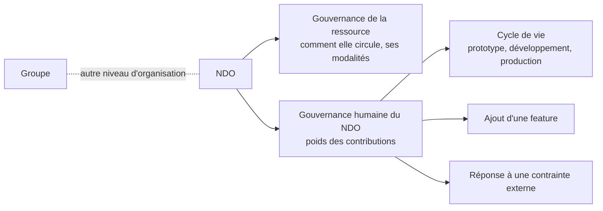
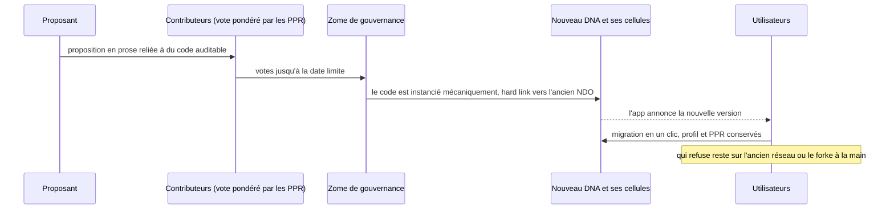

# Nondominium, Journal de la séance sur la gouvernance humaine du NDO

**Date :** mardi 8 septembre 2026 (48 minutes, à partir de 12 h 12 heure de Montréal, pause de 26 à 30)

**Participants :** Soushi (Sacha Pignot, développeur principal de Nondominium, `speaker_0`), Tibi (Tiberius Brastaviceanu, cofondateur de Sensorica, `speaker_1`). Les noms ne sont pas prononcés ; l'attribution vient du contenu (`speaker_0` lance l'enregistrement et annonce le transcript, `speaker_1` tient le document de travail et demande une reformulation « pour un agent IA »).

**Contexte :** Première séance consacrée à la gouvernance humaine du NDO, distincte de la gouvernance de la ressource déjà spécifiée (comment elle circule, ses modalités). Tibi tient un document de travail où il prend des notes en cours de séance. Noms propres mal transcrits et corrigés ici : « land Dominion », « Nodominion », « node dominion », « None Dominium » deviennent Nondominium ; « NBO » devient NDO ; « Unit » devient Unyt ; « CEL » devient cellule ; « zone » désigne le zome (de gouvernance). Les crochets donnent la minute dans l'enregistrement.

## TL;DR

La question de départ est à qui appartient Nondominium : pas aux développeurs, parce qu'un réseau n'a de valeur que par son écosystème, et qu'il vaut mieux un petit pouvoir sur un outil adopté massivement que tout le pouvoir sur un outil que personne n'utilise. Trois modèles de vote ont été comparés (le vote égal avec veto de l'ONU, un membre un vote des coopératives, le vote proportionnel aux tokens du Web3) ; le veto est écarté parce qu'il permet au cœur de prendre le réseau en otage, au profit d'un poids accru pour les gros contributeurs qu'une masse critique de la longue traîne peut toujours renverser. Le poids de vote est dérivé des contributions (les PPR), jamais échangeable. Le mécanisme technique retenu : on vote sur du code déjà écrit et auditable, et le vote instancie mécaniquement un nouveau DNA et ses cellules, sans intervention humaine entre les deux, ce qui protège aussi les développeurs contre la contrainte externe (« c'est pas moi qui choisis »). L'app pousse ensuite les utilisateurs à migrer, l'ancien réseau restant forkable à la main.

## Mises à jour

**À qui appartient Nondominium.** Tibi ouvre sur la question « très générale et philosophique » : le premier réflexe serait de répondre « aux développeurs », mais du point de vue écosystémique ce n'est pas bon. Soushi a le même questionnement sur ses autres projets : le fondateur donne la vision et doit apprendre à « laisser aller le bébé », puis vient la question de la gouvernance de cette vision une fois transmise à une communauté (les mises à jour, l'interopérabilité, les partenariats avec d'autres écosystèmes). [0 à 1]

**Le cas Bitcoin.** Tibi prend Bitcoin comme cadre réel : la décision reste aux mineurs, alors que la valeur du réseau dépend aussi des wallets, des exchanges et des services autour. Les mineurs paient l'infrastructure, les autres font leur argent ailleurs ; ils ne peuvent pas aliéner l'écosystème sans tuer la valeur, mais gardent un veto de fait, « une sorte de tyrannie du mineur ». À l'inverse, on ne peut pas trop leur retirer de pouvoir, sinon l'écosystème les presse comme Walmart presse ses producteurs jusqu'à les faire disparaître. Soushi ajoute que la preuve d'enjeu pose le même problème, tempéré par l'incitatif : celui qui contrôle n'a pas intérêt à faire chuter la valeur du token. [1 à 5]

## Discussion

**Moins de contrôle, plus d'adoption.** Tibi pose le raisonnement économique de départ : Soushi et lui sont les développeurs, mais sans adoption ils n'ont « cent pour cent de rien ». La position d'*enlightened selflessness* consiste à préférer un plus petit pouvoir décisionnel sur quelque chose qui se répand comme le feu ; la part des forks et des redevances se prend alors sur la masse d'adoption. Le moteur reste l'économie de contribution (« on mine avec nos cerveaux, puis on lock nos contributions ») ; la question est comment donner une voix à des membres de l'écosystème qui n'ont encore rien contribué mais ont un potentiel de diffusion. Soushi répond que la diffusion est elle-même une contribution, reconnue après coup et non achetée d'avance, sinon on sort des règles de l'OVN. [5 à 7]

**Le nouveau venu avec une bonne idée.** Tibi soulève le cas d'un acteur qui découvre Nondominium et a besoin d'une mise à jour : ses premières contributions seraient « de la poussière » face au cœur. Soushi répond qu'une idée sérieuse passe par du design, des architectures et des plans soumis à la communauté, qui sont autant de contributions ; un partenaire externe peut être écouté sans encore décider, et devenir membre du cœur avec le temps. Tibi précise la distinction : tout le monde peut s'exprimer et accéder aux outils de discussion, mais ce sont les contributeurs de long terme qui tranchent. Pour Soushi, le but est un environnement où les idées d'un nouveau contributeur sont accueillies sans qu'il doive « grinder » pour être entendu. Tibi rappelle qu'ils conçoivent un gabarit : dans un écosystème qui forkera Nondominium, ils ne seront pas là, « ce sera un autre cœur ». [7 à 13]

**Trois modèles de vote.** Soushi objecte qu'un cœur à droit de veto reste une concentration du pouvoir, et voudrait un contrepoids de la longue traîne. Tibi écarte la coopérative pure, un membre un vote : un nouvel arrivé y pèse autant que ceux qui ont bâti, et Soushi donne l'exemple d'une entreprise qui double ses effectifs en un an et dilue ceux qui ont permis la croissance. Tibi décrit l'ONU : un pays un vote, avec un veto pour les puissances qui « peuvent bouger le monde », militairement et économiquement. Il n'aime pas le veto et propose plutôt un multiplicateur pour les gros contributeurs, que la longue traîne peut toujours dépasser si elle se met contre eux ; Soushi y reconnaît les DAO, où des petits porteurs associés peuvent renverser une baleine. Dans ses notes, Tibi range les trois modèles (ONU, coopératives, Web3 au vote proportionnel aux tokens) sous la philosophie de conception : un fonctionnement écosystémique, inscrit dans l'architecture et non dans une promesse. [13 à 16, 31]

**Gouvernance humaine contre gouvernance de la ressource.** Soushi situe le sujet : la gouvernance de la ressource dit comment elle circule ; celle-ci porte sur le poids des contributions et sur qui fait évoluer le NDO. Tibi précise que c'est au niveau du NDO, pour que personne ne puisse le détourner, le groupe étant une autre affaire. Les exemples : qui décide qu'un NDO passe de prototype à développement ou à production, qui décide d'ajouter une feature, sachant qu'une feature peut affaiblir le système comme l'augmentation de la taille des blocs. [16 à 17]

**La contrainte externe.** Soushi prend l'exemple d'une injonction légale exigeant une porte dérobée parce que des criminels utilisent le réseau. Tibi : si le gouvernement tord le bras d'un petit nombre au cœur, la majorité doit pouvoir aller contre lui, comme le Congrès américain qui peut passer outre le veto présidentiel à une majorité qualifiée (Tibi avance « soixante-quinze pour cent ou plus »). Le principe : quand une question est assez populaire, une masse critique de la longue traîne doit pouvoir renverser le cœur, parce qu'il est plus difficile de corrompre une majorité que le cœur. Soushi ajoute qu'il faut aussi éviter un cœur trop hermétique, comme les cercles fermés de témoins sur Steem ou de développeurs historiques ailleurs, qui gardent leur position. [17 à 21]

**Le vote comme sécurité personnelle.** Puisque changer les règles veut dire changer les règles de validation du zome de gouvernance, par signature, le pouvoir doit passer mécaniquement. Tibi : face au gouvernement, le développeur doit pouvoir dire « c'est même pas moi, vous pouvez me torturer, c'est pas moi qui vais injecter ce code-là ». Soushi y voit l'absence de point de défaillance unique dans la décision : « j'ai juste un trente-troisième des clés ». Il raconte les serveurs privés d'un jeu en ligne que l'éditeur poursuit sans relâche : le code passe à des équipes anonymes et dispersées, avec huit sauvegardes sur la planète, pour qu'aucune arrestation ne puisse les arrêter. Tibi en tire une réalisation, qu'il note dans le document : le veto pourrait nuire au réseau lui-même, puisqu'il permet de le paralyser pour imposer une mesure. [21 à 25]

**Un poids dérivé, jamais échangeable.** Soushi demande si ce poids pourrait prendre la forme de jetons de gouvernance sur Unyt, comme une monnaie de crédit mutuel. Tibi répond non : le poids puise dans les contributions. Soushi le reformule : il est généré à partir des PPR, dérivé et non échangé, « parce que quand tu peux trader ta gouvernance, c'est là que c'est la source de la corruption ». [25 à 26]

**Les défenses à concevoir.** Après la pause, Tibi relit ses notes : défense contre la contrainte d'un gouvernement ou de tout pouvoir coercitif externe, défense contre la tyrannie du cœur, défense contre la prise de contrôle hostile (« quelqu'un qui vient mettre un million de dollars »). Pour cette dernière, il estime qu'il y a peu à concevoir, le NDO vivant sur un support non capturable ; Soushi insiste pour que la gouvernance elle-même ne soit pas capturable, sans devoir forker à chaque fois, tout en gardant la possibilité de forker. [31 à 33]

**Le vote produit un fork.** Tibi note la règle : le vote change les règles de validation du zome de gouvernance, on chain, et le pouvoir passe mécaniquement. Soushi voit d'abord le fork comme un signe de défaut de gouvernance ; Tibi le corrige : le fork est le mécanisme de changement, hostile ou bénéfique, et il est bénéfique quand tout le monde l'a décidé. Soushi le compare aux soft forks des blockchains : une mise à jour qui casse la compatibilité est un fork du réseau, normal, accompagné de tout ce qu'il faut pour migrer. Tibi rappelle ce qu'ils avaient conçu en voiture : la mécanique du fork clone la cellule, qui hérite des nouvelles propriétés, avec un hard link entre la nouvelle version du NDO et l'ancienne ; changer les règles de validation rend de toute façon incompatible avec l'ancien réseau. Quand les votes sont entrés à une date limite, la fonction s'exécute et la cellule est forkée. Soushi relève une différence avec les blockchains : ce sont les utilisateurs, pas des mineurs, qui font la mise à jour, et ils ont donc eux aussi un veto de fait, puisque deux ou trois utilisateurs restés sur l'ancienne version suffisent à le garder vivant. [33 à 38]

**Voter sur du code.** Tibi propose qu'on ne vote pas sur une prose humaine mais sur une prose reliée à du code, auditable, qui est copié dans la base de code à l'issue du vote, recompilé et instancié automatiquement, sans qu'un humain puisse changer une ligne en cours de route. Soushi le rapproche d'une pull request, déjà écrite et testable avant d'être votée, et distingue la part de méta-programmation. Tibi écarte GitHub du mécanisme : c'est une surface externe de lecture et de discussion avant le vote. Soushi précise qu'on ne modifie pas une cellule vivante : le vote crée un nouveau DNA, l'ancienne cellule meurt avec l'ancien réseau, et les nouvelles cellules prolifèrent ; il faut une migration en un clic depuis l'app, comme les mises à jour de Moss, pour que chacun garde son profil et ses PPR au lieu de se recréer un agent. Tibi insiste : le passage du vote à l'instanciation doit être « water tight », mécanique et continu, sinon celui qui gère le code peut toujours s'insérer, et ceux qui veulent capturer savent cibler la bonne personne. [38 à 44]

**Forcer la migration.** Tibi demande si l'on peut empêcher de rester sur l'ancien code. Soushi : un pair qui n'a pas suivi le fork échoue à la validation et se retrouve sur un réseau vide ; l'UI, voire le coordinateur, peut aussi bloquer toutes les fonctions et ne laisser que l'écran de migration. C'est contournable en réécrivant l'UI, mais presque personne ne le fera. Tibi conclut : si l'écosystème l'a décidé, on suit, sinon « faites votre fork ailleurs ». À sa demande, Soushi le reformule pour un agent IA : quand la communauté a décidé un fork et que la migration est prête, l'UI et le zome de coordination forcent la migration en bloquant tout sauf l'écran de migration. [44 à 46]

**Le but de la séance.** Soushi rappelle l'objectif : poser un cadre de gouvernance clair pour lancer le premier NDO de Nondominium et commencer la levée de fonds, et pour travailler avec les stagiaires dont Tibi a parlé. La séance s'arrête pour que Soushi en produise le résumé. [46 à 48]

## Décisions

- **Le veto est écarté** : il permet au cœur de paralyser le réseau pour imposer une mesure ; Tibi l'a noté comme une réalisation de la séance. [24 à 25]
- **Le poids de vote est dérivé des contributions (PPR), jamais échangeable** : une gouvernance qu'on peut acheter est la source de la corruption. [25 à 26]
- **Un vote porte sur du code déjà écrit et auditable, et l'instancie mécaniquement**, sans intervention humaine entre le vote et la nouvelle cellule. [38 à 44]
- **Changer les règles de validation, c'est forker** : nouveau DNA, hard link vers l'ancien NDO, migration outillée depuis l'app. [33 à 38]
- **L'UI, et si possible le coordinateur, forcent la migration une fois le fork décidé** ; qui veut garder l'ancien réseau le forke à la main. [44 à 46]

## Discuté, non tranché

- **Le multiplicateur pour les gros contributeurs** : son ampleur, et le seuil de masse critique auquel la longue traîne peut renverser le cœur, restent à fixer. [14 à 16, 18 à 19]
- **La voix des nouveaux venus et des partenaires externes** : ils peuvent s'exprimer et être écoutés, mais le mécanisme qui transforme leurs idées en poids n'est pas défini. [7 à 13]
- **Rendre la migration forcée non contournable** : le blocage par l'UI se contourne, celui par le coordinateur est à explorer. [44 à 45]
- **Automatiser le clonage d'un NDO à l'issue du vote** : faisable de façon programmatique selon Soushi, la part de méta-programmation reste à concevoir. [38 à 41]

## Actions

- **Soushi :** produire le transcript et un résumé de la séance et l'envoyer à Tibi. [47 à 48]
- **Soushi :** reformuler le mécanisme de migration forcée en termes opérationnels pour un agent IA. [45 à 46]
- **Tibi :** consigner dans le document de travail les modèles de vote, les défenses et la réalisation sur le veto. [24 à 25, 31 à 33]

## En suspens

- **Le seuil exact de dépassement du veto présidentiel américain** : Tibi avance « soixante-quinze pour cent ou plus », la Constitution prévoit deux tiers de chaque chambre.
- **Le nom de la personne qui voulait rejoindre la discussion** à [16] : il n'est pas audible.
- **La migration des source chains annoncée pour une prochaine version de Holochain**, que Soushi évoque à [36] : à vérifier dans les notes de version.

## Corrections après la rencontre

- **Le veto présidentiel se renverse aux deux tiers, pas à 75 %** : l'article I, section 7 de la Constitution américaine exige un vote des deux tiers de chaque chambre. [18]
