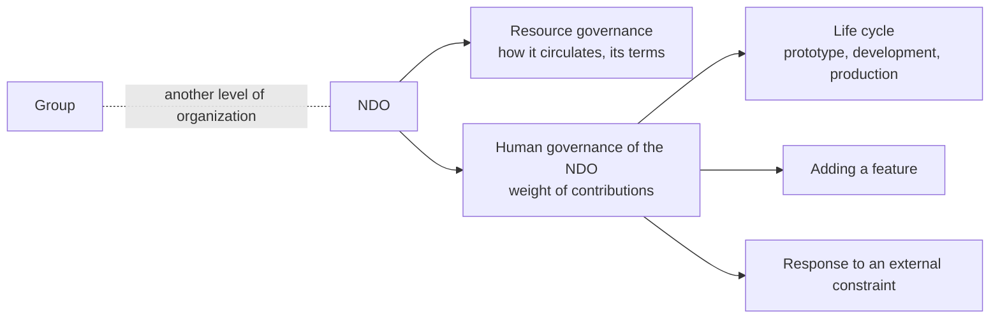
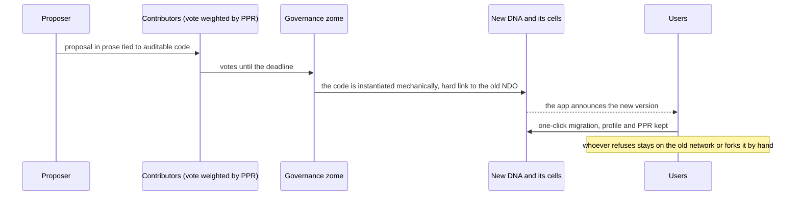

# Nondominium, Journal of the session on the human governance of the NDO

**Date:** Tuesday, September 8, 2026 (48 minutes, starting at 12:12 Montreal time, break at 26 to 30)

**Attendees:** Soushi (Sacha Pignot, lead developer of Nondominium, `speaker_0`), Tibi (Tiberius Brastaviceanu, co-founder of Sensorica, `speaker_1`). Names are not spoken; attribution comes from the content (`speaker_0` starts the recording and announces the transcript, `speaker_1` holds the working document and asks for a rewording "for an AI agent").

**Context:** First session devoted to the human governance of the NDO, distinct from the governance of the resource, which is already specified (how it circulates, its terms). Tibi keeps a working document where he takes notes during the session. Misheard proper nouns, corrected here: "land Dominion", "Nodominion", "node dominion", "None Dominium" become Nondominium; "NBO" becomes NDO; "Unit" becomes Unyt; "CEL" becomes cell; "zone" means the (governance) zome. The brackets give the minute in the recording. This is an English translation; the original journal is in French.

## TL;DR

The starting question is who owns Nondominium: not the developers, because a network has value only through its ecosystem, and a small share of power over a widely adopted tool is better than all the power over a tool nobody uses. Three voting models were compared (equal vote with a UN-style veto, the cooperatives' one member one vote, the Web3 vote proportional to tokens); the veto is set aside because it lets the core hold the network hostage, in favor of extra weight for large contributors that a critical mass of the long tail can always overturn. Voting weight is derived from contributions (the PPR) and is never tradable. The technical mechanism retained: people vote on code that is already written and auditable, and the vote mechanically instantiates a new DNA and its cells, with no human intervention in between, which also protects the developers against external coercion ("it's not me choosing"). The app then pushes users to migrate, and the old network stays forkable by hand.

## Updates

**Who owns Nondominium.** Tibi opens on the "very general and philosophical" question: the first reflex would be to answer "the developers", but from an ecosystem point of view that is not good. Soushi has the same questioning on his other projects: the founder provides the vision and has to learn to "let the baby go", and then comes the question of governing that vision once it is handed to a community (updates, interoperability, partnerships with other ecosystems). [0 to 1]

**The Bitcoin case.** Tibi takes Bitcoin as a real-world frame: the decision stays with the miners, while the network's value also depends on wallets, exchanges and the services around it. The miners pay for the infrastructure, the others make their money elsewhere; the miners cannot alienate the ecosystem without killing the value, but they keep a de facto veto, "a kind of miner tyranny". Conversely, you cannot take too much power from them, or the ecosystem squeezes them the way Walmart squeezes its producers until they disappear. Soushi adds that proof of stake poses the same problem, tempered by the incentive: whoever is in control has no interest in making the token's value fall. [1 to 5]

## Discussion

**Less control, more adoption.** Tibi lays out the starting economic reasoning: Soushi and he are the developers, but without adoption they have "a hundred percent of nothing". The *enlightened selflessness* position is to prefer a smaller share of decision power over something that spreads like wildfire; the share from forks and royalties is then taken on the mass of adoption. The engine remains the contribution economy ("we mine with our brains, then we lock our contributions"); the question is how to give a voice to members of the ecosystem who have not yet contributed anything but have potential for spreading the word. Soushi answers that spreading the word is itself a contribution, recognized afterwards and not bought in advance, otherwise we step outside the rules of the OVN. [5 to 7]

**The newcomer with a good idea.** Tibi raises the case of an actor who discovers Nondominium and needs an update: their first contributions would be "dust" next to the core. Soushi answers that a serious idea goes through design, architectures and plans submitted to the community, which are contributions in themselves; an outside partner can be listened to without yet deciding, and can become a member of the core over time. Tibi spells out the distinction: everyone can speak and access the discussion tools, but it is the long-term contributors who decide. For Soushi, the goal is an environment where a new contributor's ideas are welcomed without their having to "grind" to be heard. Tibi reminds him that they are designing a template: in an ecosystem that forks Nondominium, they will not be there, "it will be another core". [7 to 13]

**Three voting models.** Soushi objects that a core with a veto right is still a concentration of power, and would want a counterweight from the long tail. Tibi rules out the pure cooperative, one member one vote: a newcomer weighs as much as those who built, and Soushi gives the example of a company that doubles its headcount in a year and dilutes those who made the growth possible. Tibi describes the UN: one country one vote, with a veto for the powers that "can move the world", militarily and economically. He does not like the veto and proposes a multiplier for large contributors instead, which the long tail can always outweigh if it turns against them; Soushi recognizes the DAOs in it, where small holders banding together can overturn a whale. In his notes, Tibi files the three models (UN, cooperatives, Web3 with token-proportional voting) under the design philosophy: an ecosystemic way of working, written into the architecture and not into a promise. [13 to 16, 31]

**Human governance versus resource governance.** Soushi frames the topic: the governance of the resource says how it circulates; this one concerns the weight of contributions and who makes the NDO evolve. Tibi specifies that it is at the NDO level, so that nobody can hijack it, the group being another matter. The examples: who decides that an NDO moves from prototype to development or to production, who decides to add a feature, knowing that a feature can weaken the system like raising the block size. [16 to 17]

**External coercion.** Soushi takes the example of a legal order demanding a backdoor because criminals use the network. Tibi: if the government twists the arm of a few people in the core, the majority must be able to go against it, like the US Congress, which can override the presidential veto with a qualified majority (Tibi suggests "seventy-five percent or more"). The principle: when an issue is popular enough, a critical mass of the long tail must be able to overturn the core, because it is harder to corrupt a majority than the core. Soushi adds that a core that is too hermetic must also be avoided, like the closed circles of witnesses on Steem or of historical developers elsewhere, who hold on to their position. [17 to 21]

**The vote as personal security.** Since changing the rules means changing the validation rules of the governance zome, by signature, power has to pass mechanically. Tibi: facing the government, the developer must be able to say "it's not even me, you can torture me, I'm not the one who will inject that code". Soushi sees in this the absence of a single point of failure in the decision: "I only have one thirty-third of the keys". He tells of the private servers of an online game that the publisher pursues relentlessly: the code passes to anonymous, scattered teams, with eight backups around the planet, so that no arrest can stop them. Tibi draws a realization from it, which he notes in the document: the veto could harm the network itself, since it makes it possible to paralyze it in order to force a measure through. [21 to 25]

**A derived weight, never tradable.** Soushi asks whether this weight could take the form of governance tokens on Unyt, like a mutual-credit currency. Tibi answers no: the weight draws on contributions. Soushi rephrases it: it is generated from the PPR, derived and not exchanged, "because when you can trade your governance, that's where the corruption comes from". [25 to 26]

**The defenses to design.** After the break, Tibi rereads his notes: defense against coercion by a government or any external coercive power, defense against the tyranny of the core, defense against hostile takeover ("someone who comes and puts in a million dollars"). For the last one, he thinks there is little to design, the NDO living on a support that cannot be captured; Soushi insists that the governance itself must not be capturable, without having to fork every time, while keeping the possibility to fork. [31 to 33]

**The vote produces a fork.** Tibi notes the rule: the vote changes the validation rules of the governance zome, on chain, and power passes mechanically. Soushi first sees the fork as a sign of a governance failure; Tibi corrects him: the fork is the mechanism of change, hostile or beneficial, and it is beneficial when everyone has decided it. Soushi compares it to blockchain soft forks: an update that breaks compatibility is a fork of the network, which is normal, accompanied by everything needed to migrate. Tibi recalls what they had designed in the car: the fork mechanism clones the cell, which inherits the new properties, with a hard link between the new version of the NDO and the old one; changing the validation rules makes it incompatible with the old network anyway. When the votes are in at a deadline, the function runs and the cell is forked. Soushi notes a difference with blockchains: it is the users, not miners, who do the update, and so they too have a de facto veto, since two or three users who stay on the old version are enough to keep it alive. [33 to 38]

**Voting on code.** Tibi proposes that people vote not on human prose but on prose tied to code, auditable, which is copied into the codebase after the vote, recompiled and instantiated automatically, with no human able to change a line along the way. Soushi likens it to a pull request, already written and testable before being voted on, and distinguishes the meta-programming part. Tibi rules GitHub out of the mechanism: it is an external surface for reading and discussion before the vote. Soushi specifies that a live cell is not modified: the vote creates a new DNA, the old cell dies with the old network, and the new cells proliferate; a one-click migration from the app is needed, like Moss updates, so that everyone keeps their profile and their PPR instead of recreating an agent. Tibi insists: the passage from the vote to the instantiation must be "water tight", mechanical and continuous, otherwise whoever manages the code can always step in, and those who want to capture the network know how to target the right person. [38 to 44]

**Forcing the migration.** Tibi asks whether staying on the old code can be prevented. Soushi: a peer that has not followed the fork fails validation and ends up on an empty network; the UI, or even the coordinator, can also block all functions and leave only the migration screen. It can be bypassed by rewriting the UI, but almost nobody will. Tibi concludes: if the ecosystem has decided it, you follow, otherwise "make your fork elsewhere". At his request, Soushi rewords it for an AI agent: when the community has decided on a fork and the migration is ready, the UI and the coordinator zome force the migration by blocking everything except the migration screen. [44 to 46]

**The goal of the session.** Soushi restates the objective: to set a clear governance framework to launch Nondominium's first NDO and start fundraising, and to work with the interns Tibi mentioned. The session stops so that Soushi can produce the summary. [46 to 48]

## Decisions

- **The veto is set aside**: it lets the core paralyze the network to force a measure through; Tibi noted it as a realization of the session. [24 to 25]
- **Voting weight is derived from contributions (PPR), never tradable**: governance that can be bought is the source of corruption. [25 to 26]
- **A vote is on code that is already written and auditable, and instantiates it mechanically**, with no human intervention between the vote and the new cell. [38 to 44]
- **Changing the validation rules means forking**: new DNA, hard link to the old NDO, migration supported by tooling from the app. [33 to 38]
- **The UI, and if possible the coordinator, force the migration once the fork is decided**; whoever wants to keep the old network forks it by hand. [44 to 46]

## Discussed, not decided

- **The multiplier for large contributors**: its size, and the critical-mass threshold at which the long tail can overturn the core, remain to be set. [14 to 16, 18 to 19]
- **The voice of newcomers and outside partners**: they can speak and be listened to, but the mechanism that turns their ideas into weight is not defined. [7 to 13]
- **Making forced migration impossible to bypass**: blocking through the UI can be bypassed, blocking through the coordinator is yet to be explored. [44 to 45]
- **Automating the cloning of an NDO after the vote**: feasible programmatically according to Soushi, the meta-programming part remains to be designed. [38 to 41]

## Actions

- **Soushi:** produce the transcript and a summary of the session and send it to Tibi. [47 to 48]
- **Soushi:** reword the forced-migration mechanism in operational terms for an AI agent. [45 to 46]
- **Tibi:** record in the working document the voting models, the defenses and the realization about the veto. [24 to 25, 31 to 33]

## Outstanding

- **The exact threshold for overriding the US presidential veto**: Tibi suggests "seventy-five percent or more", while the Constitution provides for two thirds of each chamber.
- **The name of the person who wanted to join the discussion** at [16]: it is not audible.
- **The migration of source chains announced for an upcoming Holochain release**, which Soushi mentions at [36]: to be checked in the release notes.

## Corrections after the meeting

- **The presidential veto is overridden by two thirds, not 75%**: Article I, Section 7 of the US Constitution requires a two-thirds vote of each chamber. [18]
