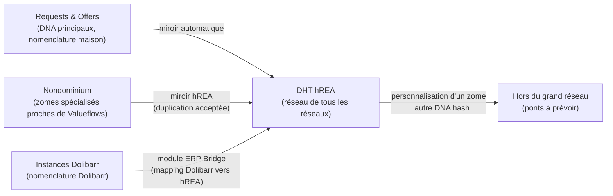
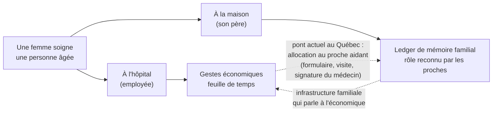
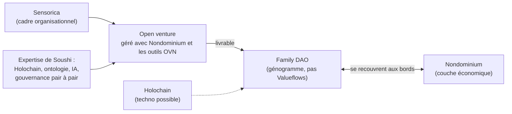

# Nondominium, Journal de discussion au Lab

**Date :** mardi 29 septembre 2026, 15 h 09 (56 minutes)

**Participants :** Soushi (speaker_0, développeur principal de Nondominium), Tibi (speaker_1, Sensorica) ; l'attribution vient de l'ouverture de l'enregistrement, où Soushi dit « au laboratoire avec Tibi ».

**Contexte :** Séance de travail en présentiel au Lab, trois semaines après la réunion du 8 septembre sur la gouvernance humaine du NDO. Point de départ : les prototypes d'UI que Soushi avait partagés avec Tibi. Transcription machine avec attribution des locuteurs ; les noms propres mal entendus sont corrigés ici : « Nodominium », « Landominium », « Node Dominion », « Non Dominium » deviennent Nondominium ; « HREA », « Ashreya », « Hреаs » deviennent hREA ; « Adam » devient AD4M ; « MSP Server » devient MCP server ; « Michel Barnes » est très probablement Michel Bauwens (inféré du contexte P2P, non confirmé). Les crochets donnent la minute dans l'enregistrement.

## TL;DR

L'UI de Nondominium est pensée comme une application unifiée à plusieurs perspectives, chacune répondant à la question « qu'est-ce que la personne est en train de faire ? » : une perspective ressources, une perspective travail (Kanban, contributions), une perspective agents (compétences, réputation, graphe de relations), et une perspective stratégie et intelligence où un agent IA via MCP aide à allouer son temps entre projets. La carte géographique et le chat sont des outils qui apparaissent dans plusieurs perspectives, pas des perspectives. Au-dessus viennent les implémentations spécifiques (art, eau, agriculture), qui adaptent terminologie, workflows et visuel à la culture de chaque communauté, parce que le langage universel de NRP a aliéné des gens. hREA sert de couche d'interopérabilité : chaque implémentation garde sa nomenclature et reflète ses données dans une DHT hREA, comme le fait déjà Requests & Offers, et un pont ERP (Dolibarr) passerait par hREA plutôt que par Nondominium ; la limite est que toute personnalisation de zome change le DNA hash. La seconde moitié ouvre le chantier Family DAO : une couche familiale pair à pair fondée sur le génogramme et non sur Valueflows, que Nondominium ne sert pas directement, mais que Sensorica peut porter comme open venture géré avec Nondominium. Fil commun : le même geste change de sens selon le contexte, et AD4M, avec ses perspectives et ses langages, fournit peut-être les briques pour passer d'un contexte à l'autre.

## Mises à jour

**Les prototypes partagés.** Soushi ouvre sur l'idée tirée des prototypes qu'il a montrés à Tibi : « un UI unifié, mais avec plusieurs perspectives », des couches centrées tantôt sur les agents et le social, tantôt sur les ressources, les processus, ou la géographie (voir une ville sur une carte). [0 à 1]

**Le pont ERP par hREA.** Soushi a récemment réfléchi à un module Dolibarr de type ERP Bridge. Sa conclusion : le brancher sur hREA plutôt que sur Nondominium directement. Le module fait le mapping complet Dolibarr vers hREA ; comme il parle Valueflows, les DHT hREA des différentes instances Dolibarr deviennent compatibles avec la DHT hREA de Nondominium, et ce sont les DHT hREA qui font le pont. Les utilisateurs de Dolibarr, eux, « vont s'en câlisser dans le fond de Value Flow en arrière-plan » : ils voient un module de networking pour échanger des ressources, avec la nomenclature Dolibarr qu'ils connaissent. [12 à 13]

**Le modèle miroir de Requests & Offers.** Soushi rappelle ce que fait déjà R&O : chaque écriture dans les DNA principaux, avec leur nomenclature maison, est reflétée automatiquement dans hREA, « comme un système miroir de notre système custom, mais en HREA ». [13 à 14]

## Discussion

**La perspective comme question sur l'activité.** Tibi pose le principe : chaque perspective répond à « qu'est-ce que l'usager est en train de faire ? ». La carte n'est pas une perspective : cartographier géographiquement, « c'est un outil qui peut apparaître dans plusieurs perspectives ». Chaque perspective a une primitive de base, et la navigation consiste à « nager dans l'océan » de cette primitive. [0 à 1]

**Perspective ressources.** Quelqu'un cherche une imprimante 3D ou veut créer une ressource. La primitive est la ressource ; il navigue l'océan des ressources, voit quelles communautés les utilisent, lesquelles sont locales (via l'outil carte), puis ajoute des couches : qui les utilise, quelle organisation les possède. [1 à 2]

**Perspective travail.** Quelqu'un s'assoit devant Nondominium pour travailler sur un projet. Mode Kanban : ce que font les gens, ce qu'on peut faire dans le contexte d'une ressource, d'un projet ou d'un groupe (« qu'est-ce que je peux faire dans ce groupe-là aujourd'hui ? »), loguer des contributions, voir des tâches. [1 à 3]

**Perspective agents.** Trouver des partenaires pour un projet. La primitive est l'agent : chercher une compétence (quelqu'un qui fait du JavaScript), ouvrir son profil, voir ses communautés, projets, compétences et réputation, puis « sautiller » de lien en lien dans le graphe de relations. Les groupes y apparaissent aussi, puisque ce sont des types d'agents. Outils possibles : carte de la distribution mondiale des compétences, et chat pour entrer directement en relation, peut-être à travers la Capability Surface. [2 à 4]

**Perspective stratégie et intelligence.** Tibi décrit la réflexion stratégique : comment interagir avec cette économie réseau et allouer son temps. On nage dans la mer des projets et des organisations, avec des tâches qui en émanent, et on se demande quels seraient ses bénéfices et son impact selon le stade du projet (early stage, en développement, proche de la fin). Un agent IA qui connaît ton profil, à travers un MCP server, suggère des projets adaptés : si tu as besoin d'argent, ceux qui ont déjà du financement ; si tu veux mettre cinq ou dix pour cent de ton temps dans des projets à haut potentiel sans revenu immédiat, ceux-là. Outil de simulation : « Si je mets 10 % de mon temps à des projets qui ont du haut impact, 10 % [...] impact social [...] puis le reste du temps [...] des projets qui génèrent un revenu », l'agent montre les opportunités. Actions associées : s'abonner à une communauté, en devenir membre, s'attacher à un projet. L'analyse repose sur les bénéfices que les projets publient eux-mêmes. Soushi y voit aussi un tableau de bord personnel. [4 à 7, 39]

**Implémentations spécifiques.** Au-dessus des perspectives de base, un groupe ou réseau utilise Nondominium à ses propres fins. Exemples de Tibi : un réseau en France autour du stewarding et de la cogestion de l'eau, où le concept de source devient central ; un réseau d'artistes (nom entendu « Repair », non confirmé). Chacun a son langage, d'où l'importance d'un dictionnaire : comment ils nomment les processus et les ressources. Leçon de NRP : « ce langage universel qui polluait un peu. Les gens, ils se trouvaient un petit peu aliénés », et un projet software et un projet hardware n'ont déjà pas la même culture. L'adaptation porte sur la terminologie d'abord, puis sur les workflows (artistes et ingénieurs n'enchaînent pas les processus de la même façon), puis sur le visuel. Ce niveau touche la machinerie économique et organisationnelle, et arrivera quand on fera du Nondominium pour un domaine (art, environnement, agriculture). [7 à 10]

**Le module et les conflits Valueflows.** Tibi cite Lynn et Bob, derrière Valueflows : les processus et nomenclatures de l'alimentation et de l'agriculture entrent en conflit avec ceux de la high tech, et chacun arrive avec ses requirements. Soushi a proposé le module ; Lynn constate que chacun veut autre chose. Tibi : « C'est ça le problème quand tu présentes un monolithe pour différentes cultures. » Soushi : Valueflows est une ontologie générique, un moteur d'arrière-plan ; dans R&O, les primitives Valueflows sont dessous, mais les gestionnaires de la plateforme d'entraide parlent en termes qu'ils comprennent. Tibi ajoute la contrainte inverse : les applications doivent se parler en arrière-plan, pour que les artistes puissent un jour interfacer avec les agriculteurs, d'où des dictionnaires et des traductions sur la base Valueflows. [10 à 12]

**Garder la logique par zome, agréger dans hREA.** Soushi pèse deux options pour Nondominium : exporter directement dans hREA, puisqu'il y a beaucoup de Valueflows brut dedans, ou garder des zomes spécialisés avec leur logique proche de Valueflows et un miroir hREA. Il penche pour la seconde : la duplication est acceptable parce que le rôle de la DHT hREA est avant tout l'agrégation. Dans R&O c'est plus serré (un DNA pour un), alors que Nondominium en agrège plusieurs. Tibi résume : hREA fait le pont entre toutes les implémentations spécifiques de Nondominium et avec les applications Web 2 comme les ERP ; le réseau DHT hREA devient « le réseau de tous les réseaux ». [14 à 15]

**La limite du DNA hash.** Soushi : dès qu'on personnalise des zomes (en ajouter, ajouter la source), on n'a plus le même DNA hash. L'interopérabilité native existe entre deux DHT hREA vanille, parce qu'elles partagent le même code ; avec des variations, « c'est pas impossible, mais il faudra peut-être rajouter un peu de bricole », des ponts pour rendre nos améliorations rétrocompatibles. Tibi : « On ne fait plus partie du grand réseau. » [15 à 16]

**Family DAO : une autre couche, une autre ontologie.** Tibi ouvre une réflexion de long terme, à « juste la mettre là pour l'instant ». Family DAO ne repose pas sur l'OVN : dans la couche économique, la structure de base est l'Open Value Network et les relations sont de valeur ; dans la couche famille, la structure de base est le génogramme, qui reproduit tous les types de relations d'une famille élargie. [16 à 18]

**Le même geste, deux ledgers.** Exemple que Tibi attribue à Michel Bauwens (entendu « Michel Barnes ») : une femme qui soigne son vieux père à la maison et la même femme qui soigne une personne âgée à l'hôpital font les mêmes gestes. À l'hôpital, elle est employée, ses gestes sont économiques et inscrits dans la feuille de temps. À la maison, ils sont inscrits dans une sorte de « ledger de mémoire » de la famille et lui donnent un rôle reconnu par ses proches. La société ne voit pas ces deux actions ensemble. Le Québec fait un pont (allocation au proche aidant), mais par formulaire, visite, signature du médecin : « grosse bureaucratie ». Une infrastructure informationnelle familiale qui parle à l'infrastructure économique rendrait ce travail visible et reconnu ailleurs (déductions fiscales, métro gratuit). [18 à 22]

**La source comme remède aux externalités.** Tibi : les externalités existent parce que les ledgers de la municipalité et du ministère de l'Environnement ne parlent pas au ledger économique. Une étude sur la pollution d'une rivière, publiée dans une revue, ne touche pas le ledger des entreprises qui utilisent l'eau ; il faut un humain intermédiaire, un bureau régional, des politiques, une police environnementale, avec le risque de « l'enveloppe brune ». Soushi demande si l'open data suffit. Tibi : oui, mais la différence est que les données sont posées sur la même surface, le digital twin de la rivière qu'on appelle la source, utilisé à la fois par les scientifiques et par les entreprises qui y prélèvent (débit, planification des prélèvements). Attachées à la source plutôt qu'éparpillées, elles s'analysent d'un coup et peuvent donner naissance à des règles d'utilisation. Soushi relie ça à la promesse de Nondominium, Holochain, Valueflows et hREA : des flux unifiés dans un même réseau, accessibles pour l'analyse, les boucles de rétroaction et l'intelligence collective. [22 à 26]

**Des langages qui doivent se parler.** Tibi : Nondominium se fonde sur Valueflows pour l'interopérabilité entre contextes économiques ; Family DAO aura un autre vocabulaire, qui gère le relationnel et le stewarding d'une richesse familiale pas forcément tangible. Nondominium est à la couche économique (ressources, sources, processus, échanges, contributions) mais devra se connecter à la science (gestion du savoir partagé), à la famille et au reste, pour éviter les silos. [26 à 28]

**Souveraineté fractale et famille.** Soushi relie à son idée de souveraineté fractale : si l'on définit un pattern efficace de gouvernance et d'économie pair à pair au niveau quasi atomique du foyer et de la famille élargie, il peut grandir aux échelles supérieures, « inoculé, propagé ». Tibi retrace l'histoire : économie de survie agraire centrée sur la famille, surplus échangés au marché, puis mercantilisme, industrialisation, digitalisation, et des silos. L'économie visible n'est que la pointe de l'iceberg : l'agent économique a été formé par sa famille (éducation, valeurs, outils), travail invisible. L'exemple de l'empire britannique « construit sur un handshake » : le code du gentleman ne vient pas de l'économie. Soushi retourne la causalité : c'est lui qui a forgé la culture économique, et il permet l'émergence. Tibi : la famille forge ce terrain de confiance, et en la dissolvant on scie la branche sur laquelle l'économie est posée. [28 à 32]

**Famille, tribalisme, pair à pair.** Soushi : la famille a longtemps été l'unité politique (blasons, dynasties, clans), et l'étouffer revient à centraliser le pouvoir, car elle portait diversité et résilience. Tibi décrit deux tendances : la gauche communiste qui veut dissoudre la famille (il cite le Manifeste), et le conservatisme qui en fait la métaphore de la nation, d'où le tribalisme et les conflits ; il cite « maître chez nous » comme métaphore familiale du nationalisme québécois. La société pair à pair tranche : l'individu est aussi important que sa communauté, comme dans la commons-based peer production. La question : « Comment est-ce qu'on peut garder la famille sans tomber dans le tribalisme ? » Soushi : les atomes souverains sont nécessaires (diversité, expérimentation, prise locale réelle, « au moins, j'ai un peu d'impact sur ma famille »), le risque est le silo ; c'est un équilibre entre individu et collectif, famille et société, qui s'étend au biorégional et au cosmo-local. Chaque famille pourrait avoir son système économique sur mesure, hREA et Nondominium, avec sa propre gouvernance et sa culture. [32 à 39]

**Perspectives, niveau deux.** De retour à l'UI, Tibi récapitule : perspectives de base (ressources, agents, processus, intelligence et stratégie) et implémentations spécifiques. La famille n'en est pas une : on ne peut pas « rouler un Nondominium pour la famille », parce qu'elle n'est ni en mode transactionnel ni en coproduction, elle produit du family wealth, pas du economic wealth. Soushi propose au moins le partage de connaissances (le cookbook de grand-mère) ; Tibi : c'est justement ce que Family DAO veut faire, avec le génogramme à la place de Valueflows. D'où la reformulation : Nondominium devient la perspective économique du pair à pair, Family DAO sa perspective familiale, et comme le protocole pair à pair est partout, « le génogramme peut parler à hREA ». Soushi précise : les couches economic event et economic resource y seraient moins présentes, mais planification, agents et connaissance pourraient convenir à une ontologie plus sociale que économique. [39 à 41]

**Ce que Sensorica apporte à Family DAO.** Soushi demande la relation concrète. Tibi : Nondominium ne s'applique pas à Family DAO, qui ne parle pas le langage économique ; en revanche Holochain peut servir à le développer (le porteur est parti sur la blockchain, mais Tibi pense qu'il a besoin de l'autre), et Sensorica sert de cadre organisationnel. Développer Family DAO est une action économique : « Family DAO, c'est le livrable d'un réseau, d'un open venture, qui se gère à partir de Nondominium, mais qui a comme livrable le Family DAO qui n'est pas Nondominium. » Soushi reformule : un projet parallèle, géré avec nos outils OVN et Nondominium, qui bénéficie de notre expertise Holochain, ontologie, IA et gouvernance pair à pair. Tibi : les deux se recouvrent à leurs bords (compte commun pour acheter une maison d'un côté, relationnel dans les réseaux économiques de l'autre). [42 à 45]

**Souveraineté numérique de la famille.** Tibi : Facebook, Messenger, WhatsApp répondent au besoin relationnel des familles mais leur retirent la souveraineté sur leur mémoire collective (photos d'enfance, décennies de communication), et instrumentalisent leurs données (ciblage politique). Le but : une infrastructure qui renforce la souveraineté familiale et la connecte à l'économie sans contradiction, sans pousser jusqu'à la nation comme famille ni aller vers une IA centralisatrice qui remplacerait la famille (« C'est le seul qui me comprend »). [45 à 49]

**L'écovillage et la frontière économique.** Soushi raconte un écovillage visité vers 2021 ou 2022, une dizaine de personnes, qui lui avait demandé une petite app pour tracer les dettes entre membres et les contributions au pot commun, une forme de crédit mutuel ; le même besoin existe dans les familles et entre colocataires (qui fait l'épicerie, le ménage). Tibi met en garde : « si tu mets trop de paradigmes économiques dans une famille, tu détruis le relationnel ». Soushi : une frontière claire et explicite, mais perméable, l'effet bordure de la permaculture ; chaque famille comme microéconomie, une macroéconomie faite de microéconomies en relation plutôt qu'une monoculture à monnaie unique. [49 à 53]

**Le changement de contexte, et AD4M.** Tibi : AD4M est intéressant parce qu'il opère à des niveaux de perspective différents ; la vraie question est de savoir quand on change de contexte. La recette de grand-mère reproduite à Noël garde une mémoire culinaire, relationnelle ; quand le restaurant du coin vient demander d'apprendre à faire le pâté, on bascule dans l'économique. Soushi : pas forcément un switch on/off, il y a des zones grises (« Jean-Claude et fils Inc. »). Tibi : ce sont les mêmes actions, la même personne, comme la fille à la maison et à l'hôpital. Soushi conclut que l'événement doit être conscient de son contexte, que Valueflows est peut-être trop économique pour ça, et qu'AD4M (anciennement Perspectivism), avec ses perspectives et ses langages, donne peut-être les briques pour faire le pont intercontexte et interperspective. [53 à 56]

## Décisions

- **L'UI est une application unifiée à perspectives, définies par l'activité de la personne.** Base : ressources, travail (Kanban, contributions), agents, stratégie et intelligence. Carte et chat sont des outils transverses. Accord des deux, sans objection. [0 à 7, 39]
- **Les implémentations spécifiques adaptent terminologie, workflows et visuel au-dessus de Valueflows**, qui reste le moteur d'arrière-plan. Raison : le langage universel de NRP a aliéné des utilisateurs. [7 à 12]
- **Family DAO n'est pas une implémentation de Nondominium.** C'est un projet parallèle, livrable d'un open venture géré avec Nondominium et les outils OVN, porté organisationnellement par Sensorica, avec Holochain comme techno possible. [42 à 45]

## Discuté, non tranché

- **Miroir hREA ou export direct.** Soushi penche pour garder des zomes spécialisés et un miroir hREA dédié à l'agrégation, en acceptant la duplication ; pas de décision. [14 à 15]
- **Interopérabilité entre DHT hREA personnalisées.** Toute personnalisation change le DNA hash et sort du « grand réseau » ; ponts et rétrocompatibilité à concevoir. [15 à 16]
- **Pont ERP Dolibarr par hREA.** Direction réfléchie par Soushi, approuvée par Tibi, pas encore un projet engagé. [12 à 13, 15]
- **Comment matérialiser le changement de contexte.** Frontière claire et perméable entre relationnel et économique ; AD4M évoqué comme substrat possible, à explorer. [51 à 56]
- **Où s'arrête le suivi de contributions dans un cadre familial.** Crédit mutuel utile pour écovillages et colocations, dangereux pour le relationnel s'il est poussé trop loin. [49 à 51]

## Actions

Aucune action n'a été assignée pendant la discussion. Soushi a clos l'enregistrement en disant qu'il en tirerait un rapport sur l'UI, sur Family DAO et sur la question de l'UI et de l'UX adaptées par communauté. [41 à 42, 56]

## En suspens

- **L'interface modulaire existe déjà.** Soushi rappelle que la Surface et le Surface Attachment (les capability slots) l'ont déjà formalisée, et que R&O réfléchit au même sujet pour le white labeling ; le lien entre ces slots et les implémentations spécifiques reste à écrire. [42 à 43]
- **Le porteur de Family DAO** n'est pas nommé dans l'enregistrement ; il est sur la blockchain et Tibi pense qu'il aurait besoin de Holochain. À confirmer : qui il est, et comment il rejoint Sensorica. [43]
- **Le réseau d'artistes** cité comme exemple a été transcrit « Repair » ; nom à confirmer. [7 à 8]
- **« Vine »**, cité comme canal de chat possible avec un agent, n'est pas identifié. [4]
