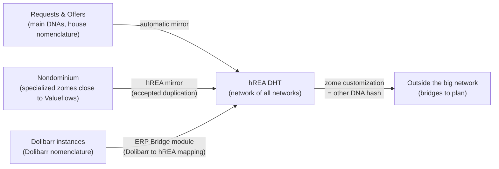
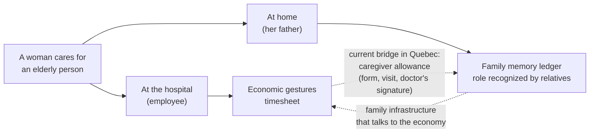
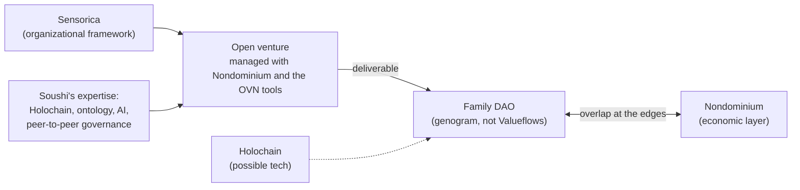

# Nondominium, Discussion Journal at the Lab

**Date:** Tuesday, September 29, 2026, 3:09 pm (56 minutes)

**Attendees:** Soushi (speaker_0, lead developer of Nondominium), Tibi (speaker_1, Sensorica); the attribution comes from the opening of the recording, where Soushi says "at the lab with Tibi".

**Context:** In-person working session at the Lab, three weeks after the September 8 meeting on the human governance of the NDO. Starting point: the UI prototypes Soushi had shared with Tibi. Machine transcription with speaker attribution; misheard proper nouns are corrected here: "Nodominium", "Landominium", "Node Dominion", "Non Dominium" become Nondominium; "HREA", "Ashreya", "Hреаs" become hREA; "Adam" becomes AD4M; "MSP Server" becomes MCP server; "Michel Barnes" is most probably Michel Bauwens (inferred from the P2P context, not confirmed). Square brackets give the minute in the recording. This is an English translation; the original journal is in French.

## TL;DR

Nondominium's UI is designed as one unified application with several perspectives, each answering the question "what is the person doing right now?": a resources perspective, a work perspective (Kanban, contributions), an agents perspective (skills, reputation, relationship graph), and a strategy and intelligence perspective where an AI agent, through MCP, helps allocate one's time between projects. The geographic map and the chat are tools that appear in several perspectives, not perspectives themselves. On top come the specific implementations (art, water, agriculture), which adapt terminology, workflows and visuals to each community's culture, because the universal language of NRP alienated people. hREA serves as the interoperability layer: each implementation keeps its own nomenclature and mirrors its data into an hREA DHT, as Requests & Offers already does, and an ERP bridge (Dolibarr) would go through hREA rather than through Nondominium; the limit is that any zome customization changes the DNA hash. The second half opens the Family DAO workstream: a peer-to-peer family layer built on the genogram and not on Valueflows, which Nondominium does not serve directly, but which Sensorica can carry as an open venture managed with Nondominium. Common thread: the same gesture changes meaning depending on context, and AD4M, with its perspectives and languages, may provide the building blocks for moving from one context to another.

## Updates

**The shared prototypes.** Soushi opens with the idea drawn from the prototypes he showed Tibi: "a unified UI, but with several perspectives", layers centered sometimes on agents and the social side, sometimes on resources, processes, or geography (seeing a city on a map). [0 to 1]

**The ERP bridge through hREA.** Soushi recently thought about a Dolibarr module of the ERP Bridge type. His conclusion: plug it into hREA rather than directly into Nondominium. The module does the full mapping from Dolibarr to hREA; since it speaks Valueflows, the hREA DHTs of the different Dolibarr instances become compatible with Nondominium's hREA DHT, and it is the hREA DHTs that do the bridging. Dolibarr users, for their part, "will be shielded from the Value Flow background in the back end": they see a networking module for exchanging resources, with the Dolibarr nomenclature they know. [12 to 13]

**The Requests & Offers mirror model.** Soushi recalls what R&O already does: every write in the main DNAs, with their house nomenclature, is automatically reflected in hREA, "like a mirror system of our custom system, but in hREA". [13 to 14]

## Discussion

**The perspective as a question about activity.** Tibi lays down the principle: each perspective answers "what is the user doing right now?". The map is not a perspective: mapping geographically is "a tool that can appear in several perspectives". Each perspective has a base primitive, and navigation consists of "swimming in the ocean" of that primitive. [0 to 1]

**Resources perspective.** Someone is looking for a 3D printer or wants to create a resource. The primitive is the resource; they navigate the ocean of resources, see which communities use them, which ones are local (via the map tool), then add layers: who uses them, which organization owns them. [1 to 2]

**Work perspective.** Someone sits down in front of Nondominium to work on a project. Kanban mode: what people are doing, what can be done in the context of a resource, a project or a group ("what can I do in that group today?"), logging contributions, seeing tasks. [1 to 3]

**Agents perspective.** Finding partners for a project. The primitive is the agent: search for a skill (someone who does JavaScript), open their profile, see their communities, projects, skills and reputation, then "hop" from link to link in the relationship graph. Groups appear there too, since they are types of agents. Possible tools: a map of the worldwide distribution of skills, and a chat to get in touch directly, perhaps through the Capability Surface. [2 to 4]

**Strategy and intelligence perspective.** Tibi describes strategic reflection: how to interact with this network economy and allocate one's time. You swim in the sea of projects and organizations, with tasks emanating from them, and you ask what your benefits and impact would be depending on the project stage (early stage, in development, close to the end). An AI agent that knows your profile, through an MCP server, suggests suitable projects: if you need money, those that already have funding; if you want to put five or ten percent of your time into high-potential projects with no immediate income, those. Simulation tool: "If I put 10% of my time into high-impact projects, 10% [...] social impact [...] then the rest of the time [...] into projects that generate income", the agent shows the opportunities. Associated actions: subscribing to a community, becoming a member, attaching oneself to a project. The analysis relies on the benefits that projects publish themselves. Soushi also sees a personal dashboard in it. [4 to 7, 39]

**Specific implementations.** On top of the base perspectives, a group or network uses Nondominium for its own purposes. Tibi's examples: a network in France around water stewarding and co-management, where the concept of source becomes central; a network of artists (name heard as "Repair", not confirmed). Each has its own language, hence the importance of a dictionary: how they name processes and resources. Lesson from NRP: "that universal language that polluted things a bit. People found themselves a little alienated", and a software project and a hardware project already do not share the same culture. The adaptation covers terminology first, then workflows (artists and engineers do not chain processes the same way), then visuals. This level touches the economic and organizational machinery, and will arrive when we build Nondominium for a domain (art, environment, agriculture). [7 to 10]

**The module and the Valueflows conflicts.** Tibi cites Lynn and Bob, behind Valueflows: the processes and nomenclatures of food and agriculture conflict with those of high tech, and everyone arrives with their own requirements. Soushi proposed the module; Lynn notes that everyone wants something different. Tibi: "That's the problem when you present a monolith to different cultures." Soushi: Valueflows is a generic ontology, a back-end engine; in R&O, the Valueflows primitives are underneath, but the managers of the mutual-aid platform speak in terms they understand. Tibi adds the inverse constraint: applications must talk to each other in the back end, so that artists can one day interface with farmers, hence dictionaries and translations on top of the Valueflows base. [10 to 12]

**Keep the logic per zome, aggregate in hREA.** Soushi weighs two options for Nondominium: export directly into hREA, since there is a lot of raw Valueflows in it, or keep specialized zomes with their logic close to Valueflows and an hREA mirror. He leans toward the second: duplication is acceptable because the role of the hREA DHT is above all aggregation. In R&O it is tighter (one DNA for one), whereas Nondominium aggregates several. Tibi sums up: hREA bridges all of Nondominium's specific implementations and with Web 2 applications like ERPs; the hREA DHT network becomes "the network of all networks". [14 to 15]

**The DNA hash limit.** Soushi: as soon as zomes are customized (adding some, adding the source), we no longer have the same DNA hash. Native interoperability exists between two vanilla hREA DHTs, because they share the same code; with variations, "it's not impossible, but we may have to add a bit of tinkering", bridges to make our improvements backward compatible. Tibi: "We're no longer part of the big network." [15 to 16]

**Family DAO: another layer, another ontology.** Tibi opens a long-term reflection, to "just put it there for now". Family DAO is not based on the OVN: in the economic layer, the base structure is the Open Value Network and the relationships are value relationships; in the family layer, the base structure is the genogram, which reproduces all the types of relationships of an extended family. [16 to 18]

**The same gesture, two ledgers.** An example Tibi attributes to Michel Bauwens (heard as "Michel Barnes"): a woman who cares for her old father at home and the same woman who cares for an elderly person at the hospital make the same gestures. At the hospital, she is an employee, her gestures are economic and entered in the timesheet. At home, they are entered in a kind of "memory ledger" of the family and give her a role recognized by her relatives. Society does not see these two actions together. Quebec builds a bridge (caregiver allowance), but through a form, a visit, a doctor's signature: "a lot of bureaucracy". A family information infrastructure that talks to the economic infrastructure would make this work visible and recognized elsewhere (tax deductions, free metro). [18 to 22]

**The source as a remedy for externalities.** Tibi: externalities exist because the ledgers of the municipality and of the Ministry of the Environment do not talk to the economic ledger. A study on the pollution of a river, published in a journal, does not reach the ledger of the companies that use the water; it takes a human intermediary, a regional office, policies, an environmental police, with the risk of "the brown envelope". Soushi asks whether open data is enough. Tibi: yes, but the difference is that the data is placed on the same surface, the digital twin of the river that we call the source, used at once by scientists and by the companies that draw from it (flow, planning of withdrawals). Attached to the source rather than scattered, it can be analyzed in one go and can give rise to usage rules. Soushi ties this to the promise of Nondominium, Holochain, Valueflows and hREA: unified flows in the same network, accessible for analysis, feedback loops and collective intelligence. [22 to 26]

**Languages that must talk to each other.** Tibi: Nondominium is founded on Valueflows for interoperability between economic contexts; Family DAO will have another vocabulary, which handles the relational side and the stewarding of a family wealth that is not necessarily tangible. Nondominium is at the economic layer (resources, sources, processes, exchanges, contributions) but will have to connect to science (shared knowledge management), to the family and the rest, to avoid silos. [26 to 28]

**Fractal sovereignty and family.** Soushi ties this to his idea of fractal sovereignty: if we define an effective pattern of peer-to-peer governance and economy at the quasi-atomic level of the household and the extended family, it can grow to the higher scales, "inoculated, propagated". Tibi traces the history: agrarian subsistence economy centered on the family, surpluses exchanged at the market, then mercantilism, industrialization, digitalization, and silos. The visible economy is only the tip of the iceberg: the economic agent was formed by their family (education, values, tools), invisible work. The example of the British Empire "built on a handshake": the gentleman's code does not come from the economy. Soushi reverses the causality: the family forged the economic culture, and it allows emergence. Tibi: the family forges this ground of trust, and by dissolving it we saw off the branch the economy sits on. [28 to 32]

**Family, tribalism, peer to peer.** Soushi: the family was long the political unit (coats of arms, dynasties, clans), and stifling it amounts to centralizing power, because it carried diversity and resilience. Tibi describes two tendencies: the communist left that wants to dissolve the family (he cites the Manifesto), and conservatism that makes it the metaphor of the nation, hence tribalism and conflicts; he cites "maître chez nous" ("masters in our own house") as the family metaphor of Quebec nationalism. The peer-to-peer society settles it: the individual is as important as their community, as in commons-based peer production. The question: "How can we keep the family without falling into tribalism?" Soushi: sovereign atoms are necessary (diversity, experimentation, real local grip, "at least I have a bit of impact on my family"), the risk is the silo; it is a balance between individual and collective, family and society, extending to the bioregional and the cosmo-local. Each family could have its own tailor-made economic system, hREA and Nondominium, with its own governance and culture. [32 to 39]

**Perspectives, level two.** Back to the UI, Tibi recaps: base perspectives (resources, agents, processes, intelligence and strategy) and specific implementations. The family is not one: you cannot "roll out a Nondominium for the family", because it is neither in transactional mode nor in co-production, it produces family wealth, not economic wealth. Soushi proposes at least knowledge sharing (grandmother's cookbook); Tibi: that is exactly what Family DAO wants to do, with the genogram in place of Valueflows. Hence the reformulation: Nondominium becomes the economic perspective of peer to peer, Family DAO its family perspective, and since the peer-to-peer protocol is everywhere, "the genogram can talk to hREA". Soushi clarifies: the economic event and economic resource layers would be less present there, but planning, agents and knowledge could suit an ontology that is more social than economic. [39 to 41]

**What Sensorica brings to Family DAO.** Soushi asks about the concrete relationship. Tibi: Nondominium does not apply to Family DAO, which does not speak the economic language; however, Holochain can serve to develop it (the project lead went with blockchain, but Tibi thinks they need the other), and Sensorica serves as the organizational framework. Developing Family DAO is an economic action: "Family DAO is the deliverable of a network, of an open venture, which is managed from Nondominium, but whose deliverable is the Family DAO, which is not Nondominium." Soushi rephrases: a parallel project, managed with our OVN tools and Nondominium, which benefits from our expertise in Holochain, ontology, AI and peer-to-peer governance. Tibi: the two overlap at their edges (a joint account to buy a house on one side, relational aspects in the economic networks on the other). [42 to 45]

**Digital sovereignty of the family.** Tibi: Facebook, Messenger, WhatsApp meet families' relational needs but take away their sovereignty over their collective memory (childhood photos, decades of communication), and instrumentalize their data (political targeting). The goal: an infrastructure that strengthens family sovereignty and connects it to the economy without contradiction, without going as far as the nation as a family and without drifting toward a centralizing AI that would replace the family ("It's the only one who understands me"). [45 to 49]

**The ecovillage and the economic frontier.** Soushi tells of an ecovillage visited around 2021 or 2022, about ten people, who had asked him for a small app to track debts between members and contributions to the common pot, a form of mutual credit; the same need exists in families and among roommates (who does the groceries, the cleaning). Tibi warns: "if you put too many economic paradigms into a family, you destroy the relational side." Soushi: a clear and explicit but permeable frontier, the edge effect of permaculture; each family as a microeconomy, a macroeconomy made of microeconomies in relation rather than a single-currency monoculture. [49 to 53]

**The change of context, and AD4M.** Tibi: AD4M is interesting because it operates at different perspective levels; the real question is when the context changes. Grandmother's recipe reproduced at Christmas keeps a culinary, relational memory; when the corner restaurant comes asking to learn how to make the pâté, we switch into the economic. Soushi: not necessarily an on/off switch, there are gray zones ("Jean-Claude and Sons Inc."). Tibi: these are the same actions, the same person, like the daughter at home and at the hospital. Soushi concludes that the event must be aware of its context, that Valueflows is perhaps too economic for this, and that AD4M (formerly Perspectivism), with its perspectives and languages, perhaps provides the building blocks for the inter-context and inter-perspective bridge. [53 to 56]

## Decisions

- **The UI is a unified application with perspectives, defined by the person's activity.** Base: resources, work (Kanban, contributions), agents, strategy and intelligence. Map and chat are cross-cutting tools. Both agree, no objection. [0 to 7, 39]
- **Specific implementations adapt terminology, workflows and visuals on top of Valueflows**, which remains the back-end engine. Reason: the universal language of NRP alienated users. [7 to 12]
- **Family DAO is not an implementation of Nondominium.** It is a parallel project, the deliverable of an open venture managed with Nondominium and the OVN tools, carried organizationally by Sensorica, with Holochain as a possible technology. [42 to 45]

## Discussed, not decided

- **hREA mirror or direct export.** Soushi leans toward keeping specialized zomes and an hREA mirror dedicated to aggregation, accepting the duplication; no decision. [14 to 15]
- **Interoperability between customized hREA DHTs.** Any customization changes the DNA hash and leaves the "big network"; bridges and backward compatibility to be designed. [15 to 16]
- **Dolibarr ERP bridge through hREA.** Direction thought out by Soushi, approved by Tibi, not yet a committed project. [12 to 13, 15]
- **How to materialize the change of context.** A clear and permeable frontier between relational and economic; AD4M mentioned as a possible substrate, to be explored. [51 to 56]
- **Where contribution tracking stops in a family setting.** Mutual credit is useful for ecovillages and shared housing, dangerous for the relational side if pushed too far. [49 to 51]

## Actions

No action was assigned during the discussion. Soushi closed the recording by saying he would draw a report from it on the UI, on Family DAO and on the question of UI and UX adapted by community. [41 to 42, 56]

## Outstanding

- **The modular interface already exists.** Soushi recalls that the Surface and the Surface Attachment (the capability slots) have already formalized it, and that R&O is thinking about the same subject for white labeling; the link between these slots and the specific implementations remains to be written. [42 to 43]
- **The Family DAO project lead** is not named in the recording; they are on blockchain and Tibi thinks they would need Holochain. To confirm: who they are, and how they join Sensorica. [43]
- **The network of artists** cited as an example was transcribed as "Repair"; name to confirm. [7 to 8]
- **"Vine"**, cited as a possible chat channel with an agent, is not identified. [4]
