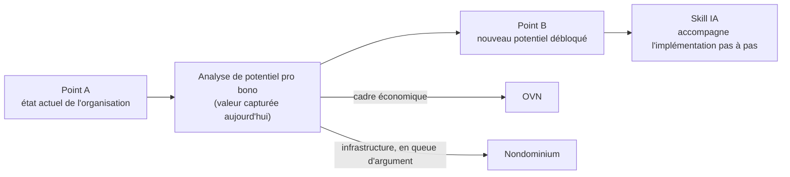
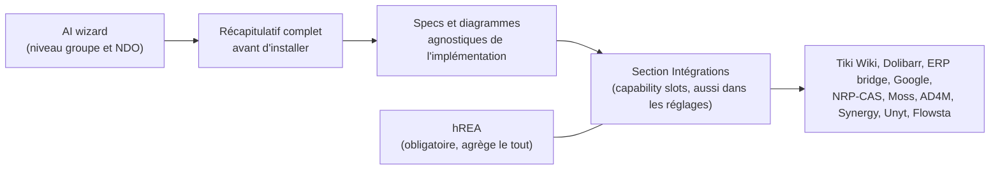
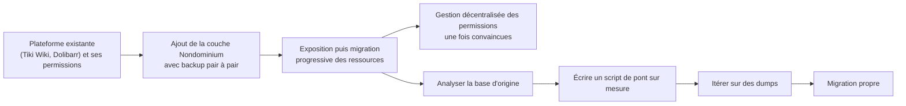

# Nondominium, Journal de rencontre avec Tibi

**Date :** mardi 13 octobre 2026 (1 h 47, d'environ 16 h 45 à 18 h 32 heure de Montréal, pause de 80 à 84)

**Participants :** Soushi (Sacha Pignot, développeur principal de Nondominium, canal micro), Tibi (Sensorica, canal système, appel Discord avec partage d'écran en fin de rencontre). Soushi nomme Tibi à [69] (« traduit-le pour Tibi »). Les crédits ElevenLabs étant épuisés, la transcription vient du moteur local sans diarisation ; les locuteurs ont été retrouvés par l'énergie de chaque canal stéréo (529 segments côté micro, 433 côté système, 116 ambigus attribués au contexte).

**Contexte :** Suite de la séance au Lab du 29 septembre  et du board « Human-first, AI-optional » du 9 octobre, dont Tibi avait reçu sa propre version. Le jalon v0.1.0 peer-mesh est daté au 25 octobre. Noms propres mal transcrits et corrigés ici : « non dominium », « nom de minium », « mon dominion » deviennent Nondominium ; « ovien », « au vien », « ovn » deviennent OVN ; « flow stop », « flostat », « l'hosta » deviennent Flowsta ; « claude flair », « clott flair » deviennent Cloudflare ; « most », « mos », « mosquée » deviennent Moss ; « rp bridge », « urp » deviennent ERP bridge ; « your own ai » est Your Own AI, le projet d'Eric (nom de famille non dit dans l'enregistrement) ; « pie chart », « païen », « p chart » désignent le tableau de contributions de Sensorica (Google Sheets) ; « endio », « indio » deviennent NDO ; « d'olibar » devient Dolibarr. Les crochets donnent la minute dans l'enregistrement.

## TL;DR

Tibi a exposé sa stratégie de dissémination pour Nondominium : ne pas vendre l'OVN ni Nondominium de front, mais produire des analyses de potentiel pro bono (« voici la valeur que ta structure capture aujourd'hui, voici le potentiel que tu pourrais débloquer, voici le chemin ») où l'OVN donne le cadre économique et Nondominium l'infrastructure, en queue d'argument. Il l'a testé avec Eric (Your Own AI), qui a bien réagi, puis avec Flowsta, et il prépare une analyse de l'écosystème Linux pour enrichir le futur skill OVN. Soushi propose de fusionner skill OVN et skill Nondominium en un seul skill couvrant tout le cycle de vie, de l'analyse organisationnelle jusqu'au déploiement, avec un playground et un « AI wizard » qui produit des specs agnostiques et expose les intégrations par la capability surface. Pour les heures, ils s'entendent sur la solution simple : la v0.1 lie le tableau de contributions Google existant à l'NDO, ce qui suffit pour être conformes à leur propre licence et fait des 18 mois de données historiques la preuve de crédibilité de la première release. Flowsta n'est pas requis pour la v0.1, qui reste un premier jalon teaser. Tibi a trouvé le board brainstorm difficile à suivre : trop cryptique pour qui n'était pas là, et pas un outil de brainstorm mais plutôt un outil d'alignement ; Soushi l'accepte et prévoit plus de contexte et des commentaires en temps réel. La fin a servi à expliquer la CI GitHub Actions et Cloudflare.

## Depuis la dernière rencontre

- **Soushi :** rapport sur l'UI à perspectives, Family DAO et l'UX par communauté (seul engagement du 29 septembre). Pas évoqué aujourd'hui ; aucune trace trouvée à part le journal lui-même. Reste ouvert.
- **Soushi :** board « Human-first, AI-optional » envoyé à Tibi avec ses propres réponses. Fait ; Tibi l'a parcouru et y a ajouté des notes pendant la pause de [80 à 84], le retour de fond est consigné plus bas.
- **Décision du 9 octobre, `delete_branch_on_merge` et nettoyage des branches du design system.** Pas fait : le réglage est toujours à `false` et le dépôt compte dix branches (vérifié le 13 au soir).
- **Questions du 29 septembre** (miroir hREA ou export direct, interopérabilité entre DHT personnalisées, pont ERP Dolibarr par hREA, changement de contexte, frontière économique dans la famille) : non rouvertes aujourd'hui, sauf le pont ERP repris comme stratégie de migration progressive.

## Mises à jour

**L'analyse de potentiel pour Eric.** Tibi rappelle ce qu'il a annoncé sur Discord. L'idée principale n'est pas la rencontre avec Eric mais de continuer le travail sur le skill OVN, parce qu'il se branche sur Nondominium, qui « devient l'infrastructure de base ». Pour Eric, il a écrit un document d'analyse et de recommandations sur Your Own AI, dont la proposition centrale est le passage de « your own AI » à « our own AI » : une infrastructure partagée, fédérée plutôt que décentralisée (pas d'Holochain, pas de vault, pas de séparation entre données personnelles et publiques), qui joue le rôle de liant communautaire, avec des fonctions proches de Requests & Offers (mémoriser ce que les gens disent et font, faire des inférences, suggérer des mises en relation). Eric a répondu « wow, c'est vraiment cool », puis est revenu quelques heures plus tard en disant qu'une partie de ce qui était proposé était déjà dans sa todo, mais que d'autres dimensions ne lui étaient pas venues. Tibi en tire que les outils nourris du wiki OVN, de la documentation et du site de Sensorica produisent déjà des analyses utiles. [2 à 12]

**Flowsta puis Linux.** Après Eric, Tibi a fait la même analyse pour Flowsta, plus fondamentale encore parce qu'elle touche la fondation identitaire, avec l'idée de combiner ensuite les deux à un niveau écosystémique : Your Own AI pourrait devenir une couche qui aide les gens à naviguer un value network (« à quel projet je peux contribuer, matcher des projets avec mes skills »). Pour se faire les dents avant d'ouvrir le skill OVN, il a choisi un cas « encore plus costaud » : l'écosystème Linux, qui a fait ses preuves depuis des décennies. Il compare Windows, macOS et Linux (capacités techniques, architectures), puis applique le modèle OVN avec Nondominium et les NDO pour voir ce que l'OVN peut apprendre de Linux (méthodologies, gouvernance, découpage kernel, distros, applications, normes, conventions et interfaces qui rendent l'ensemble modulaire mais cohérent) et ce que l'OVN pourrait apporter à cette communauté. On ne peut pas dire à Linux « utilisez l'OVN, vous serez meilleurs », la réponse serait « ça marche depuis longtemps ». [16 à 23]

**Le workflow mailing list.** Soushi ajoute ce qu'il avait discuté la veille : les développeurs du cœur de Git et du noyau Linux travaillent encore selon la méthode pour laquelle Git a été créé, patches et commits dans des fils de courriels, sans client de type GitHub, tout vivant dans le client mail. Une migration serait plus difficile pour eux, mais le reste de la communauté a des pratiques techniques variées. [20 à 21]

**Passage privé retiré.** Une partie de la discussion portait sur un sujet sans lien avec Sensorica ni Nondominium ; elle a été retirée de cette version publique. [31]

## Discussion

**La dissémination par l'analyse de potentiel.** Tibi décrit sa stratégie de diffusion de Nondominium une fois la release faite. Les gens ne savent pas ce qu'est un open value network, c'est trop abstrait, et la question « à quoi ça sert Nondominium ? » revient toujours. Quand il a répondu « du partage de ressources », on lui a dit « tu peux faire ça aujourd'hui avec toutes les informatiques qu'on a ». Même parler de nouvelles formes de propriété ne suffit pas : les gens n'ont pas l'imagination pour voir ce que ça change. Sa réponse : produire publiquement des analyses, comme du conseil pro bono, qui disent à une organisation où elle est (point A), quelle valeur elle peut capturer avec son état organisationnel actuel, quel nouveau potentiel elle peut débloquer (point B) et par quels pas, avec des interventions sur l'organisation et sur l'infrastructure, et un clin d'œil à l'OVN pour le cadre économique et à Nondominium pour l'infrastructure. Nondominium « prend son sens » quand il devient le moyen d'aller du point A au point B ; présenté hors contexte, « ça donne pas grand-chose ». Il nomme les paralysies que ça lève : ne pas connaître, manquer d'imagination, manquer de moyens ou de savoir, ne pas savoir par où commencer. Le rapport serait suivi d'un skill IA qui accompagne pas à pas l'implémentation, ce qui fait partie de la stratégie de distribution de Nondominium. [3 à 16]

**Un skill OVN et Nondominium sur tout le cycle de vie.** Soushi note qu'aujourd'hui le seul skill Nondominium est celui du développement interne, et que l'OVN touche ce qui existe dans les Google Docs. Il propose de les relier comme il l'a fait avec le skill Holochain : un skill (ou deux skills connectés) qui couvre le cycle complet. D'abord l'analyse, en amont même du design : analyse des besoins et du potentiel, identification des opportunités de transformation (« OVN-ification ») progressives, par petits bouts, avec un mode entrevue proche du mentor socratique ou de la requirements discovery, mais appliqué à l'organisation plutôt qu'au logiciel. Ensuite un brainstorm qui formalise les requirements, puis design et prototypage, puis implémentation, tests, sécurité, optimisation, CI, DevOps et déploiement. [24 à 27]

**Un playground plutôt que seulement un skill.** Soushi demande si les « outils » de Tibi vont au-delà d'un skill : une app dédiée, ou un playground de design system comme son hREA Explorer, où l'on combine des éléments de Nondominium, de l'OVN et de Valueflows pour simuler et voir à quoi ressemble une organisation, utilisable même sans IA, puisque tout le monde ne sait pas utiliser un agent. Il évoque une app qui construit des prototypes pendant qu'on lui parle et qui, à la fin, passe le relais à des agents plus spécialisés dans le code. Tibi précise plus tard que les prototypes ne sont pas forcément du code ; Soushi répond que l'idée est justement le visuel, pour les utilisateurs qui ont besoin d'un « petit feel » de leur organisation plutôt que d'architecture pure. [27 à 29, 41, 57 à 58]

**L'AI wizard.** Tibi montre le document « help new venture » du wiki OVN : le skill guide pas à pas, par exemple « vous avez besoin d'une présence web ; si vous voulez être en réseau, ça ne peut pas être juste une landing page ». Soushi nomme le concept : un AI wizard. Le skill ne donne pas forcément les outils (les gens peuvent choisir WordPress ou leur propre site) mais sort des specs, de sorte que n'importe quel outil qui prend le relais, ERP bridge, WordPress ou app native de Nondominium, soit préconfiguré. Tibi veut embarquer des écosystèmes entiers (ActivityPub, Google, Moss, Tiki Wiki) avec le pas à pas et les réglages par défaut : inscription, règles d'accès aux documents. Pour Eric, qui est un « one man show » (il publie sur GitHub, annonce ses releases sur Twitter, reçoit des issues, sans base collaborative), il ne s'agit pas de migration mais de construire de zéro une présence ouverte aux contributeurs. Moss intéresse particulièrement Tibi : avec l'équivalent de Google Docs, de Git, de Discord, Nondominium et Unyt, il offre déjà un noyau OVN, et ce serait intéressant de le tester et d'en donner du feedback à Eric. Nondominium y viendrait par défaut comme couche de coordination des ressources. Soushi développe la version produit : un wizard qui, à la fin, fait un récapitulatif complet avant d'installer, génère specs et diagrammes agnostiques de l'implémentation, et expose dans une section Intégrations (aussi accessible ensuite dans les réglages, pour les admins) les capability slots de la capability surface : Tiki Wiki, Dolibarr, l'ERP bridge, Google, l'ancien NRP-CAS, Moss, AD4M, Synergy, Unyt, Flowsta. hREA resterait obligatoire parce qu'il agrège le tout ; certaines intégrations ne seront pas installables d'emblée à cause de dépendances. Ce wizard se placerait au niveau du groupe et de l'NDO plutôt que du lobby, puisqu'on rejoint un lobby existant ; Tibi confirme. [42 à 62]

**Migration progressive et gouvernance non opinionnée.** Soushi relie tout ça à l'ERP bridge : les organisations gardent leur plateforme et leur gestion de permissions interne (Tiki Wiki, Dolibarr), ajoutent la couche Nondominium avec un backup pair à pair, exposent puis migrent leurs ressources progressivement, et n'adoptent la gestion décentralisée des permissions qu'une fois convaincues ; une migration complète peut changer de paradigme. L'import des données historiques, d'abord pour eux-mêmes, ouvre la voie à un workflow de migration dans le skill : analyser la base d'origine, connaître la structure cible, écrire un script de pont sur mesure, l'itérer sur des dumps jusqu'à une migration propre. Côté gouvernance, Soushi veut fournir des primitives de base et de bons exemples, pas imposer de modèle, avec une bonne interface d'interopérabilité, pour que même une communauté très autoritaire et une très libertaire puissent coopérer économiquement. [34 à 38, 50 à 51, 55 à 57]

**Loguer les heures dans Nondominium : le dogfooding.** Soushi propose que dès la v0.1, s'il y a un petit réseau, ne serait-ce qu'entre eux deux, ils loguent leurs heures dans les groupes, en exportant quand même les données vu l'instabilité. Tibi préfère ne pas se compliquer la vie : lier le tableau de contributions (« pie chart ») existant. Stocker les logs sur la DHT pose des questions non réfléchies (accès pour tous, perte de données entre deux migrations, absence d'identité portable). Il distingue deux couches : le ledger d'événements (chaque log, avec ses paramètres quantitatifs, heures ou argent) et le processus de valuation (le poids des rôles, l'arbitrage entre qui met du temps et qui met de l'argent), qui dépend de la communauté (méritocratique, égalitaire). Le tableau Google a les deux ; l'NDO irait chercher cet extrait plutôt que de tout reprendre. Il le formule positivement comme stratégie de transition : Nondominium permet de rester dans son milieu collaboratif (enregistrer son projet comme NDO tout en puisant les contributions là où elles vivent, par exemple les commits GitHub) sans faire ses valises vers une plateforme pas encore stable. Il ajoute un argument décisif : la licence des NDO exige au moins un tableau de contributions, donc une première release doit s'y conformer. Soushi y voit la crédibilité de la release : elle arrive avec les données historiques depuis la déclaration officielle du venture, un an et demi de travail. [29, 31 à 41]

**Flowsta dans la v0.1 ?** Soushi rappelle l'intérêt de Flowsta pour l'identité multi-appareils (ne pas perdre son historique quand l'ordinateur meurt) et demande s'il faut l'intégrer dès la v0.1. Il penche pour plus tard : il faut un système de base autonome, et la capability surface de la couche 0 offre déjà, à côté de la couche d'identité intégrée, une surface pour des autorités d'identité externes. Il propose une première petite release pour tester entre eux, puis Flowsta pour plus de robustesse avant une ouverture plus publique. Tibi tranche que ce n'est pas nécessaire : personne ne va migrer vers la première version, qui sert à dire « voici ce qui s'en vient », un peu comme Farm Hack, avec des boutons pas encore fonctionnels qui ouvrent une explication (« stay tuned »). Soushi nuance : avec le cas d'usage d'économie grassroots, la couche 0 seule résout déjà un problème concret, donc c'est un peu plus qu'une preuve de concept, et un vrai MVP de couche 0 viendra en stabilisant, puis un par couche, en itérant par petits jalons. [51 à 55]

**Le board brainstorm, vu par Tibi.** Tibi dit avoir du mal à suivre la logique de l'outil. Ce qu'il fait, ce qu'on peut y faire ou non, n'est pas clair : il a ajouté un sticky note sans savoir où il irait, et ce n'est pas du temps réel. Il le trouve « tellement minimaliste » qu'on perd le contexte : des stickies trop petits, des mots seuls dont on ne sait pas ce qu'ils veulent dire, surtout pour qui n'était pas à la discussion ; il suggère de régler le niveau de contexte selon le public, plus cryptique pour ceux qui étaient autour de la table, plus de mise en contexte pour un usage général. Sur le fond, il conteste le nom : un brainstorm, c'est l'expansion (partir dans tous les sens), puis la synthèse (grouper les stickies par relations, donner du sens) ; ce board fait plutôt le compromis, « X a dit ça, Y a dit ça, qu'est-ce qu'on prend de bon chez chacun », donc c'est un outil d'alignement, et les diagrammes Mermaid qui schématisent l'intéressent. Il relève aussi que des sections comme « already works », « model to copy », « idea catcher » cadrent mal avec le paradigme du brainstorm. Soushi reconnaît son erreur : le board est né comme brainstorm personnel, puis il a demandé à l'IA de l'adapter pour Tibi sans lui dire de se mettre dans ses chaussures. Il le requalifie en pré-brainstorm, un digest qui habille joliment un résumé qu'il avait dicté pendant une trentaine de minutes, le vrai travail venant ensuite par des entrevues socratiques visuelles. Il décrit la suite : un chat IA intégré aux panneaux du dashboard (déjà commencé), puis des commentaires entre humains en temps réel, avec un dépôt GitHub privé comme backend comme dans le design system. Il montre l'export « copy my answers », qui situe chaque ajout et chaque commentaire épinglé par son texte plutôt que par un identifiant, un choix fait exprès parce que les identifiants changeaient à chaque itération et faisaient perdre des réponses. Il retient aussi d'étoffer les paragraphes qui présentent les sections et les diagrammes (par exemple « progressive workflow adoption », jugé maigre). [62 à 86]

**Branch previews, relecture rapide.** En partage d'écran, Soushi reprend la section du board : Tibi propose de montrer le travail en cours des branches dans le design system ; Soushi voulait des branches choisies par label sur la PR (« clean, explicite, idiomatique »), Tibi listait toutes les branches, sans concept nouveau à apprendre. Soushi admet penser « comme un ingénieur » ; le compromis du board est de déployer toutes les branches par défaut et de limiter l'encombrement en supprimant les branches au merge. La moitié de l'infrastructure existe déjà, Cloudflare offrant un sous-domaine par branche, et le board distingue l'app courante, les prototypes officiels fusionnés et l'exploration sur les branches (« exploring is not shipping »). Tibi soulève la question du vocabulaire : choisir des labels, c'est choisir un vocabulaire, et comment un nouveau venu le connaîtrait-il ? Soushi y voit le point de l'adoption par niveaux, du contributeur occasionnel au mainteneur. [87 à 94]

**Ce qu'est Cloudflare, ce qu'est la CI.** Tibi ne savait pas ce qu'est Cloudflare ni s'il devait l'installer. Soushi explique que c'est une plateforme de déploiement de sites statiques et d'autres services web, configurée dans le dépôt comme de l'infrastructure as code (le workflow `deploy.yml`), qui tourne sur les runners de GitHub, auto-hébergeables, sur des HoloPorts par exemple ; rien à installer pour les contributeurs. Il montre les Actions de Nondominium : build, suites de tests, e2e, checks verts et rouges par PR, merge bloqué si un test échoue. Tibi corrige un détail : la CI ne tourne pas à chaque commit local mais à chaque push, sur le dernier commit. Soushi précise ensuite que le design system n'est pas encore branché sur Cloudflare, c'est planifié ; Cloudflare permettra la connexion GitHub pour les commentaires et Cloudflare Access (liste blanche d'adresses courriel) pour des sites privés. [94 à 106]

## Décisions

- **Les heures de la v0.1 passent par le tableau de contributions existant**, lié depuis l'NDO, plutôt que par un log sur la DHT. Raisons : éviter de perdre des données entre migrations sans identité portable, ne pas forcer les gens à quitter leur outil, et être conformes à la licence des NDO qui exige un tableau de contributions. Les données historiques deviennent la preuve de la release ; un log intégré à l'app viendra dans une version suivante. [31 à 41]
- **Flowsta n'est pas requis pour la v0.1.** Raison de Tibi : la première version est un jalon teaser, personne n'y migre ; raison de Soushi : il faut d'abord un système de base autonome, et la capability surface prévoit déjà l'identité externe. [51 à 55]
- **La dissémination passe par des analyses de potentiel**, avec l'OVN et Nondominium en queue d'argument et non en tête. Approuvé par Soushi, qui juge Your Own AI le partenaire le plus prometteur pour une intégration (meilleure relation, techniques compatibles). [3 à 16, 30]
- **Le board du 9 octobre est un outil d'alignement, pas un brainstorm**, et les boards partagés doivent porter une mise en contexte adaptée à leur public. Soushi l'accepte comme son erreur. [62 à 77]

## Discuté, non tranché

- **Un skill unique OVN et Nondominium sur tout le cycle de vie**, de l'analyse organisationnelle au déploiement. Proposé par Soushi, en phase avec la vision de Tibi ; périmètre et découpage à définir. [24 à 27]
- **Playground et AI wizard.** Specs agnostiques, intégrations exposées par la capability surface, wizard au niveau groupe et NDO, hREA obligatoire. Idées de Soushi accueillies, rien d'engagé. [27 à 29, 57 à 62]
- **Quels écosystèmes le skill supporte d'emblée.** Tibi cite ActivityPub, Google, Moss, Tiki Wiki ; Moss l'intéresse le plus. [44 à 49]
- **Branch previews : labels ou toutes les branches.** Compromis proposé dans le board (toutes les branches, suppression au merge) ; la question du vocabulaire des labels reste ouverte. [87 à 94]
- **Format du board pour plusieurs personnes.** Temps réel, commentaires entre humains, niveau de contexte par public : direction posée par Soushi, pas encore construite. [64 à 77]

## Actions

- **Soushi :** produire ce résumé et le partager avec Tibi dans le nouveau format de board de réunion. [106]
- **Soushi :** réécrire le board du 9 octobre à partir des notes et commentaires de Tibi, avec des paragraphes d'introduction de section et de diagramme plus étoffés et une mise en contexte pour un lecteur absent. [85]
- **Soushi :** mettre à jour ses heures dans le tableau de contributions OVN. [41]
- **Tibi :** envoyer ses notes et commentaires du board (export « copy my answers »). [77 à 84]
- **Tibi :** poursuivre l'analyse Linux et les analyses Your Own AI et Flowsta pour nourrir le skill OVN, puis tester Moss comme noyau OVN et en faire un retour à Eric. [16 à 23, 48]

## En suspens

- **Comment l'NDO lie le tableau de contributions** : simple lien externe, ou extrait importé (ledger plus valuation). Soushi penche pour le lien comme version facile, l'intégration dans l'app plus tard. [38 à 39]
- **Le nom de famille d'Eric** (Your Own AI) n'est pas dit dans l'enregistrement.
- **La part de l'OVN dans la licence des NDO** : Tibi affirme qu'elle exige au moins un tableau de contributions ; formulation exacte à citer quand la release la mentionnera. [40]
- **La date de la prochaine rencontre** n'a pas été fixée.

## Corrections après la rencontre

- **Cloudflare n'est pas encore en service pour le design system.** À [90], Soushi dit avoir « migré » le design system vers design.sensorica.co sur Cloudflare ; il se reprend à [103] (« pour l'instant c'est pas connecté »). Vérifié le 13 au soir : la PR #10 de `Sensorica/nondominium-design-system` (« ci: deploy to Cloudflare Pages at design.sensorica.co ») est toujours en draft, et la homepage du dépôt pointe sur `sensorica.github.io`.
- **La suppression des branches au merge n'est pas activée.** Décidée le 9 octobre et présentée aujourd'hui comme la solution au désordre des branches, elle est toujours à `false`, et le dépôt compte dix branches, dont `feat/cloudflare-pages`.
- **Flowsta n'a pas d'issue dédiée.** Soushi dit que tout est « prévu dans les issues » ; une recherche sur `Sensorica/nondominium` ne trouve aucune issue ouverte titrée Flowsta. L'intégration est spécifiée dans la documentation (`documentation/requirements/post-mvp/flowsta-integration.md`, `ndo_prima_materia.md` section 6.7).
- **Le jalon v0.1.0 peer-mesh** est daté au 25 octobre 2026, avec douze issues ouvertes : c'est la « release imminente » dont il est question.
