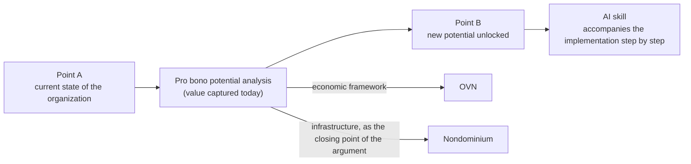
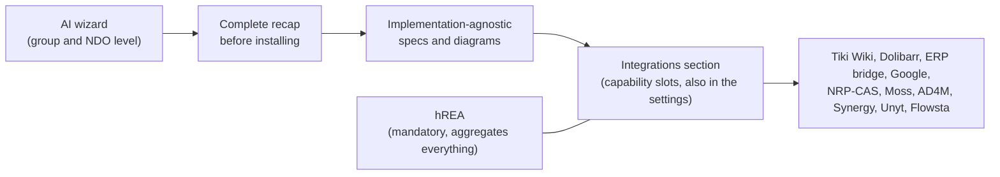
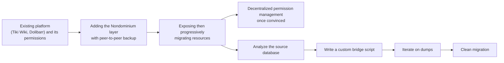

# Nondominium, Meeting Journal with Tibi

**Date:** Tuesday 13 October 2026 (1 h 47, from about 4:45 pm to 6:32 pm Montreal time, break at 80 to 84)

**Attendees:** Soushi (Sacha Pignot, lead developer of Nondominium, microphone channel), Tibi (Sensorica, system channel, Discord call with screen sharing near the end of the meeting). Soushi names Tibi at [69] ("translate it for Tibi"). Since the ElevenLabs credits ran out, the transcript comes from the local engine without diarization; speakers were recovered from the energy of each stereo channel (529 segments on the microphone side, 433 on the system side, 116 ambiguous ones attributed from context).

**Context:** Follow-up to the Lab session of 29 September and to the "Human-first, AI-optional" board of 9 October, of which Tibi had received his own version. The v0.1.0 peer-mesh milestone is dated 25 October. Proper nouns mistranscribed and corrected here: "non dominium", "nom de minium", "mon dominion" become Nondominium; "ovien", "au vien", "ovn" become OVN; "flow stop", "flostat", "l'hosta" become Flowsta; "claude flair", "clott flair" become Cloudflare; "most", "mos", "mosquée" become Moss; "rp bridge", "urp" become ERP bridge; "your own ai" is Your Own AI, Eric's project (surname not said in the recording); "pie chart", "païen", "p chart" refer to Sensorica's contribution table (Google Sheets); "endio", "indio" become NDO; "d'olibar" becomes Dolibarr. Square brackets give the minute in the recording. This is an English translation; the original journal is in French.

## TL;DR

Tibi laid out his dissemination strategy for Nondominium: do not sell the OVN or Nondominium head-on, but produce pro bono potential analyses ("here is the value your structure captures today, here is the potential you could unlock, here is the path") where the OVN provides the economic framework and Nondominium the infrastructure, as the closing point of the argument. He tested it with Eric (Your Own AI), who reacted well, then with Flowsta, and he is preparing an analysis of the Linux ecosystem to enrich the future OVN skill. Soushi proposes merging the OVN skill and the Nondominium skill into a single skill covering the whole life cycle, from organizational analysis to deployment, with a playground and an "AI wizard" that produces agnostic specs and exposes integrations through the capability surface. For hours, they agree on the simple solution: v0.1 links the existing Google contribution table to the NDO, which is enough to comply with their own license and makes the 18 months of historical data the proof of credibility of the first release. Flowsta is not required for v0.1, which remains a first teaser milestone. Tibi found the brainstorm board hard to follow: too cryptic for someone who was not there, and not a brainstorm tool but rather an alignment tool; Soushi accepts this and plans more context and real-time comments. The end of the meeting was spent explaining GitHub Actions CI and Cloudflare.

## Since last meeting

- **Soushi:** report on the perspectives UI, Family DAO and per-community UX (the only commitment from 29 September). Not mentioned today; no trace found apart from the journal itself. Still open.
- **Soushi:** "Human-first, AI-optional" board sent to Tibi with his own answers. Done; Tibi went through it and added notes during the break at [80 to 84], the substantive feedback is recorded below.
- **Decision of 9 October, `delete_branch_on_merge` and cleanup of the design system branches.** Not done: the setting is still `false` and the repository has ten branches (checked on the evening of the 13th).
- **Questions from 29 September** (hREA mirror or direct export, interoperability between custom DHTs, Dolibarr ERP bridge through hREA, context switching, economic boundary within the family): not reopened today, except the ERP bridge, taken up again as a progressive migration strategy.

## Updates

**The potential analysis for Eric.** Tibi recalls what he announced on Discord. The main idea is not the meeting with Eric but to keep working on the OVN skill, because it plugs into Nondominium, which "becomes the base infrastructure". For Eric, he wrote an analysis and recommendations document on Your Own AI, whose central proposal is the move from "your own AI" to "our own AI": a shared infrastructure, federated rather than decentralized (no Holochain, no vault, no separation between personal and public data), acting as a community binder, with functions close to Requests & Offers (remembering what people say and do, making inferences, suggesting introductions). Eric answered "wow, that's really cool", then came back a few hours later saying that part of what was proposed was already in his todo, but that other dimensions had not occurred to him. Tibi concludes that tools fed with the OVN wiki, the documentation and Sensorica's website already produce useful analyses. [2 to 12]

**Flowsta, then Linux.** After Eric, Tibi did the same analysis for Flowsta, even more fundamental because it touches the identity foundation, with the idea of then combining the two at an ecosystem level: Your Own AI could become a layer that helps people navigate a value network ("which project I can contribute to, matching projects with my skills"). To cut his teeth before opening the OVN skill, he chose a case that is "even sturdier": the Linux ecosystem, which has proven itself for decades. He compares Windows, macOS and Linux (technical capabilities, architectures), then applies the OVN model with Nondominium and the NDOs to see what the OVN can learn from Linux (methodologies, governance, kernel split, distros, applications, standards, conventions and interfaces that make the whole modular yet coherent) and what the OVN could bring to that community. You cannot tell Linux "use the OVN, you will be better", the answer would be "it has worked for a long time". [16 to 23]

**The mailing list workflow.** Soushi adds what he had discussed the day before: the core developers of Git and of the Linux kernel still work the way Git was created to support, patches and commits in email threads, with no GitHub-style client, everything living in the mail client. A migration would be harder for them, but the rest of the community has varied technical practices. [20 to 21]

**Private passage removed.** Part of the discussion was about a topic unrelated to Sensorica or Nondominium; it has been removed from this public version. [31]

## Discussion

**Dissemination through potential analysis.** Tibi describes his strategy for spreading Nondominium once the release is out. People do not know what an open value network is, it is too abstract, and the question "what is Nondominium for?" always comes back. When he answered "resource sharing", he was told "you can do that today with all the IT we have". Even talking about new forms of ownership is not enough: people lack the imagination to see what it changes. His answer: publicly produce analyses, like pro bono consulting, that tell an organization where it is (point A), what value it can capture with its current organizational state, what new potential it can unlock (point B) and through which steps, with interventions on the organization and on the infrastructure, and a nod to the OVN for the economic framework and to Nondominium for the infrastructure. Nondominium "makes sense" when it becomes the way to get from point A to point B; presented out of context, "it doesn't give much". He names the paralyses this lifts: not knowing, lacking imagination, lacking means or knowledge, not knowing where to start. The report would be followed by an AI skill that accompanies the implementation step by step, which is part of Nondominium's distribution strategy. [3 to 16]

**An OVN and Nondominium skill across the whole life cycle.** Soushi notes that today the only Nondominium skill is the one for internal development, and that the OVN covers what exists in the Google Docs. He proposes linking them as he did with the Holochain skill: one skill (or two connected skills) covering the full cycle. First the analysis, even upstream of the design: analysis of needs and potential, identification of progressive transformation opportunities ("OVN-ification"), in small pieces, with an interview mode close to the Socratic mentor or to requirements discovery, but applied to the organization rather than to the software. Then a brainstorm that formalizes the requirements, then design and prototyping, then implementation, tests, security, optimization, CI, DevOps and deployment. [24 to 27]

**A playground rather than only a skill.** Soushi asks whether Tibi's "tools" go beyond a skill: a dedicated app, or a design system playground like his hREA Explorer, where you combine elements of Nondominium, the OVN and Valueflows to simulate and see what an organization looks like, usable even without AI, since not everyone knows how to use an agent. He mentions an app that builds prototypes while you talk to it and that, at the end, hands over to agents more specialized in code. Tibi clarifies later that the prototypes are not necessarily code; Soushi answers that the idea is precisely the visual, for users who need a "little feel" of their organization rather than pure architecture. [27 to 29, 41, 57 to 58]

**The AI wizard.** Tibi shows the "help new venture" document from the OVN wiki: the skill guides step by step, for example "you need a web presence; if you want to be networked, it can't be just a landing page". Soushi names the concept: an AI wizard. The skill does not necessarily provide the tools (people can choose WordPress or their own site) but outputs specs, so that whatever tool takes over, ERP bridge, WordPress or a native Nondominium app, comes preconfigured. Tibi wants to bundle entire ecosystems (ActivityPub, Google, Moss, Tiki Wiki) with the step-by-step guidance and the default settings: sign-up, document access rules. For Eric, who is a "one man show" (he publishes on GitHub, announces his releases on Twitter, receives issues, with no collaborative base), it is not about migration but about building from scratch a presence open to contributors. Moss particularly interests Tibi: with the equivalent of Google Docs, Git, Discord, Nondominium and Unyt, it already offers an OVN core, and it would be interesting to test it and give Eric feedback on it. Nondominium would come there by default as the resource coordination layer. Soushi develops the product version: a wizard that, at the end, produces a complete recap before installing, generates implementation-agnostic specs and diagrams, and exposes in an Integrations section (also accessible afterwards in the settings, for admins) the capability slots of the capability surface: Tiki Wiki, Dolibarr, the ERP bridge, Google, the former NRP-CAS, Moss, AD4M, Synergy, Unyt, Flowsta. hREA would remain mandatory because it aggregates everything; some integrations will not be installable right away because of dependencies. This wizard would sit at the group and NDO level rather than the lobby level, since you join an existing lobby; Tibi confirms. [42 to 62]

**Progressive migration and unopinionated governance.** Soushi ties all this to the ERP bridge: organizations keep their platform and their internal permission management (Tiki Wiki, Dolibarr), add the Nondominium layer with a peer-to-peer backup, expose then progressively migrate their resources, and adopt decentralized permission management only once convinced; a full migration can change paradigm. Importing historical data, first for themselves, opens the way to a migration workflow in the skill: analyze the source database, know the target structure, write a custom bridge script, iterate on it over dumps until the migration is clean. On governance, Soushi wants to provide basic primitives and good examples, not impose a model, with a good interoperability interface, so that even a very authoritarian community and a very libertarian one can cooperate economically. [34 to 38, 50 to 51, 55 to 57]

**Logging hours in Nondominium: dogfooding.** Soushi proposes that from v0.1, if there is a small network, even just the two of them, they log their hours in the groups, while still exporting the data given the instability. Tibi prefers not to complicate things: link the existing contribution table ("pie chart"). Storing the logs on the DHT raises questions nobody has thought through (access for everyone, data loss between two migrations, no portable identity). He distinguishes two layers: the event ledger (each log, with its quantitative parameters, hours or money) and the valuation process (the weight of roles, the trade-off between who puts in time and who puts in money), which depends on the community (meritocratic, egalitarian). The Google table has both; the NDO would fetch that extract rather than take everything over. He frames it positively as a transition strategy: Nondominium lets you stay in your collaborative environment (register your project as an NDO while drawing contributions from where they live, for example GitHub commits) without packing your bags for a platform that is not yet stable. He adds a decisive argument: the NDO license requires at least one contribution table, so a first release must comply with it. Soushi sees the credibility of the release in this: it arrives with the historical data since the official declaration of the venture, a year and a half of work. [29, 31 to 41]

**Flowsta in v0.1?** Soushi recalls the interest of Flowsta for multi-device identity (not losing your history when the computer dies) and asks whether it should be integrated from v0.1. He leans toward later: a standalone base system is needed first, and the layer 0 capability surface already offers, next to the built-in identity layer, a surface for external identity authorities. He proposes a first small release to test between themselves, then Flowsta for more robustness before a more public opening. Tibi rules that it is not necessary: nobody will migrate to the first version, which serves to say "here is what is coming", a bit like Farm Hack, with buttons that do not work yet and open an explanation ("stay tuned"). Soushi qualifies this: with the grassroots economy use case, layer 0 alone already solves a concrete problem, so it is a bit more than a proof of concept, and a real layer 0 MVP will come with stabilization, then one per layer, iterating in small milestones. [51 to 55]

**The brainstorm board, as seen by Tibi.** Tibi says he has trouble following the logic of the tool. What it does, what you can or cannot do in it, is not clear: he added a sticky note without knowing where it would go, and it is not real time. He finds it "so minimalist" that context is lost: stickies too small, single words whose meaning you cannot tell, especially for someone who was not in the discussion; he suggests adjusting the level of context to the audience, more cryptic for those who were around the table, more framing for general use. On substance, he disputes the name: a brainstorm is expansion (going in all directions), then synthesis (grouping the stickies by relations, giving them meaning); this board rather does the compromise, "X said this, Y said that, what do we take that is good from each", so it is an alignment tool, and the Mermaid diagrams that schematize things interest him. He also notes that sections like "already works", "model to copy", "idea catcher" fit poorly with the brainstorm paradigm. Soushi acknowledges his mistake: the board started as a personal brainstorm, then he asked the AI to adapt it for Tibi without telling it to put itself in his shoes. He reclassifies it as a pre-brainstorm, a digest that dresses up nicely a summary he had dictated over about thirty minutes, the real work coming afterwards through visual Socratic interviews. He describes what follows: an AI chat built into the dashboard panels (already started), then real-time comments between humans, with a private GitHub repository as the backend like in the design system. He shows the "copy my answers" export, which locates each addition and each pinned comment by its text rather than by an identifier, a deliberate choice because the identifiers changed with every iteration and caused answers to be lost. He also commits to fleshing out the paragraphs that introduce the sections and the diagrams (for example "progressive workflow adoption", judged thin). [62 to 86]

**Branch previews, quick review.** On screen share, Soushi goes back to the board section: Tibi proposes showing the in-progress work of branches in the design system; Soushi wanted branches chosen by label on the PR ("clean, explicit, idiomatic"), Tibi listed all the branches, with no new concept to learn. Soushi admits to thinking "like an engineer"; the board's compromise is to deploy all branches by default and limit the clutter by deleting branches at merge. Half of the infrastructure already exists, Cloudflare offering one subdomain per branch, and the board distinguishes the current app, the official merged prototypes and exploration on branches ("exploring is not shipping"). Tibi raises the question of vocabulary: choosing labels means choosing a vocabulary, and how would a newcomer know it? Soushi sees this as the point of adoption by levels, from the occasional contributor to the maintainer. [87 to 94]

**What Cloudflare is, what CI is.** Tibi did not know what Cloudflare is or whether he should install it. Soushi explains that it is a deployment platform for static sites and other web services, configured in the repository as infrastructure as code (the `deploy.yml` workflow), which runs on GitHub's runners, self-hostable, on HoloPorts for instance; nothing to install for contributors. He shows Nondominium's Actions: build, test suites, e2e, green and red checks per PR, merge blocked if a test fails. Tibi corrects a detail: CI does not run on every local commit but on every push, on the last commit. Soushi then clarifies that the design system is not yet connected to Cloudflare, it is planned; Cloudflare will allow the GitHub connection for comments and Cloudflare Access (email address allowlist) for private sites. [94 to 106]

## Decisions

- **v0.1 hours go through the existing contribution table**, linked from the NDO, rather than through a log on the DHT. Reasons: avoid losing data between migrations without a portable identity, not force people to leave their tool, and comply with the NDO license that requires a contribution table. The historical data become the proof of the release; a log built into the app will come in a later version. [31 to 41]
- **Flowsta is not required for v0.1.** Tibi's reason: the first version is a teaser milestone, nobody migrates to it; Soushi's reason: a standalone base system is needed first, and the capability surface already provides for external identity. [51 to 55]
- **Dissemination goes through potential analyses**, with the OVN and Nondominium as the closing point of the argument rather than the lead. Approved by Soushi, who considers Your Own AI the most promising partner for an integration (better relationship, compatible techniques). [3 to 16, 30]
- **The 9 October board is an alignment tool, not a brainstorm**, and shared boards must carry context suited to their audience. Soushi accepts this as his mistake. [62 to 77]

## Discussed, not decided

- **A single OVN and Nondominium skill across the whole life cycle**, from organizational analysis to deployment. Proposed by Soushi, in line with Tibi's vision; scope and split to be defined. [24 to 27]
- **Playground and AI wizard.** Agnostic specs, integrations exposed through the capability surface, wizard at the group and NDO level, hREA mandatory. Soushi's ideas welcomed, nothing committed. [27 to 29, 57 to 62]
- **Which ecosystems the skill supports from the start.** Tibi cites ActivityPub, Google, Moss, Tiki Wiki; Moss interests him the most. [44 to 49]
- **Branch previews: labels or all branches.** Compromise proposed in the board (all branches, deletion at merge); the question of the labels' vocabulary remains open. [87 to 94]
- **Board format for several people.** Real time, comments between humans, level of context per audience: direction set by Soushi, not yet built. [64 to 77]

## Actions

- **Soushi:** produce this summary and share it with Tibi in the new meeting board format. [106]
- **Soushi:** rewrite the 9 October board from Tibi's notes and comments, with fuller section and diagram introduction paragraphs and context for an absent reader. [85]
- **Soushi:** update his hours in the OVN contribution table. [41]
- **Tibi:** send his notes and comments on the board ("copy my answers" export). [77 to 84]
- **Tibi:** continue the Linux analysis and the Your Own AI and Flowsta analyses to feed the OVN skill, then test Moss as an OVN core and give Eric feedback. [16 to 23, 48]

## Outstanding

- **How the NDO links the contribution table**: simple external link, or imported extract (ledger plus valuation). Soushi leans toward the link as the easy version, integration in the app later. [38 to 39]
- **Eric's surname** (Your Own AI) is not said in the recording.
- **The OVN's part in the NDO license**: Tibi states that it requires at least one contribution table; exact wording to be quoted when the release mentions it. [40]
- **The date of the next meeting** was not set.

## Corrections after the meeting

- **Cloudflare is not yet in service for the design system.** At [90], Soushi says he "migrated" the design system to design.sensorica.co on Cloudflare; he corrects himself at [103] ("for now it's not connected"). Checked on the evening of the 13th: PR #10 of `Sensorica/nondominium-design-system` ("ci: deploy to Cloudflare Pages at design.sensorica.co") is still a draft, and the repository homepage points to `sensorica.github.io`.
- **Deleting branches at merge is not enabled.** Decided on 9 October and presented today as the solution to the branch clutter, it is still `false`, and the repository has ten branches, including `feat/cloudflare-pages`.
- **Flowsta has no dedicated issue.** Soushi says everything is "planned in the issues"; a search on `Sensorica/nondominium` finds no open issue titled Flowsta. The integration is specified in the documentation (`documentation/requirements/post-mvp/flowsta-integration.md`, `ndo_prima_materia.md` section 6.7).
- **The v0.1.0 peer-mesh milestone** is dated 25 October 2026, with twelve open issues: this is the "imminent release" being discussed.
