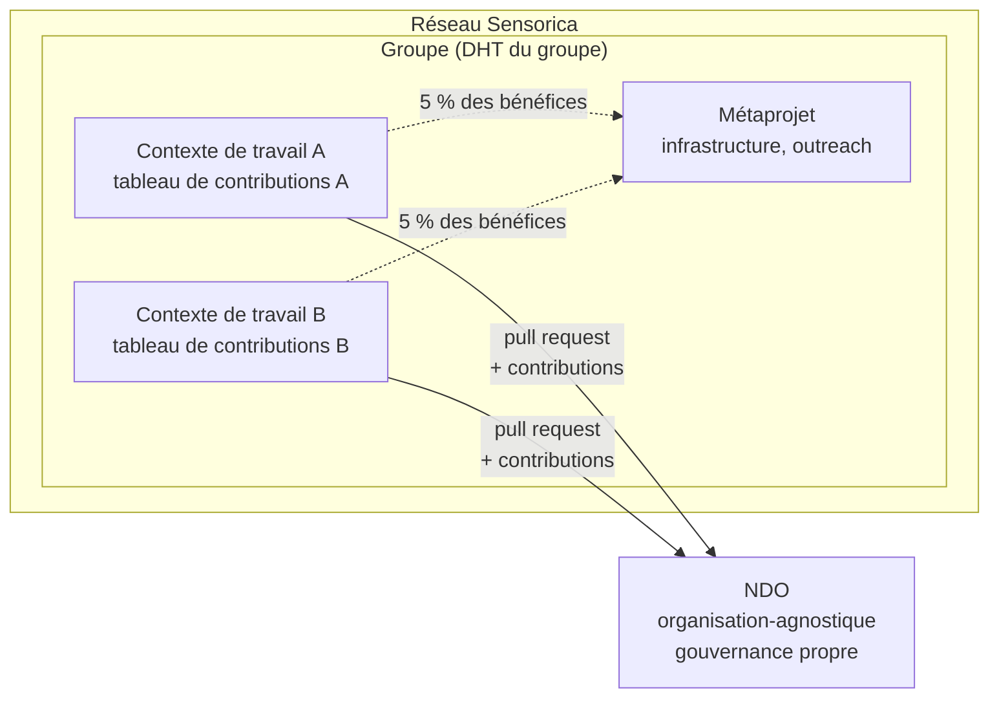
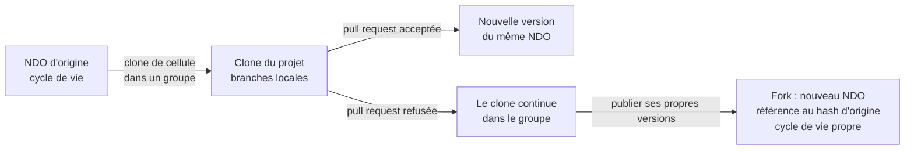
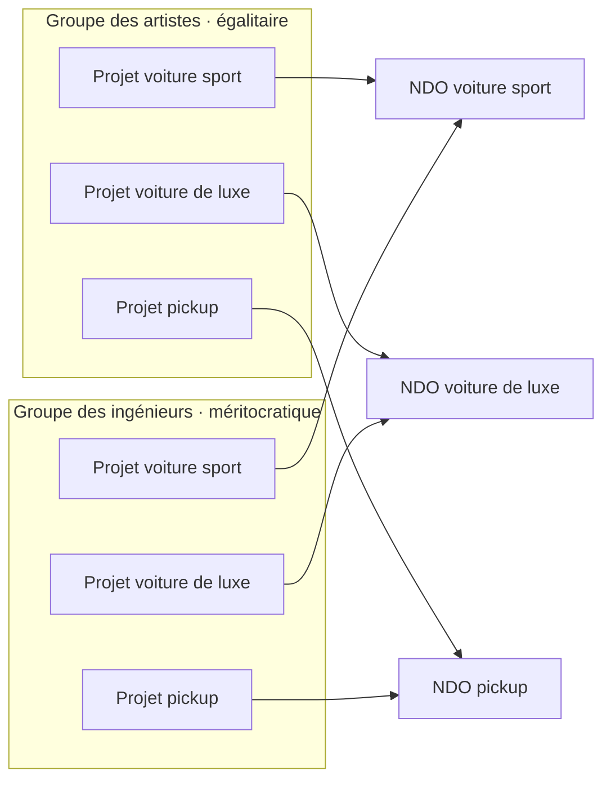
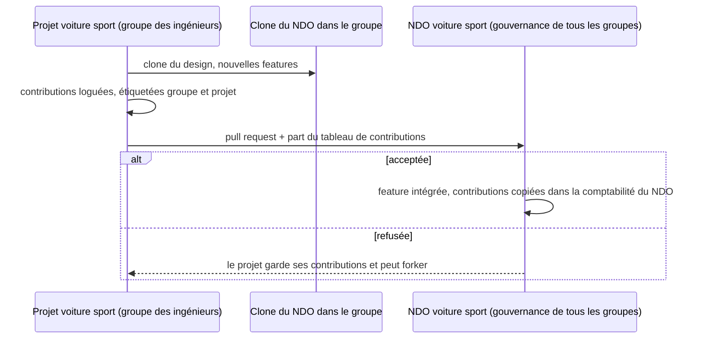
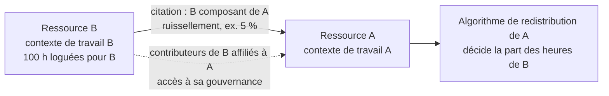

# Nondominium, Journal de la séance au Lab avec Tibi

**Date :** mardi 20 octobre 2026 (1 h 42, de 21 h 48 environ à 23 h 30 heure de Montréal, au Sensorica Lab, enregistré au téléphone)

**Participants :** Soushi (Sacha Pignot, développeur principal de Nondominium), Tibi (Tiberius Brastaviceanu, cofondateur de Sensorica). Soushi pose le contexte à [0] (« on est avec Tibi à Sensorica Lab, on est le 20 octobre »). La transcription vient du moteur local sans séparation des locuteurs, les crédits ElevenLabs étant épuisés ; qui dit quoi est reconstitué au fil du contenu (l'histoire du NRP et de Sensorica est racontée par Tibi, les renvois à hREA et au design system par Soushi), et reste une inférence.

**Contexte :** Suite de la rencontre du 13 octobre. Le jalon v0.1.0 peer-mesh est daté au 25 octobre. La discussion avait commencé avant l'enregistrement : Tibi et Soushi venaient de conclure que le « projet » n'est pas un type de NDO mais vit plus près du groupe. Noms propres mal transcrits et corrigés ici : « Santorica », « sans Saurica », « Sonsorica » deviennent Sensorica ; « l'Ine », « l'in » désignent Lynn (hREA, inférence) ; « indie », « endio », « indio », « NGO » deviennent NDO ; « HREA », « Achriah » deviennent hREA ; « Flosa », « Floster » deviennent Flowsta ; « Zifi », « Zipi » deviennent Zippy (Eric Harris-Braun, créateur de Moss, inférence) ; « Coasis » devient Coasys ; « pie chart », « pile charte » désignent le tableau de contributions. Les crochets donnent la minute dans l'enregistrement.

## TL;DR

La séance a fixé où vit le « projet » : ni type de NDO ni DHT propre, mais un contexte de travail (le *context of work* du NRP de Sensorica, nom gardé par fidélité à Bob) à l'intérieur du DHT du groupe, chaque contribution étiquetée groupe et projet. Chaque groupe a son propre système de comptabilité des contributions ; une membrane le sépare du NDO, qui reste organisation-agnostique : un projet clone le NDO dans son groupe, y travaille librement, puis soumet une pull request au NDO, dont la gouvernance accepte la feature et, avec elle, les contributions qui l'accompagnent. Le clone (une cellule clonée, encore liée à son DHT d'origine) se distingue du fork (un nouveau NDO avec son propre cycle de vie), et le marché éthique du lobby sanctionne le fork qui ne pointe pas vers l'original ni ne transporte son tableau de contributions. Tibi a retracé la règle des 5 % de Sensorica pour le travail d'infrastructure et le mécanisme de citation du NRP, que Nondominium reprend avec un pourcentage de ruissellement. Deux questions restent ouvertes : faut-il imposer l'individu comme contributeur ou accepter les agents organisationnels (Tibi penche pour les accepter, au nom de la pseudonymie), et jusqu'où déclarer ses dépendances (Holochain, Nix, React) comme NDO. Enfin, les résumés de rencontre seront publiés dans le design system de Nondominium, nettoyés de ce qui est privé, avec les passages retirés signalés.

## Depuis la dernière rencontre

- **Soushi :** produire le résumé du 13 octobre et le partager avec Tibi en board de réunion. Fait ; la publication de ces résumés a été reprise ce soir à [98 à 100], et la page `/meetings` du design system est en ligne depuis la PR #12, fusionnée cette nuit.
- **Soushi :** réécrire le board du 9 octobre à partir des notes de Tibi. Pas fait : le fichier source n'a pas changé depuis le 12 octobre. Reste ouvert.
- **Soushi :** mettre à jour ses heures dans le tableau de contributions OVN. Pas évoqué ; reste ouvert.
- **Tibi :** envoyer ses notes et commentaires du board. Pas évoqué ce soir.
- **Tibi :** poursuivre les analyses (Linux, Your Own AI, Flowsta) pour nourrir le skill OVN. En cours : Tibi cite à [14] le dernier document envoyé à Eric, sur le travail de soin et de réseautage qui n'est jamais logué, et à [52] son analyse de Flowsta, qui travaille déjà sur l'identité organisationnelle.
- **Décision du 9 octobre, suppression des branches au merge.** Fait : `delete_branch_on_merge` est à `true` sur `Sensorica/nondominium` et sur `Sensorica/nondominium-design-system` (vérifié le 21 à 0 h 40).
- **En suspens le 13 : comment le NDO lie le tableau de contributions.** Largement tranché ce soir : le tableau vit au niveau du projet dans le groupe, et passe au NDO avec la pull request (voir Décisions).

## Mises à jour

**Le contexte de travail dans le NRP de Sensorica.** Tibi retrace le modèle d'origine. Dans le NRP (Network Resource Planning), les ressources avaient un statut indépendant : une imprimante 3D était accessible à tous les projets, et un prototype fait dans un projet pouvait être cité dans un autre. « Les NDO sont organisation-agnostiques, mais dans le NRP les ressources étaient project-agnostiques. » Les gens travaillaient dans des *contexts of work*, nom donné par Bob ; quand on loguait une contribution, le formulaire demandait le contexte, et la contribution était enregistrée pour telle ressource dans tel projet, avec le rôle (développement web, hardware, impression 3D). La comptabilité des contributions s'appliquait donc par contexte de travail, et le tableau de contributions publié avec une ressource en était extrait. Soushi en tire le manque : l'app prévoit d'intégrer les tableaux de contributions sans avoir fixé à quel niveau, et il n'existe pas encore de notion de venture à l'intérieur d'un groupe pour isoler un bundle de NDO et la redistribution qui lui est liée. [0 à 6]

**La règle des 5 % et le projet Developing Sensorica.** Tibi décrit les membranes historiques. Dans la membrane Sensorica, chaque projet est un contexte de travail ; celui qui travaille pour tout le réseau (le site web, le NRP, la gouvernance, l'outreach) ne logue pas la même heure dans chaque projet, « ça n'a pas de sens ». D'où un projet de *capacity building*, Developing Sensorica, et la règle des 5 % : chaque projet qui génère un bénéfice en verse 5 % à ceux qui ont travaillé sur l'infrastructure du réseau, une sorte de taxe fédérale. La part est ajustable ; si elle dépasse les besoins, le surplus (« il nous reste 50 000 piastres ») peut financer des ventures, un plus grand local ou des machines communes. Cette membrane ne redistribue pas de façon méritocratique comme dans les projets, mais par ce pourcentage fixe. Tibi souligne le risque social qu'elle évite : sans elle, ceux d'un projet voudraient être payés sur les bénéfices d'un autre, comme des provinces qui se disputent la péréquation. [6 à 13]

**Le métaprojet pour le travail sans livrable.** Soushi rapproche la règle de ce que fait toute organisation : des tâches liées à des projets clients d'un côté, du travail interne de l'autre (payer le local, l'outreach, le site interne), qui sert plusieurs projets du groupe. Pour loguer ces heures il faut au moins « un job », donc un métaprojet ou plusieurs (Outreach Sensorica, un département), selon l'organisation que le groupe se donne. Tibi rattache cela au document envoyé à Eric : beaucoup de travail n'a ni livrable ni ressource, le soin, le réseautage, le capital social, « des choses qui se passent dans l'air ». Soushi propose d'en faire autant que possible des NDO de type service (un NDO « outreach » dans le métaprojet de Sensorica, auquel les gens rattachent leurs heures), comme le wizard le suggérait ; Tibi répond qu'il restera des choses éphémères, sans identité, plus proches d'un événement que d'une ressource. [8 à 17]

## Discussion

**Pas de valeur sans contexte.** La question de savoir où se logue un événement qui n'est pas un NDO amène Tibi au principe de base de l'OVN : une action n'a de valeur que dans un contexte. Il cite la définition de Kurt : une contribution est une action qui augmente la probabilité d'une augmentation de valeur ; regarder des vidéos au labo n'en est pas une, personne n'en bénéficie. Soushi en tire la règle de conception : un log est toujours associé à un contexte (le groupe, le projet ou le NDO), idéalement avec des liens qui prouvent l'impact, comme le lien GitHub d'un commit qui montre l'action dans son dépôt. Côté hREA, le DHT du groupe a son propre flux économique, et ce sont ces événements de log qui l'alimentent. [17 à 20]

**Une comptabilité par groupe, une membrane vers le NDO.** Tibi rappelle ce qui avait été convenu : chaque groupe a son propre système de comptabilité des contributions, et une membrane le sépare du NDO, parce que le NDO est organisation-agnostique. Si le groupe B trouve un NDO créé par le groupe A et veut y ajouter une feature, B logue ses contributions chez lui ; quand la feature arrive au NDO, c'est la gouvernance du NDO, qui transcende les groupes, qui décide (« excuse-moi, mais ton feature ça vaut rien »). Soushi insiste sur l'isolement que cela donne : les querelles sur la redistribution, les logs faux à signaler, les batailles sur le tableau de contributions restent dans le groupe, et cent groupes branchés sur le même NDO peuvent avoir chacun leurs querelles sans empoisonner sa gouvernance. [20 à 22]

**Clone contre fork.** Soushi relie la membrane à la friction du fork discutée plus tôt dans la journée : on doit pouvoir faire une copie et travailler, mais copier n'est pas forker. Dans son groupe, un projet travaille sur une copie, comme un clone Git local avec ses branches ; s'il veut faire passer ses changements, il revient vers les gens du NDO, idéalement en ayant eu la conversation avant (Tibi : arriver deux jours plus tard avec « tada, j'ai créé un nouveau feature » est moins bien reçu). Si le NDO refuse, le groupe peut continuer dans son clone, et ne forke que s'il veut publier ses propres versions sans polluer le DHT commun. Soushi donne la forme technique : le clone serait une cellule clonée Holochain (clone de DNA à la Git), un nouveau DHT encore relié directement à son DHT d'origine, alors que le fork est un nouveau NDO, avec une référence au hash de l'original mais 100 % autonome. Tibi le dit d'un mot : le fork n'est pas une nouvelle version mais une nouvelle variation, « un mutant », parce qu'une version entre dans le cycle de vie du NDO alors qu'un fork a le sien. Soushi file la métaphore : le clone est une cellule qui bourgeonne en restant collée au noyau et peut être réintégrée, le fork une division complète en deux êtres indépendants. [22 à 28]

**Le marché éthique du lobby.** Tibi rappelle une idée des débuts : un score pour chaque NDO au lobby (est-ce que ça fonctionne, combien de gens l'utilisent), avec un volet éthique, comme les étoiles d'un marché. Un fork qui ne contient pas le lien vers l'original et ne transporte pas le tableau de contributions pour une redevance, disons 5 %, est étiqueté non éthique par les participants : il reste trouvable, mais déclassé, et les gens se demandent s'ils veulent contribuer avec un groupe qui n'a pas reconnu ceux qui ont bâti la chose. Soushi veut enforcer le plus possible dans les zomes d'intégrité (référencer le hash d'origine, pointer vers un tableau de contributions valide), parce qu'une règle laissée au coordinateur se contourne avec une app modifiée qui garde le bon DNA ; le score de réputation couvre le reste. Il ajoute une dimension comparative : suivre dans le temps la réputation d'un fork face à l'amont, six mois plus tard, a-t-il tenu ses promesses ou a-t-il été capturé commercialement. Tibi situe le problème : dans le far west de l'open source, quelqu'un de plus habile en affaires prend le travail d'un bon technicien, le polit et en fait une compagnie, une forme de parasitage. [28 à 34]

**La digression Silicon Valley.** Soushi illustre par la série Silicon Valley, qu'il vient de commencer : un jeune développeur invente un algorithme de compression dans un projet personnel, une grande entreprise le rachète ou le copie et le poursuit. Tibi évoque la souris volée par Microsoft et Apple, et le jeu de la propriété intellectuelle que gagne celui qui a le plus d'avocats. Pour Soushi, une simple licence copyleft aurait suffi à protéger le héros, et c'est précisément la spécialité de leur équipe : la gestion des communs et la non-capturabilité. [34 à 39]

**Le ruissellement entre tableaux de contributions.** Soushi remarque que la licence OVN, qui encourage le ruissellement d'un NDO enfant vers son parent, s'appliquera surtout entre projets, d'un tableau de contributions à l'autre, y compris pour ce qui n'est pas un NDO (l'outreach se logue quand même), un peu comme des hard links entre projets. Ce ruissellement inter-groupes passe tout de même par les NDO quand d'autres projets les utilisent. [13 à 16, 39 à 40]

**L'individu ou l'agent organisationnel.** Tibi pose la question : quand un NDO génère des bénéfices, les contributeurs reçoivent-ils leur part comme individus ou comme organisations ? Dans les réseaux pair-à-pair, l'économie est pseudonyme ; on ne peut pas savoir si derrière un log il y a une personne ou une compagnie (« un contributeur qui travaille avec dix code monkeys »), sauf à imposer un système d'identité. Il faut donc s'attendre à ce que des organisations loguent comme un seul agent, et les compagnies voudront montrer leur nom sur leurs contributions amont (un pont ERP construit pour Nondominium par une entreprise). Soushi rapproche cela de sa critique de la personne morale et propose un module hREA expérimental qui représenterait l'organisation autrement que comme un agent, par exemple comme un accord, un bundle d'engagements ; Tibi rappelle que Valueflows distingue déjà agent individuel et agent organisationnel, et que l'option non-agentique n'est pas enforceable face à l'anonymat. Tibi donne le contre-argument du USPTO : un brevet n'accepte que des individus comme inventeurs, la compagnie n'en est que cessionnaire, et la liste des inventeurs est vérifiée dans les deux sens (personne d'absent, personne d'ajouté sans avoir touché à la technologie), ce qui est organisation-agnostique. Il conclut qu'il ne faudrait pas imposer l'individu dans Nondominium. Soushi voit Flowsta comme une piste : des DID pour les organisations, la co-signature au nom d'un groupe, la délégation de permissions ; Tibi confirme que son analyse montre que Flowsta travaille déjà sur l'identité organisationnelle. [40 à 53]

**Où vit le projet.** Revenant à la question centrale, Tibi demande si les projets doivent avoir leur propre DHT puisqu'ils ont leur propre tableau de contributions. Soushi répond non : le groupe a son DHT, chaque contribution y porte l'étiquette du projet et se filtre ; un DHT de projet ne vaudrait la peine que si le projet devenait multi-groupes, et ce pont est déjà assuré par les NDO, partagés entre groupes. Garder les projets dans le DHT du groupe facilite aussi l'agrégation vers le haut, sans agréger comme hREA des données venues de plusieurs DHT. Tibi justifie la couche : les groupes sont des affiliations par valeurs, la couche sociale, et le projet fait l'intermédiaire entre cette couche et le travail technique sur le NDO, ce qui permet une holarchie de comités. [53 à 59]

**L'exemple des voitures.** Tibi le pose pour qu'il soit dessiné dans le résumé. Trois NDO, une voiture sport, une voiture de luxe, un pickup. Les artistes (esthétique, ergonomie), plutôt égalitaires, forment leur groupe ; les ingénieurs, plus méritocratiques et hiérarchisés, le leur ; chaque groupe a un projet par voiture, avec son contrat social, sans le choc culturel des organisations. Le groupe des ingénieurs clone le design de la voiture sport, y fait de nouvelles features en travaillant de façon visible, puis fait une pull request au NDO voiture sport : la part de son tableau de contributions qui concerne cette voiture part avec la PR. Si la gouvernance du NDO (tous les groupes qui y contribuent) accepte, les contributions sont copiées dans la comptabilité du NDO, qui intègre ainsi celles de tous les groupes, chaque groupe gardant son historique local étiqueté groupe et projet ; si elle refuse, le groupe garde ses contributions et peut forker. « Le livrable vient avec les contributions. » [59 à 64]

**La citation dans le NRP, et le pourcentage de Nondominium.** Tibi revient au NRP d'origine : un projet qui a besoin d'un composant fait dans un autre projet le cite, et la citation amène toutes les contributions faites pour ce composant (seulement celles-là, pas le reste de l'autre projet) dans les contributions du nouveau projet ; cent heures loguées pour B se retrouvaient telles quelles dans A. Nondominium ajoute un pourcentage : ces contributions héritées peuvent ne valoir que 5 % de leur valeur, la règle de ruissellement. Soushi y reconnaît les hard links entre NDO. L'algorithme de redistribution est celui du contexte qui cite : c'est le projet A qui décide comment rémunérer les cent heures de B. Par la citation, les contributeurs de B deviennent affiliés au projet A, avec accès à sa gouvernance, et peuvent proposer un amendement, mais arrivent dans un contrat social déjà fixé ; Tibi pense qu'on dit plutôt merci à qui a trouvé une autre utilité à sa chose. Sur le nom, Soushi propose de garder *context of work* plutôt que « projet », trop générique, au moins dans le backend et dans un module hREA, l'UI pouvant afficher « projet ». [64 à 70]

**L'avantage démesuré du bas niveau.** Tibi expose le problème économique déjà soulevé à Sensorica : plus une contribution est de bas niveau, plus elle se multiplie par citation (« si tu réinventes le transistor »), au point que deux mois de travail sur une primitive utile rendraient quelqu'un plus riche que tout le monde, et que les gens se battraient pour les features de bas niveau. La décroissance en profondeur (5 % de 5 % de 5 %) ne règle pas tout, objecte Soushi, parce que la multiplication se fait aussi à l'horizontale : une primitive est affiliée au premier niveau de mille ventures, comme un correctif de sécurité implémenté partout en quelques jours. [71 à 74]

**Déclarer ses dépendances comme NDO.** Soushi propose de déclarer Holochain et les autres dépendances comme NDO, jusqu'à l'infrastructure : son HoloPort sous NixOS serait un NDO, avec Edge Node, Holochain et Nix en dessous ; il cite aussi les NDO historiques, comme React, utilisé depuis une décennie. Tibi y voit une stratégie : publier Nondominium avec un NDO vide pour Holochain, que l'équipe Holochain viendra réclamer, ce qui sert la dissémination et crée des liens de loyauté (ayant un intérêt dans Nondominium, ils répondront à ses besoins). Il distingue deux contributions, signaler un besoin par une issue ou faire soi-même le patch ; Soushi précise qu'on ouvre l'issue dans le dépôt de la dépendance, donc ici dans le NDO concerné, souvent pour savoir ce qui est déjà planifié. La question reste ouverte : où s'arrêter, puisque la chaîne des dépendances peut aller à l'infini. [74 à 81]

**Le matériel n'est pas le code.** Tibi rappelle pourquoi la citation était utile au NRP : intégrer B dans A demande souvent une adaptation. Pour le code, un agent IA le fait facilement ; pour le matériel non, parce que la roue d'une voiture a été optimisée pour le poids et l'usage de cette voiture, et que la physique, l'usure des saisons et le climat canadien imposent des tests. Soushi y voit une entropie propre au matériel, que seule une IA nourrie de larges données d'usage, pas un LLM généraliste, pourrait approcher. Tibi donne l'exemple du moteur électrique presque parfait auquel il manque du couple : le fabricant fait une version sur mesure, et lui offrir 0,1 % des parts le fait penser à vous dans ses prochains designs et vous appeler pour tester ses nouveaux moteurs, un tissu relationnel né d'un incitatif purement économique. [81 à 86]

**Passage privé retiré.** Une partie de la discussion portait sur des sujets sans lien avec Sensorica ni Nondominium ; elle a été retirée de cette version publique. [86 à 92]

**L'agrégation par le haut et par le bas.** Soushi résume ce qu'il a compris : le projet agrège d'abord son tableau de contributions dans son groupe, puis soumet cette agrégation au NDO, qui l'enregistre dans sa propre comptabilité. Cela recoupe le design du clone : le projet possède un clone du NDO dans son groupe, y logue son travail, puis le soumet au NDO pour validation, ce qui active le ruissellement. [92 à 94]

**Forker Holochain pour l'alléger.** Soushi rappelle que Luke, de Coasys (AD4M), parlait de forker Holochain pour n'en garder que le minimum, et qu'un article récent de Zippy évoque la même chose pour Moss : quand le créateur de Holochain forke son propre projet, ce n'est pas pour lui faire concurrence mais pour en garder un sous-ensemble. Le dépôt de Holochain, une cinquantaine de crates Rust indépendantes dans un dossier plat, s'y prête. Dans le design de Nondominium, ce besoin peut souvent se satisfaire par un clone local réduit ou par des feature flags à la compilation, comme dans d'autres projets ; Nondominium et hREA convergent d'ailleurs vers la même architecture modulaire, que Nondominium appelle ses capability slots. [94 à 98]

**Publier les résumés de rencontre.** Soushi propose de publier ces résumés dans le design system de Nondominium, qui est public : une page de meetings dans les couleurs du design system, qui centralise l'historique, et dont Tibi n'a qu'à passer le lien à son IA pour en tirer les actions. Avant publication, on retire et anonymise ce qui est privé (les sujets d'autres projets, par exemple), tout en gardant le cœur de la discussion. Tibi approuve, à condition que ce soit transparent : le résumé indique au bon timestamp qu'un passage privé a été retiré, ce qui est « tout à fait légitime ». La fin de l'enregistrement dérive hors sujet, puis devient inaudible. [98 à 102]

## Décisions

- **Le projet n'est pas un NDO et n'a pas de DHT propre** : il vit dans le DHT du groupe, chaque contribution y portant l'étiquette groupe et projet ; un DHT de projet n'aurait de sens que pour un projet multi-groupes, et ce pont est déjà fait par les NDO. [53 à 55]
- **On garde le nom *context of work*** pour le projet, par fidélité à l'héritage de Bob et parce qu'il s'accorde mieux avec Valueflows, quitte à afficher « projet » dans l'UI. [67 à 68]
- **Chaque groupe a son propre système de comptabilité des contributions**, séparé du NDO par une membrane : les contributions passent au NDO avec la pull request et seulement si sa gouvernance l'accepte. [20 à 22, 61 à 64]
- **Le clone n'est pas un fork** : un projet travaille dans un clone (cellule clonée reliée au NDO d'origine) ; le fork crée un nouveau NDO avec son propre cycle de vie. [22 à 28]
- **Les résumés de rencontre Sensorica et Nondominium sont publiés dans le design system de Nondominium**, nettoyés de ce qui est privé, chaque passage retiré étant signalé à son timestamp. [98 à 100]

## Discuté, non tranché

- **Imposer l'individu comme contributeur ou accepter les agents organisationnels.** Tibi penche pour accepter les agents organisationnels, au nom de la pseudonymie et de l'interface avec les entreprises, en reconnaissant le contre-exemple du USPTO ; Soushi propose d'explorer un module hREA qui représenterait l'organisation autrement qu'en agent, et Flowsta pour les DID organisationnels. [40 à 53]
- **Jusqu'où déclarer ses dépendances comme NDO** (Holochain, Edge Node, Nix, React) : l'intérêt de dissémination et de loyauté est clair, la limite ne l'est pas. [74 à 78]
- **Comment contenir l'avantage des contributions de bas niveau**, que la décroissance en profondeur ne règle pas quand la multiplication est horizontale. [71 à 74]
- **Ce qu'on peut enforcer dans les zomes d'intégrité pour l'éthique du fork** (référence au hash d'origine, tableau de contributions valide), et ce qui reste au score de réputation du lobby. [30 à 32]
- **Les métaprojets et les NDO de service** pour le travail sans livrable : jusqu'où le travail de soin et d'outreach peut devenir NDO, et ce qui reste un événement sans identité. [8 à 17]

## Actions

- **Soushi :** produire ce résumé avec ses diagrammes, dont l'exemple des voitures que Tibi a demandé de dessiner. [59]
- **Soushi :** publier les résumés de rencontre dans le design system de Nondominium, la version publique nettoyée et les passages privés signalés. [98 à 100]
- **Soushi :** réécrire le board du 9 octobre à partir des notes de Tibi (reporté du 13 octobre).
- **Soushi :** mettre à jour ses heures dans le tableau de contributions OVN (reporté du 13 octobre).
- **Tibi :** poursuivre l'analyse Flowsta sur l'identité organisationnelle et la co-signature de groupe, pour la question des agents organisationnels. [52 à 53]

## En suspens

- **L'endroit exact où les documents de base parlent déjà du marché éthique** : Tibi pense que l'idée y est contenue, sans l'avoir vérifié. [32]
- **L'identité de « l'Ine »** à [0], qui aurait fait évoluer le contexte de travail dans Valueflows : Lynn (hREA) est une inférence.
- **L'article de Zippy sur un fork minimal de Holochain pour Moss** : Soushi dit l'avoir « cru voir », la source n'est pas citée.
- **La date de la prochaine rencontre** n'a pas été fixée.

## Corrections après la rencontre

- **La suppression des branches au merge est maintenant active**, contrairement à ce que consignait le journal du 13 octobre : `delete_branch_on_merge` vaut `true` sur les deux dépôts (vérifié le 21 à 0 h 40 avec `gh api`).
- **La page des meetings du design system n'existait pas encore pendant la rencontre** : quand Soushi la décrit à [98], il parle d'une autre page déjà existante ; celle de Nondominium a été fusionnée cette nuit (PR #12, `bb62014`).
