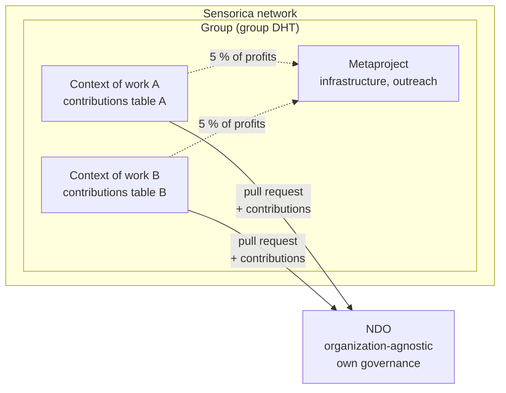
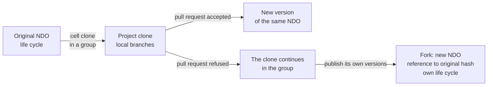
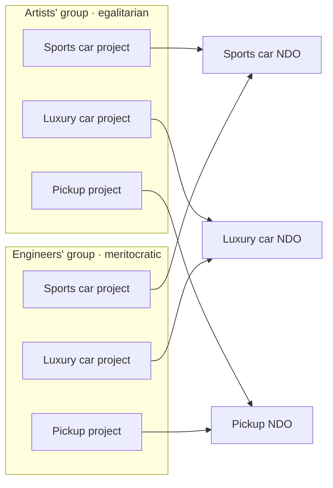
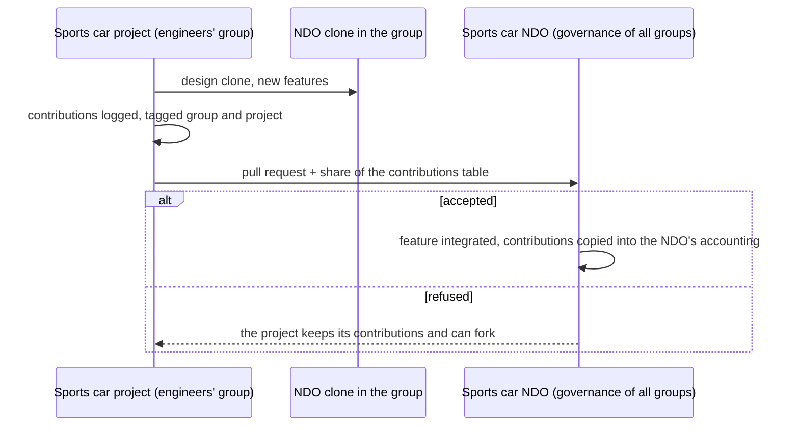
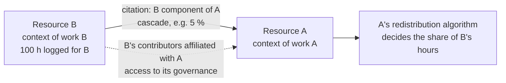

# Nondominium, Journal of the Lab session with Tibi

**Date:** Tuesday, October 20, 2026 (1 h 42, from about 9:48 p.m. to 11:30 p.m. Montreal time, at the Sensorica Lab, recorded on a phone)

**Attendees:** Soushi (Sacha Pignot, lead developer of Nondominium), Tibi (Tiberius Brastaviceanu, co-founder of Sensorica). Soushi sets the context at [0] ("we're with Tibi at Sensorica Lab, it's October 20"). The transcript comes from the local engine without speaker separation, the ElevenLabs credits being used up; who says what is reconstructed from the content (the story of the NRP and Sensorica is told by Tibi, the references to hREA and the design system by Soushi), and remains an inference.

**Context:** Follows the October 13 meeting. The v0.1.0 peer-mesh milestone is dated October 25. The discussion had started before the recording: Tibi and Soushi had just concluded that the "project" is not a type of NDO but lives closer to the group. Misheard proper nouns, corrected here: "Santorica", "sans Saurica", "Sonsorica" become Sensorica; "l'Ine", "l'in" refer to Lynn (hREA, inference); "indie", "endio", "indio", "NGO" become NDO; "HREA", "Achriah" become hREA; "Flosa", "Floster" become Flowsta; "Zifi", "Zipi" become Zippy (Eric Harris-Braun, creator of Moss, inference); "Coasis" becomes Coasys; "pie chart", "pile charte" refer to the contributions table. The brackets give the minute in the recording. This is an English translation; the original journal is in French.

## TL;DR

The session settled where the "project" lives: neither an NDO type nor its own DHT, but a context of work (the *context of work* of Sensorica's NRP, name kept out of fidelity to Bob) inside the group's DHT, with each contribution tagged by group and project. Each group has its own contribution accounting system; a membrane separates it from the NDO, which stays organization-agnostic: a project clones the NDO into its group, works freely in it, then submits a pull request to the NDO, whose governance accepts the feature and, with it, the contributions that come with it. The clone (a cloned cell, still linked to its original DHT) is distinct from the fork (a new NDO with its own life cycle), and the lobby's ethical market sanctions the fork that neither points to the original nor carries its contributions table. Tibi traced Sensorica's 5% rule for infrastructure work and the NRP's citation mechanism, which Nondominium takes up with a cascade percentage. Two questions remain open: whether to require the individual as contributor or accept organizational agents (Tibi leans toward accepting them, in the name of pseudonymity), and how far to declare one's dependencies (Holochain, Nix, React) as NDOs. Finally, the meeting summaries will be published in Nondominium's design system, cleaned of anything private, with removed passages flagged.

## Since last meeting

- **Soushi:** produce the October 13 summary and share it with Tibi as a meeting board. Done; the publication of these summaries was taken up again this evening at [98 to 100], and the design system's `/meetings` page has been live since PR #12, merged tonight.
- **Soushi:** rewrite the October 9 board from Tibi's notes. Not done: the source file has not changed since October 12. Still open.
- **Soushi:** update his hours in the OVN contributions table. Not discussed; still open.
- **Tibi:** send his notes and comments on the board. Not discussed tonight.
- **Tibi:** continue the analyses (Linux, Your Own AI, Flowsta) to feed the OVN skill. In progress: at [14] Tibi cites the last document sent to Eric, on care and networking work that is never logged, and at [52] his analysis of Flowsta, which is already working on organizational identity.
- **October 9 decision, branch deletion on merge.** Done: `delete_branch_on_merge` is `true` on `Sensorica/nondominium` and on `Sensorica/nondominium-design-system` (verified on the 21st at 12:40 a.m.).
- **Pending on the 13th: how the NDO links the contributions table.** Largely settled tonight: the table lives at the project level in the group, and goes to the NDO with the pull request (see Decisions).

## Updates

**The context of work in Sensorica's NRP.** Tibi traces the original model. In the NRP (Network Resource Planning), resources had an independent status: a 3D printer was available to all projects, and a prototype made in one project could be cited in another. "NDOs are organization-agnostic, but in the NRP resources were project-agnostic." People worked in *contexts of work*, a name given by Bob; when you logged a contribution, the form asked for the context, and the contribution was recorded for a given resource in a given project, with the role (web development, hardware, 3D printing). Contribution accounting therefore applied per context of work, and the contributions table published with a resource was extracted from it. Soushi draws out the gap: the app plans to integrate contributions tables without having fixed at which level, and there is not yet a notion of venture inside a group to isolate a bundle of NDOs and the redistribution tied to it. [0 to 6]

**The 5% rule and the Developing Sensorica project.** Tibi describes the historical membranes. In the Sensorica membrane, each project is a context of work; someone who works for the whole network (the website, the NRP, governance, outreach) does not log the same hour in every project, "that makes no sense". Hence a *capacity building* project, Developing Sensorica, and the 5% rule: each project that generates a profit pays 5% of it to those who worked on the network's infrastructure, a kind of federal tax. The share is adjustable; if it exceeds needs, the surplus ("we have 50,000 dollars left") can fund ventures, a bigger space or shared machines. This membrane does not redistribute meritocratically as projects do, but through this fixed percentage. Tibi stresses the social risk it avoids: without it, people in one project would want to be paid from another's profits, like provinces fighting over equalization. [6 to 13]

**The metaproject for work without a deliverable.** Soushi compares the rule to what every organization does: tasks tied to client projects on one side, internal work on the other (paying for the space, outreach, the internal site), which serves several projects of the group. To log these hours you need at least "a job", so one metaproject or several (Outreach Sensorica, a department), depending on the organization the group gives itself. Tibi ties this to the document sent to Eric: a lot of work has neither a deliverable nor a resource, care, networking, social capital, "things that happen in the air". Soushi proposes making as much of it as possible into service-type NDOs (an "outreach" NDO in Sensorica's metaproject, to which people attach their hours), as the wizard suggested; Tibi answers that some things will remain ephemeral, without identity, closer to an event than to a resource. [8 to 17]

## Discussion

**No value without context.** The question of where to log an event that is not an NDO leads Tibi to the basic principle of the OVN: an action has value only in a context. He cites Kurt's definition: a contribution is an action that increases the probability of an increase in value; watching videos at the lab is not one, nobody benefits. Soushi draws the design rule from it: a log is always associated with a context (the group, the project or the NDO), ideally with links that prove the impact, like the GitHub link of a commit that shows the action in its repository. On the hREA side, the group's DHT has its own economic flow, and it is these log events that feed it. [17 to 20]

**One accounting per group, one membrane toward the NDO.** Tibi recalls what had been agreed: each group has its own contribution accounting system, and a membrane separates it from the NDO, because the NDO is organization-agnostic. If group B finds an NDO created by group A and wants to add a feature to it, B logs its contributions at home; when the feature reaches the NDO, it is the NDO's governance, which transcends the groups, that decides ("excuse me, but your feature is worth nothing"). Soushi insists on the isolation this gives: the quarrels over redistribution, the false logs to flag, the battles over the contributions table stay in the group, and a hundred groups plugged into the same NDO can each have their quarrels without poisoning its governance. [20 to 22]

**Clone versus fork.** Soushi connects the membrane to the fork friction discussed earlier in the day: you must be able to make a copy and work, but copying is not forking. In its group, a project works on a copy, like a local Git clone with its branches; if it wants to get its changes through, it goes back to the NDO's people, ideally having had the conversation beforehand (Tibi: showing up two days later with "tada, I created a new feature" is received worse). If the NDO refuses, the group can keep going in its clone, and forks only if it wants to publish its own versions without polluting the shared DHT. Soushi gives the technical form: the clone would be a Holochain cloned cell (a DNA clone, Git-style), a new DHT still directly linked to its original DHT, whereas the fork is a new NDO, with a reference to the original's hash but 100% autonomous. Tibi puts it in a word: the fork is not a new version but a new variation, "a mutant", because a version enters the NDO's life cycle whereas a fork has its own. Soushi extends the metaphor: the clone is a cell that buds while staying attached to the nucleus and can be reintegrated, the fork a complete division into two independent beings. [22 to 28]

**The lobby's ethical market.** Tibi recalls an idea from the early days: a score for each NDO in the lobby (does it work, how many people use it), with an ethical dimension, like the stars of a marketplace. A fork that does not contain the link to the original and does not carry the contributions table for a royalty, say 5%, is labeled unethical by the participants: it remains findable, but downranked, and people ask themselves whether they want to contribute with a group that did not acknowledge those who built the thing. Soushi wants to enforce as much as possible in the integrity zomes (reference the original hash, point to a valid contributions table), because a rule left to the coordinator can be bypassed with a modified app that keeps the right DNA; the reputation score covers the rest. He adds a comparative dimension: tracking over time a fork's reputation against upstream, six months later, did it keep its promises or was it commercially captured. Tibi frames the problem: in the wild west of open source, someone more skilled at business takes a good technician's work, polishes it and turns it into a company, a form of parasitism. [28 to 34]

**The Silicon Valley digression.** Soushi illustrates with the series Silicon Valley, which he has just started: a young developer invents a compression algorithm in a personal project, a big company buys it out or copies it and sues. Tibi brings up the mouse stolen by Microsoft and Apple, and the intellectual property game won by whoever has the most lawyers. For Soushi, a simple copyleft license would have been enough to protect the hero, and that is precisely their team's specialty: commons management and non-capturability. [34 to 39]

**Cascade between contributions tables.** Soushi notes that the OVN license, which encourages cascade from a child NDO to its parent, will apply mostly between projects, from one contributions table to another, including for what is not an NDO (outreach is still logged), a bit like hard links between projects. This inter-group cascade still goes through the NDOs when other projects use them. [13 to 16, 39 to 40]

**The individual or the organizational agent.** Tibi asks the question: when an NDO generates profits, do contributors receive their share as individuals or as organizations? In peer-to-peer networks, the economy is pseudonymous; you cannot know whether behind a log there is a person or a company ("a contributor who works with ten code monkeys"), short of imposing an identity system. So you should expect organizations to log as a single agent, and companies will want to show their name on their upstream contributions (an ERP bridge built for Nondominium by a firm). Soushi connects this to his critique of the legal person and proposes an experimental hREA module that would represent the organization other than as an agent, for example as an agreement, a bundle of commitments; Tibi recalls that Valueflows already distinguishes individual agent and organizational agent, and that the non-agentic option is not enforceable against anonymity. Tibi gives the USPTO counter-argument: a patent accepts only individuals as inventors, the company is merely the assignee, and the list of inventors is checked both ways (nobody missing, nobody added who did not touch the technology), which is organization-agnostic. He concludes that Nondominium should not impose the individual. Soushi sees Flowsta as a lead: DIDs for organizations, co-signing on behalf of a group, delegation of permissions; Tibi confirms that his analysis shows Flowsta is already working on organizational identity. [40 to 53]

**Where the project lives.** Returning to the central question, Tibi asks whether projects should have their own DHT since they have their own contributions table. Soushi answers no: the group has its DHT, each contribution carries the project's tag there and can be filtered; a project DHT would only be worth it if the project became multi-group, and that bridge is already provided by the NDOs, shared between groups. Keeping projects in the group's DHT also eases aggregation upward, without aggregating data from several DHTs as hREA does. Tibi justifies the layer: groups are affiliations by values, the social layer, and the project mediates between that layer and the technical work on the NDO, which allows a holarchy of committees. [53 to 59]

**The cars example.** Tibi sets it up so that it gets drawn in the summary. Three NDOs, a sports car, a luxury car, a pickup. The artists (aesthetics, ergonomics), rather egalitarian, form their group; the engineers, more meritocratic and hierarchical, form theirs; each group has one project per car, with its own social contract, without the culture shock of organizations. The engineers' group clones the sports car design, makes new features in it while working visibly, then makes a pull request to the sports car NDO: the part of its contributions table that concerns this car leaves with the PR. If the NDO's governance (all the groups that contribute to it) accepts, the contributions are copied into the NDO's accounting, which thus integrates those of all the groups, each group keeping its local history tagged group and project; if it refuses, the group keeps its contributions and can fork. "The deliverable comes with the contributions." [59 to 64]

**Citation in the NRP, and Nondominium's percentage.** Tibi returns to the original NRP: a project that needs a component made in another project cites it, and the citation brings all the contributions made for that component (only those, not the rest of the other project) into the new project's contributions; a hundred hours logged for B ended up as is in A. Nondominium adds a percentage: these inherited contributions may be worth only 5% of their value, the cascade rule. Soushi recognizes hard links between NDOs in it. The redistribution algorithm is that of the citing context: it is project A that decides how to reward B's hundred hours. Through citation, B's contributors become affiliated with project A, with access to its governance, and can propose an amendment, but arrive in an already fixed social contract; Tibi thinks you rather say thank you to whoever found another use for their thing. On the name, Soushi proposes keeping *context of work* rather than "project", too generic, at least in the backend and in an hREA module, the UI being able to display "project". [64 to 70]

**The outsized advantage of the low level.** Tibi lays out the economic problem already raised at Sensorica: the lower-level a contribution, the more it multiplies through citation ("if you reinvent the transistor"), to the point that two months of work on a useful primitive would make someone richer than everyone else, and people would fight over low-level features. Decay with depth (5% of 5% of 5%) does not fix everything, Soushi objects, because the multiplication also happens horizontally: a primitive is affiliated at the first level with a thousand ventures, like a security patch implemented everywhere in a few days. [71 to 74]

**Declaring your dependencies as NDOs.** Soushi proposes declaring Holochain and the other dependencies as NDOs, down to infrastructure: his HoloPort under NixOS would be an NDO, with Edge Node, Holochain and Nix beneath it; he also cites the historical NDOs, like React, used for a decade. Tibi sees a strategy in it: publish Nondominium with an empty NDO for Holochain, which the Holochain team will come to claim, which serves dissemination and creates bonds of loyalty (having a stake in Nondominium, they will respond to its needs). He distinguishes two contributions, flagging a need through an issue or making the patch yourself; Soushi specifies that you open the issue in the dependency's repository, so here in the relevant NDO, often to find out what is already planned. The question stays open: where to stop, since the chain of dependencies can go on forever. [74 to 81]

**Hardware is not code.** Tibi recalls why citation was useful in the NRP: integrating B into A often requires adaptation. For code, an AI agent does it easily; for hardware it does not, because a car's wheel was optimized for that car's weight and use, and physics, wear across the seasons and the Canadian climate require tests. Soushi sees in it an entropy specific to hardware, which only an AI fed with large usage data, not a general-purpose LLM, could approach. Tibi gives the example of the almost perfect electric motor that lacks torque: the manufacturer makes a custom version, and offering it 0.1% of the shares makes it think of you in its next designs and call you to test its new motors, a relational fabric born of a purely economic incentive. [81 to 86]

**Private passage removed.** Part of the discussion was about a topic unrelated to Sensorica or Nondominium; it has been removed from this public version. [86 to 92]

**Aggregation from above and from below.** Soushi sums up what he understood: the project first aggregates its contributions table in its group, then submits that aggregation to the NDO, which records it in its own accounting. This matches the clone design: the project owns a clone of the NDO in its group, logs its work there, then submits it to the NDO for validation, which activates the cascade. [92 to 94]

**Forking Holochain to lighten it.** Soushi recalls that Luke, from Coasys (AD4M), talked about forking Holochain to keep only the minimum, and that a recent article by Zippy mentions the same thing for Moss: when Holochain's creator forks his own project, it is not to compete with it but to keep a subset. The Holochain repository, about fifty independent Rust crates in a flat folder, lends itself to it. In Nondominium's design, this need can often be met by a reduced local clone or by compile-time feature flags, as in other projects; Nondominium and hREA are moreover converging on the same modular architecture, which Nondominium calls its capability slots. [94 to 98]

**Publishing the meeting summaries.** Soushi proposes publishing these summaries in Nondominium's design system, which is public: a meetings page in the design system's colors, which centralizes the history, and which Tibi only has to pass the link of to his AI to draw out the actions. Before publication, whatever is private is removed and anonymized (the subjects of other projects, for example), while keeping the heart of the discussion. Tibi approves, on condition that it be transparent: the summary indicates at the right timestamp that a private passage has been removed, which is "totally legitimate". The end of the recording drifts off topic, then becomes inaudible. [98 to 102]

## Decisions

- **The project is not an NDO and has no DHT of its own**: it lives in the group's DHT, each contribution carrying the group and project tag there; a project DHT would only make sense for a multi-group project, and that bridge is already provided by the NDOs. [53 to 55]
- **We keep the name *context of work*** for the project, out of fidelity to Bob's legacy and because it fits Valueflows better, even if the UI displays "project". [67 to 68]
- **Each group has its own contribution accounting system**, separated from the NDO by a membrane: contributions pass to the NDO with the pull request and only if its governance accepts it. [20 to 22, 61 to 64]
- **The clone is not a fork**: a project works in a clone (a cloned cell linked to the original NDO); the fork creates a new NDO with its own life cycle. [22 to 28]
- **Sensorica and Nondominium meeting summaries are published in Nondominium's design system**, cleaned of anything private, each removed passage flagged at its timestamp. [98 to 100]

## Discussed, not decided

- **Requiring the individual as contributor or accepting organizational agents.** Tibi leans toward accepting organizational agents, in the name of pseudonymity and the interface with companies, acknowledging the USPTO counter-example; Soushi proposes exploring an hREA module that would represent the organization other than as an agent, and Flowsta for organizational DIDs. [40 to 53]
- **How far to declare dependencies as NDOs** (Holochain, Edge Node, Nix, React): the interest in dissemination and loyalty is clear, the limit is not. [74 to 78]
- **How to contain the advantage of low-level contributions**, which decay with depth does not fix when the multiplication is horizontal. [71 to 74]
- **What can be enforced in the integrity zomes for fork ethics** (reference to the original hash, valid contributions table), and what is left to the lobby's reputation score. [30 to 32]
- **Metaprojects and service NDOs** for work without a deliverable: how far care and outreach work can become NDOs, and what remains an event without identity. [8 to 17]

## Actions

- **Soushi:** produce this summary with its diagrams, including the cars example that Tibi asked to have drawn. [59]
- **Soushi:** publish the meeting summaries in Nondominium's design system, the cleaned public version with private passages flagged. [98 to 100]
- **Soushi:** rewrite the October 9 board from Tibi's notes (carried over from October 13).
- **Soushi:** update his hours in the OVN contributions table (carried over from October 13).
- **Tibi:** continue the Flowsta analysis on organizational identity and group co-signing, for the question of organizational agents. [52 to 53]

## Outstanding

- **The exact place where the foundational documents already discuss the ethical market**: Tibi thinks the idea is contained there, without having checked. [32]
- **The identity of "l'Ine"** at [0], who would have evolved the context of work in Valueflows: Lynn (hREA) is an inference.
- **Zippy's article on a minimal Holochain fork for Moss**: Soushi says he "thought he saw" it, the source is not cited.
- **The date of the next meeting** has not been set.

## Corrections after the meeting

- **Branch deletion on merge is now active**, contrary to what the October 13 journal recorded: `delete_branch_on_merge` is `true` on both repositories (verified on the 21st at 12:40 a.m. with `gh api`).
- **The design system's meetings page did not yet exist during the meeting**: when Soushi describes it at [98], he is talking about another page that already existed; Nondominium's was merged tonight (PR #12, `bb62014`).
