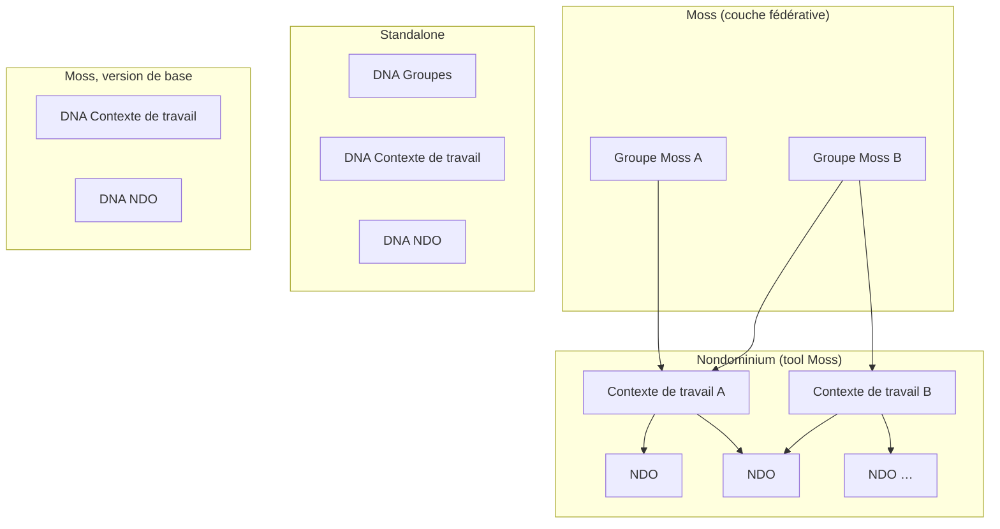
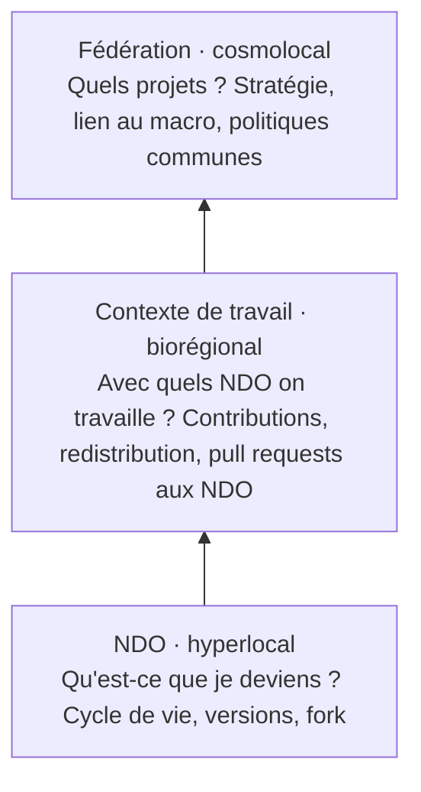
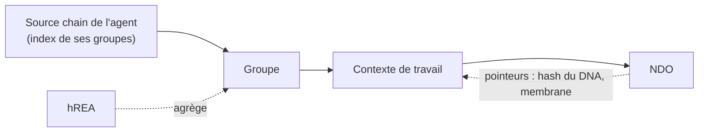

# Nondominium, Journal du brainstorm Moss avec Tibi

**Date :** mardi 27 octobre 2026 (53 min, de 22 h 06 à 22 h 59 heure de Montréal, en présence, devant un tableau blanc)

**Participants :** Soushi (Sacha Pignot, développeur principal de Nondominium), Tibi (Tiberius Brastaviceanu, cofondateur de Sensorica). La transcription vient du moteur local sans séparation des locuteurs, les crédits ElevenLabs étant épuisés ; qui dit quoi est reconstitué au fil du contenu (l'histoire du NRP, les parallèles entreprise et open source, la question du conglomérat viennent de Tibi ; la souveraineté fractale, les DHT, Moss et la publication viennent de Soushi), et reste une inférence.

**Contexte :** Soushi ouvre en posant le sujet : brainstormer l'intégration Moss de Nondominium pour la première release, et comment la notion de groupe et de contexte de travail de Nondominium s'articule avec les groupes Moss. Plus tôt dans la soirée, le plan de release v0.1.0 avait été retracé vers Moss en priorité (mode dev d'abord, nœud toujours en ligne, Holochain 0.7.1). La photo du tableau blanc de la séance accompagne ce journal. Noms propres mal transcrits et corrigés ici : « MOS », « mos », « monstres » deviennent Moss ; « indio », « Indio », « NGO » deviennent NDO ; « sans suricap », « sans suricra » deviennent Sensorica ; « vale-fleur », « Fall of Flow » deviennent Valueflows ; « HREA », « RIA » deviennent hREA ou REA selon le contexte ; « Zipi » devient Zippy (Eric Harris-Braun, créateur de Moss, inférence) ; « flowster » devient Flowsta ; « Red Heart » devient Red Hat ; « suchi i » désigne SoushAI. Les crochets donnent la minute dans l'enregistrement.

## TL;DR

La séance a posé l'architecture organisationnelle que Nondominium vise et la façon dont Moss s'y insère. Le contexte de travail (le *context of work* de Bob Haugen dans le NRP de Sensorica) est la couche projet : un espace ouvert où l'on entre et sort librement, qui travaille avec des NDO sans en être un, le nom technique restant interne et « projet » servant à l'affichage. Le NDO reste d'abord une ressource, avec une facette organisationnelle, parce qu'en Valueflows l'agent n'est pas la ressource. Trois niveaux de souveraineté, chacun avec son propre périmètre de gouvernance : le NDO (ce que je deviens), le contexte de travail (avec quels NDO on travaille, comment on contribue et redistribue), la fédération (quels projets, quelle stratégie, quelles politiques communes). Au tableau, dans Moss, les groupes Moss deviennent la couche fédérative, les groupes actuels de Nondominium deviennent les contextes de travail, et les NDO restent dessous ; en standalone, trois DNA (groupes, contexte de travail, NDO). Pour garder les deux versions compatibles, le contexte de travail mériterait son propre DNA. L'interopérabilité entre Moss et standalone passe par les NDO, à travers des pointeurs entre DHT. Pour la v0.1.0 tout cela reste hors périmètre : la priorité est une intégration Moss de base, utilisable par Grassroots Economics, avec le standalone qui suit et un vrai packaging, puisque Nondominium n'a encore jamais tourné sur un vrai DHT hors sandbox.

## Depuis la dernière rencontre

- **Soushi :** produire le résumé du 20 octobre avec ses diagrammes. Fait : le journal du 20 octobre est publié dans `/meetings` du design system.
- **Soushi :** publier les résumés de rencontre dans le design system, version nettoyée. Fait pour le 20 octobre ; ce journal-ci suit le même chemin.
- **Soushi :** réécrire le board du 9 octobre à partir des notes de Tibi. Pas évoqué ce soir ; reste ouvert.
- **Soushi :** mettre à jour ses heures dans le tableau de contributions OVN. Pas évoqué ; reste ouvert.
- **Tibi :** poursuivre l'analyse Flowsta sur l'identité organisationnelle. Pas rapporté ce soir ; Flowsta revient seulement comme pont d'identité entre Moss et standalone à [49 à 50].
- **En suspens le 20 : agents organisationnels ou individus seulement.** Pas tranché, mais la séance place l'agent organisationnel au niveau fédératif (voir Discussion).

## Mises à jour

**Le contexte de travail n'est pas dans la v0.1.0.** Tibi demande si Nondominium a déjà le contexte de travail ; Soushi répond que non, que ce n'est encore qu'un brainstorm, mais que l'idée est à garder : il n'est pas nécessaire pour lever la première release. [0 à 1]

**Du NRP à Nondominium, seul le support change.** Tibi retrace l'architecture d'origine. Dans le NRP (Network Resource Planning) de Sensorica, les ressources étaient des briques fondamentales et indépendantes, que tout contexte de travail pouvait citer, utiliser ou consommer, selon les actions Valueflows : *use* pour l'équipement réutilisable, *consume* pour les matériaux inventoriés en quantité, *cite* pour tout ce qui est numérique (documents, spécifications de méthode, designs 3D), comme une citation dans une publication scientifique. Nondominium reprend cette architecture : les ressources deviennent organisation-agnostiques, mais pair à pair plutôt que sur une plateforme avec une base de données classique, chacune sur son propre support. Dans Nondominium, la couche de contexte de travail a été implémentée comme groupe ; d'où l'idée qu'un groupe peut avoir plusieurs projets, qui eux-mêmes ont plusieurs NDO, et que des projets du même groupe ou de groupes différents peuvent avoir des NDO en commun. [1 à 5]

## Discussion

**Contexte de travail ou projet : le nom.** Bob Haugen avait appelé le projet *context of work* parce que le terme est plus ouvert à la collaboration ouverte : un contexte où l'on arrive et part quand on veut, sans contrat ni emploi, où les gens s'alignent dynamiquement sur des idées et des missions. Une organisation, à l'inverse, évoque des relations contractuelles et des comités, plus transactionnels. Ils s'accordent : en interne, dans le code et la conception, on dit contexte de travail parce que le terme colle à la chose ; à l'affichage, chaque communauté a son propre habillage, et « projet » est plus accueillant. [4 à 6]

**Le NDO a une facette organisationnelle, mais n'est pas une organisation.** Un NDO n'existe pas seul : il a une gouvernance et des contributeurs. Pour un NDO privé, c'est son propriétaire ; pour un NDO partagé, ceux qui se le partagent ; pour un NDO de type projet, ses contributeurs ; pour un objet physique partagé comme une imprimante 3D, des agents responsables différenciés (réparation, stockage). Mais la documentation de Nondominium a fixé que les NDO sont d'abord des ressources, et que Valueflows distingue clairement l'agent de la ressource. Représenter les projets comme des NDO de type projet, pour profiter des hard links et de la composabilité entre NDO, aurait été une erreur : « oui c'est faisable mais c'est pas idiomatique ». Un projet est un espace, un amalgame d'agents, plus proche d'un agent organisationnel que d'une ressource. [7 à 11]

**Une chose devient ressource par les humains autour.** « Une roche dans la forêt n'est pas une ressource » : une chose devient ressource à travers l'usage, l'intérêt et les événements, et il n'y a pas de ressource sans humain. Tibi prend l'exemple d'un diamant qui brille par terre : dès qu'un groupe le voit et comprend ce que c'est, il devient ressource, et peut engendrer un comportement de lutte pour l'acquérir. Soushi relie cela à la Complexity Oriented Programming : la ressource agit comme un attracteur de contexte et de comportement, et le graphe Valueflows n'est pas exhaustif, il assume de ne pas tout cartographier. Holochain, Valueflows et hREA sont à ses yeux des technologies orientées complexité ; le travail de Nondominium est de le formaliser par-dessus. [10 à 14]

**Trois niveaux de souveraineté fractale.** Soushi reprend sa souveraineté fractale. Le NDO est le niveau hyperlocal, pleinement souverain en lui-même. Le contexte de travail est le niveau biorégional, avec des frontières non pas géobiologiques mais sociales et économiques : ce qu'on veut obtenir des NDO qu'on utilise. La fédération est le niveau cosmolocal, qui agrège les connaissances et les redistribue à travers les contextes de travail et les NDO : chaque niveau supérieur interconnecte les niveaux inférieurs en préservant la souveraineté de chacun. Ce qui la préserve, c'est que chaque niveau a un périmètre de gouvernance très clair et agnostique des autres, « chacun a sa propre plate-bande ». Le clonage en est l'illustration : un contexte de travail peut cloner un NDO pour expérimenter et avoir ses propres désaccords sur son clone sans toucher le NDO d'origine ni sa gouvernance. [16 à 19]

**Ce que chaque niveau gouverne.** Au niveau du NDO, la gouvernance répond à « qu'est-ce que je deviens » : son cycle de vie, d'idée à spécification de design (avec un choix entre plusieurs designs et la question du fork), puis prototypage, puis nouvelles versions. Au niveau du contexte de travail, on travaille avec plusieurs NDO pour en faire d'autres, dans un projet avec des livrables : la gouvernance porte sur les NDO avec lesquels on travaille, quels soft links on fait, dans quelle direction on développe, ce qu'on soumet aux NDO comme version ou mise à jour, mais aussi sur la gestion d'activité, l'ordre des contributions avant qu'elles aboutissent dans le NDO, et la redistribution des bénéfices, c'est-à-dire les tableaux de contributions. Au niveau de la fédération, le contenu est la liste des projets, la stratégie globale et la manière de se connecter au macro. Soushi place la question du project management, restée ouverte, entre ces deux derniers niveaux : c'est elle qui avait mené au brainstorm sur le contexte de travail. [19 à 22]

**Deux parallèles : l'entreprise et l'open source.** Tibi propose deux lectures de la même structure. En entreprise : le NDO correspond au département des matériaux (inventaire, attribution, stockage, acquisition et usage des ressources), le projet au département R&D, et la couche corporative au business et au marketing, qui choisit quels projets financer selon les besoins du marché ; une séparation des préoccupations nécessaire, avec sa friction habituelle entre l'ingénieur et le commercial qui veut livrer un prototype sans backend. En open source, plus proche des cas d'usage : le NDO est le noyau, les contextes de travail sont les groupes qui travaillent chacun sur un composant (noyau, distributions, environnements de bureau, pilotes, packaging, tests), et la fédération est la conférence où tout le monde se présente avec un agenda commun (l'open source, la souveraineté numérique) quels que soient leurs désaccords ailleurs, et où émergent des politiques communes de sécurité ou d'UX, avec les grands usagers comme Red Hat à la table. [22 à 27]

**Dans Moss, les groupes Moss deviennent la couche fédérative.** Soushi applique l'image à Moss. La couche groupe de Nondominium devient la couche projet, c'est-à-dire le contexte de travail, et la couche groupe de Moss devient l'espace fédératif : « on a plus besoin de créer rien finalement ». Hors de Moss, on pourrait cloner la même structure pour la fédération, avec une gouvernance typée différemment. La question d'architecture reste ouverte : la couche fédérative est-elle un groupe de même structure avec une spécification de gouvernance différente, ou une entité assez différente pour mériter son propre DNA ? Le groupe et le lobby ont déjà chacun leur DNA. [27 à 30]

**Le contexte de travail mérite-t-il son propre DNA ?** Le brainstorm précédent avait placé les contextes de travail dans le DHT du groupe, exclusifs au groupe, ce qui facilite la découvrabilité des NDO et la mise en commun : parler à un groupe donne la liste de tous ses NDO disponibles. Mais si Moss remplace les groupes, cette option tuerait la couche fédérative et les agents organisationnels. Tibi propose de reproduire la même architecture dans les deux versions : un DHT pour les contextes de travail, d'où la notion de groupe est retirée et déléguée à Moss, pour garder clair ce que les groupes Moss font et ce que le contexte de travail fait. Soushi en convient : pour être un réplica parfait de l'architecture, « il faudrait vraiment faire deux DNA », ce qui permet en plus de fédérer, les gens pouvant se connecter à plusieurs projets. [30 à 32, 38 à 40]

**La cardinalité : plusieurs à plusieurs.** Les contextes de travail peuvent-ils être partagés entre groupes ? Tibi prend Catmaster, une venture de Sensorica : un contexte de travail avec son ensemble de NDO, auquel participent plusieurs organisations, Sensorica, Ludociel et l'hôpital Sainte-Justine. La relation entre contextes de travail et groupes est donc plusieurs à plusieurs, ce qui assume jusqu'au bout la composabilité : les NDO se composent avec les contextes de travail, qui se composent avec les groupes, eux-mêmes dans Moss. Le NRP de Sensorica devient ainsi Sensorica dans Moss, et ses projets deviennent les contextes de travail, chacun une venture avec son tableau de contributions ; là où le NRP, en web 2, demandait une API pour se connecter au NRP d'un autre réseau, Moss connecte déjà les groupes entre eux. [32 à 34, 41 à 42]

**Le terme pour une organisation d'organisations.** Tibi cherche le nom d'une organisation créée par-dessus d'autres pour les agréger, plus lâche qu'une maison mère avec ses filiales, et donne l'exemple d'Alphabet ; il demande à SoushAI de le trouver pour le résumé (voir Corrections). [42 à 44]

**Ce que Nondominium peut apporter à Moss.** Moss n'a pas de gouvernance dans ses groupes. Plutôt que de demander, Tibi propose le fait accompli : montrer ce que Sensorica fait déjà dans Nondominium, avec ses documents de gouvernance de venture et de réseau, et proposer à Eric (Moss) une couche de gouvernance fédérative et de contexte de travail, comme on le fait pour les modules d'hREA. L'idée va plus loin : chaque app Holochain, Holochain lui-même, le HDK et Moss pourraient être des NDO, consommés plutôt que travaillés. Soushi recadre : c'est pour plus tard, la v0.1.0 n'en a pas besoin. [34 à 36, 38]

**Les risques d'une dépendance à Moss.** Remplacer nos propres groupes par ceux de Moss crée une dépendance ; c'est acceptable si on l'assume, à condition de garder un remplacement, d'où les deux versions, Moss et standalone. Le souci de Soushi est la compatibilité si les groupes Nondominium font des choses que Moss ne peut pas faire ; Tibi répond que les groupes restent compatibles entre eux à travers les NDO. [37 à 38]

**L'interopérabilité passe par des pointeurs entre DHT.** Soushi décrit le mécanisme. Chaque DHT contient des entrées qui pointent vers les autres : un contexte de travail ne copie pas les données d'un NDO, il a ses propres entrées de type NDO qui contiennent le hash et ce qu'il faut pour rejoindre le réseau du NDO, membrane comprise ; l'application porte déjà le code du DNA et n'a besoin que du hash pour s'y connecter. L'agent parcourt l'arbre comme une cascade de réseaux : sa source chain lui donne ses groupes, idéalement déjà tout indexé, les groupes donnent les contextes de travail, les contextes de travail donnent les NDO. Seuls les groupes et NDO qui le concernent se chargent d'emblée, le reste à l'ouverture d'une page. [47 à 51]

**Moss et standalone peuvent-ils se parler ?** Tibi demande si quelqu'un dans Nondominium standalone et quelqu'un dans Nondominium sur Moss pourront communiquer. Soushi : « normalement oui », parce que le NDO est le pont principal d'interopérabilité entre les groupes, et que les contextes de travail sont gérés par Nondominium et non par Moss. Il n'est pas besoin de Flowsta pour lier ces réseaux ; Flowsta servirait plutôt à l'agent qui veut la même identité dans Moss et en standalone. Voir les Corrections pour la condition technique. [49 à 50]

## Décisions

- **Le contexte de travail est le nom technique interne, « projet » le nom affiché.** Le terme de Bob Haugen colle à la conception ; l'affichage s'adapte à chaque communauté. [4 à 6]
- **Les projets ne sont pas des NDO.** Le NDO est d'abord une ressource avec une facette organisationnelle ; un projet NDO ne serait pas idiomatique en Valueflows. [9 à 11]
- **Trois niveaux de souveraineté, chacun avec son périmètre de gouvernance** : NDO, contexte de travail, fédération. [16 à 22]
- **Dans Moss, les groupes Moss sont la couche fédérative et les groupes Nondominium deviennent les contextes de travail.** [27, 32 à 33]
- **Contextes de travail et groupes sont en relation plusieurs à plusieurs.** Le cas Catmaster (Sensorica, Ludociel, Sainte-Justine) en est la référence. [41 à 42]
- **La v0.1.0 vise une intégration Moss de base, sans contexte de travail**, utilisable par Grassroots Economics ; Moss d'abord, le standalone suit. [31, 36, 45 à 46]
- **Ce résumé est publié dans le design system**, qui pourra devenir un site plus large de Sensorica en gardant un chapitre Nondominium avec ses rencontres et ses boards. [44]

## Discuté, non tranché

- **Un DNA propre pour le contexte de travail, ou le DHT du groupe.** Le brainstorm précédent penchait pour le DHT du groupe ; la compatibilité Moss pousse vers un DNA séparé, que Soushi rejoint en fin de discussion. À trancher dans le board d'architecture. [30 à 32, 38 à 40]
- **La couche fédérative : même structure que le groupe avec une gouvernance typée, ou entité distincte.** [28 à 30]
- **Où vit le project management** : au contexte de travail ou à la fédération. [15 à 16]
- **Proposer à Moss une couche de gouvernance fédérative et de contexte de travail**, par le fait accompli, et quand. [34 à 35, 38]
- **Holochain, le HDK, Moss et les apps comme NDO consommés.** Reporté après la v0.1.0. [35 à 36]
- **Les deux versions dès maintenant ou Moss seul d'abord** : « ça dépend combien de temps ça prend ». [45 à 46]
- **Aligner la terminologie avec celle de Moss** (groupe, projet) pour éviter les conflits dans l'interface. [36 à 37]

## Actions

- **Soushi :** publier ce résumé dans le design system. [44]
- **Soushi :** mettre à jour le board du plan de release Moss avec cette séance, puis faire passer le travail par les étapes du V : brainstorm, requirements, architecture, implémentation. [45, 52]
- **Soushi :** préparer la phase de packaging de la première release à partir de ce résumé : compatibilité Moss, puis un standalone déployable, puisque l'app tourne désormais dans le navigateur sans Electron et qu'aucun vrai DHT n'a encore été créé hors sandbox. [45 à 46]
- **Soushi :** que tout le flux de développement (brainstorms, cycle de vie, niceboards) soit visible sur le site du design system. [52]
- **Tibi :** envoyer ses retours sur ce résumé et sur le board au plus vite. [45]
- **SoushAI :** donner le terme pour une organisation d'organisations (fait, voir Corrections). [44]

## En suspens

- La date d'une version stable de Moss sur Holochain 0.7, qui conditionne la publication publique du tool.
- Si Grassroots Economics a besoin du contexte de travail dès son premier usage, ou si les groupes Moss et les NDO suffisent.

## Corrections après la rencontre

- **Le terme demandé par Tibi.** Une organisation qui en possède d'autres et les chapeaute est une **société de portefeuille** (*holding company*), et quand ses filiales opèrent dans des secteurs sans rapport, un **conglomérat** : Alphabet est la société de portefeuille créée en 2015 au-dessus de Google. Pour plusieurs organisations indépendantes qui s'associent autour d'un projet commun sans fusionner, comme Sensorica, Ludociel et Sainte-Justine dans Catmaster, le terme est **consortium**, ou **coentreprise** (*joint venture*) quand elles créent une entité commune. La couche fédérative de Nondominium ressemble donc davantage à un consortium qu'à un conglomérat. (Termes du vocabulaire courant du droit des sociétés, donnés sans source lue ce soir ; la date d'Alphabet est un fait public connu.)
- **« Normalement oui » dépend d'une condition réseau.** Mesuré plus tôt ce soir sur les releases de Moss : la ligne Moss 0.16 sur Holochain 0.7.1 ne sort qu'en builds de test qui tournent un Holochain patché (`holochain-0.7.1-mdns.7`, `HCP2P_PROTO_VER=1002`), « network-partitioned from every other Moss install » d'après les notes de `v0.16.0-rc.3-test.26`. Un Nondominium standalone sur un Holochain 0.7.1 standard ne verra pas ces pairs. Le pont par les NDO fonctionnera entre Moss et standalone seulement quand les deux tourneront le même protocole, et quand le NDO aura les mêmes coordonnées de clone (hash du DNA, network seed, propriétés) des deux côtés ; dans Moss, chaque instance de tool dans chaque groupe reçoit en outre son propre network seed.
- **Les contextes de travail et la v0.1.0.** Le milestone v0.1.0 et le plan de release de ce soir ne contiennent aucun élément de contexte de travail ; c'est cohérent avec la décision de la séance.
