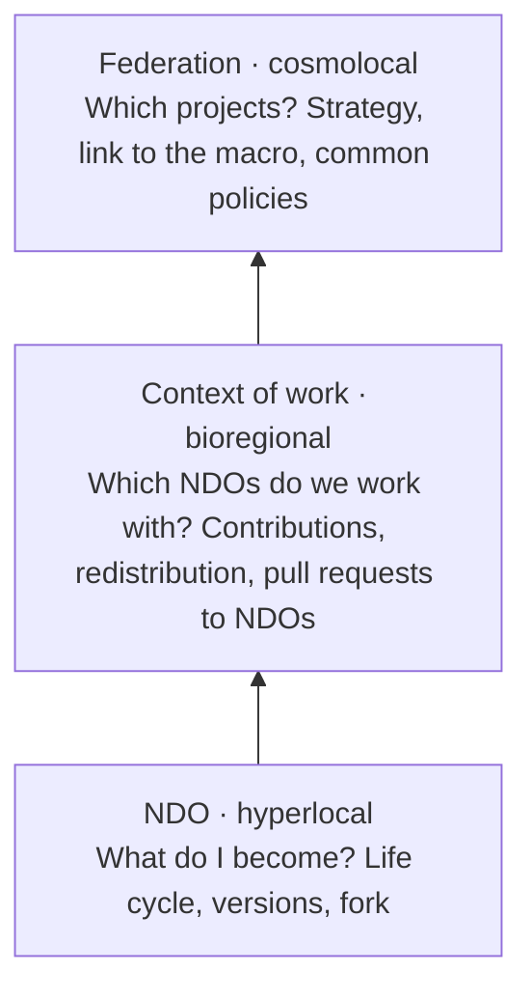
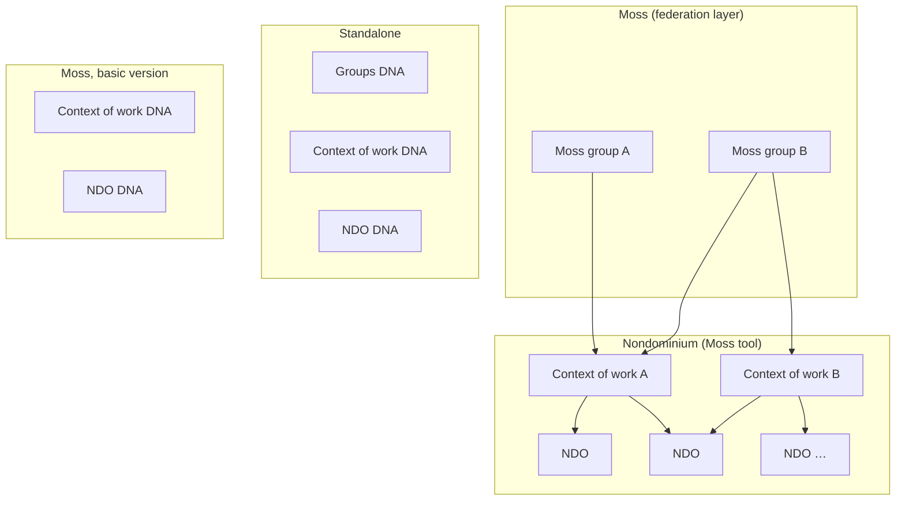
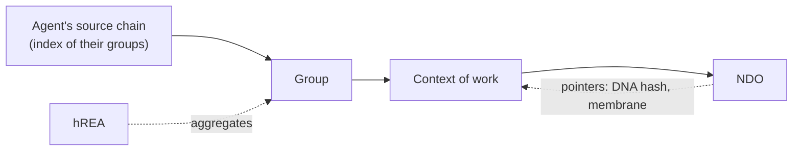

# Nondominium, Moss brainstorm journal with Tibi

**Date:** Tuesday, October 27, 2026 (53m, from 10:06 pm to 10:59 pm Montreal time, in person, at a whiteboard)

**Attendees:** Soushi (Sacha Pignot, lead developer of Nondominium), Tibi (Tiberius Brastaviceanu, co-founder of Sensorica). The transcript comes from the local engine without speaker separation, the ElevenLabs credits being exhausted; who says what is reconstructed from the content (the NRP history, the enterprise and open source parallels, and the conglomerate question come from Tibi; fractal sovereignty, the DHTs, Moss and publication come from Soushi), and remains an inference.

**Context:** Soushi opens by setting the topic: brainstorm the Moss integration of Nondominium for the first release, and how Nondominium's notion of group and context of work fits with Moss groups. Earlier in the evening, the v0.1.0 release plan had been retraced toward Moss first (dev mode first, an always-online node, Holochain 0.7.1). The photo of the session's whiteboard goes with this journal. Proper nouns that were mis-transcribed and corrected here: "MOS", "mos", "monstres" become Moss; "indio", "Indio", "NGO" become NDO; "sans suricap", "sans suricra" become Sensorica; "vale-fleur", "Fall of Flow" become Valueflows; "HREA", "RIA" become hREA or REA depending on the context; "Zipi" becomes Zippy (Eric Harris-Braun, creator of Moss, inference); "flowster" becomes Flowsta; "Red Heart" becomes Red Hat; "suchi i" stands for SoushAI. The brackets give the minute in the recording.

## TL;DR

The session set out the organizational architecture Nondominium is aiming for and how Moss fits into it. The context of work (Bob Haugen's *context of work* in Sensorica's NRP) is the project layer: an open space one enters and leaves freely, which works with NDOs without being one, the technical name staying internal and "project" being used for display. The NDO remains first of all a resource, with an organizational facet, because in Valueflows the agent is not the resource. Three levels of sovereignty, each with its own governance perimeter: the NDO (what I become), the context of work (which NDOs we work with, how we contribute and redistribute), the federation (which projects, what strategy, which common policies). On the whiteboard, in Moss, the Moss groups become the federation layer, Nondominium's current groups become the contexts of work, and the NDOs stay underneath; in standalone, three DNAs (groups, context of work, NDO). To keep both versions compatible, the context of work would deserve its own DNA. Interoperability between Moss and standalone goes through the NDOs, by way of pointers between DHTs. For v0.1.0 all of this stays out of scope: the priority is a basic Moss integration, usable by Grassroots Economics, with standalone following and real packaging, since Nondominium has never yet run on a real DHT outside the sandbox.

## Since last meeting

- **Soushi:** produce the October 20 summary with its diagrams. Done: the October 20 journal is published in the design system's `/meetings`.
- **Soushi:** publish the meeting summaries in the design system, cleaned-up version. Done for October 20; this journal follows the same path.
- **Soushi:** rewrite the October 9 board from Tibi's notes. Not discussed tonight; stays open.
- **Soushi:** update his hours in the OVN contributions table. Not discussed; stays open.
- **Tibi:** continue the Flowsta analysis on organizational identity. Not reported tonight; Flowsta comes back only as an identity bridge between Moss and standalone at [49 to 50m].
- **Pending on the 20th: organizational agents or individuals only.** Not decided, but the session places the organizational agent at the federation level (see Discussion).

## Updates

**The context of work is not in v0.1.0.** Tibi asks whether Nondominium already has the context of work; Soushi answers no, that it is still only a brainstorm, but that the idea is worth keeping: it is not needed to get the first release out. [0 to 1m]

**From the NRP to Nondominium, only the medium changes.** Tibi retraces the original architecture. In Sensorica's NRP (Network Resource Planning), resources were fundamental, independent building blocks that any context of work could cite, use or consume, according to the Valueflows actions: *use* for reusable equipment, *consume* for materials inventoried by quantity, *cite* for everything digital (documents, method specifications, 3D designs), like a citation in a scientific publication. Nondominium takes up this architecture: resources become organization-agnostic, but peer to peer rather than on a platform with a classic database, each on its own medium. In Nondominium, the context-of-work layer was implemented as a group; hence the idea that a group can have several projects, which in turn have several NDOs, and that projects of the same group or of different groups can have NDOs in common. [1 to 5m]

## Discussion

**Context of work or project: the name.** Bob Haugen had called the project *context of work* because the term is more open to open collaboration: a context where one arrives and leaves whenever one wants, with no contract or employment, where people align dynamically on ideas and missions. An organization, by contrast, evokes contractual relationships and committees, something more transactional. They agree: internally, in the code and the design, we say context of work because the term fits the thing; for display, each community has its own dress, and "project" is more welcoming. [4 to 6m]

**The NDO has an organizational facet, but is not an organization.** An NDO does not exist alone: it has a governance and contributors. For a private NDO, that is its owner; for a shared NDO, those who share it; for a project-type NDO, its contributors; for a shared physical object like a 3D printer, differentiated responsible agents (repair, storage). But the Nondominium documentation has settled that NDOs are first of all resources, and that Valueflows clearly distinguishes the agent from the resource. Representing projects as project-type NDOs, to benefit from hard links and composability between NDOs, would have been a mistake: "oui c'est faisable mais c'est pas idiomatique" (yes it's doable but it's not idiomatic). A project is a space, an amalgam of agents, closer to an organizational agent than to a resource. [7 to 11m]

**A thing becomes a resource through the humans around it.** "Une roche dans la forêt n'est pas une ressource" (a rock in the forest is not a resource): a thing becomes a resource through use, interest and events, and there is no resource without a human. Tibi takes the example of a diamond shining on the ground: as soon as a group sees it and understands what it is, it becomes a resource, and can trigger competitive behavior to acquire it. Soushi connects this to Complexity Oriented Programming: the resource acts as an attractor of context and behavior, and the Valueflows graph is not exhaustive, it accepts not mapping everything. Holochain, Valueflows and hREA are, in his view, complexity-oriented technologies; Nondominium's work is to formalize that on top of them. [10 to 14m]

**Three levels of fractal sovereignty.** Soushi returns to his fractal sovereignty. The NDO is the hyperlocal level, fully sovereign in itself. The context of work is the bioregional level, with boundaries that are not geobiological but social and economic: what one wants to get from the NDOs one uses. The federation is the cosmolocal level, which aggregates knowledge and redistributes it across contexts of work and NDOs: each higher level interconnects the lower levels while preserving the sovereignty of each. What preserves it is that each level has a very clear governance perimeter, agnostic of the others, "chacun a sa propre plate-bande" (everyone has their own flower bed). Cloning illustrates it: a context of work can clone an NDO to experiment and have its own disagreements on its clone without touching the original NDO or its governance. [16 to 19m]

**What each level governs.** At the NDO level, governance answers "what do I become": its life cycle, from idea to design specification (with a choice between several designs and the question of the fork), then prototyping, then new versions. At the context-of-work level, one works with several NDOs to make others, in a project with deliverables: governance covers the NDOs one works with, which soft links one makes, in which direction one develops, what one submits to the NDOs as a version or update, but also activity management, the order of contributions before they end up in the NDO, and the redistribution of benefits, that is, the contributions tables. At the federation level, the content is the list of projects, the overall strategy and the way of connecting to the macro. Soushi places the question of project management, which remained open, between these last two levels: it is what had led to the brainstorm on the context of work. [19 to 22m]

**Two parallels: the enterprise and open source.** Tibi offers two readings of the same structure. In an enterprise: the NDO corresponds to the materials department (inventory, allocation, storage, acquisition and use of resources), the project to the R&D department, and the corporate layer to business and marketing, which chooses which projects to fund according to market needs; a necessary separation of concerns, with its usual friction between the engineer and the salesperson who wants to ship a prototype without a backend. In open source, closer to the use cases: the NDO is the kernel, the contexts of work are the groups each working on a component (kernel, distributions, desktop environments, drivers, packaging, tests), and the federation is the conference where everyone shows up with a common agenda (open source, digital sovereignty) whatever their disagreements elsewhere, and where common security or UX policies emerge, with the big users like Red Hat at the table. [22 to 27m]

**In Moss, the Moss groups become the federation layer.** Soushi applies the picture to Moss. Nondominium's group layer becomes the project layer, that is, the context of work, and Moss's group layer becomes the federation space: "on a plus besoin de créer rien finalement" (in the end we don't need to create anything). Outside Moss, one could clone the same structure for the federation, with a differently typed governance. The architecture question stays open: is the federation layer a group of the same structure with a different governance specification, or an entity different enough to deserve its own DNA? The group and the lobby already each have their own DNA. [27 to 30m]

**Does the context of work deserve its own DNA?** The previous brainstorm had placed contexts of work in the group's DHT, exclusive to the group, which makes NDOs easier to discover and pool: talking to a group gives the list of all its available NDOs. But if Moss replaces the groups, this option would kill the federation layer and the organizational agents. Tibi proposes reproducing the same architecture in both versions: one DHT for contexts of work, from which the notion of group is removed and delegated to Moss, to keep clear what the Moss groups do and what the context of work does. Soushi agrees: to be a perfect replica of the architecture, "il faudrait vraiment faire deux DNA" (we would really have to make two DNAs), which also allows federating, people being able to connect to several projects. [30 to 32m, 38 to 40m]

**Cardinality: many to many.** Can contexts of work be shared between groups? Tibi takes Catmaster, a Sensorica venture: a context of work with its set of NDOs, in which several organizations take part, Sensorica, Ludociel and Sainte-Justine hospital. The relationship between contexts of work and groups is therefore many to many, which carries composability all the way: NDOs compose with contexts of work, which compose with groups, themselves in Moss. Sensorica's NRP thus becomes Sensorica in Moss, and its projects become the contexts of work, each a venture with its contributions table; where the NRP, in web 2, needed an API to connect to another network's NRP, Moss already connects groups to each other. [32 to 34m, 41 to 42m]

**The term for an organization of organizations.** Tibi looks for the name of an organization created on top of others to aggregate them, looser than a parent company with its subsidiaries, and gives Alphabet as an example; he asks SoushAI to find it for the summary (see Corrections). [42 to 44m]

**What Nondominium can bring to Moss.** Moss has no governance in its groups. Rather than ask, Tibi proposes the fait accompli: show what Sensorica already does in Nondominium, with its venture and network governance documents, and propose to Eric (Moss) a federation governance and context-of-work layer, as is done for hREA's modules. The idea goes further: every Holochain app, Holochain itself, the HDK and Moss could be NDOs, consumed rather than worked on. Soushi reframes: that is for later, v0.1.0 does not need it. [34 to 36m, 38m]

**The risks of depending on Moss.** Replacing our own groups with Moss's creates a dependency; that is acceptable if we own it, provided we keep a replacement, hence the two versions, Moss and standalone. Soushi's worry is compatibility if Nondominium groups do things Moss cannot; Tibi answers that the groups remain compatible with each other through the NDOs. [37 to 38m]

**Interoperability goes through pointers between DHTs.** Soushi describes the mechanism. Each DHT contains entries that point to the others: a context of work does not copy an NDO's data, it has its own NDO-type entries that contain the hash and what is needed to join the NDO's network, membrane included; the application already carries the DNA code and needs only the hash to connect to it. The agent walks the tree like a cascade of networks: their source chain gives them their groups, ideally already fully indexed, the groups give the contexts of work, the contexts of work give the NDOs. Only the groups and NDOs that concern them load up front, the rest when a page is opened. [47 to 51m]

**Can Moss and standalone talk to each other?** Tibi asks whether someone in standalone Nondominium and someone in Nondominium on Moss will be able to communicate. Soushi: "normalement oui" (normally yes), because the NDO is the main interoperability bridge between groups, and because contexts of work are managed by Nondominium and not by Moss. Flowsta is not needed to link these networks; Flowsta would rather serve the agent who wants the same identity in Moss and in standalone. See the Corrections for the technical condition. [49 to 50m]

## Decisions

- **The context of work is the internal technical name, "project" the displayed name.** Bob Haugen's term fits the design; the display adapts to each community. [4 to 6m]
- **Projects are not NDOs.** The NDO is first of all a resource with an organizational facet; a project NDO would not be idiomatic in Valueflows. [9 to 11m]
- **Three levels of sovereignty, each with its own governance perimeter**: NDO, context of work, federation. [16 to 22m]
- **In Moss, the Moss groups are the federation layer and Nondominium groups become the contexts of work.** [27m, 32 to 33m]
- **Contexts of work and groups are in a many-to-many relationship.** The Catmaster case (Sensorica, Ludociel, Sainte-Justine) is the reference. [41 to 42m]
- **v0.1.0 aims for a basic Moss integration, without the context of work**, usable by Grassroots Economics; Moss first, standalone follows. [31m, 36m, 45 to 46m]
- **This summary is published in the design system**, which could become a broader Sensorica site while keeping a Nondominium chapter with its meetings and boards. [44m]

## Discussed, not decided

- **A dedicated DNA for the context of work, or the group's DHT.** The previous brainstorm leaned toward the group's DHT; Moss compatibility pushes toward a separate DNA, which Soushi comes around to at the end of the discussion. To be settled in the architecture board. [30 to 32m, 38 to 40m]
- **The federation layer: same structure as the group with a typed governance, or a distinct entity.** [28 to 30m]
- **Where project management lives**: at the context of work or at the federation. [15 to 16m]
- **Proposing to Moss a federation governance and context-of-work layer**, by fait accompli, and when. [34 to 35m, 38m]
- **Holochain, the HDK, Moss and apps as consumed NDOs.** Postponed until after v0.1.0. [35 to 36m]
- **Both versions right now or Moss alone first**: "ça dépend combien de temps ça prend" (it depends on how long it takes). [45 to 46m]
- **Aligning the terminology with Moss's** (group, project) to avoid conflicts in the interface. [36 to 37m]

## Actions

- **Soushi:** publish this summary in the design system. [44m]
- **Soushi:** update the Moss release plan board with this session, then move the work through the steps of the V: brainstorm, requirements, architecture, implementation. [45m, 52m]
- **Soushi:** prepare the packaging phase of the first release from this summary: Moss compatibility, then a deployable standalone, since the app now runs in the browser without Electron and no real DHT has yet been created outside the sandbox. [45 to 46m]
- **Soushi:** make the whole development flow (brainstorms, life cycle, niceboards) visible on the design system site. [52m]
- **Tibi:** send his feedback on this summary and on the board as soon as possible. [45m]
- **SoushAI:** give the term for an organization of organizations (done, see Corrections). [44m]

## Outstanding

- The date of a stable Moss release on Holochain 0.7, which conditions the tool's public release.
- Whether Grassroots Economics needs the context of work from its first use, or whether Moss groups and NDOs are enough.

## Corrections after the meeting

- **The term Tibi asked for.** An organization that owns others and sits above them is a **holding company**, and when its subsidiaries operate in unrelated sectors, a **conglomerate**: Alphabet is the holding company created in 2015 above Google. For several independent organizations that join around a common project without merging, like Sensorica, Ludociel and Sainte-Justine in Catmaster, the term is **consortium**, or **joint venture** when they create a shared entity. Nondominium's federation layer is therefore more like a consortium than a conglomerate. (Terms from everyday corporate-law vocabulary, given without a source read tonight; Alphabet's date is a known public fact.)
- **"Normalement oui" (normally yes) depends on a network condition.** Measured earlier tonight on the Moss releases: the Moss 0.16 line on Holochain 0.7.1 only ships as test builds that run a patched Holochain (`holochain-0.7.1-mdns.7`, `HCP2P_PROTO_VER=1002`), "network-partitioned from every other Moss install" according to the notes of `v0.16.0-rc.3-test.26`. A standalone Nondominium on a standard Holochain 0.7.1 will not see those peers. The bridge through NDOs will work between Moss and standalone only when both run the same protocol, and when the NDO has the same clone coordinates (DNA hash, network seed, properties) on both sides; in Moss, each tool instance in each group also receives its own network seed.
- **Contexts of work and v0.1.0.** The v0.1.0 milestone and tonight's release plan contain no context-of-work item; this is consistent with the session's decision.
