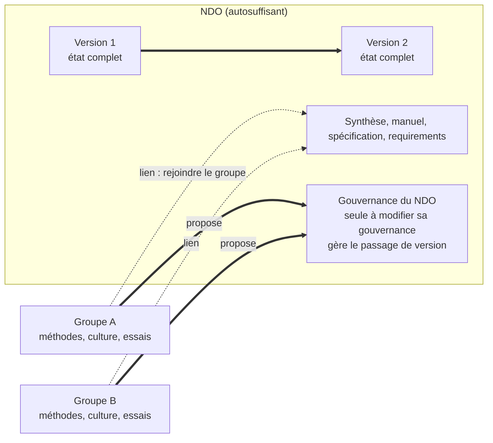
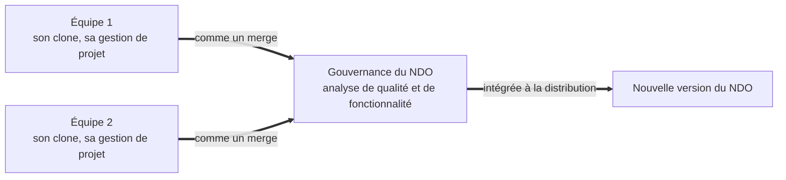
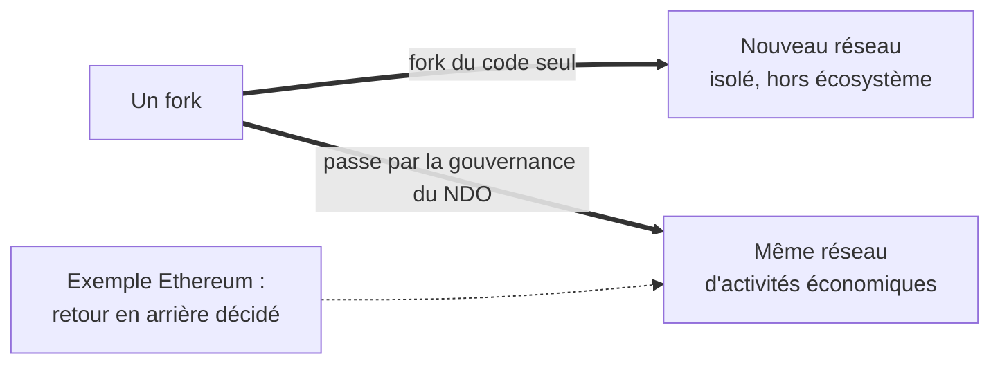

# Nondominium, Journal de la séance au Lab avec Tibi, partie 1 (15 h 09)

**Date :** mardi 17 novembre 2026, 15 h 09 (55 min, de 15 h 09 à 16 h 04, partie 1 sur 4 de la séance au Sensorica Lab, enregistrée au téléphone ; seule une partie est lisible, voir Contexte)

**Participants :** Soushi (Sacha Pignot, développeur principal de Nondominium), Tibi (Tiberius Brastaviceanu, cofondateur de Sensorica). La transcription vient du moteur local sans séparation des locuteurs ; qui dit quoi est reconstitué au fil du contenu, et reste une inférence. Là où la voix ne se laisse pas attribuer, le journal le dit.

**Contexte :** Suite de la séance au Lab du 20 octobre et du brainstorm Moss du 27 octobre. Le jalon GitHub « v0.1.0 Moss pilot » est daté au 15 décembre, et le board de release v0.1.0 a été publié le jour même dans le design system (PR #29). **La première partie est très mal transcrite** : la parole y est souvent hachée, et le premier passage du moteur (faster-whisper small) ne rendait plus rien après [16] jusqu'à la fin du fichier à [55]. Une seconde transcription avec un modèle plus gros (faster-whisper medium) a récupéré la suite jusqu'à [34], mais de façon très inégale : le texte est lisible de [22] à [33] environ, alors que [17] à [21] et la fin de [33] à [34] ne rendent que des phrases qui bouclent, inutilisables. Ce journal ne contient donc rien de [34] à la fin du fichier à [55], soit environ 21 minutes, et seulement des fragments de [16] à [22] ; la cause est inconnue (silence, pause, son inaudible, ou modèle qui décroche). Noms propres mal transcrits et corrigés ici : « Sonsorica », « sans surica », « censurica », « surica » deviennent Sensorica ; « holo chaine », « lot chaine », « au lot chaine », « l'autre chaîne », « RolloChain » deviennent Holochain ; « endominion », « non dominium », « notre dominium », « non-dominium », « endroïneum » deviennent Nondominium ; « l'IAI », « les ailes », « les haïs », « l'éaille » deviennent l'IA ; « indio », « endio », « édio », « idiot » et sans doute « mignon » deviennent NDO (inférence pour « mignon ») ; « zone », « ome », « selles » deviennent zome et cells ; « hétérium » devient Ethereum ; « soft port versus hard port » devient soft fork contre hard fork ; « comic-merge », « issues d'EPR » deviennent commit, merge, issues et PR ; « Lili » (ouverture de la première partie) désigne Tibi ; « indio », « indominia », « NBO », « N2O » et « mignon » désignent le NDO ; « work-in-test », « contexte de force » et « contexte off work » désignent le contexte de travail (*work context*) ; « le bit » désigne Git ; « le speed non-dominant » désigne le skill Nondominium. Un seul enregistrement, donc une seule horloge : les crochets donnent la minute dans le fichier de la partie, `[12]`, `[34 à 36]`. Voir l'[Index de la séance](2026-11-17-lab) pour les décisions, les actions et les points en suspens de toutes les parties, et les autres parties : [partie 2](2026-11-17-lab-p2), [partie 3](2026-11-17-lab-p3), [partie 4](2026-11-17-lab-p4).

## TL;DR

La première partie, très mal transcrite, ne se lit que par morceaux, mais elle pose le NDO autosuffisant : il possède son état, son code et sa gouvernance, chaque version en garde un état complet, le détail du travail et la gestion de projet restent dans les groupes et les contextes de travail, et forker le code isole du réseau alors que passer par la gouvernance du NDO y garde le fork. La partie récupérée de [22] à [33] ajoute les trois niveaux personnel, contexte de travail et groupe avec leurs agents, la place des serveurs MCP et celle des skills. Rien n'est lisible de [34] à la fin du fichier à [55].

## Discussion

**Le NDO se suffit à lui-même : ce qu'il possède.** La première partie s'ouvre au milieu d'un exposé ; la voix n'est pas identifiable avec certitude, et la reprise de l'architecture du NDO comme l'exemple d'Ethereum plus loin font pencher pour Tibi (inférence). Le point de départ est le contenu même du NDO : il porte en lui-même sa gouvernance et ses données, « les trois » éléments qui le constituent étant évoqués sans que la transcription permette de nommer le troisième avec sûreté. Vient ensuite la question du stockage : comment le contenu est assuré, sur quelle zome, quel stockage, par l'intermédiaire d'une pièce de l'architecture que le moteur rend par « l'autocomplicateur » (le coordinateur ou l'opérateur, sans qu'on puisse trancher). [0 à 1]

**Seule la gouvernance modifie la gouvernance.** L'exposé insiste sur une distinction : la gouvernance n'est pas gérée par cette pièce de l'architecture. « La gouvernance, elle est seule » à avoir le droit de modifier ou de faire évoluer la gouvernance du NDO sur la plateforme ; aucune autre couche, aucune application, aucun groupe ne la réécrit de l'extérieur. Un « système d'intérêts » est mentionné juste après, en lien avec une zome (un passage où le moteur hésite, « phase 10, zone »), sans qu'on puisse en dire plus. Cette autonomie est la condition de tout ce qui suit : si le NDO gouverne seul sa propre gouvernance, alors c'est à lui, et non aux groupes qui travaillent dessus, de décider de ce qui devient une nouvelle version. [1 à 2]

**Autosuffisant : l'état, le code, la spécification.** Le NDO « possède son état, il possède son code », et toute l'information nécessaire à sa fonction : sa description, sa spécification et, pour du matériel, la documentation de fabrication, de même que la documentation de la façon dont sa gouvernance fonctionne, contenue dans le NDO. La formule retenue est que le NDO doit être autosuffisant (« certes sufficient » dans la transcription) : quelqu'un qui le trouve n'a pas à aller chercher ailleurs ce qu'il faut pour le comprendre, le reproduire ou l'utiliser. [1 à 2]

**Les versions, chacune un état complet.** Les NDO ont aussi un cycle de vie, ils évoluent, et leurs versions sont encapsulées dans le NDO lui-même. La version 1 a son état complet, la version 2 a aussi son état complet, de sorte que l'historique de ces états est conservé ; chaque état, « c'est une photo » de l'état complet du NDO à ce moment-là. Le modèle est donc celui d'une suite d'instantanés complets plutôt que d'un journal de modifications : on peut revenir à n'importe quelle version sans rejouer l'histoire qui y mène. [2 à 3]

**Le développement appartient aux groupes.** Tout le travail qui va dans le développement du NDO, « on a dit que ça c'est un aspect dans les groupes » : les méthodologies de travail, de collaboration et de coordination dans le développement de nouvelles versions sont propres à chaque groupe. Un groupe a sa culture ; un groupe peut vouloir travailler, par exemple, sur certains aspects d'information du NDO, un autre sur d'autres. L'information sur la façon dont on est arrivé à la version 1, puis à la version 2, n'a pas à être portée par le NDO lui-même. C'est le prolongement direct des membranes du 20 octobre : la comptabilité et la culture de travail restent dans le groupe, le NDO reste organisation-agnostique. [2 à 4]

**Le passage de version, géré par le NDO, avec des liens vers les groupes.** Quand on arrive à une version, c'est la gouvernance même du NDO qui gère la transition d'une version à l'autre. Au moment du passage, le NDO entre dans son nouvel état sans nécessairement porter toute l'information sur l'intermédiaire, mais avec des liens qui disent : nous, on travaille sur tel aspect ; nous, sur tel autre. Ces liens permettent d'aller chercher le contexte organisationnel, pour comprendre comment les décisions ont été prises, « qu'est-ce qui a été essayé, qu'est-ce qui a marché, qu'est-ce qui n'a pas marché ». Le NDO garde ainsi un fil vers son histoire sans la contenir. [4 à 5]

**Combien charger le NDO.** Le souci est formulé tel quel : « Combien est-ce qu'on charge » le NDO ? La réponse avancée est de ne pas exiger que sa gouvernance porte toute l'historique, tout le travail, toute l'exposition qu'on pourrait en faire : il suffit de donner un lien de référence, comme une citation, qui dit en substance de rejoindre tel groupe pour avoir accès à tout le reste. À l'étape de revue de version, le NDO arrive quand même avec son manuel, son document de spécification, ses requirements. [5 à 6]

**La synthèse, pas le détail.** L'interlocuteur confirme et précise : il y a quand même une synthèse du travail fait ailleurs dans le groupe, qui entre dans l'état du NDO et dit par exemple « la première version faisait ça », avec sa revue. « Oui, c'est ça, c'est ça. Mais, mais c'est juste une synthèse. » Ce qui ne va pas dans le NDO, ce sont tous les essais des gens, les impasses du développement, les approches qui ont échoué : « c'est des détails », la complexité propre au développement, dont la personne qui parle dit avoir l'expérience pour avoir énormément travaillé sur des projets. La ligne qui se dessine : l'état de version porte le résultat et sa synthèse, le groupe porte le chemin. [5 à 7]

**L'histoire d'un projet se lit dans ses issues, ses PR et ses commits.** Une voix, vraisemblablement Soushi (inférence), répond par la pratique : le projet est géré avec les issues, les PR et le board, et l'historique des commits raconte déjà l'histoire du développement, de l'architecture et de l'autorité sur le code. C'est « vraiment intéressant » parce que la manière dont l'équipe travaille y est inscrite, et qu'une IA peut en tirer une analyse qu'aucun humain ne ferait : « il est impossible pour un humain de faire une telle analyse ». Combinée aux autres sources, vidéos, notes, discussions, « il y a énormément d'informations riches ». L'argument implicite : l'histoire détaillée n'a pas besoin d'être recopiée dans le NDO, puisqu'elle existe déjà là où le travail se fait et qu'elle devient lisible avec les bons outils. La suite du passage est inaudible. [6 à 8]

**L'émergence du projet fait-elle partie du NDO ?** La discussion revient à ce qui appartient au NDO : comment le projet a été lancé et a émergé, « ça c'est ça qui fait partie » du NDO. Une question de reformulation suit, où le NDO serait essentiellement comme un dépôt qui contiendrait l'historique de ses changements (le moteur rend la phrase de façon méconnaissable, l'analogie au dépôt est une inférence). La réponse place cet historique dans le groupe : c'est la gestion du cycle de vie, une fonction très pratique au niveau du groupe, avec ses étapes de revue et de fusion, mais pas forcément au niveau des personnes et de l'histoire fine. [8 à 9]

**La gestion de projet au niveau du contexte de travail.** La question de la gestion de projet revient alors, celle-là même qui avait mené au brainstorm sur le contexte de travail le 27 octobre : on aurait tendance à la mettre au niveau du contexte de travail (le *work context*, rendu « work-on-fest » par le moteur). L'objection qui la confirme : pour le même NDO, il peut y avoir plusieurs équipes, chacune avec sa propre gestion de projet. La gestion de projet ne peut donc pas être celle du NDO : elle est associée au lieu où chaque équipe travaille, avec sa propre organisation. [9 à 10]

**L'analogie Git : le clone local et le fork.** L'image vient de Git et de GitHub : souvent, on fait un clone local sur sa machine pour pouvoir travailler, et l'on n'a pas forcément le droit de créer des branches sur le dépôt d'origine ni de travailler avec ses branches ; on peut pourtant avoir sa propre gestion de projet à son niveau. Il peut y avoir deux groupes de développeurs techniques qui travaillent chacun sous leur propre compte, qui ont fait chacun un fork du même dépôt, et qui ont leur propre système de gestion de projet : « C'est pas grave. » La pluralité des façons de travailler n'est pas un problème à résoudre, c'est la situation normale. [9 à 11]

**Le merge passe par la gouvernance du NDO.** « On avait déjà dit ça avant » : au moment où la chose est prête, c'est comme un commit et un merge sur le NDO, qui se heurte à la gouvernance de merge du NDO. Ceux qui portent cette gouvernance appliquent leurs critères : une analyse de qualité de la chose, de sa fonctionnalité, après quoi ils décident de l'intégrer dans la distribution du NDO, c'est-à-dire de lever une nouvelle version. On retrouve la pull request du 20 octobre, vue cette fois du côté du NDO : les équipes sont libres en amont, la version est décidée en aval, par une seule instance. [10 à 11]

**On peut forker, mais la version officielle a sa régulation.** Le passage suivant est très abîmé par la transcription, et seule sa ligne générale se lit. Il est acceptable que les gens puissent forker ; dans Nondominium, un peu moins librement qu'ailleurs, parce qu'il y a une gouvernance autour de cela. La gestion de la version officielle passe par tout un système de régulation, et il faut éviter qu'une version non officielle se fasse passer pour elle ; en même temps, les gens gardent le choix. [11 à 13]

**Forker le code ne suffit pas pour rester dans le réseau.** La thèse ressort ensuite nettement. Forker le code et forker le NDO ne sont pas la même chose : celui qui forke le code n'est pas connecté au réseau du NDO, ni au monde d'activité qui l'entoure, il est isolé. D'où le rôle de la gouvernance du NDO, « pour que le fork devienne partie du réseau même d'activités économiques ». La gouvernance peut choisir de ne pas reconnaître un fork, mais elle ne l'empêche pas d'exister : « Il faut laisser la liberté. » Le fork reconnu reste dans le réseau et garde la mobilité de ses participants, la possibilité d'y faire des plans, des tests et le reste ; le fork du code seul repart de zéro, ailleurs. [13 à 15]

**L'exemple d'Ethereum, et le soft fork contre le hard fork.** L'exemple donné est Ethereum. Quand Ethereum décide d'un retour en arrière pour invalider une transaction, la décision passe, et tout le monde reste sur le même réseau. Mais quiconque forke le code d'Ethereum sort de l'écosystème : on peut forker le code et faire un nouveau réseau, mais pour rester dans le même réseau, forker le code ne suffit pas, il faut aussi les mineurs, ceux qui font tourner le réseau. La question est rapprochée de la distinction entre soft fork et hard fork : est-ce qu'on fait une version dans le réseau, ou est-ce qu'on emporte le code hors du réseau ? L'enregistrement se tait au moment de la creuser (« c'est encore une question de plus en plus de la question à laquelle... »), et le moteur ne rend plus rien d'utilisable avant [22] (la reprise par un modèle plus gros n'y trouve que des phrases qui bouclent). [14 à 16]

**Personnel, contexte de travail, groupe : les trois niveaux reviennent, avec leurs agents.** Après la lacune qui suit l'exemple d'Ethereum, la reprise tombe sur une remarque : c'est intéressant qu'on retrouve les trois niveaux, le personnel, le contexte de travail et le groupe.
La voix qui répond ajoute l'idée d'intelligence collective ; la fin de la phrase, rendue par « la coût de l'intelligence, toute forme de sport », est illisible.
Le schéma est ensuite déroulé dans l'ordre : des personnes travaillent sur des tâches et se coordonnent au niveau du contexte de travail.
Sous le contexte de travail se trouve la gestion du projet dans son ensemble, la même que celle du brainstorm du 27 octobre.
Chaque groupe a plusieurs contextes de travail, donc plusieurs projets.
À ce niveau, on pourrait aussi placer des agents IA qui voient tout le travail qui se fait dans le contexte (le moteur écrit « la flèche de work sur Google Engine », sans doute un flux de travail ; l'inférence reste faible).
La qualification des voix reste ouverte : l'exposé de l'architecture vient plus probablement de Soushi, et la réaction d'ouverture, de Tibi (inférence). [22 à 23]

**Le niveau personnel doit rester souple.** Une objection arrive, dite avec un « je dirais, oui, à la différence que » : le personnel doit être très flexible, et il n'est pas obligé d'accéder au contexte de travail, ni à un autre.
La présentation faite jusque-là « chaîne un peu l'idée » de cette souplesse, comme si le personnel devait passer par les niveaux au-dessus.
La réponse décrit un petit agent personnel capable de parler directement avec celui du groupe ou avec un contexte de travail précis, voire sans passer par eux, en allant chercher l'information là où elle est.
Grâce aux MCP, il n'y a même pas besoin d'agents spécialisés par niveau : les agents personnels, de niveau 1, ont accès au contexte de travail et au groupe, et ce sont eux qui se coordonnent entre eux.
La formule qui ressort est que tout se ramène à des agents personnels qui se coordonnent, sans agent propre au groupe ni au contexte. [22 à 24]

**L'agent reste là quand la personne dort.** Soushi (inférence, c'est lui qui raconte son usage) relève que cela dépend de l'ouverture des portables, de ce qui est allumé ou non.
La personne peut dormir, son portable rester ouvert, et son agent est quand même là.
Même quand l'humain est absent, le travail avance : les gens peuvent venir travailler, la vie du réseau continue.
Il ajoute une anecdote d'usage, que la transcription rend de façon trouée : il parle de partir dans la nuit et de travailler plus tard pour toucher la limite de jetons ; la phrase ne dit pas clairement qui travaille.
Le passage est trop abîmé pour en dire plus ; seule l'idée se lit, que l'agent personnel reste actif pendant l'absence de son humain. [24]

**Au-dessus de l'architecture, l'organisation et le lobby.** « Au-dessus de l'architecture, il y a aussi l'organisation » : on peut avoir des institutions pour les groupes, pour les bureaux.
Le niveau du lobby est cité comme réussi : on est inscrit dans un groupe, l'agent est individuel, et il permet de travailler dans chaque organisation.
On peut donc utiliser ces principes pour gérer son propre état, avec son propre lobby.
Un ajout en début de minute 25, très mal transcrit (quelqu'un qui a « des voies de telles compétences », « le marketing »), parle d'une personne présente dans plusieurs groupes à la fois ; le sens se perd après. [24 à 25]

**La composition, de haut en bas de la chaîne.** L'agent personnel est décrit comme capable de remonter la chaîne et de faire la composition à quatre endroits : entre les contextes de travail d'un même groupe, entre les NDO d'un même groupe, entre les NDO et les contextes de travail, et entre les groupes eux-mêmes.
Cela permet à un agent personnel et à son humain, comme individu, de se proposer auprès de contextes de travail et de groupes, de faire de nouveaux NDO, de travailler dans d'autres groupes et d'y créer des NDO.
« Ça pourrait être une idée », dit la voix, que la fin du passage laisse en suspens : « tu as le fonds là, de faire des NDO » reste obscur. [25 à 26]

**La place des serveurs MCP.** Une voix (Tibi, vraisemblablement, parce que c'est une question, et que « je veux voir aussi la place des MCP servers » demande une explication ; inférence) pose la question suivante : où vont les serveurs MCP qui pourraient se connecter à différents groupes et lire les contextes de travail ?
L'image est celle d'une API qui descend la hiérarchie, lobby, groupe, contexte de travail, NDO, avec des MCP capables de naviguer dans cette arborescence.
Le matchmaking est cité comme exemple de ce qu'ils feraient, et la question se resserre : quelle est la place des agents, et celle des MCP, là-dedans ?
La réponse est que les serveurs MCP allègent la charge computationnelle des modèles : ils font la navigation, la part plus algorithmique, tandis que le modèle fait le reste.
On peut en créer dans les groupes, dans les contextes de travail, et des MCP personnels pour les informations qui restent à l'individu.
Un agent personnel peut ainsi interroger : dans quel groupe, dans quel contexte, une certaine tâche est faite, et la donnée est apportée par un MCP spécialisé plutôt que reconstituée par le modèle.
La suite de la minute 27, où l'on distingue ce qui est algorithmique de ce qui revient au modèle (« le NOOX, c'est le serveur », phrase non rattachée à rien), est trop trouée pour être rapportée. [26 à 28]

**Le MCP Holochain de Soushi, avant les skills.** À 28 min, Soushi (inférence : le récit concerne son propre travail) revient sur un MCP pour Holochain, fait « avant même que le concept de skills soit inventé » ; depuis, les skills se sont montrés meilleurs, et il l'a mis de côté de plus en plus.
L'idée d'un serveur MCP générique de Holochain tient pourtant : une boîte à outils qui permet d'interagir avec le conducteur et de faire tout ce que Holochain permet.
Un MCP, dit-il, est « juste un truc » : un jeu d'outils sans mode d'emploi.
La suite, mal transcrite, va dans le sens d'un MCP générique plutôt que d'un MCP propre à Nondominium, et d'une « belle composition pour la communauté » (le moteur écrit « plus un speed non-dominant, ce qui est le mythe » ; lu : « plus un skill Nondominium »). [28 à 30]

**Le MCP donne les outils, le skill dit comment s'en servir.** Le raisonnement est une division du travail en deux couches.
Le MCP donne l'accès : il faut lui donner des tâches, et lui seul ne sait pas quoi en faire.
Le skill Nondominium dit comment l'utiliser : comment faire des versions, comment faire du matchmaking, toutes les actions qu'on voudrait faire dessus.
C'est « vraiment la couche » qui manquait : des actions positives et génériques, remontées vers ce qui est le plus commun entre les cas.
Le moteur écrit « tapé dans un deck » là où l'on lit probablement « donné dans un skill » ; le sens général est clair malgré le mot.
La conclusion de cette minute est d'être passé de l'architecture des agents à la question des skills elle-même. [29 à 31]

**Où vivent les skills : dans le NDO, dans le groupe, ou dans le contexte ?** On pose alors la question explicitement : quel type de skill veut-on avoir, et où seront-ils placés ?
Première piste : un NDO, qui porte déjà son état, son code et sa gouvernance, pourrait aussi venir avec un skill, qui dirait à un agent comment l'utiliser.
Deuxième piste : le groupe pourrait avoir le sien.
L'agent IA de la personne, qui a son propre harnais, irait chercher le skill au niveau voulu, selon le contexte où il travaille ; le moteur boucle sur « soit un complexe de combo » à cet endroit, ce qui rend la phrase inutilisable.
La voix hésite sur la place d'un skill de groupe : ce serait peut-être quelque chose de gros, parce que le groupe est vu comme un autre « venture » avec son propre projet.
Un tel skill serait un processus, ou un skill général adapté au contexte, et il pourrait y avoir en plus des skills propres au NDO.
La question qui clôt le passage est restée sans réponse dans l'enregistrement lisible : où sont ces skills, et quelles sont les règles ? [30 à 33]

**La fin de la reprise.** À 34 min, quelqu'un répond « oui, il y a des règles », puis le moteur ne produit plus que des variations sur une même phrase de questions sur l'interaction (« ce n'est pas la question d'un problème d'interaction, mais c'est la question de l'interaction »).
Rien de ce qui est dit ne peut s'y lire.
La reprise s'arrête à 34 min 29, fin de la transcription du modèle moyen, quand le fichier enregistré va jusqu'à 55 min. [34]

## Discuté, non tranché

- **Où vivent les skills : dans le NDO, dans le groupe, ou dans le contexte de travail, et selon quelles règles.** La question est posée à [30 à 33] et reste sans réponse lisible ; l'enregistrement perd la discussion juste après.

- **Le rôle des serveurs MCP et des agents dans la chaîne lobby, groupe, contexte de travail, NDO.** Une direction se dessine (un MCP générique de Holochain pour l'accès, un skill Nondominium pour le mode d'emploi, les agents personnels qui se coordonnent sans agent propre au groupe) mais rien n'est arrêté. [22 à 30]

- **Combien d'histoire le NDO porte-t-il.** Une synthèse et des liens vers les groupes semblent suffire, mais la frontière entre ce qui va dans l'état de la version et ce qui reste dans les groupes n'est pas fixée. [3 à 6]

- **Fork du code contre fork dans le réseau, soft fork contre hard fork.** La thèse est posée (la gouvernance du NDO garde le fork dans le réseau, le code seul l'isole), la suite de [16] à [22] n'est pas lisible. [13 à 16]
