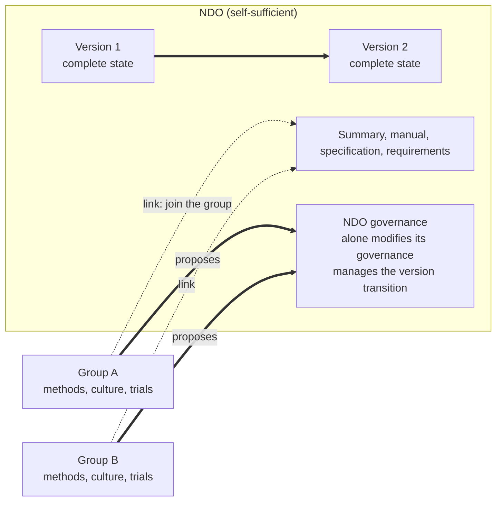
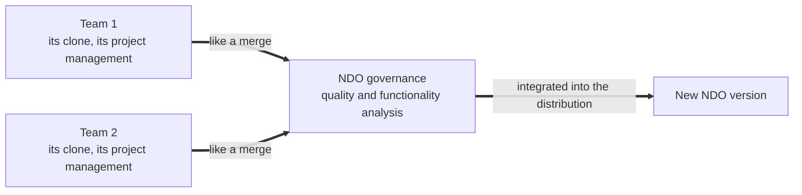
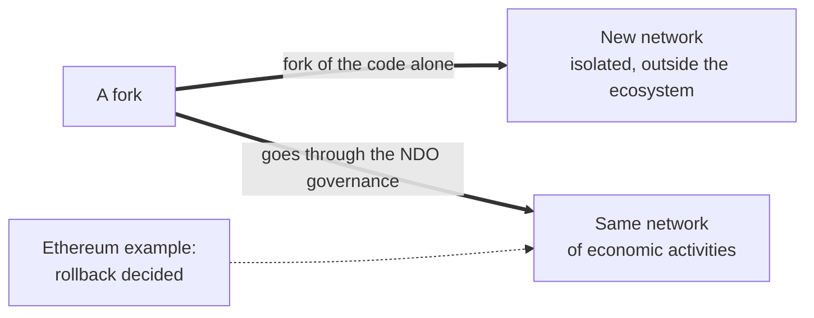

# Nondominium, Journal of the Lab session with Tibi, part 1 (3:09 p.m.)

**Date:** Tuesday, November 17, 2026, 3:09 p.m. (55 min, from 3:09 p.m. to 4:04 p.m., part 1 of 3 of the session at the Sensorica Lab, recorded on a phone; only part of it is readable, see Context)

**Attendees:** Soushi (Sacha Pignot, lead developer of Nondominium), Tibi (Tiberius Brastaviceanu, co-founder of Sensorica). The transcript comes from the local engine without speaker separation; who says what is reconstructed from the content, and remains an inference. Where the voice cannot be attributed, the journal says so.

**Context:** Follows the Lab session of October 20 and the Moss brainstorm of October 27. The GitHub milestone "v0.1.0 Moss pilot" is dated December 15, and the v0.1.0 release board was published the same day in the design system (PR #29). **The first part is very poorly transcribed**: speech in it is often choppy, and the first pass of the engine (faster-whisper small) rendered nothing after [16] until the end of the file at [55]. A second transcription with a bigger model (faster-whisper medium) recovered the rest up to [34], but very unevenly: the text is readable from about [22] to [33], whereas [17] to [21] and the end of [33] to [34] yield only looping sentences, unusable. This journal therefore contains nothing from [34] to the end of the file at [55], about 21 minutes, and only fragments from [16] to [22]; the cause is unknown (silence, a pause, inaudible sound, or the model giving up). Misheard proper nouns, corrected here: "Sonsorica", "sans surica", "censurica", "surica" become Sensorica; "holo chaine", "lot chaine", "au lot chaine", "l'autre chaîne", "RolloChain" become Holochain; "endominion", "non dominium", "notre dominium", "non-dominium", "endroïneum" become Nondominium; "l'IAI", "les ailes", "les haïs", "l'éaille" become the AI; "indio", "endio", "édio", "idiot" and probably "mignon" become NDO (inference for "mignon"); "zone", "ome", "selles" become zome and cells; "hétérium" becomes Ethereum; "soft port versus hard port" becomes soft fork versus hard fork; "comic-merge", "issues d'EPR" become commit, merge, issues and PR; "Lili" (opening of the first part) refers to Tibi; "indio", "indominia", "NBO", "N2O" and "mignon" refer to the NDO; "work-in-test", "contexte de force" and "contexte off work" refer to the work context (*work context*); "le bit" refers to Git; "le speed non-dominant" refers to the Nondominium skill. One recording, so one clock: the brackets give the minute in the file of the part, `[12]`, `[34 to 36]`. This is an English translation; the original journal is in French.

Session index: [ndo-tibi-lab-niceboard-2026-11-17.html](2026-11-17-lab), with the decisions, actions and open points of all the parts. Other parts: [part 2](2026-11-17-lab-p2), [part 3](2026-11-17-lab-p3).

## TL;DR

The first part, very poorly transcribed, can only be read in pieces, but it lays out the self-sufficient NDO: it owns its state, its code and its governance, each version keeps a complete state of it, the detail of the work and the project management stay in the groups and work contexts, and forking the code isolates from the network whereas going through the NDO's governance keeps the fork in it. The portion recovered from [22] to [33] adds the three levels of personal, work context and group with their agents, the place of MCP servers and that of skills. Nothing is readable from [34] to the end of the file at [55].

## Discussion

**The NDO is sufficient unto itself: what it owns.** The first part opens in the middle of a presentation; the voice cannot be identified with certainty, and the return to the NDO's architecture as well as the Ethereum example later on lean toward Tibi (inference). The starting point is the very content of the NDO: it carries its governance and its data within itself, "the three" elements that constitute it being mentioned without the transcript allowing the third to be named with confidence. Next comes the question of storage: how the content is ensured, on which zome, which storage, by way of a piece of the architecture that the engine renders as "l'autocomplicateur" (the coordinator or the operator, with no way to decide). [0 to 1]

**Only governance modifies governance.** The presentation insists on a distinction: governance is not managed by that piece of the architecture. "La gouvernance, elle est seule" (governance, it alone) has the right to modify or evolve the NDO's governance on the platform; no other layer, no application, no group rewrites it from outside. A "system of interests" is mentioned right after, in connection with a zome (a passage where the engine hesitates, "phase 10, zone"), with nothing more that can be said. This autonomy is the condition of everything that follows: if the NDO alone governs its own governance, then it is up to the NDO, and not to the groups working on it, to decide what becomes a new version. [1 to 2]

**Self-sufficient: the state, the code, the specification.** The NDO "possède son état, il possède son code" (owns its state, owns its code), and all the information necessary to its function: its description, its specification and, for hardware, the manufacturing documentation, as well as the documentation of how its governance works, contained in the NDO. The formula retained is that the NDO must be self-sufficient ("certes sufficient" in the transcript): someone who finds it does not have to look elsewhere for what is needed to understand, reproduce or use it. [1 to 2]

**Versions, each a complete state.** NDOs also have a life cycle, they evolve, and their versions are encapsulated in the NDO itself. Version 1 has its complete state, version 2 also has its complete state, so that the history of these states is kept; each state is "c'est une photo" (a photo) of the complete state of the NDO at that moment. The model is therefore a series of complete snapshots rather than a change log: one can go back to any version without replaying the history that leads to it. [2 to 3]

**Development belongs to the groups.** All the work that goes into developing the NDO, "on a dit que ça c'est un aspect dans les groupes" (we said that this is an aspect in the groups): the work, collaboration and coordination methodologies in developing new versions are specific to each group. A group has its culture; a group may want to work, for example, on certain information aspects of the NDO, another on others. The information on how version 1 was reached, then version 2, does not have to be carried by the NDO itself. This is the direct extension of the October 20 membranes: accounting and work culture stay in the group, the NDO stays organization-agnostic. [2 to 4]

**The version transition, managed by the NDO, with links to the groups.** When a version is reached, it is the NDO's own governance that manages the transition from one version to the next. At the moment of the transition, the NDO enters its new state without necessarily carrying all the information about what happened in between, but with links that say: we work on this aspect; we on that one. These links make it possible to fetch the organizational context, to understand how decisions were made, "qu'est-ce qui a été essayé, qu'est-ce qui a marché, qu'est-ce qui n'a pas marché" (what was tried, what worked, what did not work). The NDO thus keeps a thread to its history without containing it. [4 to 5]

**How much to load onto the NDO.** The concern is put as such: "Combien est-ce qu'on charge" (how much do we load) the NDO? The answer put forward is not to require its governance to carry the whole history, all the work, all the exposure one could make of it: it is enough to give a reference link, like a citation, that says in essence to join such and such group to get access to all the rest. At the version review stage, the NDO still arrives with its manual, its specification document, its requirements. [5 to 6]

**The summary, not the detail.** The interlocutor confirms and adds precision: there is still a summary of the work done elsewhere in the group, which enters the NDO's state and says for example "the first version did this", with its review. "Oui, c'est ça, c'est ça. Mais, mais c'est juste une synthèse." (Yes, that's it, that's it. But, but it's just a summary.) What does not go into the NDO is all the people's trials, the dead ends of development, the approaches that failed: "c'est des détails" (those are details), the complexity inherent to development, of which the speaker says they have experience from having worked a great deal on projects. The line that emerges: the version state carries the result and its summary, the group carries the path. [5 to 7]

**A project's history is read in its issues, its PRs and its commits.** A voice, presumably Soushi (inference), answers from practice: the project is managed with issues, PRs and the board, and the commit history already tells the story of the development, the architecture and the authority over the code. It is "vraiment intéressant" (really interesting) because the way the team works is inscribed in it, and because an AI can draw from it an analysis that no human would make: "il est impossible pour un humain de faire une telle analyse" (it is impossible for a human to do such an analysis). Combined with the other sources, videos, notes, discussions, "il y a énormément d'informations riches" (there is an enormous amount of rich information). The implicit argument: the detailed history does not need to be copied into the NDO, since it already exists where the work is done and becomes readable with the right tools. The rest of the passage is inaudible. [6 to 8]

**Is the project's emergence part of the NDO?** The discussion returns to what belongs to the NDO: how the project was launched and emerged, "ça c'est ça qui fait partie" (that is what is part of) the NDO. A rephrasing question follows, in which the NDO would essentially be like a repository containing the history of its changes (the engine renders the sentence unrecognizably, the analogy to the repository is an inference). The answer places that history in the group: it is life-cycle management, a very practical function at the group level, with its review and merge steps, but not necessarily at the level of people and fine-grained history. [8 to 9]

**Project management at the work context level.** The question of project management then comes back, the very one that had led to the work context brainstorm on October 27: one would tend to put it at the work context level (the *work context*, rendered "work-on-fest" by the engine). The objection that confirms it: for the same NDO, there can be several teams, each with its own project management. Project management therefore cannot be the NDO's: it is tied to the place where each team works, with its own organization. [9 to 10]

**The Git analogy: the local clone and the fork.** The image comes from Git and GitHub: often, one makes a local clone on one's machine to be able to work, and one does not necessarily have the right to create branches on the original repository or to work with its branches; one can nonetheless have one's own project management at one's level. There can be two groups of technical developers, each working under their own account, each having made a fork of the same repository, and each having their own project management system: "C'est pas grave." (No big deal.) The plurality of ways of working is not a problem to solve, it is the normal situation. [9 to 11]

**The merge goes through the NDO's governance.** "On avait déjà dit ça avant" (we already said that before): when the thing is ready, it is like a commit and a merge on the NDO, which runs into the NDO's merge governance. Those who carry this governance apply their criteria: a quality analysis of the thing, of its functionality, after which they decide to integrate it into the NDO's distribution, that is, to cut a new version. This is the October 20 pull request again, seen this time from the NDO's side: teams are free upstream, the version is decided downstream, by a single body. [10 to 11]

**One can fork, but the official version has its regulation.** The next passage is badly damaged by the transcription, and only its general line can be read. It is acceptable for people to be able to fork; in Nondominium, a little less freely than elsewhere, because there is governance around it. Management of the official version goes through a whole regulation system, and an unofficial version must be prevented from passing itself off as the official one; at the same time, people keep the choice. [11 to 13]

**Forking the code is not enough to stay in the network.** The thesis then stands out clearly. Forking the code and forking the NDO are not the same thing: whoever forks the code is not connected to the NDO's network, nor to the world of activity around it, they are isolated. Hence the role of the NDO's governance, "pour que le fork devienne partie du réseau même d'activités économiques" (so that the fork becomes part of the very network of economic activities). Governance can choose not to recognize a fork, but it does not prevent it from existing: "Il faut laisser la liberté." (Freedom must be left.) A recognized fork stays in the network and keeps the mobility of its participants, the possibility of making plans, tests and the rest there; a fork of the code alone starts from zero, elsewhere. [13 to 15]

**The Ethereum example, and soft fork versus hard fork.** The example given is Ethereum. When Ethereum decides on a rollback to invalidate a transaction, the decision goes through, and everyone stays on the same network. But whoever forks Ethereum's code leaves the ecosystem: one can fork the code and make a new network, but to stay in the same network, forking the code is not enough, one also needs the miners, those who run the network. The question is related to the distinction between soft fork and hard fork: do we make a version within the network, or do we take the code out of the network? The recording falls silent just as it digs into it ("c'est encore une question de plus en plus de la question à laquelle..." (it is again a question more and more of the question to which...)), and the engine renders nothing usable before [22] (the pass with a bigger model finds only looping sentences there). [14 to 16]

**Personal, work context, group: the three levels return, with their agents.** After the gap that follows the Ethereum example, the recording resumes on a remark: it is interesting that the three levels are found again, the personal, the work context and the group.
The voice that answers adds the idea of collective intelligence; the end of the sentence, rendered as "la coût de l'intelligence, toute forme de sport", is illegible.
The schema is then unrolled in order: people work on tasks and coordinate at the work context level.
Under the work context lies the management of the project as a whole, the same as in the October 27 brainstorm.
Each group has several work contexts, therefore several projects.
At this level, one could also place AI agents that see all the work being done in the context (the engine writes "la flèche de work sur Google Engine", probably a workflow; the inference remains weak).
The attribution of voices stays open: the presentation of the architecture more probably comes from Soushi, and the opening reaction from Tibi (inference). [22 to 23]

**The personal level must stay flexible.** An objection arrives, said with a "je dirais, oui, à la différence que" (I would say, yes, except that): the personal level must be very flexible, and is not obliged to access the work context, or any other.
The presentation so far "chaîne un peu l'idée" (somewhat chains the idea) of this flexibility, as if the personal level had to go through the levels above it.
The answer describes a small personal agent able to talk directly with the group's or with a specific work context's, or even without going through them, by fetching the information where it is.
Thanks to MCPs, there is not even a need for agents specialized by level: the personal agents, at level 1, have access to the work context and to the group, and they are the ones that coordinate among themselves.
The formula that emerges is that everything comes down to personal agents that coordinate, with no agent specific to the group or to the context. [22 to 24]

**The agent is still there when the person sleeps.** Soushi (inference, he is telling of his own use) notes that this depends on whether laptops are open, on what is on or off.
The person can be asleep, their laptop left open, and their agent is still there.
Even when the human is absent, the work moves forward: people can come and work, the life of the network goes on.
He adds an anecdote of use, which the transcription renders with gaps: he talks about leaving in the night and working later to hit the token limit; the sentence does not say clearly who is working.
The passage is too damaged to say more; only the idea can be read, that the personal agent stays active during its human's absence. [24]

**Above the architecture, the organization and the lobby.** "Au-dessus de l'architecture, il y a aussi l'organisation" (above the architecture, there is also the organization): one can have institutions for groups, for offices.
The lobby level is cited as successful: one is registered in a group, the agent is individual, and it makes it possible to work in each organization.
One can therefore use these principles to manage one's own state, with one's own lobby.
An addition at the start of minute 25, very poorly transcribed (someone who has "des voies de telles compétences" (voices of such skills), "le marketing"), speaks of a person present in several groups at once; the meaning is lost after that. [24 to 25]

**Composition, from top to bottom of the chain.** The personal agent is described as able to go up the chain and do composition in four places: between the work contexts of the same group, between the NDOs of the same group, between NDOs and work contexts, and between the groups themselves.
This allows a personal agent and its human, as an individual, to offer themselves to work contexts and groups, to make new NDOs, to work in other groups and create NDOs there.
"Ça pourrait être une idée" (that could be an idea), says the voice, which the end of the passage leaves hanging: "tu as le fonds là, de faire des NDO" (you have the funds there, to make NDOs) stays obscure. [25 to 26]

**The place of MCP servers.** A voice (Tibi, presumably, because it is a question, and "je veux voir aussi la place des MCP servers" (I also want to see the place of MCP servers) asks for an explanation; inference) asks the following question: where do the MCP servers go that could connect to different groups and read the work contexts?
The image is that of an API descending the hierarchy, lobby, group, work context, NDO, with MCPs able to navigate that tree.
Matchmaking is cited as an example of what they would do, and the question narrows: what is the place of agents, and that of MCPs, in all this?
The answer is that MCP servers lighten the computational load of the models: they do the navigation, the more algorithmic part, while the model does the rest.
One can create them in groups, in work contexts, and personal MCPs for the information that stays with the individual.
A personal agent can thus ask: in which group, in which context, a certain task is done, and the data is brought by a specialized MCP rather than reconstructed by the model.
The rest of minute 27, where what is algorithmic is distinguished from what falls to the model ("le NOOX, c'est le serveur" (the NOOX, it's the server), a sentence attached to nothing), is too full of gaps to report. [26 to 28]

**Soushi's Holochain MCP, before skills.** At 28 min, Soushi (inference: the account concerns his own work) comes back to an MCP for Holochain, made "avant même que le concept de skills soit inventé" (even before the concept of skills was invented); since then, skills have proven better, and he has set it aside more and more.
The idea of a generic Holochain MCP server nonetheless holds: a toolbox that allows interacting with the conductor and doing everything Holochain allows.
An MCP, he says, is "juste un truc" (just a thing): a set of tools without a user manual.
The rest, poorly transcribed, goes toward a generic MCP rather than one specific to Nondominium, and a "belle composition pour la communauté" (nice composition for the community) (the engine writes "plus un speed non-dominant, ce qui est le mythe"; read: "plus a Nondominium skill"). [28 to 30]

**The MCP gives the tools, the skill says how to use them.** The reasoning is a division of labor in two layers.
The MCP gives access: it has to be given tasks, and on its own it does not know what to do with them.
The Nondominium skill says how to use it: how to make versions, how to do matchmaking, all the actions one would want to take on it.
It is "vraiment la couche" (really the layer) that was missing: positive, generic actions, raised toward what is most common between cases.
The engine writes "tapé dans un deck" where one probably reads "donné dans un skill" (given in a skill); the general meaning is clear despite the word.
The conclusion of this minute is to have moved from the architecture of agents to the question of skills itself. [29 to 31]

**Where do skills live: in the NDO, in the group, or in the context?** The question is then put explicitly: what kind of skill do we want to have, and where will they be placed?
First lead: an NDO, which already carries its state, its code and its governance, could also come with a skill, which would tell an agent how to use it.
Second lead: the group could have its own.
The person's AI agent, which has its own harness, would fetch the skill at the desired level, depending on the context in which it works; the engine loops on "soit un complexe de combo" (either a combo complex) at this point, which makes the sentence unusable.
The voice hesitates on the place of a group skill: it would perhaps be something big, because the group is seen as another "venture" with its own project.
Such a skill would be a process, or a general skill adapted to the context, and there could be in addition skills specific to the NDO.
The question that closes the passage was left unanswered in the readable recording: where are these skills, and what are the rules? [30 to 33]

**The end of the recovery.** At 34 min, someone answers "oui, il y a des règles" (yes, there are rules), then the engine produces only variations on a single sentence of questions about interaction ("ce n'est pas la question d'un problème d'interaction, mais c'est la question de l'interaction" (it's not the question of an interaction problem, but it's the question of interaction)).
Nothing of what is said can be read there.
The recovery stops at 34 min 29, the end of the medium model's transcription, when the recorded file runs to 55 min. [34]

## Discussed, not decided

- **Where skills live: in the NDO, in the group, or in the work context, and by what rules.** The question is raised at [30 to 33] and stays without a readable answer; the recording loses the discussion right after.

- **The role of MCP servers and agents in the lobby, group, work context, NDO chain.** A direction is emerging (a generic Holochain MCP for access, a Nondominium skill for the user manual, personal agents that coordinate without an agent of their own for the group) but nothing is settled. [22 to 30]

- **How much history the NDO carries.** A summary and links to the groups seem to suffice, but the boundary between what goes into the version state and what stays in the groups is not fixed. [3 to 6]

- **Fork of the code versus fork within the network, soft fork versus hard fork.** The thesis is laid out (the NDO's governance keeps the fork in the network, the code alone isolates it), the continuation from [16] to [22] is not readable. [13 to 16]
