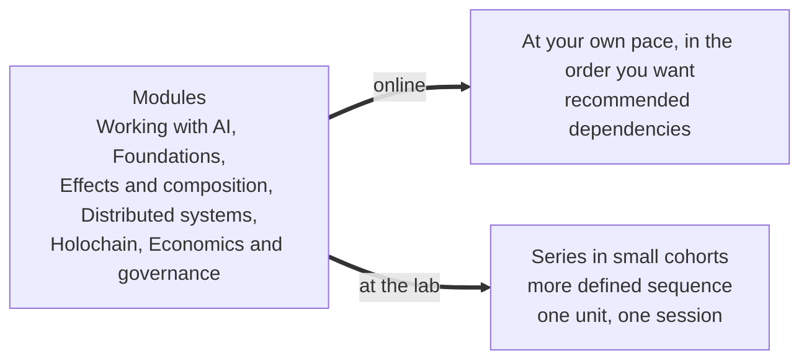
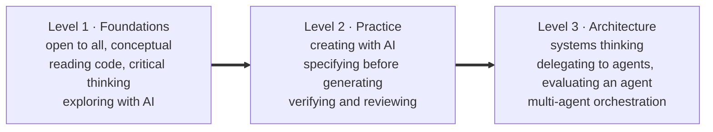
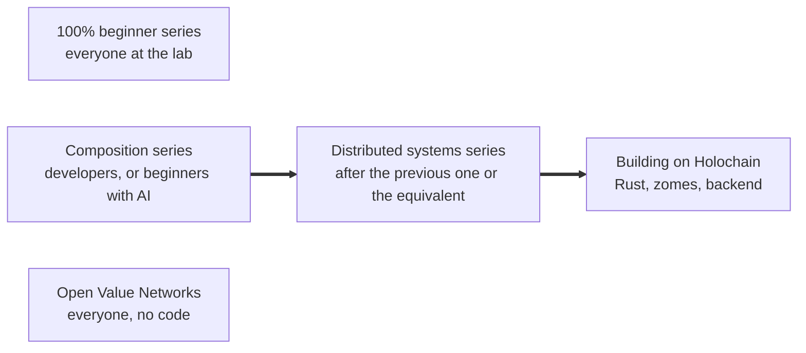
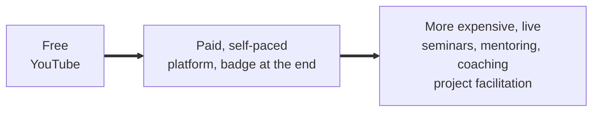
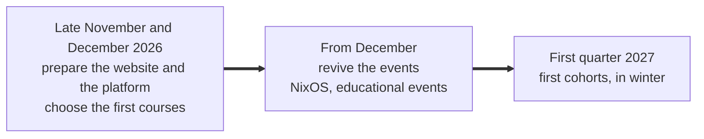
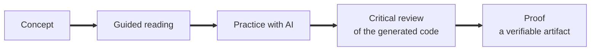

# Nondominium, Journal of the Lab session with Tibi, part 2 (4:06 p.m.)

**Date:** Tuesday, November 17, 2026, 4:06 p.m. (53 min, from 4:06 p.m. to 4:59 p.m., part 2 of 4 of the session at the Sensorica Lab, recorded on a phone)

**Attendees:** Soushi (Sacha Pignot, lead developer of Nondominium), Tibi (Tiberius Brastaviceanu, co-founder of Sensorica). Soushi opens the second part by naming it ("c'est la deuxième partie de la rencontre avec Tibi du 17 novembre au labo" (this is the second part of the meeting with Tibi on November 17 at the lab) [0]). The transcript comes from the local engine without speaker separation; who says what is reconstructed from the content (the presentation of the curriculum, Blood, Nix and the CI come from Soushi; the idea of collaborative entrepreneurship, the three tiers free, paid and in person, and the winter season come from Tibi), and remains an inference. Where the voice cannot be attributed, the journal says so.

**Context:** Follows the Lab session of October 20 and the Moss brainstorm of October 27. The second part presents the curriculum board Soushi prepared over the weekend (the curriculum board), whose module names are used here to correct the transcript. Misheard proper nouns, corrected here: "Sonsorica", "sans surica", "censurica", "surica" become Sensorica, and "c'est une suricat" refers to the Sensorica video game imagined earlier [14 to 15]; "sensoricadémie" becomes the Sensoricadémie; "holo chaine", "lot chaine", "au lot chaine", "l'autre chaîne", "RolloChain" become Holochain; "nixOS", "NYXOS", "nos viennes" become NixOS or nixos-holochain depending on the context; "hra", "ria", "Shreya", "angéria" become hREA; "endominion", "non dominium", "notre dominium", "non-dominium", "endroïneum" become Nondominium; "bloud", "blood", "Bluetooth" become Blood, the announced language; "unition", "unisson" become Unison; "life os" becomes LifeOS; "alternave" becomes AlterNef; "OBL" is probably OVN; "notebook LN" becomes NotebookLM; "Wren Starme" becomes "brainstormé" (brainstormed); "l'IAI", "les ailes", "les haïs", "l'éaille" become AI; "zone", "ome", "selles" become zome and cells; "le bit" refers to Git; "Pierre-Gleny" becomes *peer learning* (inference); "le pitou pi wiki", "fondation wiki" refer to the P2P Foundation wiki (inference) and "l'académie du pitou puce" to the P2P academy (inference); "le zéro du web" becomes the Site du Zéro and "Open Classroom" OpenClassrooms; "cote Z, cote R" refers to the R score; "les Ous" refers to the hooks (inference). A single recording, so a single clock: the brackets give the minute within the part's file, `[12]`, `[34 to 36]`. This is an English translation; the original journal is in French. See the [Session index](2026-11-17-lab) for the decisions, actions and outstanding points of all the parts, and the other parts: [part 1](2026-11-17-lab-p1), [part 3](2026-11-17-lab-p3), [part 4](2026-11-17-lab-p4).

## TL;DR

The Sensoricadémie, Sensorica's open curriculum: non-linear online modules on three levels, in-person series at the lab, modules in five steps ending with a verifiable artifact, an AI strand built on the LifeOS principles. Tibi approved it and proposed three tiers (free, paid with a badge, seminars with mentoring) to fund the OVN, with a first cohort in the first quarter of 2027. Soushi tied Blood, Unison and an HDK in Blood to it, and added a module on NixOS infrastructure during the session.

## Discussion

**The Sensoricadémie: the intention.** Soushi opens the second part with what he brainstormed over the weekend, the idea of a Sensorica curriculum. The name is a provisional pun, the Sensoricadémie, Sensorica and académie (academy); the project is to offer a teaching curriculum to teach everything they do, everything he himself has learned, now that work has been delivered. He presents the board directly rather than a document: a map of the modules, whose first track is "travailler avec l'IA" (working with AI). [0 to 1]

**Online modules, a non-linear curriculum.** The modules would be online, so that people can go at their own pace, choose the order they want and navigate freely. Soushi personally holds to the idea of a *non-linear curriculum*: you are like a self-taught learner, but guided. When you click on a topic, the board shows what is recommended to do before and what comes after: "c'est une dépendance pédagogique mais elle est recommandée" (it's a pedagogical dependency but it is recommended). People go with their intuition and their interest; at worst, the person judges that they already know enough about a subject and does not watch the video, even though it might have been very interesting. He shows a chain: this module asks for that one first, which itself asks for another; you can go back up, but in general you do all the foundations first. The idea is a suggested chain, not an imposed one, and the freedom to interconnect everything as you like while guiding the user pedagogically. [0 to 2]

**The series at the lab: a more defined sequence.** Alongside, in-person series at the lab, necessarily more sequential, in small cohorts, in small groups. At the bottom of the board Soushi shows the full set of subjects and the proposed series. Economics and governance, for example, would be the whole Open Value Network side, hREA and Valueflows, governance of shared resources, and the hREA case study, which "vient toucher les choses en haut" (reaches up to the things at the top) because it touches Holochain and distributed systems. The series are ideas for sequences that could be run at the lab by composing a bit of all this; it is the pedagogical approach the board proposes to mix the modular and the sequential. Each unit would be a class, one unit equals one session, and he acknowledges there are a lot of them. [2 to 4]

**Effects and composition, then the foundations of code.** They go through each track together. Effects and composition, "c'est toute la question mathématique derrière la programmation fonctionnelle" (it's the whole mathematical question behind functional programming). The foundations move in the same direction: programming paradigms, where functional programming is approached, TypeScript basics, Rust basics, types as sets, pure functions, composition and its laws, with modularity and composability as "mots d'ordre" (watchwords). The goal is to move toward distributed systems, Holochain, economics and governance; the foundations are tied to them and go deeper into functional programming and how it is used, because these mathematical and functional programming notions are "vraiment important pour bien comprendre les systèmes" (really important to understand systems well). NixOS infrastructure will come rather at the end: how to master all this to develop efficiently. It is the most engineering side, for someone who wants to work on Nondominium. [3 to 5]

**No degree needed: foundations and AI go together.** The principle is that you need neither a degree nor to already be a developer, and that is why the AI track is there: foundations and working with AI must go together. Without programming foundations, AI alone is not enough. Soushi takes Tibi himself as an example: when Tibi arrived with a bit of background, Soushi showed him the basics of Rust, Tibi did exercises, then the skills came along the way, and together they explored more advanced things. If you have this support and use AI well, even without a degree, you take it in well and understand it well. The challenge is to give a pedagogy to this trajectory. [5 to 6]

**The general culture of distributed systems.** The foundations of distributed systems are presented as a general engineering culture: the point is not to be "juste un expert blockchain" (just a blockchain expert) or Holochain expert who does not know the fundamentals of distributed systems. He cites the fundamentals of immutable logs and event sourcing; Tibi notes that this is important. Then, more advanced and tied to functional programming, monoids and semilattices, and how far they apply to CRDTs: all the handling of conflicts and eventual consistency in a distributed network, when there is no single authority. Tibi remarks that it is still biased toward Holochain, even if it is generic; Soushi owns it, because it is based on Sensorica's stack: you take all this to really understand the foundations, so as to see afterwards, when you reach Holochain, how it is applied. He acknowledges that it is a bit theoretical. [6 to 7]

**Level 1, Foundations: read and think before writing.** Each track has three levels. Level 1 could be open to anyone; its modules are more conceptual, but since you learn there to work and learn with AI, each one leads to assignments of the kind: use AI to run experiments, explore. People are encouraged to explore, small exercises can be given, but it is "pas fondamentalement pratique" (not fundamentally practical). The goal, with the integration of AI, is to develop progressively in the foundations "non pas l'écriture du code mais la lecture du code et la pensée critique" (not writing code but reading code and critical thinking): mastering the concepts, being familiar with reading code and syntax, while practicing with AI to generate small things you are able to read. [7 to 9]

**Level 2, Practice, and level 3, Architecture.** Level 2 is practical: by then you are specifying before generating, verifying and reviewing, composing, which is already more advanced; with foundations and the habit of critical reading, you really create something with AI, while continuing to cultivate your critical reading and your methodology. Level 3 is architecture: now that you master all this, how do you go up a level, how do you organize the whole globally, with more systems thinking. For AI, architecture is when you delegate to agents, evaluate an agent, start multi-agent orchestration. Soushi remarks that level 1 is mostly made of foundations, and that the board's labels (foundation, practice, architecture) follow this progression. [7 to 9]

**Unison and Blood, the horizon of the composition track.** The longest term of the effects and composition track is a horizon of languages: Unison, which already exists and is mature, and Blood, a new language that has just been announced. For Soushi, "c'est l'avenir de la programmation" (it's the future of programming) and it fits the curriculum's paradigm perfectly: like a mix of Rust and Effect, with other influences, more advanced still. What he takes from it for teaching: understanding programming paradigms and distributed systems, and seeing how much the notions introduced by these new languages feed the whole. [9]

**An *AI first* language? No: good for both.** Tibi asks: "c'est juste l'IA First Language ?" (it's just the AI First Language?) Soushi answers no, and that it joins his idea that "un bon langage est parfait pour les deux" (a good language is perfect for both): it must be neither just for AI nor just for humans, it must be so good that it shows. His reasons: it is declarative, because functional programming gives a clear mental model, easy to reason about; and in its language and its compiler, it brings all the guarantees, like Rust, to avoid most bugs. The compiler guarantees the absence of an entire class of bugs, and AI and humans alike can reason really efficiently together about the logic, while having what it takes to be functional. [9 to 10]

**What Blood brings: algebraic effects, a syntax close to Rust.** Soushi goes into detail: algebraic effects, algebraic types, a syntax very close to Rust but without borrow checking, which the language manages to handle in the background, so that "c'est juste du rust en plus clean" (it's just Rust, but cleaner). It stays just as performant; you can work very cleanly at a high level and go down to the low level if you want. The functional programming notions, algebraic effects and algebraic typing, are built in, and these are precisely the things he wants to teach. [10 to 11]

**How to teach it: from algebraic types to effects, in TypeScript and in Rust.** He shows the path on the board: introduce the notion of algebraic type, then go into more detail toward effects, which necessarily depend on pure functions, backed by the TypeScript basics, which help to understand pure functions. You apply it concretely in both languages, TypeScript and Rust: with these two, you have a very solid mastery of the language and the notions, and of the paradigm. He acknowledges a share of "égo de développeur" (developer ego) and tribalism in the idea that this places you above the mass of developers, but holds to the argument: these are paradigms that encourage a different rigor, essential in distributed systems, because "un système distribué c'est très sensible" (a distributed system is very sensitive), and having paradigms that force rigor makes all the difference, for AI too. [11 to 12]

**Sensorica's module in the curriculum.** Next comes Holochain and, at level 3, modularity at every scale; Soushi remarks that the board puts the levels on the side. At the end, you can have standalone modules: if you give classes at Sensorica, a module just on that, in three classes, Open Value Network, REA and Valueflows, governing shared resources, where Nondominium is introduced. The hREA case study is not in it because it is a bit more technical; it would come as a complement, as a Holochain case study, the kind of thing you would put on the website. The whole covers the field in a general way. [12 to 13]

**Where the curriculum comes from.** Soushi tells the origin: he started from the question "comment je pourrais enseigner la programmation fonctionnelle" (how could I teach functional programming), from the idea that there is a sequence of interesting notions that lets you understand programming well, and he was looking for the chain of these notions. He was doing it mostly for himself, while also thinking of passing this knowledge on. Then it extended to the whole Sensorica curriculum, and he added the AI side. [13]

**What the curriculum solves for Holochain.** Tibi finds it interesting for a precise reason: when Holochain launched, its problem was converting programmers to the Holochain paradigm. The curriculum is the tool that builds that bridge: how to take programmers who were making apps and doing web 2 development, who are starting to take an interest in blockchain, and bring them toward Holochain as well. And not just Holochain, but in specific contexts, such as that of a particular class. [13 to 14]

**The Sensorica video game as homework.** Tibi ties the curriculum to the idea of the Sensorica video game, not in the development curriculum but in the last track, economics and governance: the homework would be to log into the game that same evening, the class taking place in the game. "Bon là on va loin" (okay, now we're going far), he admits, but these are ideas. Even without a video game, a track like this one could give a form of symbolic recognition (the word is badly transcribed) that tells the person they understand development, that they can enter the structure. [14 to 15]

**The content will come one module at a time.** Tibi asks whether the content already exists. Soushi answers no, not for now: the idea is to plan, to start agreeing on the overall structure, then to make the content little by little, without waiting to have 100% of the content before starting to put it out on the internet, one module at a time, and to run one cohort at a time to test and improve. [15]

**Collaborative entrepreneurship on the same structure.** Tibi says he really likes the structure and its modularity, and asks whether the same structure, with the same modularity, could be used for what they had called *collaborative entrepreneurship*. It was done as a class; Tibi wanted to turn it into a *peer learning* experience, and it would be interesting to project it onto this structure: the way to handle the different levels, to offer a sequence of short classes or workshops. Soushi places it: a workshop is very practical, so level 2, or even level 1 with exercises, but it stays within a class context, not necessarily a lecture, a teaching workshop; "ça marche" (that works). [15 to 16]

**Continuity, and people who are not programmers.** Tibi comes back to the infrastructure track and stresses continuity, "très importante" (very important): how to give people skills, how to equip them. Starting with AI makes it possible to reach not only programmers, but people who do not really have programming skills, all the way to having them host apps and infrastructure. What is more interesting still is the open side: "vous avez pas besoin d'être un programmeur" (you don't need to be a programmer). Soushi confirms that this is what is strong, and that the two of them are good at accompanying people: Tibi is a living example of it, and so is he. [20 to 21]

**What school did not teach, and the opinionated senior developer.** Soushi says he has never learned as much as lately, distributed infrastructure, functional programming, and "dieu merci" (thank God) it was AI that taught him; school never taught him any of it. Those who do not come from school have not been taught old ways of doing things and will be more open to new paradigms. Conversely, senior developers are often very opinionated: one of them who arrives in a functional programming class will have intelligent technical arguments, "ça pourrait aller plus vite si on le ferait à comme ci comme ça" (it could go faster if we did it this way or that way), legitimate questions, and it is not stupid to do things differently in some contexts. But you would have to argue and defend why this paradigm is good for distributed systems, which would force you to get ahead of the curriculum, and these people are not necessarily in a listening and open mode. At the same time he sees it as "un beau défi" (a fine challenge). [21 to 22]

**Themed series against drift.** For that, themed cohorts: building on Holochain, Rust basics, composability in Rust, zomes, and only the Holochain backend; or distributed systems in general; or just composition and functional programming. Precise themes prevent drift. You still put in small AI basics: the first two classes are just AI for learning, taking up the tool and learning with it, which is really good for a beginner cohort. [24]

**Series with different prerequisites.** The series can also be distinguished by their prerequisites: a 100% beginner series, for everyone at the lab; a series for developers or beginners with AI; a series that comes after that one or the equivalent; building on Holochain, which can be complemented by the composition modules; and a series for everyone, with no code. There is a way to use this well to target audiences. And Tibi's idea that other modules could be added is "la beauté de la modularité" (the beauty of modularity): you can add as many as you want; on the site, people naturally choose the ones they want, and it is by offering series that the calendar is composed as you go. [24 to 25]

**A learning platform, badges.** Tibi proposes putting this on a learning platform: you make the videos, the texts, people take them online, or on YouTube, and you give badges, as on Udemy. Soushi remarks that Udemy is often used rather to sell classes; Tibi sees in it precisely a way to fund themselves, in addition to the badges. This can be done at different levels: put the basic classes on a platform, then give classes in person. [25 to 26]

**Three tiers: YouTube, paid, in person.** Tibi then structures the proposal: "tu peux avoir 3 niveaux" (you can have 3 levels). A level on YouTube, free. A paid level, where people train themselves, and at the end a badge can be given: "c'est très important ça" (that's very important). A somewhat more expensive level, by registration ("pour la prochaine fois, ça va être next month" (for next time, it'll be next month)), which can be more in-depth seminars, more practical but live, with mentoring and coaching, more than a web platform. [26 to 27]

**The facilitator and *peer learning*.** Tibi spells out what in-person adds. You can still have interactivity on web platforms, discussion forums between students and with the teachers; but in person, the teacher becomes the facilitator. If someone has a particular project, they get help in a very contextual way: maybe someone does not want to build an OVN, but wants to do something for a co-op; you are then a facilitator. There is also the whole assembly of *peer learning* tools, learning from one another, and perhaps subgroups by case: "il y a toute une organisation qui va pouvoir se faire" (there's a whole organization that can be set up). [27]

**The Sensoricadémie and AlterNef.** Soushi finds in it his AlterNef project: AlterNef is oriented toward peer education, a "université père à père" (a misheard "peer-to-peer university") in the transcript, a peer-to-peer university. The Sensoricadémie lets him explore this notion of peer education concretely. [27 to 28]

**The paid platform runs by itself and can fund the OVN.** Coming back to Tibi's idea, Soushi notes that a paid platform automates: once set up, it "coûte tout seul" (runs on its own, as transcribed) in a certain way, and "plein de gens font du très bon passif" (lots of people make very good passive income) with it. Tibi: "ça pourrait financer l'OVN" (that could fund the OVN). The other way is to give a three-hour class during the day, in person. Either way, it is a way to fund the OVN and to fund development. [28]

**Charging to keep out bots and trolls.** Tibi adds the friction argument: if you want to give certificates, it is important to charge, "car sinon tu vas avoir des bots, des trolls" (because otherwise you'll get bots, trolls); when there is not a minimum of friction, people abuse it. When they have to invest a minimum, they are more motivated to finish the certificate. [28 to 29]

**The AWS model: free content, paid exam.** Soushi describes another model: you can take the whole course, but you have to pay to take the exam and get the certificate; often, all the course content is public in nature. That is the Amazon Web Services certification: "tout la doc est gratuite" (all the docs are free), there are tons of YouTube videos on how to use AWS, and if you want the certificate, you pay. [29]

**The objection: no demand for certification yet.** A voice, Tibi in all likelihood (inference), answers that in that case he would not give the certification, "parce qu'il n'y a pas un besoin" (because there isn't a need) that is clear: people come to manage their own projects. He would rather put the classes on a platform where you already pay for the class, with the certification at the end, but without making the class free for those who are not interested in certification; there is not really, "pas encore" (not yet), any demand for certification. The point remains open. [29 to 30]

**Coursera and OpenClassrooms: the certificate that is worth something.** Soushi recalls that there are several e-learning models if you want certificates: Udemy, where you certify at the end, Coursera, or the French model whose name he is looking for, OpenClassrooms. He tells the story: the founder, when he was young, had made the Site du Zéro; at 14, Soushi had started programming and Linux thanks to him ("c'est lui qui m'a dit c'était quoi Linux" (he's the one who told me what Linux was)), and the site was "bien drôle" (really funny). Then he made OpenClassrooms, which became a real official academy from France, international, with classes in French and English, and above all certified with the government. Like Coursera, it has milestone systems. The certificate there does not say you watched all the videos: you did a project, reviewed by humans, a real review by peers and mentors, a concrete project negotiated with your teachers, with access to mentoring, and this human relationship "justifie le prix aussi" (justifies the price too). They joke about students to whom AI would be plugged in behind the scenes, and who would not even know their mentor is an AI. [30 to 32]

**The content is not pulled out of a hat.** Soushi says what makes him confident: "tout ce contenu là on ne le sort pas du chapeau" (all this content, we're not pulling it out of a hat). You have to go one module at a time, and the challenge will mostly be organization: for a big module like the one on working with AI, making sure everything is consistent across the whole module. But each topic as such, he feels able to teach in person, and creating the content will not take very long, because he knows his stuff at that level. [31 to 32]

**Who carries what.** Soushi acknowledges that much of it is tied to him, because it is the engineering side; but the whole economic side, "c'est ton module" (that's your module), he tells Tibi, including the hREA case study in the Holochain track, where Tibi will be well placed to come in. The rest is oriented toward architecture and engineering, but Tibi has experience with people who take a module for interests other than ending up with Holochain. That is precisely the idea of the modules: they are cut so they can be taken separately, and they are very generic. People could come to the Sensoricadémie just for one module, drawn because they heard it had a great course on AI, without caring about the rest. [32 to 33]

**Per unit or by subscription: the example of the Svelte course.** Soushi distinguishes two ways of selling: modules per unit, a whole module sold once, with permanent access and updates; or a subscription, like an academy he knows without naming it: 30 dollars a month for access to all the courses, or buying module by module. Its author makes, he says, tens of thousands of dollars a month: when you look at his number of students and figure most of them pay a subscription, "t'abarnouche" (wow, you're floored). On top of that, he has a YouTube channel where he makes free content, and these free courses give people a taste for going to his platform. Soushi had subscribed to it to supplement his courses, and that is where he learned Svelte. [33 to 34]

**Open access, the title afterwards.** Tibi confirms that everything is moving toward this kind of platform, all the more since there is no longer the entry barrier of needing the right R score to access knowledge. That is where it is aimed: you come, it is open, you do not need a title to attend the course, the title comes afterwards if you were a good student. With AI above all, these are complex technical subjects, but if you have the will, the curiosity, the perseverance, like someone starting a new program at university where it is not always easy, you have the tools you need, and specific courses on how to use these tools well. [34 to 35]

**Tools on top of the course: learning to fish.** Soushi adds complementary tools: perhaps learning niceboards, a small tool anyone can use whenever they want to review, with all the references. These are add-ons: you come to the course and leave with plenty of other tools that are not necessarily part of it, with a demonstration of how to customize them and play with them, for free. His skills have been published on GitHub for a while already, and he could promote them on X: "voici mes skills perso" (here are my personal skills). It is a system of thought, equipping people: we are "pas là pour leur donner du poisson" (not there to give them fish), but to give them fishing rods and teach them to fish. All the resources given at the end of each course, the course boards for review, the practical exercises, participants will be able to give to their AI to review well. [35 to 36]

**"Ok, let's go for it man".** Tibi agrees to the whole. Soushi then proposes setting a timeline to run the first cohorts in 2027, and to start preparing the first courses; they will have to choose carefully where to begin. [36]

**Winter, not summer.** Tibi sets the seasonal constraint: it has to be during the winter, because in summer you are competing with outdoor activities; in winter, people tend to look for indoor activities, and as soon as summer arrives, these questions of courses dissipate, because people go to the beach, on vacation, to the jazz festival, so many things that captivate. [36]

**Aim for the first quarter, revive the events from December.** The idea retained is to aim for the first quarter: from December, the events are revived, the NixOS events, and Soushi recalls that he had already talked about it, he wanted to hold events to give courses, educational events; this fits into the same educational platform, and it is good during the winter. So the rest of November and December can be used to start preparing the website and the platform. [36 to 37]

**Present online before in person: article or video.** Before each in-person version, the presentation should be made online, and online is not necessarily a video: the format can be a long article ("moi j'aime ça lire" (me, I like reading)), or both. The video would not be them alone: it would be made by AI, with the real voice-over and the human explanation, "comme t'as faite toi" (like the one you made); Soushi agrees he has to finish that video. AI is very good at making videos and animations, with code excerpts, to show the concepts, make animated diagrams, add little bonuses, as they had done with NotebookLM. All the courses could even be generated with NotebookLM, but its style is not to their liking: you can feel too much that it is generated; at worst it is a backup service. Then monetize them, which is a way to fund themselves and to be able to bootstrap their development. [37 to 38]

**Rewriting his DNAs in Blood, and why.** With Blood, Soushi sees himself rewriting his DNAs, his cells, his zomes. He has done the research, and it fits the paradigm so well that he has started, not prototyping since the language is not out, but imagining how it would be designed: what writing zomes in Blood with an HDI would look like, and how much it adds layers of security. The main reason: the code lives in a database, content-addressed like the DHT, and it is no longer text files. Text files are kept as a surface to work on, but the code is automatically indexed in a content-addressed database, so that Git and diffs no longer work the same way; it is more precise. [39 to 40]

**Integrity checked while you write.** In Holochain, with the integrity zomes, the LSP and the compiler could detect while you write that you are breaking integrity: you rename something, you change something, and the system sees it not just in the diff but in the semantic addressing of the code in the database. It is as if the codebase were naturally indexed semantically in a database, by the design of the language. The tools he used, MCPs that indexed the codebase to analyze it better, the language does naturally, and that helps at every level. [40 to 41]

**Effect is a library, Blood has it by design.** The language also adds by default what Soushi finds in Effect in TypeScript. But TypeScript is already a layer on top of JavaScript, and Effect a library for TypeScript that has to add the effects, which starts to make a load; here, "c'est by design dans le langage" (it's by design in the language), the whole logic of algebraic effects. Effect comes very close to this notion, but it is not 100% algebraic effects, whereas Blood is fundamentally. This helps with formal proofs, and that is why it helps AIs a lot: it gives an enormous amount of guarantees, by design, like formal code. When he sees people writing in Python or native JavaScript, he thinks it is "le code le plus imprédictible" (the most unpredictable code) by design, even when the code is clean, when you know how it works under the hood compared with infinitely more predictable systems. [41 to 42]

**For Holochain, patience: HDK and HDI prototypes.** He would like to propose rewriting Holochain's code in Blood, but checks himself: one has to be patient, because it will be an experimental language, the syntax will change a lot and it will take years. He will still try, for fun, his own HDK and HDI prototypes, with all of Holochain's code staying in Rust: making his bindings, his bridges, so as to be able to code Holochain applications in Blood. [42]

**Abilities, and complexity oriented programming.** What struck him in the syntax is the notion of *ability*, like traits. He made the link with Complexity Oriented Programming: with algebraic effects, you define what a function can do, the other functions it can call, through its calling context; "c'est vraiment le contexte qui définit qu'est-ce qu'elle peut faire" (it's really the context that defines what it can do). These remain pure functions: you cannot call just any function, the signature has to say what it can call. Complexity oriented programming then prompts in him the question of emergence: in this kind of signature, the conditions of emergence should be given, explicitly, and not ad hoc elsewhere in the module or the file. He draws two leads from it: making his own DSLs, languages that use Effect fundamentally, as if they were compiled to TypeScript Effect; or making a language truly designed for complexity oriented programming. [42 to 44]

**The author of Blood, and Unison.** Tibi suggests he share this concept of complexity oriented programming with them. Soushi specifies who the author is: a developer on the Effect core, who has been doing Rust for a long time, whom he has followed for a while because he is "un top tier programmer" (a top tier programmer) in the same paradigm as him. He saw him set off on his language, which he announces as inspired by Rust, Effect and Unison, and that is how Soushi discovered Unison: a language that already exists, fairly mature, which has its concepts of the codebase as a database and of content addressing; he did not know it existed, and this language had already introduced the paradigm. [44 to 45]

**A "Rust plus plus", on the horizon.** For distributed architecture, the development of distributed infrastructure and applications, and in general working with AI, and even AI itself and the front end, Soushi already sees Rust as a form of ultimate language with which he would feel comfortable doing everything, from low level to front end to scripting; Blood would be "rust plus plus". He checks himself at once: these are horizons, the language is not even out, and it will be experimental when it comes out. [45]

**Contributing to Blood, and the path to the Holochain core.** It is something Soushi would like to contribute to, and, as Tibi says, to bring his concepts into: it would not be a new idea for them, but it would be good to steer them while they develop, and to show them the potential for what he calls his compiled stack, strongly oriented toward distributed architecture and infrastructure, "nous là avec Holochain" (us, here, with Holochain). Tibi finds it very good that they work together. The same with the Holochain core team, which Soushi says he is getting closer to thanks to Paul and the tooling he makes: he could offer them prototypes of a rewrite of the HDK and HDI in Blood, without having to rewrite everything, which would let people write their own applications in Blood and give an idea of what the language does; and if that encourages them, rewrite other parts of the core, Holochain being so modular that it could be rewritten one crate at a time, depending on the bindings with Rust, which he has no doubt will be good. [45 to 46]

**WebAssembly as a condition.** A condition is set: it has to be a language that fundamentally targets WebAssembly, "c'est super important ça" (that's super important). If the author has not planned to target WebAssembly from the start, "eh bah je vais t'aider" (well then, I'll help you). Soushi concludes that this gives plenty of new ideas about how they could potentially contribute, and asks SoushAI to remember it ("slash remember"). [46 to 47]

**The principles of the curriculum.** To wrap up the curriculum before moving on to the next step, Soushi goes back over the principles on the board, concepts he has already talked about with Tibi: modularity and composability first; concepts and reading code before writing, critical reading with AI before doing concrete projects; open to curious self-learners; Rust and TypeScript for concrete work; human ideas first, AI optional, which is also one of the principles of LifeOS, which the curriculum tries to draw on. [47 to 48]

**The shape of a module, and the proof.** Every module has the same shape: a concept, a guided reading, practice with AI, a critical review, where you learn to review generated code, and the proof the board proposes: every module ends with a verifiable artifact. Soushi has seen it on some platforms: at the end of each module, the exercise is a test suite to make pass; you have to write the code, you can do it with AI, which will get it right the first time ("one-shotter"), but you then have to analyze it and optimize it. [48 to 49]

**The LifeOS principles of the AI track.** Soushi quickly reads the LifeOS principles of the AI track: direction is the bottleneck, AI's bottleneck is direction and not execution, the essential thing is to capture intent; done is written as verifiable criteria, hence the whole question of verifying systematically and of articulating the ideal state (*ideal state articulation*); verification is half the work; the ideal state rather than the procedure; spend what the task deserves; fix the system, not your notes. [48 to 49]

**External content is data: prompt injection and surfaces.** The next principle concerns security: when the AI sees external content, it always interprets it as data and not as an instruction, which avoids being hijacked; "c'est comment tu te protèges du prompt injection" (that's how you protect yourself from prompt injection). So you clearly define what the surfaces are. Soushi illustrates it with his own practice: his assistant points out to him that he did not tell it something in the terminal but elsewhere, because "c'est vraiment la surface qui définit si c'est bien moi ou pas" (it's really the surface that defines whether it's really me or not), and therefore whether the instruction should be followed. Things remain to be clarified between the terminal chat, the niceboard chats, the merge permission system he created: the provenance of the data, does it really come from the human, from the user, or from the site it scanned. It is built in, and the hooks (inference) tighten as soon as they see it overstep. [49 to 50]

**Minimal disclosure, and sovereignty.** Last principle read: minimal disclosure, sending providers only what the model needs to answer well. Privacy questions are exploding, and ideally this should be done in a sovereign way; there is a whole chapter of the module on sovereignty, AI and the commons. He then goes over what the discussion of the board brought up, including algebraic effects, and the decisions that remain to be made. [50 to 51]

**The name: from the P2P academy to the Sensoricadémie.** Soushi proposes sharing the board with Tibi, then comes back to the name. The first ideas were called the P2P academy (inference); then the Sensorica open curriculum, the basic idea, more generic. He adds a charge against blockchain: people might want to do blockchain, but it is not real peer to peer, "fondamentalement c'est centralisé" (fundamentally it's centralized); it is an interesting technology, but they made the mistake of calling themselves peer to peer and centralizing, and for him it never was. Acknowledging that the open curriculum might be too generic, he comes back to the Sensoricadémie: a brand that says where it comes from, and a pun that works in French. They try the English form, and Tibi asks for the A to be capitalized. The end, poorly transcribed, drifts toward the work on Nondominium's license, and Soushi closes: "je pense qu'on a fait le tour" (I think we've covered it), they can change the subject. [51 to 53]

## Discussed, not decided

- **Certification: pay for the exam, pay for the certifying course, or no certification for now.** Tibi wants friction to discourage bots and trolls; Soushi describes the AWS model and the certificate based on a project reviewed by humans; a voice doubts there is any demand yet. [28 to 32]

- **Selling per unit or by subscription**, and on which platform (Udemy, Coursera, OpenClassrooms as models, or a platform of their own). [25 to 26, 30 to 34]

- **Collaborative entrepreneurship projected onto the same structure**, as level 1 or 2 workshops. [15 to 16]

- **The final name.** The Sensoricadémie is presented as a working name, with a capital A to place and its English form to find. [0, 51 to 53]

- **Proposing HDK and HDI prototypes in Blood to the Holochain core, and sharing complexity-oriented programming with Blood's authors.** At the stage of intention, the language not being published. [42 to 47]
