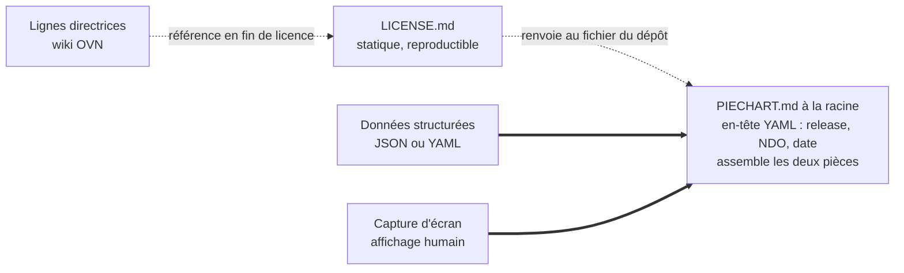
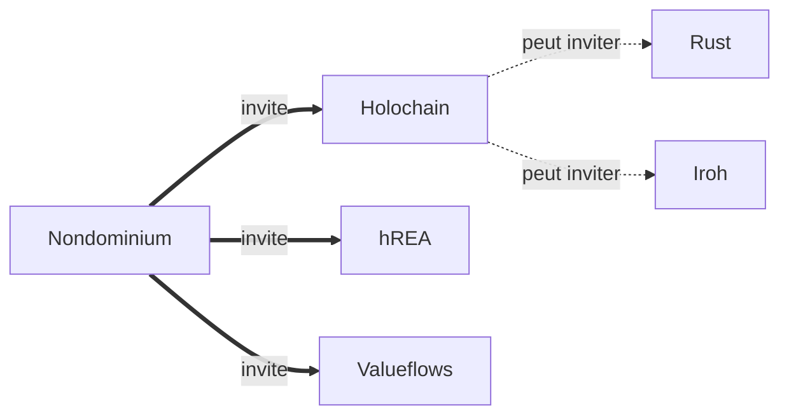

# Nondominium, Journal de la séance au Lab avec Tibi, partie 3 (17 h 00)

**Date :** mardi 17 novembre 2026, 17 h 00 (18 min, de 17 h 00 à 17 h 18, partie 3 sur 3 de la séance au Sensorica Lab, enregistrée au téléphone)

**Participants :** Soushi (Sacha Pignot, développeur principal de Nondominium), Tibi (Tiberius Brastaviceanu, cofondateur de Sensorica). Soushi ouvre la troisième partie en la nommant (« troisième partie de la rencontre au labo du 17 avec Tibi » [0]). SoushAI intervient à l'écran, quand Soushi lui demande où se trouve le tableau de contributions [1 à 4]. La transcription vient du moteur local sans séparation des locuteurs ; qui dit quoi est reconstitué au fil du contenu (la question de la redevance aux dépendances vient de Tibi), et reste une inférence. Là où la voix ne se laisse pas attribuer, le journal le dit.

**Contexte :** Suite de la séance au Lab du 20 octobre et du brainstorm Moss du 27 octobre. La troisième partie reprend une exigence posée le 13 octobre : la licence des NDO demande un tableau de contributions, et Tibi voulait lier celui de Sensorica pour la v0.1. Noms propres mal transcrits et corrigés ici : « Sonsorica », « sans surica », « censurica », « surica » deviennent Sensorica ; « holo chaine », « lot chaine », « au lot chaine », « l'autre chaîne », « RolloChain » deviennent Holochain ; « hra », « ria », « Shreya », « angéria » deviennent hREA ; « endominion », « non dominium », « notre dominium », « non-dominium », « endroïneum » deviennent Nondominium ; « OBL » est probablement OVN ; « l'IAI », « les ailes », « les haïs », « l'éaille » deviennent l'IA ; « indio », « endio », « édio », « idiot » et sans doute « mignon » deviennent NDO (inférence pour « mignon ») ; « héro » désigne Iroh, la bibliothèque réseau pair à pair (inférence) ; « hollownix » devient Holonix ; « suite est » désigne Sweettest (inférence) ; « cargo tolm » devient `Cargo.toml` et « le paquet de jizan » `package.json` ; « reneurs », « sias » deviennent les runners et la CI ; « PiChart », « pie chart » désignent le tableau de contributions, la « Contribution Pie-Chart » de `LICENSE.md`. Un seul enregistrement, donc une seule horloge : les crochets donnent la minute dans le fichier de la partie, `[12]`, `[34 à 36]`.

Index de la séance : [ndo-tibi-lab-niceboard-2026-11-17.html](2026-11-17-lab), avec les décisions, les actions et les points en suspens de toutes les parties. Autres parties : [partie 1](2026-11-17-lab-p1), [partie 2](2026-11-17-lab-p2).

## TL;DR

Le tableau de contributions de la v0.1 : `LICENSE.md` reste statique, un fichier distinct à la racine porte le tableau et ses données brutes, et la redevance ne vise que les dépendances de premier niveau (Holochain, hREA, Valueflows), invitées à s'inscrire elles-mêmes. On dresse d'abord la liste des dépendances avant de décider le reste.

## Discussion

**Le tableau, une obligation de la licence.** Soushi ouvre la troisième partie sur les tableaux de contributions pour la v0.1 de Nondominium et passe la parole à Tibi. Tibi pose le cadre : le tableau est lié à la licence de Nondominium, qui exige la propagation des contributions passées, celles qui ont servi à écrire et développer Nondominium. Il existe aujourd'hui sur une surface web 2, une feuille Google Sheets, et il insiste qu'il ne s'agit pas d'une image figée : « Il est toujours à jour le PiChart », parce que c'est un lien vers la feuille vivante, pas une photo. Il croit qu'un lien existe déjà sur GitHub, à côté de la licence. Soushi propose de l'ajouter même s'il n'était pas à jour, puis vérifie avec SoushAI, qui ne trouve aucun lien (voir Mises à jour). [0 à 4]

**Un onglet sur GitHub, et un emplacement dans le gabarit.** Soushi commence par la solution la plus simple : mettre l'adresse dans un fichier à côté de `LICENSE.md`. Il montre l'interface de GitHub : dès qu'on crée un fichier de licence, un onglet apparaît à côté du README, et il y en avait un troisième entre les deux ; on pourrait mettre le lien là. Mais la question touche le design de la licence elle-même : il faudrait, dans le gabarit de la licence, une place qui lie clairement au tableau, un emplacement réservé pour sa référence. « C'est pas juste une petite référence noyée en bas » : on peut la mettre vers la fin, mais il faut rendre explicite que c'est le lien vers le tableau, puisque la licence le mentionne partout et qu'il faut faire l'association. [3 à 5]

**Une licence avec un lien est-elle encore une licence ?** La question suivante est de droit, et Soushi la formule : « est-ce qu'on a le droit de créer une licence avec un lien comme ça » ? Et « est-ce que si le lien change est-ce que c'est un changement de licence », ou faut-il mettre le lien dans un fichier à côté ? Le fond est que « la licence c'est quelque chose de statique », censée être reproduite telle quelle d'un projet à l'autre ; des emplacements à remplir peuvent donc être problématiques, et le tableau a plutôt l'allure d'une annexe à la licence. [5 à 6]

**La release est une photo, mais il faut les données brutes.** L'interlocuteur répond par le moment de la release : « Oui donc tout la release c'est une photo. » Un instantané au moment de la release, donc ce n'est pas grave que le tableau joint soit figé à cette date. Mais la photo seule ne suffit pas : il faut avoir les données brutes quand même. [6]

**L'idée : laisser la licence telle quelle et ajouter un fichier.** « Ah j'ai une idée. » On laisse la licence telle quelle, quitte à l'améliorer plus tard, et l'on ajoute simplement un fichier à côté, par exemple `PIECHART.md`, comme un document dans le code, à la racine du dépôt. C'est ce que SoushAI venait justement de proposer, remarque Soushi. L'objection, qu'il y a déjà un `LICENSE.md` à la racine, tombe aussitôt : la licence, « il faut qu'il reste statique », c'est elle qui définit les règles et elle n'a pas à porter d'emplacement à remplir ; l'important est que le tableau soit à côté. Même si la licence ne pointe pas directement vers une adresse, elle dit que le tableau est dans le fichier dédié de ce dépôt, « et du coup ça suffit ». [6 à 7]

**Un fichier standard, et une licence qui en fixe la structure.** Cela devient un standard : tous les dépôts qui utilisent la licence doivent venir accompagnés de ce fichier, « c'est standardifié ». La licence reste statique, et le fichier markdown peut contenir plusieurs choses, « pas juste un lien brut comme ça on peut faire un vrai beau fichier markdown ». La licence pourrait même définir la structure que ce fichier doit prendre, les règles de cette preuve de tableau ; et quelqu'un remarque que c'est déjà là, ce que les Corrections confirment. [7 à 8]

**Les données brutes, pas une capture à déchiffrer.** Le fichier doit contenir les données de manière brute, pas seulement une image ; une image peut être utile en complément, et « on l'a justement ». Il faudra qu'il suive les lignes directrices et représente bien les preuves, que ce soit directement dans le markdown ou sous forme structurée à côté : les données doivent être accessibles « en brut et non juste un screenshot à décrypter », parce qu'ainsi « on peut les parser on peut les analyser on peut les copier coller ». La capture d'écran n'est pas une mauvaise idée pour autant, comme le logo qui est un fichier à côté ; elle peut s'afficher avec la donnée, puisqu'il y a peu de données : le nombre de contributeurs, avec un chiffre chacun. [8 à 9]

**Trois pièces, et l'en-tête YAML.** Soushi assemble les pièces. La capture, « ça c'est le côté humain » ; un JSON, par exemple, pour la version structurée des données ; et le fichier `.md` qui assemble les deux en suivant la structure, qui s'assure que tout est là et qui donne les métadonnées : pour quelle release, le nom du NDO, la date. Ce qui est bien, c'est qu'un fichier markdown peut porter un en-tête YAML, des données structurées comme du JSON, avec objets, listes et booléens ; le fichier est donc à la fois structuré et lisible pour les humains. Il conclut : « ça c'est la le pie chart lui même l'objet lui-même », la façon dont on le représente dans le code ; reste le second point, la redevance aux dépendances. [9 à 10]

**Les lignes directrices du tableau.** Avant de passer à la suite, Soushi tient à clarifier quel document fait référence pour la forme du tableau : à la fin de la licence, la dernière référence, « contribution pie chart guide line », un lien vers le wiki OVN. Il voulait juste s'assurer que ce soit « clair clair ». [10]

**La redevance aux dépendances : quel critère ?** Tibi ouvre le second point : pour compléter cet objet qu'est le tableau, il va falloir donner une redevance aux dépendances, et la question est le critère qu'on se donne. Sa proposition : prendre la première couche de dépendances, Holochain, hREA, Valueflows. On ne prend pas Rust ni les autres affaires, parce que c'est déjà un deuxième niveau ; la première couche, ce sont les dépendances que Nondominium utilise directement. [10 à 11]

**Chacun invite le niveau suivant.** La logique est celle de l'invitation : à qui lance-t-on l'invitation ? À la première couche, et Holochain, s'il le veut, pourra ajouter Rust ; « chacun va être responsable d'ajouter s'il le veut d'inviter le niveau suivant ». Holochain pourrait de même inviter Iroh (inférence), le protocole pair à pair qu'il utilise. Le critère est donc clair : on invite Holochain, et les autres peuvent venir avec leurs propres dépendances ; Nondominium ne se préoccupe que de la première couche, parce que c'est elle que la redevance impacte directement. [11]

**Pourquoi ne pas inviter toutes les sous-dépendances.** L'argument contre l'invitation en profondeur est posé du point de vue de Holochain : si Nondominium invite Holochain et toutes ses sous-dépendances d'un coup, Holochain a déjà, dès son arrivée, des gens vers qui ses bénéfices potentiels vont ruisseler, sans qu'on l'ait même consulté sur le fait qu'il a ces dépendances, et alors que ces dépendances ne sont même pas présentes. [11 à 12]

**Pas de ruissellement sans inscription, et la question des NDO morts.** La réponse est le consentement : les dépendances ne recevront rien tant qu'elles ne sont pas officiellement inscrites ; les gens doivent venir s'inscrire eux-mêmes, il faut « avoir leur consentement ». Sinon, on les représente quand même, mais ce seront des NDO morts, inactifs, sans personne pour les représenter : un NDO avec aucun agent dedans sauf ceux qui l'ont initialisé, « ça sert à grand chose ». Une voix nuance : ce n'est pas grave, et « symboliquement ça reste », un emplacement en attendant. Le point n'est pas tranché. [11 à 12]

**Dresser la liste avec l'IA.** Peut-on obtenir automatiquement, avec l'IA, la liste des dépendances de premier niveau ? Soushi pense que oui : on peut faire des scans et des analyses, et rien qu'au niveau de la base de code, `Cargo.toml` et `package.json` sont les manifestes qui contiennent toutes les dépendances logicielles ; à partir de là, on voit les dépendances logicielles. [12 à 13]

**À quel grain : un NDO par bibliothèque, ou un parent par projet.** Reste le découpage : chaque bibliothèque est-elle un NDO en soi ? Holochain, ce n'est pas juste Holochain : il y a le HDK, le HDI, le client, Sweettest (inférence), Holonix, autant de sous-composants. Fait-on un seul NDO parent pour Holochain, ou le découpe-t-on ? L'interlocuteur relève que c'est un paquet que l'on installe d'un bloc quand on se lance dans Holochain, depuis une source qui est à eux. La réponse qui se dégage s'appuie sur la composabilité du NDO, que l'interface montre déjà : on fait le NDO parent, on invite Holochain, et Holochain pourra venir faire lui-même la composabilité de son NDO, ajouter par des hard links des composants pour ses crates et tout ce qu'il expose. Nondominium n'a qu'à inviter le parent. [13 à 14]

**Rust est aussi notre dépendance.** Soushi ajoute une remarque qui déplace le critère : Rust est une dépendance de Holochain, mais Nondominium code aussi en Rust, et c'est Rust qui lui fournit son outillage. De même Nix : Holochain l'utilise par Holonix, mais Nondominium l'utilise aussi. [14]

**Nix et la CI : la mise à jour de GitHub du 11 novembre.** Soushi raconte qu'il s'apprête à réécrire toutes ses CI : elles tournent sur Ubuntu, ce qu'on ne peut pas changer puisque c'est ce que fournissent les runners de GitHub, mais au moins c'est Nix qui gérera la CI, ce qui la rend reproductible malgré tout et beaucoup plus stable. « ça a pété » récemment : GitHub a fait le 11 novembre une mise à jour qui casse beaucoup de CI, un gros passage par défaut d'Ubuntu 24 à Ubuntu 26, et comme leurs CI sont sur l'image par défaut, il se peut qu'elles soient rouges ; il faut alors mettre à jour ses propres paquets. Les Corrections montrent que les CI de Nondominium sont restées vertes. [14 à 15]

**Faire la liste d'abord, puis décider.** Tibi, selon toute vraisemblance (inférence), recentre : « faisons la liste d'abord », puis on décidera, en relisant ce que la licence dit exactement. Soushi garde l'idée que Nondominium a lui aussi ces dépendances directes et devrait peut-être les représenter, Nix étant très utilisé pour l'infrastructure ; ce que dit la licence, selon lui, c'est qu'il faut partager les bénéfices avec elles. La suite est inaudible pendant près de deux minutes. [15 à 17]

**La pause.** L'enregistrement reprend sur Soushi qui s'excuse : il va lancer la transcription de la deuxième partie de la rencontre pendant que Tibi cherche quelque chose, quitte à mettre en pause ou à prendre une pause. Il conclut que, sur les tableaux de contributions, ils ont « quand même cumulé pas mal d'idées » avec cet enregistrement pour reprendre plus tard. [17 à 18]

## Discuté, non tranché

- **Représenter aussi les dépendances directes de Nondominium (Rust, Nix).** [14 à 15]

- **Créer des NDO d'attente pour les dépendances pas encore inscrites**, ou s'en abstenir puisqu'ils seraient inactifs. [11 à 12]
