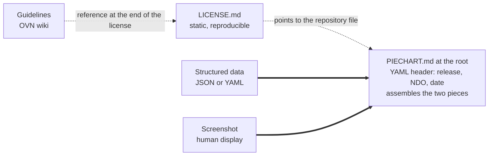
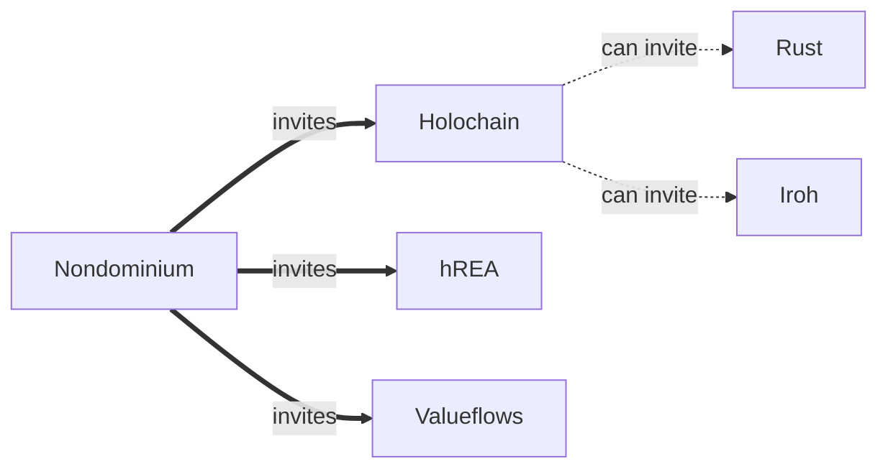

# Nondominium, Journal of the Lab session with Tibi, part 3 (5:00 p.m.)

**Date:** Tuesday, November 17, 2026, 5:00 p.m. (18 min, from 5:00 p.m. to 5:18 p.m., part 3 of 3 of the session at the Sensorica Lab, recorded on a phone)

**Attendees:** Soushi (Sacha Pignot, lead developer of Nondominium), Tibi (Tiberius Brastaviceanu, co-founder of Sensorica). Soushi opens the third part by naming it ("troisième partie de la rencontre au labo du 17 avec Tibi" (third part of the meeting at the lab on the 17th with Tibi) [0]). SoushAI speaks on screen when Soushi asks it where the contributions table is [1 to 4]. The transcript comes from the local engine without speaker separation; who says what is reconstructed from the content (the question of the royalty to dependencies comes from Tibi), and remains an inference. Where the voice cannot be attributed, the journal says so.

**Context:** Follows the Lab session of October 20 and the Moss brainstorm of October 27. The third part takes up a requirement set on October 13: the NDO license requires a contributions table, and Tibi wanted to link Sensorica's for v0.1. Misheard proper nouns, corrected here: "Sonsorica", "sans surica", "censurica", "surica" become Sensorica; "holo chaine", "lot chaine", "au lot chaine", "l'autre chaîne", "RolloChain" become Holochain; "hra", "ria", "Shreya", "angéria" become hREA; "endominion", "non dominium", "notre dominium", "non-dominium", "endroïneum" become Nondominium; "OBL" is probably OVN; "l'IAI", "les ailes", "les haïs", "l'éaille" become the AI (l'IA); "indio", "endio", "édio", "idiot" and probably "mignon" become NDO (inference for "mignon"); "héro" refers to Iroh, the peer-to-peer networking library (inference); "hollownix" becomes Holonix; "suite est" refers to Sweettest (inference); "cargo tolm" becomes `Cargo.toml` and "le paquet de jizan" `package.json`; "reneurs", "sias" become the runners and the CI; "PiChart", "pie chart" refer to the contributions table, the "Contribution Pie-Chart" of `LICENSE.md`. A single recording, hence a single clock: the brackets give the minute in the part's file, `[12]`, `[34 to 36]`. This is an English translation; the original journal is in French.

Session index: [ndo-tibi-lab-niceboard-2026-11-17.html](2026-11-17-lab), with the decisions, actions and open points of all the parts. Other parts: [part 1](2026-11-17-lab-p1), [part 2](2026-11-17-lab-p2).

## TL;DR

The v0.1 contributions table: `LICENSE.md` stays static, a separate file at the root carries the table and its raw data, and the royalty targets only first-level dependencies (Holochain, hREA, Valueflows), invited to register themselves. The list of dependencies is drawn up first, before deciding the rest.

## Discussion

**The table, an obligation of the license.** Soushi opens the third part on the contributions tables for Nondominium's v0.1 and hands the floor to Tibi. Tibi sets the frame: the table is tied to Nondominium's license, which requires the propagation of past contributions, those that served to write and develop Nondominium. It exists today on a web 2 surface, a Google Sheets spreadsheet, and he insists that it is not a frozen image: "Il est toujours à jour le PiChart" (The PiChart is always up to date), because it is a link to the living spreadsheet, not a photo. He believes a link already exists on GitHub, next to the license. Soushi offers to add it even if it was not up to date, then checks with SoushAI, which finds no link (see Updates). [0 to 4]

**A tab on GitHub, and a place in the template.** Soushi starts with the simplest solution: put the address in a file next to `LICENSE.md`. He shows GitHub's interface: as soon as a license file is created, a tab appears next to the README, and there was a third one between the two; the link could go there. But the question touches the design of the license itself: the license template would need a place that clearly links to the table, a reserved spot for its reference. "C'est pas juste une petite référence noyée en bas" (It's not just a little reference buried at the bottom): it can go near the end, but it has to be made explicit that it is the link to the table, since the license mentions it everywhere and the association has to be made. [3 to 5]

**Is a license with a link still a license?** The next question is one of law, and Soushi puts it: "est-ce qu'on a le droit de créer une licence avec un lien comme ça" (are we allowed to create a license with a link like that)? And "est-ce que si le lien change est-ce que c'est un changement de licence" (if the link changes, is that a change of license), or should the link go in a file next to it? The substance is that "la licence c'est quelque chose de statique" (a license is something static), meant to be reproduced as is from one project to another; blanks to fill in can therefore be a problem, and the table looks more like an appendix to the license. [5 to 6]

**The release is a photo, but the raw data is needed.** The other speaker answers with the moment of the release: "Oui donc tout la release c'est une photo." (Yes, so the whole release is a photo.) A snapshot at the moment of the release, so it does not matter that the attached table is frozen at that date. But the photo alone is not enough: the raw data is needed anyway. [6]

**The idea: leave the license as it is and add a file.** "Ah j'ai une idée." (Ah, I have an idea.) The license is left as it is, even if it is improved later, and a file is simply added next to it, for example `PIECHART.md`, like a document in the code, at the root of the repository. This is exactly what SoushAI had just proposed, Soushi notes. The objection, that there is already a `LICENSE.md` at the root, falls at once: the license, "il faut qu'il reste statique" (it has to stay static), is what defines the rules and it has no business carrying a blank to fill in; what matters is that the table is next to it. Even if the license does not point directly to an address, it says that the table is in the dedicated file of this repository, "et du coup ça suffit" (and so that's enough). [6 to 7]

**A standard file, and a license that fixes its structure.** This becomes a standard: every repository that uses the license must come with this file, "c'est standardifié" (it's standardized). The license stays static, and the markdown file can contain several things, "pas juste un lien brut comme ça on peut faire un vrai beau fichier markdown" (not just a raw link like that, we can make a real, nice markdown file). The license could even define the structure this file must take, the rules of this proof of the table; and someone notes that this is already there, which the Corrections confirm. [7 to 8]

**Raw data, not a screenshot to decipher.** The file must contain the data in raw form, not only an image; an image can be useful as a complement, and "on l'a justement" (we have exactly that). It will have to follow the guidelines and represent the evidence well, whether directly in the markdown or in structured form alongside: the data must be accessible "en brut et non juste un screenshot à décrypter" (raw and not just a screenshot to decipher), because that way "on peut les parser on peut les analyser on peut les copier coller" (we can parse it, we can analyze it, we can copy and paste it). The screenshot is not a bad idea for all that, like the logo which is a file next to it; it can be displayed with the data, since there is little data: the number of contributors, with a figure each. [8 to 9]

**Three pieces, and the YAML header.** Soushi assembles the pieces. The screenshot, "ça c'est le côté humain" (that's the human side); a JSON, for example, for the structured version of the data; and the `.md` file that assembles the two following the structure, that makes sure everything is there and that gives the metadata: for which release, the name of the NDO, the date. What is nice is that a markdown file can carry a YAML header, structured data like JSON, with objects, lists and booleans; the file is therefore both structured and readable by humans. He concludes: "ça c'est la le pie chart lui même l'objet lui-même" (that is the pie chart itself, the object itself), the way it is represented in the code; the second point remains, the royalty to dependencies. [9 to 10]

**The table's guidelines.** Before moving on, Soushi wants to clarify which document is the reference for the form of the table: at the end of the license, the last reference, "contribution pie chart guide line", a link to the OVN wiki. He just wanted to make sure it was "clair clair" (crystal clear). [10]

**The royalty to dependencies: what criterion?** Tibi opens the second point: to complete this object that is the table, a royalty will have to be given to dependencies, and the question is the criterion we give ourselves. His proposal: take the first layer of dependencies, Holochain, hREA, Valueflows. We do not take Rust or the other things, because that is already a second level; the first layer is the dependencies that Nondominium uses directly. [10 to 11]

**Each one invites the next level.** The logic is that of the invitation: to whom do we send the invitation? To the first layer, and Holochain, if it wants, will be able to add Rust; "chacun va être responsable d'ajouter s'il le veut d'inviter le niveau suivant" (each one will be responsible for adding, if it wants, for inviting the next level). Holochain could likewise invite Iroh (inference), the peer-to-peer protocol it uses. The criterion is therefore clear: we invite Holochain, and the others can come with their own dependencies; Nondominium is concerned only with the first layer, because that is the one the royalty directly affects. [11]

**Why not invite all the sub-dependencies.** The argument against inviting in depth is put from Holochain's point of view: if Nondominium invites Holochain and all its sub-dependencies at once, Holochain already has, from the moment it arrives, people toward whom its potential benefits will trickle down, without anyone even consulting it on the fact that it has these dependencies, and while these dependencies are not even present. [11 to 12]

**No trickle-down without registration, and the question of dead NDOs.** The answer is consent: dependencies will receive nothing as long as they are not officially registered; people have to come and register themselves, we must "avoir leur consentement" (have their consent). Otherwise they are represented anyway, but they will be dead NDOs, inactive, with nobody to represent them: an NDO with no agent in it except those who initialized it, "ça sert à grand chose" (what good is that). A voice qualifies this: it does not matter, and "symboliquement ça reste" (symbolically it remains), a placeholder in the meantime. The point is not decided. [11 to 12]

**Drawing up the list with AI.** Can the list of first-level dependencies be obtained automatically, with AI? Soushi thinks so: scans and analyses can be done, and at the codebase level alone, `Cargo.toml` and `package.json` are the manifests that contain all the software dependencies; from there, the software dependencies are visible. [12 to 13]

**At what grain: one NDO per library, or one parent per project.** The remaining question is the breakdown: is each library an NDO in itself? Holochain is not just Holochain: there is the HDK, the HDI, the client, Sweettest (inference), Holonix, so many sub-components. Do we make a single parent NDO for Holochain, or split it? The other speaker points out that it is a package installed in one block when one gets started with Holochain, from a source that is theirs. The answer that emerges relies on the NDO's composability, which the interface already shows: we make the parent NDO, we invite Holochain, and Holochain will be able to do the composability of its NDO itself, adding components by hard links for its crates and everything it exposes. Nondominium only has to invite the parent. [13 to 14]

**Rust is our dependency too.** Soushi adds a remark that shifts the criterion: Rust is a dependency of Holochain, but Nondominium also codes in Rust, and it is Rust that provides its tooling. Likewise Nix: Holochain uses it through Holonix, but Nondominium uses it too. [14]

**Nix and the CI: GitHub's update of November 11.** Soushi says he is about to rewrite all his CIs: they run on Ubuntu, which cannot be changed since that is what GitHub's runners provide, but at least Nix will manage the CI, which makes it reproducible all the same and much more stable. "ça a pété" (it broke) recently: on November 11 GitHub made an update that breaks many CIs, a big default switch from Ubuntu 24 to Ubuntu 26, and since their CIs are on the default image, they may be red; one then has to update one's own packages. The Corrections show that Nondominium's CIs stayed green. [14 to 15]

**Make the list first, then decide.** Tibi, in all likelihood (inference), refocuses: "faisons la liste d'abord" (let's make the list first), then we will decide, rereading what the license says exactly. Soushi holds on to the idea that Nondominium also has these direct dependencies and should perhaps represent them, Nix being widely used for infrastructure; what the license says, according to him, is that benefits must be shared with them. The rest is inaudible for nearly two minutes. [15 to 17]

**The pause.** The recording resumes on Soushi apologizing: he is going to start the transcription of the second part of the meeting while Tibi looks for something, even if it means pausing or taking a break. He concludes that, on the contributions tables, they have "quand même cumulé pas mal d'idées" (still piled up quite a few ideas), with this recording to pick things up again later. [17 to 18]

## Discussed, not decided

- **Also represent Nondominium's direct dependencies (Rust, Nix).** [14 to 15]

- **Create placeholder NDOs for dependencies not yet registered**, or refrain since they would be inactive. [11 to 12]
