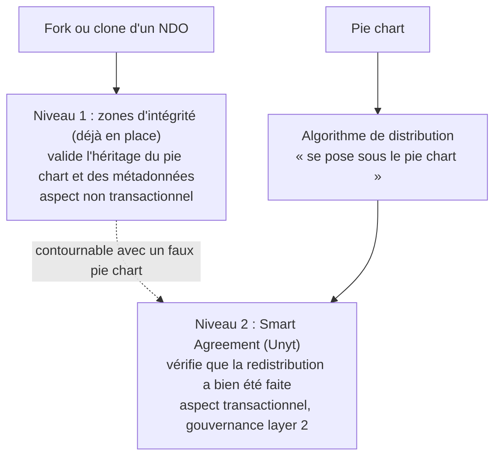
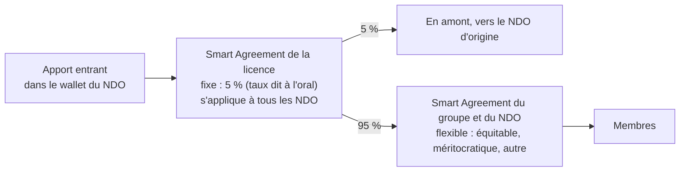
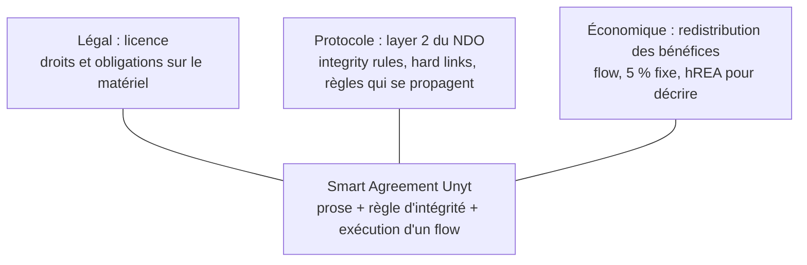
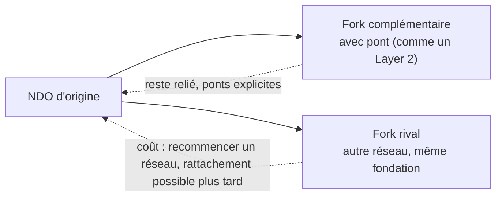
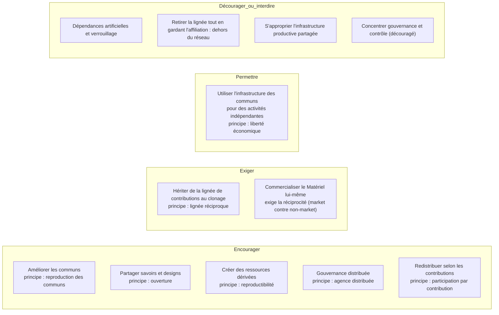

# Nondominium, Journal de la séance au Lab avec Tibi, partie 4 (18 novembre, 01 h 46)

**Date :** nuit du mardi 17 au mercredi 18 novembre 2026, à partir de 01 h 46 (2 h 27, partie 4 de la séance au Sensorica Lab, enregistrée au téléphone)

**Participants :** Soushi (Sacha Pignot, développeur principal de Nondominium), Tibi (Tiberius Brastaviceanu, cofondateur de Sensorica). Soushi situe lui-même la partie à la minute 18 : on a parlé du pie chart « tantôt », on clarifie maintenant la licence OVN et comment l'appliquer « à travers le pie chart dans le code », dans la nuit du 17 au 18 novembre avec Tibi et Sacha. La transcription vient du moteur local sans séparation des locuteurs ; qui dit quoi est reconstitué au fil du contenu et reste une inférence, signalée comme telle. Entre les minutes 84 et 96 environ, le moteur a rendu en anglais des propos tenus en français.

**Contexte :** Suite directe de la [partie 3](2026-11-17-lab-p3) (le tableau de contributions de la v0.1 dans un fichier à côté de la licence, la redevance aux dépendances de premier niveau). À partir de la minute 21, Tibi lit et commente la dernière réponse de son fil ChatGPT sur la licence OVN, partagé à Soushi pendant la séance ; le le journal cite son anglais exact là où la lecture orale le déforme. Le tableau de la section 8 du fil ne figure pas dans le texte copié ; ses lignes ne viennent que de la lecture orale. Un seul enregistrement, donc une seule horloge : les crochets donnent la minute dans le fichier de la partie, `[12]`, `[34 à 36]`.

Index de la séance : [ndo-tibi-lab-niceboard-2026-11-17.html](2026-11-17-lab). Autres parties : [partie 1](2026-11-17-lab-p1), [partie 2](2026-11-17-lab-p2), [partie 3](2026-11-17-lab-p3).

## TL;DR

La licence d'un réseau pair à pair est appliquée par le réseau lui-même, comme Bitcoin : qui ne la respecte pas se retrouve sur un fork, hors du réseau, sans avocats. Pour Nondominium cela donne deux niveaux : les zones d'intégrité valident dès maintenant qu'un NDO forké hérite du pie chart de son parent, et un Smart Agreement Unyt vérifiera plus tard que la redistribution a bien eu lieu. Pour la v0.1, Soushi propose la plomberie de distribution en placeholder, « pas plugée » : Nondominium est le Genesis, rien n'est à distribuer tant qu'aucun revenu n'entre, et la redevance ne se paie qu'après un gain. Tibi décrit deux Smart Agreements en cascade sur le portefeuille d'un NDO : un fixe, celui de la licence (5 % à l'oral), exécuté avant tout, puis un flexible, celui du groupe, pour les 95 % restants. La lecture du fil ajoute la distinction entre communs matériels (copiables) et communs de réseau (qui obligent), l'exit et la portabilité contre l'enclosure, et l'idée que la licence décrit des principes que Nondominium implémente, sans dépendre de lui. La dernière demi-heure passe au passeport numérique de produit et à la composabilité des NDO.

## Discussion

### Minutes 0 à 30
**La licence implicite dans le réseau pair à pair, l'exemple de Bitcoin.** L'enregistrement s'ouvre en pleine phrase, sur l'idée du fork. Les mineurs n'y adhèrent pas, mais quelqu'un peut quand même « [créer] un autre bitcoin », « le bitcoin classique », ou, selon la transcription, « l'intérieur classique » (inférence : Ethereum Classic). Dans le pair à pair, « la licence est implicite dans le réseau » : c'est en ne la respectant pas qu'on se retrouve « à l'extérieur du réseau ». La licence de Bitcoin, dit l'interlocuteur, c'est « essentiellement de dire que tu dois respecter le protocole du bitcoin », c'est-à-dire la façon dont les pièces sont créées et dont le pouvoir fonctionne. Quiconque force les règles et refuse « le contrat social » sort du réseau. [0 à 1]

**Contrat intelligent et contrat juridique en paire, l'intégrité de Holochain.** L'interlocuteur suivant (probablement Soushi, inférence : le vocabulaire Holochain est le sien) rapproche cela des contrats intelligents. EOS, avec Daniel Larimer, associait un contrat intelligent à un contrat « régalien » (inférence : contrat juridique, peut-être ricardien), « la version code, la version régalien » venant de pair avec la version en langage naturel. Holochain ajoute la notion d'intégrité, les zones d'intégrité, ce qui le distingue du reste de l'industrie des licences. Il va plus loin : les Smart Agreements, avec Unyt (transcrit « Units »), permettraient de « forcer le flow ». Il compare à ce qu'on n'aurait pas tenté avec des contrats intelligents sur une chaîne déterministe comme Cardano, « avec EU et TXO » (eUTXO, inférence). Le texte écrit, le fichier Markdown, devient alors « une formalité qui fait juste décrire comment fonctionne » le système (la transcription dit « NetByDesign », inférence : « net by design »). [1 à 3]

**Le fork d'un NDO valide l'héritage du pie chart.** Le processus informatique qui clone ou fork un NDO exécute « les rules de base » : pour rester dans le réseau, il faut valider que la licence est respectée, que l'on a « hérité le pie chart du précédent ». Sinon « tu te retrouves à l'extérieur du réseau », parce qu'on n'est plus compatible avec l'intégrité. L'autre voix acquiesce (« Exactement »). Soushi insiste sur la conséquence de conception : il ne faut pas penser la licence seulement comme « un beau petit texte à forcer légalement » avec des avocats. Même si les avocats disent que la licence ne marche pas, « c'est comme ça que ça marche », comme un contrat intelligent. [2 à 4]

**Pourquoi les utilisateurs « agreent » : code ouvert, documentation, rustdoc.** Les utilisateurs consentent parce que le code source est ouvert et qu'une documentation le représente clairement. Comme la documentation pointe vers le code, on vérifie facilement qu'elles concordent. Le rustdoc ajoute de la transparence. [4]

**Deux niveaux d'architecture : zones d'intégrité, puis Smart Agreement.** Soushi pose deux niveaux. Le premier consiste à faire « le plus possible dans les zones d'intégrité par nous-mêmes » : valider que l'on hérite des pie charts et des métadonnées. Mais cela reste contournable, par exemple en envoyant « un faux pie chart ». Le deuxième niveau est donc le Smart Agreement, qui vérifie que la redistribution a réellement eu lieu : le pie chart est de la donnée reçue, mais l'obligation (« faire les redistributions du 5 %, par exemple », dit-il) est une action. L'autre voix répond que cela peut aussi aller dans la gouvernance du NDO : l'algorithme de distribution « se pose sous le pie chart », et on ne peut pas faire tourner un bénéfice sans pie chart en entrée. Soushi nomme cela « le layer 2 », l'aspect transactionnel de la gouvernance. Il en tire un partage : l'aspect non transactionnel du pie chart se sécurise dans la zone d'intégrité custom existante, l'aspect transactionnel demande Unyt et le Smart Agreement. [4 à 7]

**Pour la v0.1 : un placeholder, parce que Nondominium est le Genesis.** Soushi constate que « tout est live » et qu'il faut peut-être, pour la 0.1, avoir au moins l'architecture sans Unyt, « sinon, on repousse 0.1 » si l'on veut l'aspect transactionnel dès le début. Piste : un placeholder, la distribution avec toute la logique, mais « pas plugée ». Ce qui sauve, c'est que Nondominium est « le Genesis, on est le premier » : la plomberie sera en place, mais il n'y aura pas de pie chart « en haut, prêt à être envoyé en bas », personne en dessous, pas de placeholder activé, et « la distribution se fait quand il y a une input ». On peut donc attendre les versions suivantes pour intégrer la distribution. [7 à 9]

**On ne paie la licence qu'après avoir un gain.** L'autre voix précise la nature de la redevance : « tu ne payes pas ta licence avant d'avoir quelque chose à distribuer ». Le paiement n'est pas en avant, il est après. Il en donne l'image : « ton piping est là », et « dès que tu as 100$ à distribuer à tes collaborateurs, tu sais qu'il y a un 5% de ça qui va en avant ». La transcription dit « revanche » pour redevance (inférence). Soushi confirme : à la 0.1 il n'y aura rien à distribuer, c'est correct ; pour une 0.2 qui viendrait vite sans bénéfice en entrée et sans placeholders intégrés, on pourra « délayer ça ». Le taux de 5 % est celui prononcé à l'oral, qui diffère des 2 % et 0,5 % du fil ChatGPT (que la séance n'a pas encore ouvert à ce stade). [8 à 9]

**Le dépôt Smart Agreement de l'organisation Holo, et Unyt sans l'application.** Soushi observe qu'avant on attendait la maturité, mais « maintenant, officiellement » l'organisation (la transcription dit « Holo », inférence : Holochain) a « tous les repos qu'il te faut », dont le dépôt Smart Agreement vu à l'époque. L'autre voix pense que c'est un module d'Unyt : on a besoin du module pour l'architecture, pas de l'application. Le passage qui suit reconstitue un souvenir de test (inférence sur l'attribution : Soushi) : HoloFuel serait natif dans Holochain, Unyt est « l'application un peu plus construite », qui permettait de créer ses propres unités, « nos propres MCC », dont un test d'une monnaie à la Sensorica (« un sensory kakuin », inférence : un Sensorica coin). L'interface prévoyait de faire à la main des Smart Agreements avec des templates, « mais on ne l'avait pas testé ». Dans le cas de Nondominium, on pourrait coder ces accords « de manière programmatique ». [9 à 11]

**Un Smart Agreement de licence qui s'exécute avant celui du groupe.** L'autre voix décrit l'assemblage : un Smart Agreement dit « tu prends 5% de tout le input pour le donner en bas », il ne parle que de la licence, « s'exécute automatiquement, peu importe ce que tu fais avec l'autre 95% ». Le 95 % relève d'un second accord, celui du groupe. L'accord de licence est « fondamental » et s'applique à tous les NDO : tout apport dans le portefeuille du NDO subit 5 % automatiquement, « avant même que tu le touches ». Puis le groupe décide comment répartir le reste, de façon équitable, méritocratique ou autre : c'est « une flexibilité ». Image : « tu as reçu 100 pièces ? Non, tu as juste 95 pièces », « c'est la première taxe », puis la deuxième. Point de principe : on ne laisse pas le choix aux humains d'« appuyer sur un bouton », « c'est le but de l'informatique ». Soushi complète : ce sera un bundle de Smart Agreements, d'autres liés à d'autres logiques transactionnelles (« payer le transporteur »), et dans le cas du pie chart, deux déjà : « un fixe et un qui est flexible », le fixe étant celui de la licence, le flexible composé des règles de gouvernance du groupe et du NDO. [11 à 14]

**La cagnotte de réparation et la tragédie des communs.** Autre exemple d'accord à insérer : un équipement mutualisé. Pour éviter « la tragédie des communs » (tout le monde utilise, personne ne paie la réparation quand ça casse), un interlocuteur propose qu'une transaction de custodianship ne puisse pas être validée sans que cinq pièces soient déposées dans une cagnotte de réparation, « comme un real-key » (transcription incertaine, inférence : règle fixe). On peut en mettre dix ; cinq vont à la cagnotte, le surplus va « dans les communs, dans la trésorerie » (à toi, à moi, à Sensorica, au labo). Il compare à un événement « sur donation volontaire minimum dix » : le tarif est dix, donnez plus si vous pouvez. Cela relèverait de la gouvernance du NDO, puisqu'un NDO de type équipement peut avoir son propre portefeuille. [14 à 16]

**Will Ruddick et la tirelire de réparation.** Un interlocuteur raconte avoir parlé aujourd'hui avec Will (la transcription donne « Will Ruddick » à 16:22, inférence : Soushi, d'après « vous m'avez dit que vous étiez en bon contact » dit par l'autre). Will lui a demandé comment faire sur le Discord (transcrit « Grâche d'économie », inférence : Grassroots Economics). Le simple fait qu'« un Will Ruddick joue avec notre application » est qualifié de succès. À sa question sur qui paie les réparations d'un équipement, la réponse fut : chaque NDO a son propre portefeuille avec une « piggy bank de réparation » qui « se ramasse » ; quand ça casse, on se paie du temps et de la pièce, et quelqu'un vient réparer « parce qu'il y a de l'argent à faire ». Sinon ce sont les mêmes qui réparent pendant que les usagers font de l'exploitation gratuite, « un classique ». Dire à Will que ce n'est pas encore « un an de mignons » (inférence : pas encore un an de NDO) mais « c'est ce qu'on peut faire ». [16 à 17]

**Les frais de transaction sur Bitcoin : priorité, mempool, support.** L'interlocuteur prolonge par une analogie Bitcoin : il y a une taxe de transaction payée avant la transaction, et le mempool (« même pool ») pose la question de la priorité, de qui paie plus et passe devant les autres. Il a déjà vu une transaction payée rester 24 heures sans passer ; à l'époque il a dû contacter le support, qui a augmenté les frais pour lui. Aujourd'hui, depuis son propre nœud, on peut reprogrammer la transaction encore dans le mempool pour augmenter les frais. Conclusion : « il y a des taxes comme ça qui sont représentées, qui sont justifiables ». [17 à 18]

**Lancer la lecture du fil ChatGPT et situer la séance.** Un interlocuteur propose de lire le texte, le lien ayant été mis (inférence : par Tibi). Soushi, qui enregistre, ouvre la quatrième rencontre : on a parlé du pie chart « tantôt », on clarifie maintenant le côté licence OVN et comment l'appliquer concrètement « à travers le pie chart dans le code », dans la nuit « du 17 au 18 novembre 2016 » (lire 2026) avec Tibi et Sacha. Une remarque légère (« ça, il sait que c'est sushi, hein ? ») montre que la transcription ne reconnaît pas le prénom, inférence : Soushi. L'autre voix dit qu'il s'apprête à lire. [18 à 19]

**Passage non récupérable pendant la lecture silencieuse.** De 19:29 à 20:42 le texte n'est quasi plus prononcé : quelques fragments (« Et là, ce qu'il dit ici, c'est la chose suivante », « j'ai mis le non-dominium là-dessus », « Parce que je dis attends ») et de longs blancs. Ce qui est lu à voix basse ou sur écran ne peut pas être reconstitué : **non récupérable, 19 min 29 s à 20 min 42 s**. À 20:42 : « C'est très intéressant ce qu'il nous dit là. » Soushi résume : « Pas importe si tu fais... si tu es une compagnie ou pas. Remets les choses dans les commons. » (inférence : renvoi au critère de la nature de l'usage plutôt que de l'organisation, lu dans le fil). [19 à 21]

**Demande de capture d'écran des trois couches.** Soushi demande à l'autre un petit screenshot « de juste ces trois-là » : les trois notions qui permettent de voir la distinction entre ce qui doit être dans hREA (le réseau économique, l'aspect fonctionnel, la gouvernance de l'économique) et le point en dessous, l'aspect déclaratif : « ce qu'on fait avec notre layer 2 ». Il s'agit des trois éléments « The commons / The economic network / The economic paradigm » du fil, que l'on retrouve à la ligne « The commons: The collectively produced resources, knowledge, designs, software, infrastructure, and other materials » (inférence sur la correspondance). L'autre cherche comment partager (« Parce que là, j'ai peut-être le modèle gratuit »), trouve le bouton « Share » de la conversation et envoie le lien. Soushi : « là, t'as tout le contexte, tu peux te donner à manger à l'IA aussi. » [21 à 22]

**Lecture du fil : le GPL, le PPL, l'OVN et les trois niveaux.** La lecture (par Tibi, d'après le contexte, voix non vérifiable) reprend le fil à « The GPL primarily protects the first. The Peer Production License attempts to protect the first and impose conditions on the second, using organizational ownership and distribution of surplus as criteria. The OVN License should address all three. This is particularly important because a resource can remain technically open while its economic exploitation undermines the conditions that made its production possible. » La transcription donne « Le JPL » à trois reprises : le premier est le GPL, le deuxième le PPL, « Le JPL devrait adresser tous les trois » est l'OVN License. Les trois niveaux sont, dans le fil, « The commons », « The economic network » et « The economic paradigm ». Soushi réagit : « Ah, il a compris ! » et fait relire la phrase sur le ressort (« resource ») technique ouvert. [22 à 23]

**Open source économiquement capturé : Microsoft, Google, VS Code.** Soushi explique ce que la phrase décrit : un projet peut rester « techniquement ouvert » tandis que l'exploitation économique « appauvrit » ceux qui l'ont produit. C'est « le modèle actuel de l'exploitation économique qui prête sur les commons ». Microsoft et Google font de l'open source (VS Code), mais « économiquement, ils le capturent pareil, l'écosystème », en l'exploitant pour enrichir la corporation qui a centralisé la technologie. C'est ce qu'on disait « tantôt ». [23 à 24]

**Takers contre givers, et le paradigme que l'usage reproduit.** Soushi rattache cela à la question des « takers vs givers ». La lecture reprend : « But the economic activity surrounding that resource may reproduce a different paradigm from the one that produced it. » Soushi traduit : « tu renforces le capitalisme à l'ordonnance de la technologie. » Puis la lecture : « The question for OVN is therefore not only whether the commons remains open, but whether its use reinforces or undermines the reproduction of P2P economic relations. » (la transcription déforme la fin en « la reproduction de la relation économique »). [24 à 25]

**Les briques de l'industrie que les corpos utilisent sans contribuer.** À 25:01, après un blanc (non récupérable de 24:39 à 25:01), un interlocuteur parle d'une brique de l'audiovisuel utilisée par tous les médias et maintenue depuis vingt ans par quelqu'un qui ne « roule » pas sur l'or (le projet n'est pas nommé, inférence : un outil comme FFmpeg). Des projets que les corpos utilisent sans contribuer en amont, et dont les contributeurs bénévoles ne bénéficient jamais des profits. « Est-ce que nous, on vient régler ? » La lecture enchaîne sur « un objectif plus ambitieux que la copie conventionnelle » : « This is a more ambitious objective than conventional copyleft. » [24 à 25]

**La réciprocité intégrée au réseau.** Lecture (même fil) : « Nondominium introduces something fundamentally different: network-embedded reciprocity. Your explanation of NDO affiliation and cloning is particularly important. Traditional open-source licensing operates primarily through legal relationships between copyright holders and users. The license travels with copies of the work. Compliance is essentially a matter of respecting the legal conditions attached to those copies. » Soushi résume : on se retrouve « dans un contexte légal qui est complètement détaché de la tech ». Puis : « Nondominium introduces another layer… An NDO is not simply a file or a software package. It represents an identifiable resource within an economic network. » [25 à 26]

**Copier du code sur GitHub ne vous met pas hors du marché.** Soushi (inférence) tire la conséquence : si l'on copie du code open source sur GitHub et qu'on « roule sa compagnie » dessus, on n'est pas mis dehors du marché pour avoir transgressé la licence. On peut quand même « vendre sa poutine au coin de la rue », parce que le marché ne reconnaît pas la licence et que l'on ne fait pas encore partie du réseau économique. Avec Nondominium, le coût de sortie est l'exclusion du réseau. Passage non récupérable de 26:35 à 26:55 (blanc de la lecture). [26 à 27]

**Deux poids deux mesures : l'exemple d'un retour dans une entreprise.** Soushi ajoute qu'une règle intégrée évite « deux poids de mesure ». Il cite une affaire en cours impliquant « Jensen Wang » (inférence : Jensen Huang), réinstauré malgré une règle de l'entreprise, parce qu'il serait quelqu'un de spécial ; avec un système où la règle est la même pour tous, ce passe-droit n'existerait pas. Les détails de l'affaire sont flous à la transcription et ne sont pas corrigés ici. [27]

**Les règles qui changent en pleine transaction, et les paramètres modifiables par les admins.** Soushi évoque un message de RaiTurk (« Ray Turk » dans la transcription) publié peu avant : en pleine transaction, les règles changent, on passe de zéro frais à « 40% de frais ». Il montre ainsi que les règles peuvent changer arbitrairement ; Holochain est cité comme réponse (« c'est son truc », incertain). Soushi s'est retenu de commenter : cela dépend si le paramètre est configurable par des administrateurs ou si c'est « un magic string hard codé dans le code ». Telle qu'il conçoit la chose, ce pourrait être un paramètre géré par les admins et enregistré dans une entrée plutôt que codé en dur, ce qui garde la flexibilité. [27 à 29]

**Fredo, une app Unyt et la valeur d'une monnaie communautaire.** Soushi raconte en avoir parlé avec Fredo (identité non précisée), à qui il disait qu'on peut faire des applications sur Holochain avec « Unity » (lire Unyt) : « c'est quoi la valeur de l'app ? » Elle serait liée à HoloFuel, aurait ainsi une valeur ; « c'est qui qui décide du taux d'échange ? » Sa réponse : la communauté, ce qui demande une gouvernance. Même sans « backup » HoloFuel, qui est « comme une forme de porte d'exit », la valeur reste une valeur intrinsèque d'échange interne de services et de biens. Les MCC (Mutual Credit Currency) sont « censés être à la base » des écosystèmes autosuffisants. La transcription s'arrête à 29:59 sur cette phrase. [28 à 30]

### Minutes 30 à 60
**Du point sur les ponts à la lecture du fil.** La section s'ouvre au milieu d'un propos sur les communautés qui ont une monnaie interne, des points ayant « une valeur intrinsèque pour leur propre communauté écosystème, tout en pouvant être interopérables avec la macroéconomie ». Certains offrent plus de services et accumulent des points, puis « à un moment donné, il faut qu'ils cash out ». À moins que la communauté ne vive en autarcie, ses membres ont besoin d'autres biens et services : « il faut des ponts, car sinon au bout d'un moment ils vont vite se sentir limités ». L'exemple donné : échanger avec ses voisins, c'est bien, mais on finit par avoir besoin d'une nouvelle tondeuse ou d'une réparation, et un tracteur mis au service de la communauté tombe en panne sans réparateur dans l'écosystème. Le locuteur s'excuse de continuer « parce qu'on enregistre » ; l'autre répond que ça reste pertinent. On ne sait pas qui parle (inférence : c'est probablement la suite de l'échange sur les monnaies internes de la partie précédente). [30 à 31]

**Lecture du fil : cloner un NDO n'est pas copier une ressource.** À partir de [31:03], la voix lit le texte de ChatGPT (section 2 du fil, « Nondominium introduces something fundamentally different: network-embedded reciprocity »). Le français transcrit est une lecture orale partiellement déformée. Le fil dit : « An NDO is not simply a file or a software package. It represents an identifiable resource within an economic network. » Puis : lors d'un clone ou d'un fork, « A new NDO is created. An affiliation relationship connects it to its predecessor. The contribution distribution of the original NDO is inherited according to the applicable governance rules. The new NDO acquires its own contribution distribution, incorporating the inherited allocation. Its continued affiliation with the network depends on respecting those rules. » Le texte oppose ensuite deux opérations : « Copying a resource: Someone can reproduce the material independently. » et « Cloning an NDO: Someone creates a new network object that remains affiliated with the original economic network. » La seconde « carries more than the material itself. It carries economic and historical relationships » (le français transcrit : « elle crée des relations économiques et historiques »). À [32:30] un interlocuteur résume : « tu as un coût si tu te retrouves à l'extérieur de ça », puis la lecture reprend avec « C'est une innovation potentiellement puissante » (le fil dit : « This is a potentially powerful innovation »). [31 à 32]

**Une réaction sur ChatGPT, puis un trou dans la transcription.** Autour de [32:37], un interlocuteur dit, en parlant de la machine : « c'est [ChatGPT] qui dit ça », puis ajoute une remarque plaisante, en partie inintelligible (le texte transcrit « ils sont toujours en train de me laisser le cul » est une déformation, non récupérable avec certitude). Il demande « Est-ce qu'ils ont tort ? » et l'autre convient qu'objectivement ils ne peuvent que dire cela. À [33:07] : « Il a compris l'intention. Jusqu'à l'instant, il a juste redit ce qu'on a dit. » Soit la machine n'a pas encore ajouté de substance à ce qui a déjà été dit. De [33:07] à [34:22] la transcription est quasi vide : deux phrases isolées à [33:19] et [33:21] (« C'est les composantes ») et une à [33:51] (« C'est ça, oui, c'est ça »). Trou de lecture ou de discussion, non récupérable. [32 à 34]

**Locus : un nouveau lieu de contribution.** À [34:22] la lecture reprend sur la section 3 du fil. Le fil dit : « A fork inherits part of this history and economic structure. It also becomes a new locus of contributions and future benefit redistribution. » Le français transcrit : « C'est un locus, c'est un lieu, c'est un nouveau lieu de contribution pour ce nouveau [NDO] et un nouveau lieu pour un nouveau Benefit Redistribution Algorithm. » Soushi demande ce que veut dire « locus », n'étant pas habitué au mot (inférence : c'est lui, car il dit qu'il va regarder par curiosité). Tibi, ou l'autre voix, répond que c'est un lieu, que le mot existe en français, « c'est plus qu'un lieu ». Une plaisanterie suit : « Le locus de l'Homunculus, c'est le tanner » (probablement l'athanor ; inférence, SoushAI est le homunculus du système). [34 à 35]

**GitHub n'a pas la couche économique.** Entre [35:04] et [35:49] la transcription est lacunaire. Il reste : « Oui, parce que GitHub n'a pas cette couche économique. » Dans le fil, c'est la comparaison avec le fork classique : « conventional software forking, where Git history might preserve attribution, but there is no inherent economic obligation to recognize the original contributors ». Le reste est non récupérable. [35]

**Trois niveaux de réciprocité : légal, protocole, économique.** De [35:49] à [37:00] la voix lit la section « A distinction I would emphasize : There are three possible levels of reciprocity ». Le fil collé ne contient pas la liste (« These mechanisms reinforce one another, but they are not interchangeable »), donc on la reconstitue depuis le français. Les trois niveaux : le légal (les droits et obligations associés au matériel) ; le protocole de Nondominium, c'est-à-dire l'intégrité, « les règles qui gouvernent l'affiliation », « les hard links » et « les pièges qui se propagent » (les contraintes qui se propagent, inférence) ; l'économique, « la redistribution des bénéfices » dans le réseau, le compte contributif. Un interlocuteur dit : « C'est la transition, c'est ce que tu appelles le flow. » [35 à 37]

**Le Smart Agreement couvrirait le niveau économique.** Soushi propose que le Smart Agreement (Unyt) puisse couvrir « ce compte économique slash transactionnel ». L'autre voix (Tibi, inférence) précise comment : le Smart Agreement « fixe le 5% » donc il fait partie de l'intégrité ; il a une composante en prose, en langage humain, qui le lie à l'aspect légal ; et il a une composante économique, car il « exécute une transaction » : « du moment où tu as eu 100 [unité transcrite « rollofuel », non identifiée], directement, le niveau économique, le Smart Agreement exécute un flow d'argent ». Soushi replace chaque niveau dans l'architecture : le protocole est le côté déclaratif, « ça vit dans le layer 2 du NDO », lié à leurs integrity rules et à leurs zomes custom ; le côté économique et transactionnel passe par hREA (transcrit « Shreya »), avec ses propres règles. Il note que hREA n'est pas lié à la gouvernance, mais que le Smart Agreement ajouterait « une couche de gouvernance à notre flow économique ». [36 à 38]

**Un module de gouvernance pour hREA avec Unyt ?** Soushi pose la question : on parlait de faire un module de gouvernance pour hREA ; « est-ce qu'on pourrait utiliser, pour ça, Unyt » ? Comme c'est modulaire, intégrer une dépendance optionnelle serait acceptable. Tibi répond que, tel que décrit, on n'a même pas besoin de hREA : un Smart Agreement a une composante légale (une prose, un engagement), fait partie des integrity rules, et peut porter une règle simple, « 5% automatiquement distribué ». Les deux s'accordent que c'est la base fixe commune à tous les NDO du réseau, définie par la licence et qui s'hérite, et que l'exécutabilité du Smart Agreement assure le niveau économique. Tibi insiste : un Smart Agreement ne sert pas qu'à passer des tokens, il peut exécuter « un badge », donner accès « à un processus de governance », gérer des credentials ou des frais, et pas seulement le pie chart. [38 à 40]

**Smart Agreement, hREA et Valueflows : exécuter ou décrire.** Soushi relie le Smart Agreement à hREA et Valueflows : il a déjà étudié les correspondances entre leurs principes ; ce qui l'intéresse est que ce sont des événements déclenchés, donc connectés à la couche événementielle de hREA dans leur implémentation. Tibi : dans Valueflows, une transaction est un événement économique. Soushi développe : hREA/Valueflows est « une ontologie avant tout, une couche descriptive », une couche d'observabilité, pas d'applicabilité ni transactionnelle. Dans la zone d'intégrité de hREA, il a « renforcé pas mal » les règles, mais elles restent génériques et ne vérifient que la logique propre à Valueflows, non une gouvernance custom. On peut visualiser des flux et des process, mais « on l'exécute pas » ; le Smart Agreement serait ce qui « vient exécuter les process de hREA ». [40 à 41]

**Nouvelles à Lynn et Requests and Offers.** Soushi note qu'il n'a pas donné de nouvelles à Lynn (transcrit « Lean ») depuis un moment, malgré beaucoup d'idées et du travail sur hREA, surtout les intégrations dans Nondominium. Il observe que Nondominium est « Valueflows first », alors que Requests and Offers (transcrit « Request an Offer ») se présente comme hREA. Il veut lui apporter du neuf sur leurs brainstorms, les différents modules et ses projets pour la prochaine version, car on fait moins de réunions et elle a peut-être l'impression qu'on l'a mise de côté. Il explique la raison : pas de réunions ; « même moi, je ne vois plus Anita. C'est juste Sam et moi, full focus Dev » ; la partie hREA est faite « en quelque sorte » : il a son exchange process, son mapping et un dashboard. Un interlocuteur mentionne « Cameron » comme cause (transcrit « C'est à cause de Cameron », contexte non récupérable). À [43:27] un interlocuteur demande s'il peut fumer ; l'autre accepte. [41 à 43]

**Hard fork : le protocole ne peut pas empêcher.** La lecture reprend à [43:38]. Le fil dit : « someone could take the source code of Nondominium, modify it, remove the contribution-inheritance rule, and run an independent network. The protocol cannot prevent this. What it can do is make clear that the resulting network is no longer part of the original Nondominium network under its established governance rules. This is analogous to a blockchain hard fork, as you suggest. » Le français transcrit « couteau de blockchain » est un « fork de blockchain ». (La thèse de Tibi en amont, reprise dans le fil : comme dans Bitcoin, soit tous les nœuds passent à une nouvelle version, soit un fork se crée.) [43 à 44]

**La réserve : ce qui est implémenté et ce qui est visé.** Le fil poursuit : « There is an important qualification: the source repository currently describes the NDO-per-cell architecture, permanent DNA identity, embedded governance, and a modular governance-as-operator design. However, the README still identifies some economic processes and governance components as being under development. We should distinguish the intended economic inheritance mechanism from what is already implemented and validated in code. » Un interlocuteur résume : « Il dit que le code ne supporte pas tout ça. On est d'accord. » La suite du fil : « The license should describe the economic principles and obligations. Nondominium should provide an implementation of those principles, where technically possible. We should avoid making the legal license dependent on a particular software implementation. » Tibi et Soushi confirment que la licence décrit, et que Nondominium l'implémente. Tibi demande si Soushi avait partagé la première version de la licence ; il répond que c'est la même session qu'il y a deux mois, que Tibi a continuée. Les discussions d'architecture informent la licence : « ça va de pair, la licence avec Nondominium ». [44 à 46]

**Six principes : ce qu'on protège exactement.** De [45:47] à [50] la voix lit la section 4 du fil : « The most important question: what exactly are we protecting? » Le fil dit : « You are right that these traditional categories [capitalism, socialism, P2P] should not become fundamental concepts in the license. Instead, we should identify the structural characteristics of the economic paradigm we want to reproduce. I would propose exploring six principles. » Les six, avec le titre anglais du fil :
- A. Distributed agency : l'autorité de décision distribuée, contextuelle ; une ressource ne devrait pas tomber sous « the unilateral authority of whoever initially created it or provided funding for it ».
- B. Contribution-derived participation : les droits de participation viennent des contributions plutôt que de l'investissement ou de l'appartenance formelle.
- C. Non-exclusive access and reproducibility : un participant ne doit pas pouvoir transformer le savoir ou l'infrastructure collectifs en actif productif exclusif.
- D. Reciprocal lineage : un NDO dérivé ne doit pas « erase the contributions embedded in its ancestry while retaining the benefits of affiliation with the original network ».
- E. Distributed benefit generation and redistribution : « The objective is not simply to compensate original creators. It is to support the continued reproduction of the productive ecosystem. »
- F. Network interoperability and autonomy.
Au passage, un interlocuteur commente le principe A : « Ça c'est [la thèse de] [Vienne ?] » (mot non fiable, probablement une référence personnelle, non récupérable), et le C : « Ça c'est les licences open source. » [45 à 50]

**Reproduire le système productif, pas seulement les créateurs.** Tibi demande si Soushi comprend la distinction : l'accent n'est pas sur les créateurs mais sur « la reproduction du système de production lui-même ». Il relie cela à la critique de Marx : « la capture des moyens de la production ». Soushi en tire que rendre le moyen de production explicite limite la capture : elle devient transparente, « on la rend impossible de base », et la transparence ajoute de la sécurité et de la résilience. Tibi insiste : la licence concerne le créateur d'un NDO, mais aussi « le Productive Ecosystem », elle ne renforce pas seulement l'individu qui a créé quelque chose en faisant abstraction du reste. Il conclut : « Toute l'économie générative est dans cette phrase. » [48 à 50]

**Perte de la transcription.** De [50:38] à [51:17] la transcription n'est qu'une boucle d'hallucination (« quand même » répété). Non récupérable. Ce qui précède juste avant ([50:30] à [50:37]) est l'idée que le flux nourrit le créateur mais aussi l'écosystème de production. [50 à 51]

**Régénératif : arroser tout le sol, pas une seule racine.** Soushi propose une image : la relation bénéfice mutuelle et bidirectionnelle d'un agent avec son écosystème, une « symbiose » (il cherche le mot : naturelle, organique, régénérative, symbiotique). Tibi développe avec l'eau qui coule vers le bas : si le flux ne visait que le créateur, on choisirait « lui ou lui ou lui » selon ce qu'on juge important. Nondominium impose au contraire de tout distribuer, donc « si tu laisses de l'eau couler dans l'écosystème, ça va arroser toutes les petites affaires ». Le mécanisme est « d'ensemble », donc régénératif : il ne repose pas sur un créateur choisi, qu'on pourrait vouloir exploiter plus tard ou fidéliser. Il contraste avec l'open source tel qu'il le décrit : une compagnie donne de l'argent à un contributeur qu'elle veut fidéliser et oublie celui qui a fait un patch important. Être régénératif, « c'est d'arroser le sol, pas juste cette racine-là ». Soushi y ajoute que la règle de 5 % « aveugle », héritée de tous les NDO via le Smart Agreement, évite le favoritisme et une forme de lobbyisme arbitraire. Tibi : c'est toute la complexité économique, car un contributeur discret pourrait plus tard devenir celui qui sauve un écosystème. [51 à 54]

**Les petites bibliothèques fondamentales.** Soushi donne l'exemple de contributeurs dont la part est devenue une brique fondamentale : dans l'écosystème Linux, beaucoup de petites bibliothèques de compression maintenues par de petites équipes bénévoles. Il évoque « le fameux hack », la tentative de backdoor dans une petite bibliothèque de compression, où un contributeur est resté des années dans l'équipe avant d'être démasqué (inférence : l'affaire XZ Utils ; le nom n'est pas dit dans la transcription, Soushi dit qu'il ne s'en souvient plus). Tibi acquiesce (« Ah oui, il a été planté »). Soushi précise que ce n'est pas l'idée, mais que c'est un bon exemple de bibliothèque gérée par des bénévoles et fondamentale. [54 à 55]

**Premier niveau et sous-dépendances : le risque de capture.** Soushi relie cela au ruissellement : une brique fondamentale a beaucoup d'enfants et de petits-enfants, donc du ruissellement remonte. Mais il y a une différence entre avoir beaucoup de dépendants au premier niveau, qui rapportent directement, et leurs sous-dépendances. C'est un risque de capture : quelqu'un dont le type de produit se distribue très bien au premier niveau pourrait générer énormément. Tibi : la licence dit 5 % ici et « 5% de 5%, 5% de 5% » ensuite, mais ça vaut pour les sous-niveaux ; Soushi maintient que quelqu'un connecté « à un million de choses » au premier niveau reste un risque. Il rappelle qu'on avait abordé ce sujet dans une discussion précédente. [55 à 56]

**Pyramidal, pas pyramidal.** Soushi note que dès qu'on parle de ruissellement, les gens disent « c'est pyramidal, c'est Ponzi » (transcrit « pansy »), donc il faut bien identifier les risques. Tibi répond que ce n'est pas pyramidal, car les schémas pyramidaux reposent sur les nouveaux membres qui paient une cotisation qui remonte puis est redistribuée : l'argent d'en haut vient toujours d'en bas. Exemple chiffré : dix nouveaux paient chacun 10 $, cela fait 100 $, qui sont distribués ; il en faut ensuite 1000, puis plus, car la pyramide a besoin d'un nombre croissant de nouveaux entrants ; quand il n'y en a plus, l'entrée tarit et tout s'effondre. Ici, selon lui, ce qui est distribué « vient d'ailleurs », d'une vente, donc il n'y a pas de circularité de ce type : l'entrée peut arriver à n'importe quel niveau et couler en bénéfice. Le fil porte sur ce point plus loin, hors de cette section. [56 à 60]

**Digression hermétique.** À [57:50] une voix dit que cela résonne « presque mot pour mot » avec le principe hermétique des Tables d'émeraude d'Hermès Trismégiste (transcrit « tables d'Hemrose, de la maîtreise Mégis ») : « ce qui est en haut est comme ce qui est en bas », « as above, so below ». Elle ajoute que c'est une symétrie universelle (bien/mal, lumière/ténèbres, yin/yang) et que « cette symétrie ici, elle est négative » dans le cas du schéma pyramidal. Ce passage ressemble à une réponse de ChatGPT lue à voix haute plutôt qu'à une remarque spontanée (inférence, le style est celui du fil, mais le texte précis n'est pas dans le fil collé). Tibi enchaîne sur la pyramide. À [59:56] une voix dit : « Tu peux avoir une utilité de couche, ça ne te dérange pas. Mais la porte d'entrée est partout. » La section se coupe là, au milieu de l'idée. [57 à 60]

### Minutes 60 à 90
**Une pyramide inversée, mais pas un schéma de Ponzi.** La séquence s'ouvre en cours de phrase, sur un schéma que l'interlocuteur trace à la main (« Ce n'est pas juste les nouveaux, tu vois »). La valeur peut « rentrer par ici, par ici », puis couler vers le bas, mais seulement vers un bénéficiaire situé « en haut » (le mot est transcrit « bayerien », inférence : bénéficiaire, bailleur ou ancêtre de la chaîne). C'est donc « un ponzi inversé », « une pyramide, mais inversée ». La précision qui compte : « ce n'est pas un ponzi », parce qu'il y a toujours « une source externe à la pyramide », alors que dans un Ponzi « la source est la pyramide elle-même ». Un Ponzi est un raisonnement fermé sur lui-même qui s'autoalimente et n'est donc pas viable. L'autre voix reformule : c'est pour cela qu'il n'est pas viable. [60 à 61]

**Principe F : interopérabilité et autonomie des réseaux.** Un interlocuteur passe au fil ChatGPT (« là, il m'écrit les choses ») et lit le principe F, l'un des six principes du fil, après avoir rappelé que le principe E sur la redistribution des bénéfices a déjà été couvert [61]. Texte du fil : « Resources and networks should be able to interact without requiring centralized permission. At the same time, individual networks should retain the capacity to establish and enforce their own governance rules. » Puis : « P2P does not mean the absence of rules. It means that rules emerge from distributed governance rather than being imposed by an external centralized authority. » Les six principes ne sont « pas nécessairement une liste finale » et servent à identifier un comportement économique « sans référer à des catégories organisationnelles ». [60 à 62]

**Le marché n'est pas le pair à pair.** Le fil enchaîne sur « An important tension: Market versus Non-Market is not the same as P2P versus non-P2P » et dit vouloir contester un aspect du modèle émergent. Interlocuteur : « on est d'accord, parce qu'il y a du marché dans le peer-to-peer ». Une brève hésitation sur l'écran (« C'est où mon truc, là ? ») précède la lecture de la grille. [62]

**La grille à deux axes.** Le lecteur annonce « deux scénarios » alors que le fil écrit « Consider four scenarios » (le tableau du fil est omis dans le texte copié) et énumère les quatre cases, production et gouvernance pair à pair d'un côté, hiérarchique de l'autre : un groupe qui utilise un OVN ERP pour contribuer ses activités (usage hors marché) ; un OVN qui produit et vend un produit physique à partir de designs matériels partagés (« by the way, they can sell », usage marché) ; une corporation conventionnelle qui utilise un OVN ERP en interne sans le vendre (hors marché) ; une corporation qui vend des produits incorporant des designs matériels OVN (marché). Marché / hors marché sépare les colonnes, pair à pair / non pair à pair sépare les lignes : « deux dimensions indépendantes ». Conséquence tirée du fil : une exemption pour l'usage hors marché exempterait aussi la corporation hiérarchique qui utilise l'ERP en interne. Un interlocuteur le reformule : une corporation à profit peut faire un usage marché et hors marché d'une chose open source. Le fil juge que cela « pourrait être acceptable », puisque Tibi a explicitement dit de ne pas imposer d'obligations comptables invasives à l'usage hors marché (« You have explicitly indicated that we should not impose invasive accounting obligations on non-market uses », attribution à Tibi par inférence, le « you » du fil étant l'auteur de l'invite), mais cela révèle que la distinction marché / hors marché « cannot protect the P2P paradigm ». [62 à 64]

**Approche A : une seule frontière économique.** Lecture du fil : la licence ne distingue que l'usage marché de l'usage hors marché ; l'usage hors marché est libre économiquement ; l'usage marché déclenche une obligation de redistribution de 2 % ; tous les dérivés préservent le lignage des contributions. Le lecteur s'arrête avant les limites de l'approche (le fil ajoute que les organisations hiérarchiques peuvent bénéficier d'usages hors marché sans contribuer au commun). Il commente la première phrase : le fil sépare la relation avec le matériel lui-même (le fait de le vendre) de ce qu'on peut en faire, par exemple faire rouler sa compagnie dessus, gagner de l'argent ou vendre des produits qu'il a aidé à créer. [64 à 65]

**Le cas Dolibarr : usage commercial sans vendre l'artefact.** Un interlocuteur fait le lien avec une discussion antérieure sur l'hébergement d'un outil pair à pair. Il se met à la place d'une entreprise qui utilise Dolibarr (transcrit « Doliba », « Dolibar ») pour faire tourner sa compagnie et développe des modules sur mesure pour ses clients : elle ne vend pas Dolibarr, mais gagne sa vie grâce à lui par des services d'intégration, de customisation, de configuration. Est-ce un « commercial use » ? Réponse de l'interlocuteur : cela dépend des licences. Certaines interdisent l'usage commercial et le définissent comme un usage dans un contexte commercial, même pour une compagnie qui « vend juste des patates » et pour laquelle Dolibarr n'est que de l'infrastructure ; d'autres disent « tant que tu ne vends pas Dolibarr » on peut en tirer profit. À côté, la Dolistore (transcrite « Dolly Store ») : ce ne sont pas les gens de Dolibarr qui vendent mais les auteurs des modules, avec une licence d'un autre type, comme un marché de plugins à la WordPress, parce que ce n'est pas le même code. [65 à 67]

**Ce qui différencie : l'artefact est-il l'objet de la transaction ?** La distinction, formulée en plusieurs reprises, est de portée : soit le périmètre de l'artefact seul (est-il l'objet de la transaction ?), soit le contexte élargi dans lequel on l'applique. Dans le second cas, être un agent commercial qui s'en sert suffit à devoir payer une licence ; dans le premier, l'artefact apporte juste le contexte où on l'applique plus tard et ne devient pas un objet transactionnel. Cela rejoint le texte de Tibi dans le fil, la ligne 15 : le « commercial » présuppose le « transactionnel », et le Matériel ne doit pas être l'objet d'un échange direct (« The requirement is for the Material (the thing) in question not to be an object of direct exchange », citation du fil, en lien par inférence). Une voix note que dire tout cela à voix haute est bien, que cela l'a « déjà dit dans mon prompt », que cela aide à formaliser, et qu'il partagera ce document à côté pour compléter le compte rendu de la journée. [66 à 69]

**Approche B : deux frontières indépendantes.** Lecture du fil : la licence distinguerait la relation économique avec le Matériel (marché / hors marché) et la relation avec le réseau productif (« peer to peer compatible versus extractive »). La première détermine si la redistribution économique est due ; la seconde détermine si certaines formes de participation, d'affiliation et d'accès aux bénéfices de niveau réseau sont compatibles avec les principes de gouvernance du réseau. C'est, dit le lecteur, « le cas de Nondominium » et c'est plus ambitieux : une activité peut être hors marché sans être compatible pair à pair. Une corporation hiérarchique qui vend des patates en utilisant Dolibarr aurait une relation hors marché, mais ne serait pas compatible pair à pair. (Le fil précise que cette corporation n'aurait pas de pourcentage à redistribuer mais n'acquerrait pas automatiquement les droits liés à l'affiliation au réseau, et pose la question : qui détermine qu'une activité est compatible pair à pair ? Cette partie du fil n'est pas lue dans l'enregistrement.) [69 à 70]

**Objection : un mur entre marché et pair à pair est un non-sens.** Un interlocuteur argumente que cette compatibilité est nécessaire, puis dérive : si l'on voulait interdire toute transaction, ce serait bannir la notion même de transaction économique ; or, avec les mécanismes en place, il y a le potentiel de faire du commerce électronique pair à pair sur Holochain (transcrit « l'autre chaîne », inférence), avec les portefeuilles Unyt (transcrit « unit »). Faire de Unyt « fondamentalement incompatible » avec le pair à pair, ou la notion de MCC (Mutual Credit Currency) incompatible, serait absurde. Mettre un mur entre les deux est « un non-sens », parce qu'il faut bien une forme de mécanisme transactionnel, donc commercial par extension, et que le transactionnel et le commercial vont de pair. Si l'on posait le mur (dès qu'il y a activité commerciale, ce n'est plus du pair à pair), on ne pourrait « jamais se lier au monde économique actuel » avec une application Holochain. L'autre voix répond que l'on peut se connecter, mais en payant : « tu peux le faire, mais tu dois payer. C'est dans le contexte ». Le cas d'un commerçant utilisant des NDO dépasse selon lui le simple commerce électronique : la question est la compatibilité de la licence avec le marché. [70 à 73]

**Le clavier : fabriquer chez soi, ou en Fab Lab.** Exemple d'un design matériel (un clavier) : en fabriquer un chez soi est non commercial ; le fabriquer dans un Fab Lab, « tu t'en fais et t'en vas », est commercial. On ne l'interdit pas : « si tu fais de l'argent, arrose l'écosystème. Si tu as des inputs, arrose l'écosystème. Si tu n'as pas d'inputs, n'arrose pas. » Cela existe déjà dans d'autres licences : gratuites et non commerciales tant qu'on ne fait pas d'argent, avec parfois un seuil précis (100 000 $ de bénéfices) à partir duquel on redistribue. Leur défaut : elles sont trop invasives, il faut surveiller et envoyer un inspecteur vérifier le seuil. Ici, c'est « by design » et pas plus intrusif, parce que c'est lié à des données publiques déjà agrégées. Pour les données non publiques (certains PPR, des entrées chiffrées dans la DHT), c'est l'algorithme qui les lit, pas des humains ni des tiers. [73 à 75]

**Le Product Passport : le fabricant paie et recharge son client.** Pour la fabrication, « c'est simple » : on doit offrir un passeport de produit avec le produit, créé à partir du NDO (transcrit « dios », inférence) parce qu'il faut prouver cryptographiquement qu'on a utilisé le design. Émettre le passeport coûte ; le fabricant le paie, puis le facture à son client. Interlocuteur : « Ça, c'est un autre smart agreement qu'on va devoir avoir. Et c'est à côté du pie chart », celui dont on a beaucoup parlé pour les certifications, comme « payer le petit 5 $ pour pouvoir faire ceci ». Dans un Fab Lab : « voici mon design, fais-moi un produit », et on exige une garantie, avec un aspect légal : « je te promets que j'ai utilisé tout ce qui est dans le product passport », par exemple pas la pièce achetée en Chine mais celle qui venait avec le design. Le fabricant ne peut pas donner ce passeport sans preuves cryptographiques ; les aspects légaux de responsabilité du fabricant sont donc déjà embarqués. Si le fabricant a remplacé un composant par un truc chinois qui s'est cassé, « où est ma garantie ? » : dans le passeport, qu'on peut porter devant un tribunal. [75 à 77]

**Composabilité des passeports.** Maintenant qu'il y a des sous-NDO et des hard links (transcrits « harddings ») qui indiquent composants et sous-composants, les passeports de produit peuvent devenir composables, comme les NDO. Question sur la composabilité du passeport de produit numérique européen (transcrit de façon inintelligible, « Double Penetration Passport ... l'anus » ; on comprend, par inférence, le Digital Product Passport de l'Union européenne) : « À quel point il est composable, celui de l'Union Européenne ? ». Réponse : il suit les hard links de composabilité, donc il y a une chaîne, presque un score, car pour qu'il soit complet la chaîne de passeports doit l'être. Les composants NDO ont-ils eux aussi besoin d'un passeport pour valider celui du dessus ? Non : ce qu'on hérite est le design, pas des produits matériels, et le passeport n'accompagne qu'une instance fabriquée, d'où son nom. Question restée ouverte : si l'on achète une pièce, elle ne vient pas forcément avec un passeport de produit. [77 à 79]

**Le passeport classique, et pourquoi il change en pair à pair.** Dans l'ancien système, une pièce électronique arrive avec sa fiche technique émise par la compagnie, avec son logo : c'est un engagement légal (« tu peux amener ça en cour »), un Product Passport de fait. Un interlocuteur demande si c'est l'équivalent du layer 1 (inférence : couche 1 du modèle NDO). La réponse : en pair à pair, il n'y a pas un fabricant qui met son logo, n'importe qui peut fabriquer. Dans une compagnie, R&D, contrôle qualité et innovateurs sont sous un même toit et la chaîne entière est sous la responsabilité du fabricant. En production par les pairs, le fabricant n'est pas l'innovateur ; le passeport exige donc un blueprint validé par d'autres, et ce que le fabricant ajoute est sa promesse légale d'avoir suivi le blueprint à la lettre, avec le Bill of Materials et les composants achetés auprès des vendeurs indiqués. « Ça hérite un design qui a été déjà validé puis ça ajoute ma responsabilité. » Il renvoie au projet « Breeding Games » (nom tel que transcrit, non vérifié) où « c'est exactement ça l'architecture ». [79 à 82]

**Fabriquer sans passeport, ou le garantir sans toucher le client.** Si l'on fait une chose commerciale, on peut donner un clavier sans passeport : ce serait « l'économie en-the-ground, pair à pair », que Nondominium ne verrait pas, comme quelqu'un du labo qui imprime en 3D et donne la pièce. Mais on peut demander une garantie, qui est le passeport ; le fabricant l'obtient en imprimant depuis le NDO, ce qui exige de payer (exemple chiffré : 5 tokens le passeport, 10 tokens facturés au client, 5 en poche, les 5 autres déjà partis). L'idée est de ne pas forcer le client à transiger avec Nondominium : le fabricant peut être sous Nondominium, mais le client veut seulement récupérer ses affaires. C'est une séparation des concepts : c'est l'entrepreneur qui gère, pas le client. Séquence illustrée : le client demande une facture, la garantie ; l'entrepreneur imprime, paie, recharge 5 tokens de plus ; « comment je peux te faire confiance quand tu as utilisé les bonnes components ? » : il y a une suite logique. [82 à 84]

**Exemple d'hébergement : le concept de sortie.** Le lecteur annonce l'exemple d'hébergement (« c'était quoi ton hosting example ? C'est le ERP ») qu'il a ajouté au fil après leur discussion, puis lit le point 6 du fil. Titre du fil : « Your hosting example reveals another important principle: preventing enclosure ». Texte : « Your example of an open-source ERP hosting provider is especially useful because it introduces the concept of exit. » Deux services. Service A : hébergement, sauvegardes et maintenance, export complet des données, formats standard, migration vers un autre fournisseur, sans restriction artificielle sur l'ERP sous-jacent. Service B : contrôle l'accès aux données clients, extensions et formats propriétaires, migration difficile ou ruineuse, dépendances techniques qui empêchent les clients de partir. Le second « is creating a mechanism of dependency and enclosure ». Principe tiré : « The use of commons infrastructure ... must not be used to create artificial dependencies that undermine the autonomy and freedom of its users. » La transcription de cette lecture passe à l'anglais à partir de [84] et le reste de la séquence est transcrit en anglais (inférence : le moteur a traduit le français parlé). [84 à 86]

**Sortir, migrer, forker : une propriété économique.** Suite de la lecture : « In a P2P economy, the ability to exit, migrate, fork, and establish alternative relationships is fundamental. This is not just a technical property. It is an economic property. A network that cannot be exited without losing accumulated data, productive relationships, or participation rights is vulnerable to capture. » Le fil dit que les identités persistantes et relations réseau de Nondominium « could help address this », mais qu'il faudra penser soigneusement à quelles informations et quelles relations doivent rester portables quand un agent quitte le réseau. Le lecteur répète la dernière phrase (« we need to think carefully about which information and relationships must remain portable when an agent wants to leave »). [86 à 87]

**Silence, puis l'interopérabilité DHT et hREA comme porte de sortie.** Entre 87:01 et 87:49 il n'y a presque aucun texte (une phrase répétée à 87:15 à 87:21, rien de 87:21 à 87:49) : trou non récupérable de 87:21 à 87:49, vraisemblablement un temps de lecture ou de réflexion. Un interlocuteur (inférence : Soushi, qui parle de ce que Nondominium offre) dit ensuite que l'interopérabilité de la DHT passe par hREA, parce qu'elle permet d'aller vers une autre application que Nondominium avec les mêmes données économiques : « HREA is a bridge ». Même sans hREA, tout tient à la migration des données. Un agent peut indexer la DHT et en faire un export complet ; on veut surtout rendre à l'utilisateur ses données, donc un export de la chaîne source (transcrit « chain ») avec ses relations. [87 à 88]

**Quelles relations ? Les liens sociaux, pas les liens entre entrées.** L'autre voix demande de quelles relations on parle : entre agents. Comme avec Facebook, on peut exporter ses données mais on perd ses amis ; l'export doit porter « the real relations », pas seulement les liens entre entrées au sens du code. Précision de l'interlocuteur : les relations, ce sont toutes les connexions aux agents avec lesquels on interagit. [88 à 89]

**Pas de verrouillage fournisseur.** Soushi (inférence) conclut sur l'interopérabilité : on est le pont entre hREA et la DHT. Si l'autre application parle au moins notre hREA et notre DHT commune, et surtout à l'ère de l'IA où toutes les plateformes seront ultra personnalisables, la porte reste ouverte. Changer d'application revient à changer d'interface : il n'y a pas de vendor lock-in, parce que le réseau, ce sont « moi, mes protocoles ». L'autre application aurait d'autres DNA mais toujours « one man, one DHT, one common DNA », qui permet l'interopérabilité. [89 à 90]

### Minutes 90 à 120
**Note de lecture.** Le début de la tranche (90 à 96) est rendu en anglais par le moteur de transcription, probablement une traduction automatique de propos tenus en français (inférence). Cela explique les tournures abruptes. Il n'y a pas de séparation des locuteurs. De 97 à 100 puis de 105 à 115, c'est la lecture à voix haute du fil ChatGPT sur la licence OVN, traduite à la volée en français puis lue en anglais, avec des commentaires intercalés. Le tableau de la section 8 du fil n'existe pas dans le fichier texte (les tableaux ont été perdus à l'export). Ses lignes ne se retrouvent donc que dans la lecture orale.

**Une application différente qui parle hREA.** La tranche s'ouvre en pleine phrase : tant qu'on garde « this common DNA, which is made for interoperability », on peut avoir « an app completely different ». Toute la logique qui mappe l'ADN hREA, les flux Valueflows, peut être « completely custom » dans l'application de chacun. Il peut donc exister un Nondominium « completely different », mais « as long as I speak HREA, the fundamental code, it's ok, you will understand my flow ». Les signatures sont différentes, et c'est à la gouvernance de savoir « how compatible we are or not ». L'essentiel est que les deux parlent la même langue : « after we can speak both French and English ». [90 à 91]

**Le fork de Bitcoin et la démocratie directe.** Le locuteur annonce « an interesting thing with the non-dominium networks » : dans la blockchain, passer à une nouvelle version de Bitcoin dépend des mineurs. Dans un réseau Nondominium, au contraire, « people decide for themselves, they don't have to convince the miners ». Le passage est en partie inintelligible : on entend « we're going to make an interruption fork, but they can have putches », puis une majorité qui se met sur la nouvelle version tandis que l'autre côté « you're alone ». Il conclut que c'est « really a direct democracy », « the law of the foot ». Il compare avec la preuve d'enjeu et la preuve d'enjeu déléguée : « we have it in a stronger way ». Il ajoute : « I've never seen that and it's by design, the Holochain application is really a direct democracy ». Plus loin, il s'adresse à Soushi : « you hear that, this idea for the article, of direct democracy by design with Holochain, people can vote with their feet ». Le locuteur est vraisemblablement Tibi (inférence, d'après l'adresse à Soushi). L'idée est destinée à un article. [90 à 92]

**Daniel Larimer, la démocratie fractale et le droit de divorcer.** L'autre interlocuteur (Soushi, inférence) rapproche cela de Daniel Larimer, qui après EOS « est allé faire le concept de démocratie fractale » et « fractalie » (sans doute Fractally, inférence). Il le décrit comme « un protocole agnostique qui peut rouler sur n'importe quelle blockchain ou même sans blockchain », donc qu'on pourrait faire rouler avec Holochain, et dont on pourrait « s'inspirer à un certain niveau ». Vient ensuite l'analogie du mariage : sans le droit de dire non, pas de souveraineté. « Tu es dans un mariage mais tu ne peux pas divorcer, c'est forcé, il n'y a pas de liberté ». Avec le droit de divorcer, de forker, « d'aller voir ailleurs » et de se remarier ailleurs, « là c'est vraiment des mariages d'amour ». Les associations sont alors volontaires, « pas parce que t'as une dépendance soit économique soit technologique ». [92 à 93]

**Les utilisateurs de Bitcoin ne forkent pas, les mineurs oui.** Les « utilisateurs de bitcoin peuvent pas forquer le bitcoin, c'est les mineurs ». Il y a donc « une espèce d'oligarchie » : avec seulement « 5 ou 6 poules » (pools) de mineurs qui font la majorité, « t'es sous pression ». C'est « beaucoup plus centralisé ». Suit un trait d'ironie sur ceux qui se disent rois de la décentralisation, « ben déjà tu parles de royauté, ça commence mal ». La suite est partiellement inintelligible. [93 à 94]

**Michel Bauwens avait raison sur Bitcoin.** L'un raconte s'être battu avec « Michel vans » (Michel Bauwens, inférence) pour le convaincre que Bitcoin était « pi tout pire ». Lui disait que non, et aujourd'hui « j'y donnerais raison », parce qu'il avait des intuitions. L'autre relève que Bitcoin sert souvent d'exemple de réseau Nondominium, parce que la production de service y était « père à père » au début, avant la « dépendance de pouvoir de calcul énorme ». [94 à 95]

**Les ASIC, Monero et l'IA.** La blockchain a été « une sorte d'aperçu » de ce qui se passe avec l'IA : de grosses demandes, du matériel spécialisé plus coûteux et plus énergivore (les ASIC). Seul Monero est resté moins touché, et c'est pourquoi il tient sur le long terme. L'IA répète le même schéma « à une plus grosse échelle ». Aujourd'hui « plus personne chiale sur le pool for fork » (preuve de travail, inférence), et « tu verras dans 2-3 ans » : on ne parlera plus de blockchain. Une phrase sur « la maquette qui s'éternise, merci Trump » ressemble à un aparté sans lien clair (inférence). Les stretches de silence entre [96:15] et [97:11] sont des pauses. [95 à 97]

**Reprise de la lecture : copie du matériel contre participation au réseau.** Tibi lit alors le fil. Il commence par la section 7 du fil, traduite à la volée : une entreprise peut utiliser un logiciel open source sans participer au réseau qui le produit, et c'est légitime sous la GPL. Le fil dit : « A company can use a piece of open-source software without participating in the network that produces and maintains it. That is perfectly legitimate under the GPL. » Puis : « But suppose the company wants to benefit from the Nondominium network itself. » Elle voudrait « cloner des NDOs en protégeant leur affiliation, interagir avec d'autres agents, utiliser des ressources partagées, participer dans des échanges, profiter de la distribution », accéder au savoir et à la réputation accumulés et construire des relations économiques. Le fil l'énonce ainsi : « Clone NDOs while maintaining their affiliation. Interact with other agents. Use shared resources. Participate in resource exchanges. Benefit from contribution-based redistribution. Access accumulated network knowledge and reputation. Build economic relationships with other network participants. » Le lecteur commente : Nondominium offre « bien, bien, bien des incitatifs » autres que l'usage d'une chose, « parce que tu es connecté à un écosystème économique ». Quand on télécharge un logiciel, on n'est pas connecté à tout, mais quand on clone le NDO, « tu restes connecté à tout. C'est solidaire ». Le fil conclut : « It is participating in a productive ecosystem. And participation in that ecosystem entails obligations. » [97 à 98]

**Material Commons et Network Commons.** Le lecteur traduit ensuite la distinction du fil. « Material Commons: The resource itself, which can be copied and independently used. Network Commons: The accumulated relationships, identities, histories, contribution records, governance structures, and shared economic infrastructure. » Le premier peut être reproduit indépendamment, le second demande de respecter les conditions sous lesquelles le réseau fonctionne. Le lecteur commente : « tu ne peux pas reproduire tout le réseau ». Le fil dit que cela « may be one of the most important contributions of Nondominium to the architecture of the OVN License ». Il propose de rendre la participation à l'infrastructure P2P conditionnelle au respect des principes : « Someone can take a copy of the Material and build something independently. But they cannot necessarily claim affiliation with the original network while rejecting its economic governance rules. » [98 à 99]

**Ne pas punir : le coût est de recommencer un réseau.** Après un trou de transcription [99:32 à 99:58], Tibi résume la section : « Il dit de ne pas punir ». Il reprend la phrase du fil, « we should not try to prevent all forms of use that do not align with P2P principles ». Son commentaire : tu peux copier le matériel, faire ce que tu veux, « mais tu n'es plus dans le réseau ». « On ne va pas courir après toi avec des avocats pour te punir. » Le coût est explicite : « il faut que tu recommences à zéro ». Si tu veux un réseau complémentaire, « il va falloir faire des ponts explicites ». Ce n'est pas se mettre le réseau à dos, mais assumer que c'est un nouveau réseau. Ce qui peut être un désincitatif (ne plus bénéficier de l'ancien réseau) peut aussi être un incitatif. [99 à 101]

**La modularité et le droit de forker un NDO.** Tibi relie cela à la semaine précédente. Un module idéal en Holochain, c'est « son propre DHT », ce qui le rend « totalement indépendant des autres zones ». Il y voit une caractéristique importante : laisser les gens forker un NDO (transcrit « Mignon », corrigé en NDO) donne « un mécanisme d'évolution ». Une digression sur « la génération Z » et un « ZZ à ZZ » est inintelligible. Il dit ensuite à Soushi « écoute pas, oublie ça » (« Soutchia », corrigé en Soushi, inférence). [101 à 102]

**Ne pas être dogmatique sur le NDO.** Tibi annonce qu'il mettra des commentaires après sur le fil, mais que c'est important : « Il faut pas être dogmatique de [NDO], parce que c'est notre porte à nous aussi si on veut que l'écosystème survive. » Si quelqu'un fait une société ailleurs et réussit plus que nous, la phrase est transcrite « c'est qu'on était dans le temps », ce qui est ambigu (inférence : « dans le tort » ?). On peut partager le succès en faisant des ponts. L'analogie du village : tu peux forker le village, mais pas rester physiquement dans le même, il faut aller à côté. [102]

**Deux sortes de forks : avec pont ou rivaux.** L'exemple de Cardano et Ethereum : Cardano est « plus qu'un fork parce qu'il a changé radicalement ». Le cas des Layer 2 est différent, car là on a « la même fondation ». D'où la distinction : il y a deux types de forks, « ceux qui ont un pont, comme les Layer 2 avec un Layer 1 », et « ceux qui sont là pour être rival ». Comme dans la rivalité des ressources discutée plus tôt, on retrouve la rivalité dans le fork : fork complémentaire ou fork rival ? Même un fork rival peut être positif et constructif : quelqu'un a une meilleure idée et veut la tester. Il donne « un mécanisme d'évolution », « une porte pour la diversité, les alternatives ». [103 à 104]

**Cycles, stagnation et renouveau des NDO.** L'un évoque ses « affaires ésotériques » : les cycles font que les choses deviennent stagnantes, donc « il faut toujours une porte pour le renouveau ». C'est la question de la réactualisation. Les NDO doivent pouvoir « se réactualiser avant de devenir juste un vieux décombre » : une nouvelle version, ou être dépréciés et « renaître sous forme de nouveau NDO ». Un interlocuteur approuve. [104 à 105]

**Section 8 : les incitatifs évolutifs.** La lecture reprend en anglais. « What should the OVN License incentivize and discourage? I would now frame the design problem in terms of evolutionary incentives. » Le fil dit : « We want the license to create conditions under which P2P economic arrangements have a structural advantage over competing arrangements. Not necessarily by prohibiting other arrangements, but by making P2P participation more attractive and extractive arrangements less advantageous. Here is my initial map. » Les lignes du tableau, telles que lues et commentées, sont reprises dans le schéma ci-dessous. Tibi commente plusieurs lignes en français. Pour la commercialisation, « on va pas t'exécuter, on va t'exiler » est corrigé aussitôt par « non, pas exiler, c'est comme tu dois payer. T'es notre ami. C'est pas une sorte de raquette, c'est que tout le monde paye, nous-mêmes on paye, c'est une règle générale pour tout le monde ». Pour les dépendances artificielles : « c'est le cas de figure de quelqu'un qui host OpenERP » (le fil parlait d'un ERP open source). Pour la lignée : « If you remove contribution lineage, you're out ». Le fil conclut : « Notice that none of these principles require the use of mention of corporation, cooperative, non-profit, capitalism or socialism. They describe behavior in economic relationships. » [105 à 108]

**Section 9 : protéger les conditions de l'émergence P2P.** Le fil avertit : « We should not try to prescribe what the entire future P2P economy must look like. P2P is an evolving paradigm. Different networks will experiment with different governance mechanisms, contribution accounting methods, resource-sharing arrangements, and redistribution algorithms. If the OVN License becomes too prescriptive, it could inhibit precisely the experimentation it is intended to encourage. » D'où la distinction entre les principes fondamentaux à protéger (accès non exclusif aux communes, préservation de la lignée de contributions, agence et gouvernance distribuées, réciprocité dans la reproduction de l'infrastructure partagée, liberté de forker et d'établir des réseaux autonomes, protection contre l'enclosure et l'appropriation unilatérale) et les mécanismes d'implémentation qui doivent rester adaptables (algorithmes de redistribution, méthodes de valorisation des contributions, opérateurs de gouvernance, seuils des droits de participation, formes de coordination, pourcentages et allocations). Le fil ajoute : « Its governance-as-operator architecture is interesting precisely because governance mechanisms can evolve without changing the underlying resource data structures. » [108 à 111]

**Section 10 : quatre pistes avant d'écrire.** Le fil annonce quatre domaines à examiner « before we write anything ». A, l'économie de l'affiliation au réseau : « what exactly does an NDO inherit when it is cloned? Is it merely a fixed percentage of the original contribution pie-chart, or does it inherit a continuing economic relationship with its ancestors? » avec la distinction entre reconnaissance historique des contributions, redistribution continue, participation à la gouvernance et affiliation au réseau, qui peuvent avoir des règles différentes. B, l'économie de l'enclosure : restreindre l'accès, créer des dépendances, concentrer la décision, empêcher la portabilité, privatiser les dérivés, capter les effets de réseau sans réciprocité. Tibi commente sur la liste : « all of the above », « these are all cases of enclosures ». La piste C du fil (le rapport entre marchés et P2P) n'est pas audible : [112:11 à 112:41] n'est qu'un fragment (« Yes, that's it. The conclusions come out a bit. ») (non récupérable). Ce fragment de transcription ne permet pas de dire si elle a été lue. D, la frontière entre licence et protocole : « The license establishes the legal conditions for using and reproducing the Material. Nondominium establishes the rules for affiliation and participation in the network. The benefit redistribution algorithm operationalizes economic reciprocity. The three should reinforce each other without becoming unnecessarily dependent on one another. » [111 à 113]

**L'hypothèse centrale du fil : la capacité de reproduction.** Lecture de l'hypothèse : « The OVN License should protect the reproductive capacity of P2P economic networks. By reproductive capacity, I mean the ability of a network to continuously regenerate its productive resources, knowledge, relationships, governance structures, and economic infrastructure through distributed contributions. » Elle va plus loin que la protection de la propriété intellectuelle ou que des dérivés restant ouverts. Le fil situe la GPL, la PPL et la licence OVN en trois niveaux : la GPL protège la reproduction des communs logiciels, la PPL tente de protéger la production entre pairs contre certaines formes d'appropriation, la licence OVN pourrait protéger la reproduction de tout l'écosystème productif P2P. Le fil dit que Nondominium fournirait l'infrastructure technique pour que certains principes deviennent opérationnels plutôt que de rester des obligations juridiques. Tibi commente : « It's not just legislative, it's executive at the same time. It's naturally by design present. As we said, we don't just describe it legally, we implement it. » Le fil se clôt sur sa suggestion : « I suggest we investigate the concept of enclosure next. » [113 à 115]

**Bilan de la lecture commentée.** Un interlocuteur dit que c'est « vraiment cool » d'avoir pu nourrir « ça » (la suite de l'enregistrement, inférence) en donnant le document, pour qu'il ait le contexte et la référence. La lecture commentée « va être très bon ». Il note qu'on en est à « plus d'une heure cinquante-cinq » d'enregistrement. [115]

**Passeport numérique de produit et preuve du matériel.** Un interlocuteur revient à un point noté plus tôt, sur la certification et le digital product passport (DPP), liée à ce qui avait été commencé avec « PEP Master » (nom conservé tel qu'entendu, incertain). L'idée est de certifier des composants, comme le board (carte électronique) et le « jeu » (terme incertain), pour montrer que la carte a été programmée correctement. Il cherche une signature électronique ou « électromagnétique, un truc dans le genre » pour le prouver. Cela amène la production entre pairs plus matérielle : développer des technologies « self-provable ». La question se pose pour le matériau (un plastique adapté à la bouche, un « bec », des « caissons » moins critiques), que l'on ne peut pas tester de la même façon. Au niveau logiciel, c'est plus simple : tests et checksums. Au niveau matériel, « c'est le challenge ». [115 à 117]

**L'instrument légal et la chaîne des NDO.** Un interlocuteur objecte que le passeport est aussi un instrument légal : il contient « une promesse du fabricant qui a suivi la recette », qu'on peut « amener à court ». La peur d'y être amené régule, et cela montre qu'on ne peut pas tout automatiser avec « Code is Law » : « les entités juridiques sont encore importantes. Elles ont encore un rôle à jouer. » Le DPP vise la traçabilité de la chaîne d'approvisionnement. Dans le cas de Nondominium, « toute la chaîne de NDO, c'est des sous-components », avec des hard links, et toute cette chaîne d'enfants et de sous-enfants devrait avoir elle aussi une preuve, un DPP. Mais cela ne prouve rien du fait que la personne a bien imprimé la pièce, et que le médecin (le destinataire final, sans doute un dispositif médical, inférence) puisse vérifier le plastique. Les matériaux sont plus difficiles à prouver, un défi « en dehors de notre cadre ». [117 à 119]

**La facture comme preuve.** Une suggestion : on pourrait inclure dans le passeport la facture d'achat du plastique, parce que « les factures sont déjà ancrées dans le système légal ». S'il fallait un autre passeport de produit, il faudrait que ce soit « la responsabilité du fournisseur de plastique ». La tranche s'arrête à ce point. [119 à 120]

### Minutes 120 à 147

**Appliquer le passeport de produit à Nondominium.** Un interlocuteur, qui parlait de la logique du passeport numérique de produit européen (DPP) depuis la minute précédente, finit son tour : l'élément arrive « juste là, parce que c'est la facture du fournisseur avec les spécifications techniques ». Il comprend l'intention européenne : forcer la traçabilité « à toutes les échelles pour que t'aies une vraie chaîne, et pas juste des factures et des promesses ». Sa réserve : « ils vont le faire de manière centralisée ». Il en tire l'idée d'appliquer la même chose avec Nondominium, et d'aller prendre le DPP « de manière pire » (mot transcrit tel quel, le sens voulu est peut-être « de manière meilleure » ou « décentralisée » : inférence, non résolu). [120 à 121]

**Un angle stratégique côté Holochain.** Le même interlocuteur note que Holochain (la fondation) est plus tourné vers l'IA ces temps-ci, mais qu'elle avait annoncé à plusieurs reprises vouloir travailler avec l'Union européenne sur les DPP, avec de gros acteurs. Arriver avec « une solution DPP native Holochain, ça va pas leur déplaire », en pensant à Holo Ventures (transcrit « Holoventure », nom non vérifié) et surtout à la Holochain Foundation. [120 à 121]

**Deux volets dans la soirée : la licence et l'architecture.** Un interlocuteur résume la soirée en deux volets : la licence, qui est « complètement » liée à l'architecture et au code de Nondominium. Les discussions de licence avec le passeport de produit les ont menés carrément dans cette dimension. Il fallait attendre ce travail du layer 2 avec la licence pour revenir au passeport (transcrit « Peepmaster », inférence : « Product Passport ») et y réfléchir. [121]

**Le passeport n'est pas pour le R0.** Le passeport ne sera pas le R0. Même si c'est une question d'identité qui pourrait le laisser penser, il implique plus de choses : les spécifications, donc le layer 1, et la gouvernance. Il y a aussi l'aspect contribution : « maintenant on peut juste lui donner un by-chart sans avoir la mécanique de capture de contribution », ce qui renvoie au tableau de contributions de la v0.1 (voir Implications). Cela implique enfin les hard links : ils sont liés au NDO, mais forment un composant extérieur aux trois layers, une relation entre NDO en plus des layers eux-mêmes. [121 à 122]

**Les hard links ne sont pas que des composants.** L'ensemble du contexte d'un NDO (pas seulement les liens de type component) serait utile pour un DPP. Le même interlocuteur rappelle qu'on avait dit pouvoir avoir d'autres types de hard links, vers des NDO connexes qui ne sont pas des composants au sens de la dépendance. L'autre voix demande lesquels. Réponses énumérées : la composition (« Composability »), le fork (un successeur : l'un est End of Life et on en crée un nouveau), et des dépendances comme couteau et fourchette, où l'on a besoin des deux pour une action sans que l'un dépende de l'autre. Cette dépendance serait formalisée comme un troisième NDO par un hard link. L'intervenant précise qu'un hard link est avant tout sémantique, mais que s'il définit un comportement d'exclusivité, cela implique peut-être des spécifications de gouvernance supplémentaires, sauf si l'on ajoute une fonctionnalité explicite pour préciser des relations particulières. [122 à 125]

**Le package est-il un NDO ?** Exemple d'un téléphone avec son chargeur : un accessoire, ou un « package ». Question posée : un package devient-il un NDO, avec son propre cycle de vie ? La même voix demande comment le NRP (Sensorica) gère cela. Exemple donné : une équipe de marketing qui part de plusieurs produits et fait l'idéation de la première étape du cycle de vie sur un packaging, puis le développe, l'assemble, le diffuse. Il aurait les mêmes étapes ; dans un logiciel, le packaging, c'est la release, et publier sur NPM en est une étape. Différence relevée entre un panier et des dépendances : dans un logiciel, on ne peut pas retirer un élément du package sans empêcher le tout de fonctionner. [125 à 126]

**Un « NDO bundle ».** Ce qu'ils définissent là est la notion de NDO bundle, une sorte de regroupement de NDO. Première idée : les inter-lier, mais cela pourrait être « messy » (tout le monde lié à tout le monde), alors qu'un objet de regroupement serait plus propre. Les hard links restent les liens inter-NDO (forks, NDO connexes). Le chargeur n'est pas un bundle nécessaire ni exclusif : il sert aussi à une lampe, ou à charger le téléphone avec un autre appareil. [126 à 127]

**Compatibilité par critère de spécification : l'exemple USB-C.** Ce qui rend le chargeur compatible avec différents appareils, c'est un critère commun dans leurs spécifications : USB-C. Le téléphone a un port USB-C, positif, et les chargeurs l'ont aussi en négatif, au sens où l'un reçoit et l'autre fournit ; dans les deux sens, ils sont compatibles. Il n'y a donc pas besoin que tout le NDO soit lié par un hard link : l'association se fait par-dessus, par inférence à partir des spécifications. [127 à 129]

**Retour sur le layer 1 : les spécifications comme surface d'interopérabilité.** Un interlocuteur y voit un enseignement pour le layer 1 : les spécifications pourraient s'interlinker entre NDO, comme un outil d'indexation permettant tout type de connexion (USB-C, positif, négatif), la « composabilité des choses ». Deux chargeurs ensemble ne servent à rien, il faut un appareil à charger et un chargeur, et il y a bien d'autres critères de compatibilité possibles à intégrer dans les spécifications du layer 1. L'autre voix (inférence : Soushi, qui a conçu l'interface de spécification) avoue que « la spécification de la chose » lui avait paru floue en faisant l'UI, mais que la spécification peut être conçue pour mettre en évidence les surfaces d'interopérabilité ou de composabilité, une interface entre NDO. [129 à 130]

**Catégories contre fonctionnalité.** Une question de catégorisation : le couteau et la fourchette n'ont rien en eux-mêmes qui les lie, sinon la catégorie d'outils pour manger ; morphologiquement, ils ne s'emboîtent pas. L'association est faite par catégorie et non par fonctionnalité : l'un n'a pas besoin de l'autre, seul l'acte de manger les associe. Il faudrait pouvoir délimiter ces associations, sans qu'elles valent de manière générale. [130 à 131]

**Définir l'état idéal, laisser l'IA et le MCP faire les liens.** Un interlocuteur dit que si l'on met l'IA là-dessus, elle fera ces connexions, mais que l'art est de bien définir où l'on veut aller : « Nous, il faut qu'on soit maîtres de l'état idéal. » Les spécifications sont assez descriptives pour qu'un agent IA avec un MCP établisse les connexions de manière sémantique : deux critères compatibles entre deux NDO feraient un simple lien. [131 à 132]

**Compatibilité à portée précise.** Il faut des scopes précis : un chargeur est compatible « seulement dans l'action de charger, dans le contexte de chargement ». Un NDO peut avoir plusieurs contextes, donc une association n'est pas toujours valable pour un NDO ; il faudrait ajouter cette nuance pour dire dans quel contexte on peut composer, en plus de « positif et négatif dans le cas d'une charge ». Constat des deux voix : « ça devient très complexe », et l'une avoue ajouter des couches à chaque fois. [132 à 133]

**Un assistant de gabarit de spécification.** Soushi (inférence) propose des helpers : « donne-moi un template de spécification pour un chargeur », qui génèrerait à la volée un formulaire proche de ce dont la chose a besoin (interface, voltage : 14 volts, 9 volts, ampérage oublié et ajoutable), couvrant « 99 % des spécifications ». Raison : spécifier est complexe et il ne faut pas noyer les utilisateurs dans les détails quand ils créent un NDO dans l'UI. [133 à 134]

**Ne pas spécifier pour des NDO qui n'existent pas.** Corollaire énoncé : ça ne sert à rien de créer une quantité de spécifications pour l'interopérabilité avec des NDO qui n'existent pas encore. Ça doit s'appuyer sur l'écosystème existant : si des NDO compatibles existent déjà, on peut se brancher ; sinon, inutile d'être exhaustif. On peut aussi essayer de les nommer tous, mais c'est au choix. [134 à 135]

**L'argument économique : la recomposabilité.** « L'argument économique, c'est la recomposabilité. » Un interlocuteur (inférence : Tibi) développe : l'innovation est souvent incrémentale, on crée A, on crée B, et quelqu'un voit qu'on peut les assembler en C. À partir d'un inventaire de mille choses, on peut en faire cinq mille autres en les combinant ; c'est incrémental et exponentiel, et les opportunités croissent même plus qu'exponentiellement : « elle est factorielle ». À chaque chose ajoutée, on fait exploser le nombre de choses possibles. [135 à 138]

**Pair à pair contre capitalisme : permission de remix et transparence.** Selon lui, c'est ce qui rend la production pair à pair supérieure au capitalisme. L'exemple : sur GitHub, des millions de projets open source ; on y met un agent pour créer de nouveaux logiciels en composant l'existant. Avec la permission de remix, on est plus productif et plus innovant, parce que tout est transparent : on sait comment ça marche et comment le modifier. Le capitalisme met par design des barrières : l'opacité (on ne trouve pas comment ça marche) et l'interdiction de recombiner, perçue « comme un crime ». Le mot transcrit « dans le cap et au bien » (136) est probablement une référence à l'histoire de Sensorica ou d'un projet (inférence, non résolu). [136 à 138]

**La culture : musique et DRM.** L'autre voix ajoute que dans la culture c'est pareil : « tu fais de la musique avec la musique », on ne part pas de rien. Soushi (inférence : il parle de Suno et de son cas d'usage) dit s'amuser avec Suno, et que le contrôle lui manque ; le problème, ce sont les DRM : dès qu'il donne beaucoup de morceaux, ou de la musique moins connue, l'outil les analyse. On voit « comment le capitalisme vient s'initier dans une société créative ». [138 à 139]

**L'infrastructure de la composabilité par agent IA.** Tibi (inférence) répond que Soushi vient de décrire l'infrastructure pour que cette composabilité se fasse presque automatiquement par un agent IA, là où dans la culture ce sont les gens qui font les connexions. Il demande si Soushi lui a déjà présenté SoushiFactory (transcrit « Sushi Factory ») : rien que l'idée de Niceboard, des primitives d'UI modulaires qu'on recompose pour les besoins, avec des gabarits qui figent les cas répétés mais restent ajustables. [139 à 140]

**Composabilité et modularité comme principe d'architecture.** Soushi (inférence) explique que tout ce qu'il bâtit l'est par accumulation de mémoires et de skills utilisés les uns avec les autres, en changeant de plus en plus de formats vers des tableaux de bord : « tu récomposes ta propre poutine », et imagine-t-on le potentiel en ouvrant au monde entier, y compris d'IA à IA, donc d'intelligence collective. La composabilité et la modularité sont un de ses principes de base : on peut toujours ajuster, ajouter des briques, modifier, et même versionner et forker les modules pour préserver des variations. Avec l'IA, la modularité n'est même plus obligatoire par défaut, on peut la « masser » ; l'autre voix objecte que si c'est facile à rendre compatible, c'est qu'il y avait déjà un minimum de blocs, contrairement à un monolithe où il faut creuser des trous. D'où le constat que ce sont des principes universels : bons pour la maintenance et l'architecture humaines, et les IA les aiment car ils leur facilitent le travail. [140 à 142]

**Programmation fonctionnelle, intention et effets.** Lien avec la programmation fonctionnelle : on déclare une intention (le nom de la fonction), l'implémentation est abstraite, on lit la signature (ce qu'elle reçoit, ce qu'elle retourne). Cela permet de travailler de manière déclarative, avec un raisonnement simplifié : tout se compose avec tout. Si tout était écrit dans un langage fonctionnel, tout serait compatible par défaut ; sinon, ce sont les effets, notamment les effets algébriques. En TypeScript, dit Soushi (inférence), son UI fonctionne ainsi : la plupart de ses fonctions sont des effets, faits pour se recombiner à l'infini. [142 à 145]

**Les standards comme condition de la composabilité.** L'autre voie : les standards. Exemple de la construction : portes et fenêtres standards, panneaux de 4 par 8 achetés chez « Roland » (inférence : Rona, quincaillerie québécoise). Le standard permet la composabilité, qui a besoin de règles et de protocoles. Qu'est-ce qui facilite l'interopérabilité ? Valueflows : « c'est un standard, c'est un langage », confirmé par l'autre voix. [145]

**Remixer plutôt que tout réinventer.** Tibi (inférence) rappelle ce qu'il disait à Michel Bauwens : le pair à pair gagnera, car un de ses arguments économiques les plus puissants est qu'il est hyper innovant grâce à la permission de remix. Eux innovent en remixant Holochain et Valueflows, sans prétendre tout avoir inventé from scratch. À l'inverse, les compagnies doivent tout bâtir from scratch pour passer les brevets, se prémunir contre les poursuites (transcrit « de l'eau soute », inférence : « ... »). [145 à 146]

**Clôture.** Un interlocuteur dit que « c'était une bonne soirée » et arrête l'enregistrement : « c'est 2h26. Pour une partie 4, on va être bains » (inférence : « on va être bien », la quatrième partie suffit). [146 à 147]

## Décisions

Aucune décision formelle dans cette partie. Deux convergences sont nettes et servent de base au plan :

- **La v0.1 sort sans Unyt, avec la distribution en placeholder.** Soushi le propose (« sinon, on repousse 0.1 »), parce que Nondominium est le Genesis et que la distribution ne se fait « que quand il y a une input » ; Tibi précise que la licence ne se paie qu'après un gain. [7 à 9]
- **La licence décrit les principes, Nondominium les implémente, et la licence ne dépend pas d'une implémentation.** Lu dans le fil, confirmé par les deux. [44 à 46]

## Discuté, non tranché

- **Deux niveaux d'application** : héritage du pie chart validé dans les zones d'intégrité, redistribution vérifiée par un Smart Agreement Unyt. [3 à 7]
- **Deux Smart Agreements en cascade** sur le portefeuille d'un NDO : la licence, fixe (5 % à l'oral, contre 2 % dans la position de Tibi dans le fil), puis le groupe, flexible. [11 à 14, 38 à 39]
- **« 5 % de 5 % » aux niveaux inférieurs**, et le risque de capture par un contributeur très présent au premier niveau. [55 à 56]
- **Un taux paramétrable** par des administrateurs, dans une entrée, plutôt que codé en dur. [27 à 29]
- **La cagnotte de réparation** obligatoire dans une transaction de custodianship d'un équipement. [14 à 17]
- **Approche A ou B du fil** : une seule frontière (marché / hors marché) ou deux (marché, et compatible pair à pair / extractif). [64 à 73]
- **Ce qu'un NDO cloné hérite** : un pourcentage fixe du pie chart d'origine, ou une relation économique continue. [111]
- **Fork complémentaire avec pont, ou fork rival.** [103 à 105]
- **Exit et portabilité** : quelles données et quelles relations un agent emporte en quittant le réseau, avec hREA et la DHT commune comme pont. [86 à 90]
- **Le passeport numérique de produit**, second Smart Agreement « à côté du pie chart », hors du R0. [75 à 84, 115 à 122]
- **Types de hard links et NDO bundle**, compatibilité inférée des spécifications du layer 1. [122 à 135]

## Actions

- **Tibi** : commenter le fil ChatGPT après la séance. [102]
- **Tibi** : partager le fil pour compléter le compte rendu (fait en séance, lien envoyé à Soushi). [21 à 22, 69]
- **Soushi** : donner des nouvelles à Lynn sur hREA, les brainstorms et la prochaine version. [41 à 43]
- **Soushi** : retenir « démocratie directe par conception » pour un article. [92]

## En suspens

- Le taux de la licence : 5 % à l'oral, 2 % dans le fil ; la v2.0 du dépôt `ovn-license` le laisse à la gouvernance.
- Le prochain thème proposé par le fil : l'enclosure. [114]
- Minutes non récupérables : 19:29 à 20:42, 23:37 à 23:59, 24:39 à 25:01, 26:35 à 26:55, 33:07 à 34:22 (fragments seulement), 35:04 à 35:49 (fragments), 50:38 à 51:17 (boucle d'hallucination), 87:21 à 87:49, 99:32 à 99:58, 112:11 à 112:41 (la piste C du fil n'est pas audible).

## Corrections

Noms mal transcrits et corrigés : « Units », « unit », « Unity » deviennent Unyt ; « HREA », « Shreya », « Shrea » deviennent hREA ; « indio », « indios », « dios », « mignon », « NGO » deviennent NDO ; « non-dominium », « nos dominions », « Ondominium » deviennent Nondominium ; « harddings » devient hard links ; « l'autre chaîne », « Olochain » deviennent Holochain (inférence) ; « JPL » devient GPL, PPL puis OVN License selon l'occurrence ; « copie conventionnelle » devient conventional copyleft ; « l'intérieur classique » devient Ethereum Classic (inférence) ; « EU et TXO » devient eUTXO (inférence) ; « Doliba », « Dolibar » deviennent Dolibarr et « Dolly Store » Dolistore ; « Request an Offer » devient Requests and Offers ; « Lean » devient Lynn (inférence) ; « Ray Turk » devient RaiTurk ; « Grâche d'économie » devient Grassroots Economics (inférence) ; « Michel vans », « Michel Barons » deviennent Michel Bauwens ; « fractalie » devient Fractally (inférence) ; « Sushi Factory » devient SoushiFactory et « Nice board » Niceboard ; « Peepmaster », « PEP Master » désignent probablement le passeport de produit (inférence) ; « Double Penetration Passport » est une déformation du Digital Product Passport européen (inférence) ; « Hemrose, maîtreise Mégis » devient Hermès Trismégiste ; « pansy » devient Ponzi ; « Roland » devient Rona (inférence) ; « revanche » devient redevance (inférence) ; « 17 au 18 novembre 2016 » se lit 2026.
