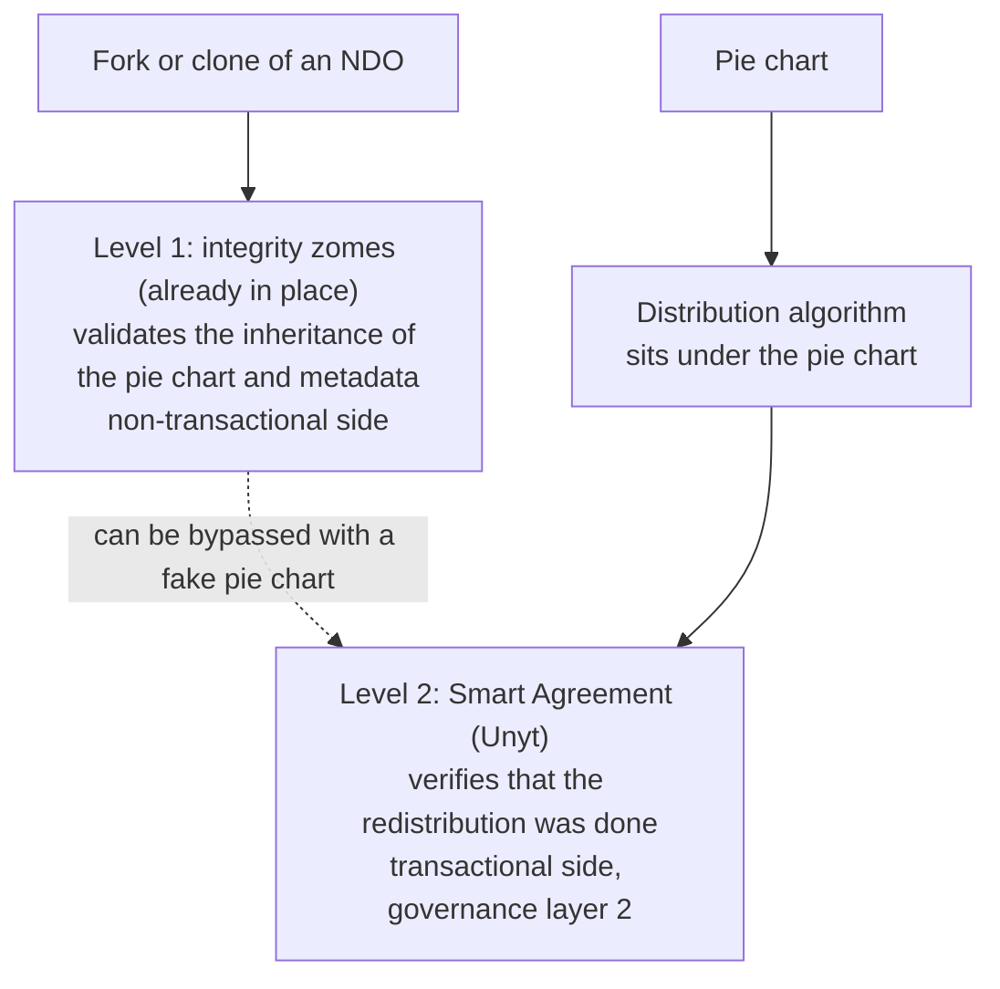
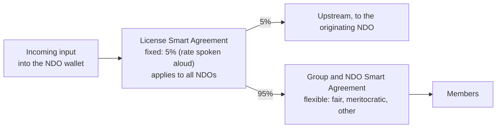
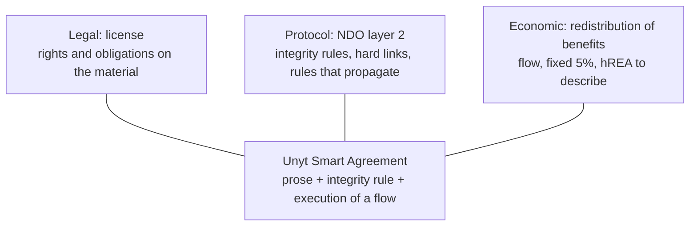
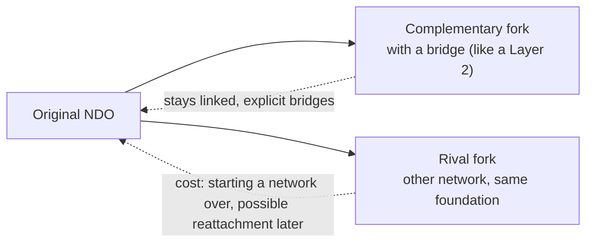
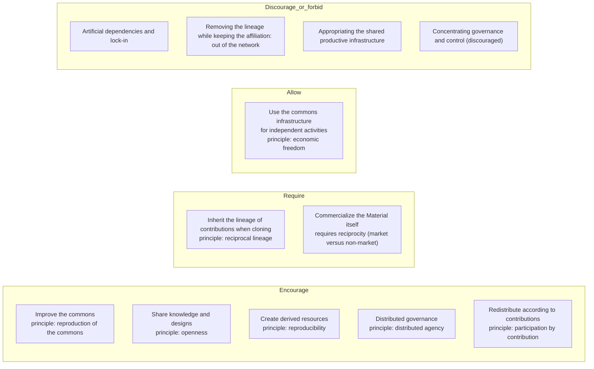

# Nondominium, Journal of the Lab session with Tibi, part 4 (November 18, 1:46 a.m.)

**Date:** night of Tuesday, November 17 to Wednesday, November 18, 2026, from 1:46 a.m. (2 h 27, part 4 of the session at the Sensorica Lab, recorded on a phone)

**Attendees:** Soushi (Sacha Pignot, lead developer of Nondominium), Tibi (Tiberius Brastaviceanu, co-founder of Sensorica). Soushi himself places the part at minute 18: the pie chart was discussed "tantôt" (earlier), and now the OVN license is being clarified, along with how to apply it "à travers le pie chart dans le code" (through the pie chart in the code), on the night of November 17 to 18 with Tibi and Sacha. The transcript comes from the local engine without speaker separation; who says what is reconstructed from the content and remains an inference, flagged as such. Between about minutes 84 and 96, the engine rendered in English words that were spoken in French.

**Context:** Direct continuation of [part 3](2026-11-17-lab-p3) (the v0.1 contributions table in a file next to the license, the royalty to first-level dependencies). From minute 21, Tibi reads and comments on the latest reply of his ChatGPT thread on the OVN license, shared with Soushi during the session; the journal quotes his exact English where the oral reading distorts it. The table of section 8 of the thread is not in the copied text; its rows come only from the oral reading. A single recording, so a single clock: the brackets give the minute in the part's file, `[12]`, `[34 to 36]`. This is an English translation; the original journal is in French. See the [Session index](2026-11-17-lab) for the decisions, actions and outstanding points of all the parts, and the other parts: [part 1](2026-11-17-lab-p1), [part 2](2026-11-17-lab-p2), [part 3](2026-11-17-lab-p3).

## TL;DR

The license of a peer-to-peer network is enforced by the network itself, like Bitcoin: whoever does not respect it ends up on a fork, outside the network, with no lawyers involved. For Nondominium this gives two levels: the integrity zomes validate from now on that a forked NDO inherits its parent's pie chart, and a Unyt Smart Agreement will later verify that the redistribution actually took place. For v0.1, Soushi proposes the distribution plumbing as a placeholder, "pas plugée" (not plugged in): Nondominium is the Genesis, there is nothing to distribute as long as no revenue comes in, and the royalty is only paid after a gain. Tibi describes two Smart Agreements in cascade on an NDO's wallet: a fixed one, the license's (5% when spoken), executed before anything else, then a flexible one, the group's, for the remaining 95%. The reading of the thread adds the distinction between material commons (copyable) and network commons (which bind), exit and portability against enclosure, and the idea that the license describes principles that Nondominium implements, without depending on it. The last half hour moves on to the digital product passport and the composability of NDOs.

## Discussion

### Minutes 0 to 30
**The license implicit in the peer-to-peer network, the Bitcoin example.** The recording opens mid-sentence, on the idea of the fork. Miners do not adhere to it, but someone can still "[créer] un autre bitcoin" (create another bitcoin), "le bitcoin classique" (classic bitcoin), or, according to the transcript, "l'intérieur classique" (inference: Ethereum Classic). In peer-to-peer, "la licence est implicite dans le réseau" (the license is implicit in the network): it is by not respecting it that one ends up "à l'extérieur du réseau" (outside the network). Bitcoin's license, the speaker says, is "essentiellement de dire que tu dois respecter le protocole du bitcoin" (essentially saying that you must respect the Bitcoin protocol), that is, the way coins are created and the way power works. Anyone who forces the rules and refuses "le contrat social" (the social contract) leaves the network. [0 to 1]

**Smart contract and legal contract as a pair, Holochain's integrity.** The next speaker (probably Soushi, inference: the Holochain vocabulary is his) links this to smart contracts. EOS, with Daniel Larimer, paired a smart contract with a "régalien" contract (inference: legal contract, perhaps Ricardian), "la version code, la version régalien" (the code version, the "régalien" version) coming together with the natural-language version. Holochain adds the notion of integrity, the integrity zomes, which sets it apart from the rest of the licensing industry. He goes further: Smart Agreements, with Unyt (transcribed "Units"), would make it possible to "forcer le flow" (enforce the flow). He compares this with what one would not have tried with smart contracts on a deterministic chain like Cardano, "avec EU et TXO" (with EU and TXO) (eUTXO, inference). The written text, the Markdown file, then becomes "une formalité qui fait juste décrire comment fonctionne" (a formality that just describes how it works) the system (the transcript says "NetByDesign", inference: "net by design"). [1 to 3]

**Forking an NDO validates the inheritance of the pie chart.** The computing process that clones or forks an NDO executes "les rules de base" (the base rules): to stay in the network, it must validate that the license is respected, that one has "hérité le pie chart du précédent" (inherited the pie chart of the previous one). Otherwise "tu te retrouves à l'extérieur du réseau" (you end up outside the network), because you are no longer compatible with the integrity. The other voice agrees ("Exactement" (Exactly)). Soushi insists on the design consequence: the license must not be thought of only as "un beau petit texte à forcer légalement" (a nice little text to enforce legally) with lawyers. Even if the lawyers say the license does not work, "c'est comme ça que ça marche" (that is how it works), like a smart contract. [2 to 4]

**Why users "agree": open code, documentation, rustdoc.** Users consent because the source code is open and documentation represents it clearly. Since the documentation points to the code, it is easy to check that they match. Rustdoc adds transparency. [4]

**Two architecture levels: integrity zomes, then Smart Agreement.** Soushi sets out two levels. The first is to do "le plus possible dans les zomes d'intégrité par nous-mêmes" (as much as possible in the integrity zomes ourselves): validating that one inherits the pie charts and the metadata. But this can still be bypassed, for example by sending "un faux pie chart" (a fake pie chart). The second level is therefore the Smart Agreement, which verifies that the redistribution really took place: the pie chart is received data, but the obligation ("faire les redistributions du 5 %, par exemple" (making the 5% redistributions, for example), he says) is an action. The other voice answers that this can also go into the NDO's governance: the distribution algorithm "se pose sous le pie chart" (sits under the pie chart), and a benefit cannot be run without a pie chart as input. Soushi calls this "le layer 2" (layer 2), the transactional side of governance. From this he draws a split: the non-transactional side of the pie chart is secured in the existing custom integrity zone, the transactional side requires Unyt and the Smart Agreement. [4 to 7]

**For v0.1: a placeholder, because Nondominium is the Genesis.** Soushi notes that "tout est live" (everything is live) and that perhaps, for 0.1, we need at least the architecture without Unyt, "sinon, on repousse 0.1" (otherwise, we push back 0.1) if we want the transactional side from the start. A lead: a placeholder, the distribution with all its logic, but "pas plugée" (not plugged in). What saves it is that Nondominium is "le Genesis, on est le premier" (the Genesis, we are the first): the plumbing will be in place, but there will be no pie chart "en haut, prêt à être envoyé en bas" (at the top, ready to be sent down), nobody below, no placeholder activated, and "la distribution se fait quand il y a une input" (the distribution happens when there is an input). So we can wait for later versions to integrate the distribution. [7 to 9]

**The license is only paid after a gain.** The other voice specifies the nature of the royalty: "tu ne payes pas ta licence avant d'avoir quelque chose à distribuer" (you do not pay your license before you have something to distribute). The payment is not up front, it comes after. He gives the picture: "ton piping est là" (your piping is there), and "dès que tu as 100$ à distribuer à tes collaborateurs, tu sais qu'il y a un 5% de ça qui va en avant" (as soon as you have $100 to distribute to your collaborators, you know that 5% of it goes forward). The transcript says "revanche" (revenge) for royalty ("redevance") (inference). Soushi confirms: at 0.1 there will be nothing to distribute, that is fine; for a 0.2 that would come quickly with no benefit as input and no placeholders built in, we can "délayer ça" (delay that). The 5% rate is the one spoken aloud, which differs from the 2% and 0.5% of the ChatGPT thread (which the session has not yet opened at this point). [8 to 9]

**The Holo organization's Smart Agreement repository, and Unyt without the app.** Soushi observes that before, we were waiting for maturity, but "maintenant, officiellement" (now, officially) the organization (the transcript says "Holo", inference: Holochain) has "tous les repos qu'il te faut" (all the repos you need), including the Smart Agreement repository seen at the time. The other voice thinks it is a Unyt module: we need the module for the architecture, not the app. The passage that follows reconstructs a memory of a test (inference on attribution: Soushi): HoloFuel would be native in Holochain, Unyt is "l'application un peu plus construite" (the somewhat more built application), which made it possible to create one's own units, "nos propres MCC" (our own MCCs), including a test of a Sensorica-style currency ("un sensory kakuin", inference: a Sensorica coin). The interface planned for making Smart Agreements by hand with templates, "mais on ne l'avait pas testé" (but we had not tested it). In Nondominium's case, these agreements could be coded "de manière programmatique" (programmatically). [9 to 11]

**A license Smart Agreement that executes before the group's.** The other voice describes the assembly: a Smart Agreement that says "tu prends 5% de tout le input pour le donner en bas" (you take 5% of all the input to give it down), it speaks only of the license, "s'exécute automatiquement, peu importe ce que tu fais avec l'autre 95%" (executes automatically, no matter what you do with the other 95%). The 95% falls under a second agreement, the group's. The license agreement is "fondamental" (fundamental) and applies to all NDOs: any input into the NDO's wallet automatically undergoes 5%, "avant même que tu le touches" (before you even touch it). Then the group decides how to split the rest, fairly, meritocratically or otherwise: that is "une flexibilité" (a flexibility). Image: "tu as reçu 100 pièces ? Non, tu as juste 95 pièces" (you received 100 coins? No, you only have 95 coins), "c'est la première taxe" (it is the first tax), then the second. A point of principle: humans are not left the choice to "appuyer sur un bouton" (press a button), "c'est le but de l'informatique" (that is the point of computing). Soushi adds: it will be a bundle of Smart Agreements, others tied to other transactional logics ("payer le transporteur" (paying the carrier)), and in the pie chart's case, two already: "un fixe et un qui est flexible" (a fixed one and a flexible one), the fixed one being the license's, the flexible one made of the governance rules of the group and of the NDO. [11 to 14]

**The repair kitty and the tragedy of the commons.** Another example of an agreement to insert: shared equipment. To avoid "la tragédie des communs" (the tragedy of the commons) (everyone uses it, nobody pays for the repair when it breaks), a speaker proposes that a custodianship transaction cannot be validated unless five coins are deposited into a repair kitty, "comme un real-key" (like a real-key) (uncertain transcription, inference: fixed rule). One can put in ten; five go to the kitty, the surplus goes "dans les communs, dans la trésorerie" (into the commons, into the treasury) (to you, to me, to Sensorica, to the lab). He compares it to an event "sur donation volontaire minimum dix" (on voluntary donation, minimum ten): the price is ten, give more if you can. This would fall under the NDO's governance, since an equipment-type NDO can have its own wallet. [14 to 16]

**Will Ruddick and the repair piggy bank.** A speaker says he talked with Will today (the transcript gives "Will Ruddick" at 16:22, inference: Soushi, from "vous m'avez dit que vous étiez en bon contact" (you told me you were in good contact) said by the other). Will asked him how to go about it on the Discord (transcribed "Grâche d'économie", inference: Grassroots Economics). The mere fact that "un Will Ruddick joue avec notre application" (a Will Ruddick is playing with our app) is called a success. To his question about who pays for an equipment's repairs, the answer was: each NDO has its own wallet with a "piggy bank de réparation" (repair piggy bank) that "se ramasse" (gets collected); when it breaks, one pays for time and parts, and someone comes to repair "parce qu'il y a de l'argent à faire" (because there is money to be made). Otherwise it is always the same people repairing while the users do free exploitation, "un classique" (a classic). Tell Will that it is not yet "un an de mignons" (inference: not yet a year of NDOs) but "c'est ce qu'on peut faire" (it is what we can do). [16 to 17]

**Transaction fees on Bitcoin: priority, mempool, support.** The speaker extends this with a Bitcoin analogy: there is a transaction fee paid before the transaction, and the mempool ("même pool") raises the question of priority, of who pays more and goes ahead of the others. He has already seen a paid transaction sit for 24 hours without going through; at the time he had to contact support, which raised the fees for him. Today, from one's own node, one can reprogram the transaction still in the mempool to increase the fees. Conclusion: "il y a des taxes comme ça qui sont représentées, qui sont justifiables" (there are fees like that which are represented, which are justifiable). [17 to 18]

**Starting the reading of the ChatGPT thread and placing the session.** A speaker proposes reading the text, the link having been put in (inference: by Tibi). Soushi, who is recording, opens the fourth meeting: the pie chart was discussed "tantôt" (earlier), and now the OVN license side is being clarified, and how to apply it concretely "à travers le pie chart dans le code" (through the pie chart in the code), on the night "du 17 au 18 novembre 2016" (of November 17 to 18, 2016) (read 2026) with Tibi and Sacha. A light remark ("ça, il sait que c'est sushi, hein ?" (that, it knows it is sushi, right?)) shows that the transcript does not recognize the first name, inference: Soushi. The other voice says he is about to read. [18 to 19]

**Unrecoverable passage during the silent reading.** From 19:29 to 20:42 the text is barely spoken: a few fragments ("Et là, ce qu'il dit ici, c'est la chose suivante" (And here, what it says here is the following), "j'ai mis le non-dominium là-dessus" (I put the non-dominium on it), "Parce que je dis attends" (Because I say wait)) and long blanks. What is read in a low voice or on screen cannot be reconstructed: **unrecoverable, 19 min 29 s to 20 min 42 s**. At 20:42: "C'est très intéressant ce qu'il nous dit là." (What it tells us there is very interesting.) Soushi sums up: "Pas importe si tu fais... si tu es une compagnie ou pas. Remets les choses dans les commons." (Doesn't matter if you do... if you are a company or not. Put things back into the commons.) (inference: a reference to the criterion of the nature of the use rather than of the organization, read in the thread). [19 to 21]

**Request for a screenshot of the three layers.** Soushi asks the other for a small screenshot "de juste ces trois-là" (of just these three): the three notions that make it possible to see the distinction between what must be in hREA (the economic network, the functional side, the governance of the economic) and the point below it, the declarative side: "ce qu'on fait avec notre layer 2" (what we do with our layer 2). These are the three elements "The commons / The economic network / The economic paradigm" of the thread, found in the line "The commons: The collectively produced resources, knowledge, designs, software, infrastructure, and other materials" (inference on the correspondence). The other looks for how to share ("Parce que là, j'ai peut-être le modèle gratuit" (Because right now, I may have the free model)), finds the conversation's "Share" button and sends the link. Soushi: "là, t'as tout le contexte, tu peux te donner à manger à l'IA aussi." (there, you have all the context, you can feed it to the AI too.) [21 to 22]

**Reading the thread: the GPL, the PPL, the OVN and the three levels.** The reading (by Tibi, from the context, voice not verifiable) picks up the thread at "The GPL primarily protects the first. The Peer Production License attempts to protect the first and impose conditions on the second, using organizational ownership and distribution of surplus as criteria. The OVN License should address all three. This is particularly important because a resource can remain technically open while its economic exploitation undermines the conditions that made its production possible." The transcript gives "Le JPL" three times: the first is the GPL, the second the PPL, "Le JPL devrait adresser tous les trois" (The JPL should address all three) is the OVN License. The three levels are, in the thread, "The commons", "The economic network" and "The economic paradigm". Soushi reacts: "Ah, il a compris !" (Ah, it understood!) and has the sentence about the technically open "resource" (transcribed "ressort") read again. [22 to 23]

**Economically captured open source: Microsoft, Google, VS Code.** Soushi explains what the sentence describes: a project can remain "techniquement ouvert" (technically open) while economic exploitation "appauvrit" (impoverishes) those who produced it. It is "le modèle actuel de l'exploitation économique qui prête sur les commons" (the current model of economic exploitation that lends on the commons). Microsoft and Google do open source (VS Code), but "économiquement, ils le capturent pareil, l'écosystème" (economically, they capture it all the same, the ecosystem), exploiting it to enrich the corporation that centralized the technology. That is what was said "tantôt" (earlier). [23 to 24]

**Takers versus givers, and the paradigm that use reproduces.** Soushi ties this to the question of "takers vs givers". The reading continues: "But the economic activity surrounding that resource may reproduce a different paradigm from the one that produced it." Soushi translates: "tu renforces le capitalisme à l'ordonnance de la technologie." (you reinforce capitalism at technology's command.) Then the reading: "The question for OVN is therefore not only whether the commons remains open, but whether its use reinforces or undermines the reproduction of P2P economic relations." (the transcript distorts the end into "la reproduction de la relation économique" (the reproduction of the economic relation)). [24 to 25]

**The industry's building blocks that corporations use without contributing.** At 25:01, after a blank (unrecoverable from 24:39 to 25:01), a speaker talks about an audiovisual building block used by all the media and maintained for twenty years by someone who is not "roulant sur l'or" (rolling in gold) (the project is not named, inference: a tool like FFmpeg). Projects that corporations use without contributing upstream, and whose volunteer contributors never benefit from the profits. "Est-ce que nous, on vient régler ?" (Do we come and settle up?) The reading moves on to "un objectif plus ambitieux que la copie conventionnelle" (an objective more ambitious than conventional copyleft): "This is a more ambitious objective than conventional copyleft." [24 to 25]

**Reciprocity built into the network.** Reading (same thread): "Nondominium introduces something fundamentally different: network-embedded reciprocity. Your explanation of NDO affiliation and cloning is particularly important. Traditional open-source licensing operates primarily through legal relationships between copyright holders and users. The license travels with copies of the work. Compliance is essentially a matter of respecting the legal conditions attached to those copies." Soushi sums up: one ends up "dans un contexte légal qui est complètement détaché de la tech" (in a legal context that is completely detached from the tech). Then: "Nondominium introduces another layer… An NDO is not simply a file or a software package. It represents an identifiable resource within an economic network." [25 to 26]

**Copying code on GitHub does not put you out of the market.** Soushi (inference) draws the consequence: if one copies open-source code on GitHub and "roule sa compagnie" (carries on one's business) on it, one is not thrown out of the market for having violated the license. One can still "vendre sa poutine au coin de la rue" (sell one's poutine on the street corner), because the market does not recognize the license and one is not yet part of the economic network. With Nondominium, the cost of exit is exclusion from the network. Unrecoverable passage from 26:35 to 26:55 (blank in the reading). [26 to 27]

**Rules that change mid-transaction, and parameters editable by admins.** Soushi brings up a message from RaiTurk ("Ray Turk" in the transcript) posted shortly before: in the middle of a transaction, the rules change, going from zero fees to "40% de frais" (40% fees). This shows that rules can change arbitrarily; Holochain is cited as the answer ("c'est son truc" (it is its thing), uncertain). Soushi held back from commenting: it depends on whether the parameter is configurable by administrators or whether it is "un magic string hard codé dans le code" (a hard-coded magic string in the code). As he designs it, it could be a parameter managed by the admins and recorded in an entry rather than hard-coded, which keeps the flexibility. [27 to 29]

**Fredo, a Unyt app and the value of a community currency.** Soushi tells of discussing it with Fredo (identity not specified), to whom he said that one can make applications on Holochain with "Unity" (read Unyt): "c'est quoi la valeur de l'app ?" (what is the value of the app?) It would be tied to HoloFuel, and so would have a value; "c'est qui qui décide du taux d'échange ?" (who decides the exchange rate?) His answer: the community, which requires governance. Even without HoloFuel "backup", which is "comme une forme de porte d'exit" (like a form of exit door), the value remains an intrinsic value of internal exchange of services and goods. MCCs (Mutual Credit Currency) are "censés être à la base" (supposed to be at the base) of self-sufficient ecosystems. The transcript stops at 29:59 on this sentence. [28 to 30]

### Minutes 30 to 60
**From the point about bridges to the reading of the thread.** The section opens in the middle of a remark about communities that have an internal currency, points having "une valeur intrinsèque pour leur propre communauté écosystème, tout en pouvant être interopérables avec la macroéconomie" (an intrinsic value for their own community ecosystem, while being able to be interoperable with the macroeconomy). Some offer more services and accumulate points, then "à un moment donné, il faut qu'ils cash out" (at some point, they have to cash out). Unless the community lives in autarky, its members need other goods and services: "il faut des ponts, car sinon au bout d'un moment ils vont vite se sentir limités" (bridges are needed, because otherwise after a while they will quickly feel limited). The example given: trading with your neighbors is fine, but you end up needing a new lawnmower or a repair, and a tractor put at the community's service breaks down with no repairer in the ecosystem. The speaker apologizes for going on "parce qu'on enregistre" (because we are recording); the other answers that it is still relevant. It is not known who is speaking (inference: it is probably the continuation of the exchange on internal currencies from the previous part). [30 to 31]

**Reading the thread: cloning an NDO is not copying a resource.** From [31:03], the voice reads the ChatGPT text (section 2 of the thread, "Nondominium introduces something fundamentally different: network-embedded reciprocity"). The transcribed French is a partly distorted oral reading. The thread says: "An NDO is not simply a file or a software package. It represents an identifiable resource within an economic network." Then, on a clone or a fork: "A new NDO is created. An affiliation relationship connects it to its predecessor. The contribution distribution of the original NDO is inherited according to the applicable governance rules. The new NDO acquires its own contribution distribution, incorporating the inherited allocation. Its continued affiliation with the network depends on respecting those rules." The text then contrasts two operations: "Copying a resource: Someone can reproduce the material independently." and "Cloning an NDO: Someone creates a new network object that remains affiliated with the original economic network." The second "carries more than the material itself. It carries economic and historical relationships" (the transcribed French: "elle crée des relations économiques et historiques" (it creates economic and historical relationships)). At [32:30] a speaker sums up: "tu as un coût si tu te retrouves à l'extérieur de ça" (you have a cost if you end up outside of it), then the reading resumes with "C'est une innovation potentiellement puissante" (It is a potentially powerful innovation) (the thread says: "This is a potentially powerful innovation"). [31 to 32]

**A reaction to ChatGPT, then a hole in the transcript.** Around [32:37], a speaker says, speaking of the machine: "c'est [ChatGPT] qui dit ça" (it is [ChatGPT] that says that), then adds a joking remark, partly unintelligible (the transcribed text "ils sont toujours en train de me laisser le cul" is a distortion, not recoverable with certainty). He asks "Est-ce qu'ils ont tort ?" (Are they wrong?) and the other agrees that objectively they can only say that. At [33:07]: "Il a compris l'intention. Jusqu'à l'instant, il a juste redit ce qu'on a dit." (It understood the intent. Up to now, it has just repeated what we said.) That is, the machine has not yet added substance to what has already been said. From [33:07] to [34:22] the transcript is nearly empty: two isolated sentences at [33:19] and [33:21] ("C'est les composantes" (It is the components)) and one at [33:51] ("C'est ça, oui, c'est ça" (That's it, yes, that's it)). A gap in the reading or the discussion, unrecoverable. [32 to 34]

**Locus: a new place of contribution.** At [34:22] the reading resumes on section 3 of the thread. The thread says: "A fork inherits part of this history and economic structure. It also becomes a new locus of contributions and future benefit redistribution." The transcribed French: "C'est un locus, c'est un lieu, c'est un nouveau lieu de contribution pour ce nouveau [NDO] et un nouveau lieu pour un nouveau Benefit Redistribution Algorithm." (It is a locus, it is a place, it is a new place of contribution for this new [NDO] and a new place for a new Benefit Redistribution Algorithm.) Soushi asks what "locus" means, not being used to the word (inference: it is him, since he says he will look it up out of curiosity). Tibi, or the other voice, answers that it is a place, that the word exists in French, "c'est plus qu'un lieu" (it is more than a place). A joke follows: "Le locus de l'Homunculus, c'est le tanner" (The locus of the Homunculus is the tanner) (probably the athanor; inference, SoushAI is the system's homunculus). [34 to 35]

**GitHub does not have the economic layer.** Between [35:04] and [35:49] the transcript has gaps. What remains: "Oui, parce que GitHub n'a pas cette couche économique." (Yes, because GitHub does not have this economic layer.) In the thread, this is the comparison with the classic fork: "conventional software forking, where Git history might preserve attribution, but there is no inherent economic obligation to recognize the original contributors". The rest is unrecoverable. [35]

**Three levels of reciprocity: legal, protocol, economic.** From [35:49] to [37:00] the voice reads the section "A distinction I would emphasize : There are three possible levels of reciprocity". The pasted thread does not contain the list ("These mechanisms reinforce one another, but they are not interchangeable"), so it is reconstructed from the French. The three levels: the legal (the rights and obligations attached to the material); the Nondominium protocol, that is, the integrity, "les règles qui gouvernent l'affiliation" (the rules that govern affiliation), "les hard links" (the hard links) and "les pièges qui se propagent" (the traps that propagate) (the constraints that propagate, inference); the economic, "la redistribution des bénéfices" (the redistribution of benefits) in the network, the contributory account. A speaker says: "C'est la transition, c'est ce que tu appelles le flow." (It is the transition, it is what you call the flow.) [35 to 37]

**The Smart Agreement would cover the economic level.** Soushi proposes that the Smart Agreement (Unyt) could cover "ce compte économique slash transactionnel" (this economic slash transactional account). The other voice (Tibi, inference) specifies how: the Smart Agreement "fixe le 5%" (fixes the 5%) so it is part of the integrity; it has a prose component, in human language, which ties it to the legal side; and it has an economic component, because it "exécute une transaction" (executes a transaction): "du moment où tu as eu 100 [unit transcribed "rollofuel", unidentified], directement, le niveau économique, le Smart Agreement exécute un flow d'argent" (the moment you had 100 [unit], directly, the economic level, the Smart Agreement executes a money flow). Soushi places each level in the architecture: the protocol is the declarative side, "ça vit dans le layer 2 du NDO" (it lives in the NDO's layer 2), tied to their integrity rules and their custom zomes; the economic and transactional side goes through hREA (transcribed "Shreya"), with its own rules. He notes that hREA is not tied to governance, but that the Smart Agreement would add "une couche de gouvernance à notre flow économique" (a governance layer to our economic flow). [36 to 38]

**A governance module for hREA with Unyt?** Soushi asks the question: we were talking about making a governance module for hREA; "est-ce qu'on pourrait utiliser, pour ça, Unyt" (could we use Unyt for that)? Since it is modular, integrating an optional dependency would be acceptable. Tibi answers that, as described, we do not even need hREA: a Smart Agreement has a legal component (a prose, a commitment), is part of the integrity rules, and can carry a simple rule, "5% automatiquement distribué" (5% automatically distributed). The two agree that it is the fixed base common to all the network's NDOs, defined by the license and inherited, and that the Smart Agreement's executability ensures the economic level. Tibi insists: a Smart Agreement is not only for passing tokens, it can execute "un badge" (a badge), give access "à un processus de governance" (to a governance process), manage credentials or fees, and not only the pie chart. [38 to 40]

**Smart Agreement, hREA and Valueflows: executing or describing.** Soushi connects the Smart Agreement to hREA and Valueflows: he has already studied the correspondences between their principles; what interests him is that they are triggered events, therefore connected to hREA's event layer in their implementation. Tibi: in Valueflows, a transaction is an economic event. Soushi elaborates: hREA/Valueflows is "une ontologie avant tout, une couche descriptive" (an ontology above all, a descriptive layer), an observability layer, not enforceability nor transactional. In hREA's integrity zone, he has "renforcé pas mal" (strengthened quite a bit) the rules, but they remain generic and only check Valueflows's own logic, not custom governance. One can visualize flows and processes, but "on l'exécute pas" (we do not execute it); the Smart Agreement would be what "vient exécuter les process de hREA" (comes to execute hREA's processes). [40 to 41]

**News for Lynn and Requests and Offers.** Soushi notes that he has not given Lynn (transcribed "Lean") news for a while, despite many ideas and work on hREA, especially the integrations in Nondominium. He observes that Nondominium is "Valueflows first", whereas Requests and Offers (transcribed "Request an Offer") presents itself as hREA. He wants to bring her something new on their brainstorms, the different modules and his plans for the next version, because there are fewer meetings and she may feel she has been set aside. He explains the reason: no meetings; "même moi, je ne vois plus Anita. C'est juste Sam et moi, full focus Dev" (even I no longer see Anita. It is just Sam and me, full focus on dev); the hREA part is done "en quelque sorte" (in a way): he has his exchange process, his mapping and a dashboard. A speaker mentions "Cameron" as the cause (transcribed "C'est à cause de Cameron" (It is because of Cameron), context unrecoverable). At [43:27] a speaker asks if he can smoke; the other agrees. [41 to 43]

**Hard fork: the protocol cannot prevent it.** The reading resumes at [43:38]. The thread says: "someone could take the source code of Nondominium, modify it, remove the contribution-inheritance rule, and run an independent network. The protocol cannot prevent this. What it can do is make clear that the resulting network is no longer part of the original Nondominium network under its established governance rules. This is analogous to a blockchain hard fork, as you suggest." The transcribed French "couteau de blockchain" (blockchain knife) is a "fork de blockchain" (blockchain fork). (Tibi's thesis upstream, taken up in the thread: as in Bitcoin, either all the nodes move to a new version, or a fork is created.) [43 to 44]

**The reservation: what is implemented and what is aimed at.** The thread continues: "There is an important qualification: the source repository currently describes the NDO-per-cell architecture, permanent DNA identity, embedded governance, and a modular governance-as-operator design. However, the README still identifies some economic processes and governance components as being under development. We should distinguish the intended economic inheritance mechanism from what is already implemented and validated in code." A speaker sums up: "Il dit que le code ne supporte pas tout ça. On est d'accord." (It says the code does not support all that. We agree.) The thread goes on: "The license should describe the economic principles and obligations. Nondominium should provide an implementation of those principles, where technically possible. We should avoid making the legal license dependent on a particular software implementation." Tibi and Soushi confirm that the license describes and Nondominium implements. Tibi asks whether Soushi had shared the first version of the license; he answers that it is the same session as two months ago, which Tibi continued. The architecture discussions inform the license: "ça va de pair, la licence avec Nondominium" (they go together, the license with Nondominium). [44 to 46]

**Six principles: what exactly we are protecting.** From [45:47] to [50] the voice reads section 4 of the thread: "The most important question: what exactly are we protecting?" The thread says: "You are right that these traditional categories [capitalism, socialism, P2P] should not become fundamental concepts in the license. Instead, we should identify the structural characteristics of the economic paradigm we want to reproduce. I would propose exploring six principles." The six, with the thread's English title:
- A. Distributed agency: decision authority that is distributed and contextual; a resource should not fall under "the unilateral authority of whoever initially created it or provided funding for it".
- B. Contribution-derived participation: participation rights come from contributions rather than from investment or formal membership.
- C. Non-exclusive access and reproducibility: a participant must not be able to turn collective knowledge or infrastructure into an exclusive productive asset.
- D. Reciprocal lineage: a derived NDO must not "erase the contributions embedded in its ancestry while retaining the benefits of affiliation with the original network".
- E. Distributed benefit generation and redistribution: "The objective is not simply to compensate original creators. It is to support the continued reproduction of the productive ecosystem."
- F. Network interoperability and autonomy.
In passing, a speaker comments on principle A: "Ça c'est [la thèse de] [Vienne ?]" (That is [the thesis of] [Vienne?]) (unreliable word, probably a personal reference, unrecoverable), and on C: "Ça c'est les licences open source." (That is open source licenses.) [45 to 50]

**Reproducing the productive system, not only the creators.** Tibi asks whether Soushi understands the distinction: the emphasis is not on the creators but on "la reproduction du système de production lui-même" (the reproduction of the production system itself). He ties this to Marx's critique: "la capture des moyens de la production" (the capture of the means of production). Soushi draws from it that making the means of production explicit limits capture: it becomes transparent, "on la rend impossible de base" (we make it impossible from the start), and transparency adds security and resilience. Tibi insists: the license concerns the creator of an NDO, but also "le Productive Ecosystem" (the Productive Ecosystem), it does not only reinforce the individual who created something while ignoring the rest. He concludes: "Toute l'économie générative est dans cette phrase." (The whole generative economy is in this sentence.) [48 to 50]

**Loss of the transcript.** From [50:38] to [51:17] the transcript is only a hallucination loop ("quand même" (all the same) repeated). Unrecoverable. What comes just before ([50:30] to [50:37]) is the idea that the flow feeds the creator but also the production ecosystem. [50 to 51]

**Regenerative: watering all the soil, not a single root.** Soushi proposes an image: the mutually beneficial, bidirectional relationship of an agent with its ecosystem, a "symbiose" (symbiosis) (he searches for the word: natural, organic, regenerative, symbiotic). Tibi elaborates with water flowing downward: if the flow targeted only the creator, one would pick "lui ou lui ou lui" (him or him or him) according to what one judges important. Nondominium on the contrary imposes distributing everything, so "si tu laisses de l'eau couler dans l'écosystème, ça va arroser toutes les petites affaires" (if you let water flow into the ecosystem, it will water all the little things). The mechanism is "d'ensemble" (holistic), therefore regenerative: it does not rest on a chosen creator, whom one might later want to exploit more or retain. He contrasts it with open source as he describes it: a company gives money to a contributor it wants to retain and forgets the one who made an important patch. Being regenerative, "c'est d'arroser le sol, pas juste cette racine-là" (is to water the soil, not just that root). Soushi adds that the "blind" 5% rule, inherited from all NDOs through the Smart Agreement, avoids favoritism and a form of arbitrary lobbying. Tibi: this is the whole economic complexity, because a discreet contributor might later become the one who saves an ecosystem. [51 to 54]

**The small foundational libraries.** Soushi gives the example of contributors whose part became a foundational building block: in the Linux ecosystem, many small compression libraries maintained by small volunteer teams. He brings up "le fameux hack" (the famous hack), the backdoor attempt in a small compression library, where a contributor stayed in the team for years before being unmasked (inference: the XZ Utils affair; the name is not said in the transcript, Soushi says he no longer remembers it). Tibi agrees ("Ah oui, il a été planté" (Ah yes, he was planted)). Soushi clarifies that this is not the idea, but that it is a good example of a library run by volunteers and foundational. [54 to 55]

**First level and sub-dependencies: the risk of capture.** Soushi ties this to trickle-down: a foundational building block has many children and grandchildren, so something trickles back up. But there is a difference between having many dependents at the first level, who pay directly, and their sub-dependencies. It is a capture risk: someone whose type of product distributes very well at the first level could generate enormous amounts. Tibi: the license says 5% here and "5% de 5%, 5% de 5%" (5% of 5%, 5% of 5%) afterward, but that holds for the sublevels; Soushi maintains that someone connected "à un million de choses" (to a million things) at the first level remains a risk. He recalls that this topic had been raised in a previous discussion. [55 to 56]

**Pyramidal, not pyramidal.** Soushi notes that as soon as one talks about trickle-down, people say "c'est pyramidal, c'est Ponzi" (it is pyramidal, it is Ponzi) (transcribed "pansy"), so the risks must be properly identified. Tibi answers that it is not pyramidal, because pyramid schemes rely on new members paying a fee that goes up and is then redistributed: the money at the top always comes from the bottom. Numerical example: ten newcomers each pay $10, that makes $100, which is distributed; then 1000 are needed, then more, because the pyramid needs a growing number of new entrants; when there are no more, the inflow dries up and everything collapses. Here, according to him, what is distributed "vient d'ailleurs" (comes from elsewhere), from a sale, so there is no circularity of that kind: the input can arrive at any level and flow into benefit. The thread addresses this point further on, outside this section. [56 to 60]

**Hermetic digression.** At [57:50] a voice says this resonates "presque mot pour mot" (almost word for word) with the Hermetic principle of the Emerald Tablets of Hermes Trismegistus (transcribed "tables d'Hemrose, de la maîtreise Mégis"): "ce qui est en haut est comme ce qui est en bas" (that which is above is like that which is below), "as above, so below". It adds that this is a universal symmetry (good/evil, light/darkness, yin/yang) and that "cette symétrie ici, elle est négative" (this symmetry here is negative) in the case of the pyramid scheme. This passage looks like a ChatGPT reply read aloud rather than a spontaneous remark (inference, the style is the thread's, but the exact text is not in the pasted thread). Tibi moves on to the pyramid. At [59:56] a voice says: "Tu peux avoir une utilité de couche, ça ne te dérange pas. Mais la porte d'entrée est partout." (You can have a layer utility, it does not bother you. But the entry door is everywhere.) The section cuts off there, in the middle of the idea. [57 to 60]

### Minutes 60 to 90
**An inverted pyramid, but not a Ponzi scheme.** The sequence opens mid-sentence, on a diagram the speaker draws by hand ("Ce n'est pas juste les nouveaux, tu vois" (It's not just the new ones, you see)). Value can "rentrer par ici, par ici" (come in here, here), then flow downward, but only toward a beneficiary located "en haut" (at the top) (the word is transcribed "bayerien", inference: beneficiary, funder or ancestor in the chain). So it is "un ponzi inversé" (an inverted Ponzi), "une pyramide, mais inversée" (a pyramid, but inverted). The point that matters: "ce n'est pas un ponzi" (it is not a Ponzi), because there is always "une source externe à la pyramide" (a source external to the pyramid), whereas in a Ponzi "la source est la pyramide elle-même" (the source is the pyramid itself). A Ponzi is reasoning closed in on itself that feeds itself and is therefore not viable. The other voice rephrases: that is why it is not viable. [60 to 61]

**Principle F: interoperability and autonomy of networks.** One speaker moves to the ChatGPT thread ("là, il m'écrit les choses" (there, it is writing things for me)) and reads principle F, one of the thread's six principles, after recalling that principle E on benefit redistribution has already been covered [61]. Text of the thread: "Resources and networks should be able to interact without requiring centralized permission. At the same time, individual networks should retain the capacity to establish and enforce their own governance rules." Then: "P2P does not mean the absence of rules. It means that rules emerge from distributed governance rather than being imposed by an external centralized authority." The six principles are "pas nécessairement une liste finale" (not necessarily a final list) and serve to identify an economic behavior "sans référer à des catégories organisationnelles" (without referring to organizational categories). [60 to 62]

**The market is not peer to peer.** The thread goes on to "An important tension: Market versus Non-Market is not the same as P2P versus non-P2P" and says it wants to challenge one aspect of the emerging model. Speaker: "on est d'accord, parce qu'il y a du marché dans le peer-to-peer" (we agree, because there is market in peer-to-peer). A brief hesitation on screen ("C'est où mon truc, là ?" (Where is my thing, now?)) precedes the reading of the grid. [62]

**The two-axis grid.** The reader announces "deux scénarios" (two scenarios) while the thread writes "Consider four scenarios" (the thread's table is omitted from the copied text) and lists the four cells, peer-to-peer production and governance on one side, hierarchical on the other: a group that uses an OVN ERP to contribute its activities (non-market use); an OVN that produces and sells a physical product from shared hardware designs ("by the way, they can sell", market use); a conventional corporation that uses an OVN ERP internally without selling it (non-market); a corporation that sells products incorporating OVN hardware designs (market). Market / non-market separates the columns, peer to peer / non-peer to peer separates the rows: "deux dimensions indépendantes" (two independent dimensions). Consequence drawn by the thread: an exemption for non-market use would also exempt the hierarchical corporation that uses the ERP internally. A speaker rephrases it: a for-profit corporation can make both market and non-market use of an open source thing. The thread judges that this "pourrait être acceptable" (could be acceptable), since Tibi explicitly said not to impose invasive accounting obligations on non-market use ("You have explicitly indicated that we should not impose invasive accounting obligations on non-market uses", attribution to Tibi by inference, the thread's "you" being the author of the prompt), but it reveals that the market / non-market distinction "cannot protect the P2P paradigm". [62 to 64]

**Approach A: a single economic boundary.** Reading of the thread: the license distinguishes only market use from non-market use; non-market use is economically free; market use triggers a 2% redistribution obligation; all derivatives preserve the lineage of contributions. The reader stops before the limits of the approach (the thread adds that hierarchical organizations can benefit from non-market uses without contributing to the commons). He comments on the first sentence: the thread separates the relationship with the hardware itself (the fact of selling it) from what one can do with it, for example run one's company on it, make money or sell products it helped create. [64 to 65]

**The Dolibarr case: commercial use without selling the artifact.** A speaker links this to an earlier discussion on hosting a peer-to-peer tool. He puts himself in the place of a company that uses Dolibarr (transcribed "Doliba", "Dolibar") to run its business and develops custom modules for its clients: it does not sell Dolibarr, but earns its living with it through integration, customization and configuration services. Is that a "commercial use"? The speaker's answer: it depends on the licenses. Some forbid commercial use and define it as use in a commercial context, even for a company that "vend juste des patates" (just sells potatoes) and for which Dolibarr is only infrastructure; others say "tant que tu ne vends pas Dolibarr" (as long as you don't sell Dolibarr) one can profit from it. Alongside, the Dolistore (transcribed "Dolly Store"): it is not the Dolibarr people who sell but the authors of the modules, under a different kind of license, like a WordPress-style plugin market, because it is not the same code. [65 to 67]

**What makes the difference: is the artifact the object of the transaction?** The distinction, formulated several times, is one of scope: either the perimeter of the artifact alone (is it the object of the transaction?), or the wider context in which it is applied. In the second case, being a commercial agent who uses it is enough to have to pay a license; in the first, the artifact merely supplies the context in which one later applies it and does not become a transactional object. This matches Tibi's text in the thread, line 15: the "commercial" presupposes the "transactional", and the Material must not be the object of a direct exchange ("The requirement is for the Material (the thing) in question not to be an object of direct exchange", quote from the thread, linked by inference). A voice notes that saying all this out loud is good, that he "déjà dit dans mon prompt" (already said it in my prompt), that it helps to formalize, and that he will share that document alongside to complete the day's record. [66 to 69]

**Approach B: two independent boundaries.** Reading of the thread: the license would distinguish the economic relationship with the Material (market / non-market) from the relationship with the productive network ("peer to peer compatible versus extractive"). The first determines whether economic redistribution is owed; the second determines whether certain forms of participation, affiliation and access to network-level benefits are compatible with the network's governance principles. This is, says the reader, "le cas de Nondominium" (the Nondominium case) and it is more ambitious: an activity can be non-market without being peer-to-peer compatible. A hierarchical corporation that sells potatoes using Dolibarr would have a non-market relationship but would not be peer-to-peer compatible. (The thread specifies that this corporation would have no percentage to redistribute but would not automatically acquire the rights tied to network affiliation, and asks: who determines that an activity is peer-to-peer compatible? This part of the thread is not read in the recording.) [69 to 70]

**Objection: a wall between market and peer to peer is nonsense.** A speaker argues that this compatibility is necessary, then drifts: if one wanted to forbid every transaction, that would be banning the very notion of an economic transaction; yet, with the mechanisms in place, there is the potential to do peer-to-peer e-commerce on Holochain (transcribed "l'autre chaîne" (the other chain), inference), with Unyt wallets (transcribed "unit"). Making Unyt "fondamentalement incompatible" (fundamentally incompatible) with peer to peer, or making the notion of MCC (Mutual Credit Currency) incompatible, would be absurd. Putting a wall between the two is "un non-sens" (nonsense), because some transactional mechanism, therefore commercial by extension, is needed, and the transactional and the commercial go together. If the wall were set (as soon as there is commercial activity, it is no longer peer to peer), one could "jamais se lier au monde économique actuel" (never connect to the current economic world) with a Holochain application. The other voice answers that one can connect, but by paying: "tu peux le faire, mais tu dois payer. C'est dans le contexte" (you can do it, but you have to pay. It's in the context). The case of a merchant using NDOs goes beyond simple e-commerce, in his view: the question is the license's compatibility with the market. [70 to 73]

**The keyboard: making it at home, or in a Fab Lab.** Example of a hardware design (a keyboard): making one at home is non-commercial; making it in a Fab Lab, "tu t'en fais et t'en vas" (you make yourself one and leave), is commercial. It is not forbidden: "si tu fais de l'argent, arrose l'écosystème. Si tu as des inputs, arrose l'écosystème. Si tu n'as pas d'inputs, n'arrose pas." (if you make money, water the ecosystem. If you have inputs, water the ecosystem. If you have no inputs, don't water it.) This already exists in other licenses: free and non-commercial as long as one does not make money, sometimes with a specific threshold ($100,000 in profits) above which one redistributes. Their flaw: they are too invasive, one has to monitor and send an inspector to check the threshold. Here it is "by design" and no more intrusive, because it is tied to public data that is already aggregated. For non-public data (certain PPRs, encrypted entries in the DHT), it is the algorithm that reads them, not humans or third parties. [73 to 75]

**The Product Passport: the manufacturer pays and recharges the customer.** For manufacturing, "c'est simple" (it's simple): one must offer a product passport with the product, created from the NDO (transcribed "dios", inference) because one must prove cryptographically that the design was used. Issuing the passport costs; the manufacturer pays it, then bills it to the customer. Speaker: "Ça, c'est un autre smart agreement qu'on va devoir avoir. Et c'est à côté du pie chart" (That is another smart agreement we will have to have. And it sits next to the pie chart), the one we talked about a lot for certifications, like "payer le petit 5 $ pour pouvoir faire ceci" (paying the little $5 to be able to do this). In a Fab Lab: "voici mon design, fais-moi un produit" (here is my design, make me a product), and a guarantee is required, with a legal aspect: "je te promets que j'ai utilisé tout ce qui est dans le product passport" (I promise you that I used everything in the product passport), for example not the part bought in China but the one that came with the design. The manufacturer cannot give this passport without cryptographic proof; the legal aspects of the manufacturer's liability are therefore already built in. If the manufacturer swapped a component for a Chinese thing that broke, "où est ma garantie ?" (where is my warranty?): in the passport, which can be taken to court. [75 to 77]

**Composability of passports.** Now that there are sub-NDOs and hard links (transcribed "harddings") that indicate components and sub-components, product passports can become composable, like NDOs. Question on the composability of the European digital product passport (transcribed unintelligibly; the European Union's Digital Product Passport is understood, by inference): "À quel point il est composable, celui de l'Union Européenne ?" (How composable is the European Union one?). Answer: it follows the composability hard links, so there is a chain, almost a score, because for it to be complete the chain of passports must be complete. Do the NDO components also need a passport to validate the one above? No: what is inherited is the design, not hardware products, and the passport accompanies only a manufactured instance, hence its name. Question left open: if one buys a part, it does not necessarily come with a product passport. [77 to 79]

**The classic passport, and why it changes in peer to peer.** In the old system, an electronic part arrives with its datasheet issued by the company, with its logo: it is a legal commitment ("tu peux amener ça en cour" (you can bring that to court)), a de facto Product Passport. A speaker asks whether it is the equivalent of layer 1 (inference: layer 1 of the NDO model). The answer: in peer to peer, there is no single manufacturer putting its logo on it, anyone can manufacture. In a company, R&D, quality control and innovators are under one roof and the entire chain is under the manufacturer's responsibility. In peer production, the manufacturer is not the innovator; the passport therefore requires a blueprint validated by others, and what the manufacturer adds is its legal promise of having followed the blueprint to the letter, with the Bill of Materials and the components bought from the indicated vendors. "Ça hérite un design qui a été déjà validé puis ça ajoute ma responsabilité." (It inherits a design that has already been validated, then it adds my responsibility.) He points to the "Breeding Games" project (name as transcribed, not verified) where "c'est exactement ça l'architecture" (that is exactly the architecture). [79 to 82]

**Making without a passport, or guaranteeing it without touching the customer.** If one does something commercial, one can give a keyboard without a passport: that would be "l'économie en-the-ground, pair à pair" (the on-the-ground, peer-to-peer economy), which Nondominium would not see, like someone at the lab who 3D-prints and gives away the part. But one can ask for a guarantee, which is the passport; the manufacturer obtains it by printing from the NDO, which requires paying (worked example: 5 tokens for the passport, 10 tokens billed to the customer, 5 in pocket, the other 5 already gone). The idea is not to force the customer to transact with Nondominium: the manufacturer may be under Nondominium, but the customer only wants to get their stuff. It is a separation of concepts: it is the entrepreneur who manages, not the customer. Illustrated sequence: the customer asks for an invoice, the guarantee; the entrepreneur prints, pays, recharges 5 more tokens; "comment je peux te faire confiance quand tu as utilisé les bonnes components ?" (how can I trust you when you used the right components?): there is a logical sequel. [82 to 84]

**Hosting example: the concept of exit.** The reader announces the hosting example ("c'était quoi ton hosting example ? C'est le ERP" (what was your hosting example? It's the ERP)) that he added to the thread after their discussion, then reads point 6 of the thread. Thread title: "Your hosting example reveals another important principle: preventing enclosure". Text: "Your example of an open-source ERP hosting provider is especially useful because it introduces the concept of exit." Two services. Service A: hosting, backups and maintenance, full data export, standard formats, migration to another provider, with no artificial restriction on the underlying ERP. Service B: controls access to customer data, proprietary extensions and formats, difficult or ruinous migration, technical dependencies that keep customers from leaving. The second "is creating a mechanism of dependency and enclosure". Principle drawn: "The use of commons infrastructure ... must not be used to create artificial dependencies that undermine the autonomy and freedom of its users." The transcription of this reading switches to English from [84] and the rest of the sequence is transcribed in English (inference: the engine translated the spoken French). [84 to 86]

**Exit, migrate, fork: an economic property.** Continuation of the reading: "In a P2P economy, the ability to exit, migrate, fork, and establish alternative relationships is fundamental. This is not just a technical property. It is an economic property. A network that cannot be exited without losing accumulated data, productive relationships, or participation rights is vulnerable to capture." The thread says that Nondominium's persistent identities and network relationships "could help address this", but that it will be necessary to think carefully about which information and which relationships must remain portable when an agent leaves the network. The reader repeats the last sentence ("we need to think carefully about which information and relationships must remain portable when an agent wants to leave"). [86 to 87]

**Silence, then DHT and hREA interoperability as the way out.** Between 87:01 and 87:49 there is almost no text (a sentence repeated at 87:15 to 87:21, nothing from 87:21 to 87:49): unrecoverable gap from 87:21 to 87:49, presumably reading or thinking time. A speaker (inference: Soushi, speaking of what Nondominium offers) then says that the DHT's interoperability goes through hREA, because it makes it possible to move to another application than Nondominium with the same economic data: "HREA is a bridge". Even without hREA, everything comes down to data migration. An agent can index the DHT and make a full export of it; above all the aim is to give the user back their data, so an export of the source chain (transcribed "chain") with its relationships. [87 to 88]

**Which relationships? Social ties, not links between entries.** The other voice asks which relationships are meant: between agents. As with Facebook, one can export one's data but one loses one's friends; the export must carry "the real relations", not only the links between entries in the code sense. Clarification from the speaker: the relationships are all the connections to the agents one interacts with. [88 to 89]

**No vendor lock-in.** Soushi (inference) concludes on interoperability: we are the bridge between hREA and the DHT. If the other application at least speaks our hREA and our common DHT, and above all in the age of AI where all platforms will be ultra-customizable, the door stays open. Changing application amounts to changing interface: there is no vendor lock-in, because the network is "moi, mes protocoles" (me, my protocols). The other application would have other DNAs but still "one man, one DHT, one common DNA", which allows interoperability. [89 to 90]

### Minutes 90 to 120
**Reading note.** The start of the segment (90 to 96) is rendered in English by the transcription engine, probably a machine translation of remarks made in French (inference). This explains the abrupt phrasing. There is no speaker separation. From 97 to 100 and then from 105 to 115, it is the reading aloud of the ChatGPT thread on the OVN license, translated on the fly into French then read in English, with interspersed comments. The table of section 8 of the thread does not exist in the text file (tables were lost in the export). Its rows can therefore be found only in the oral reading.

**A different application that speaks hREA.** The segment opens mid-sentence: as long as one keeps "this common DNA, which is made for interoperability", one can have "an app completely different". All the logic that maps the hREA DNA, the Valueflows flows, can be "completely custom" in each person's application. A "completely different" Nondominium can thus exist, but "as long as I speak HREA, the fundamental code, it's ok, you will understand my flow". The signatures are different, and it is up to governance to know "how compatible we are or not". The essential thing is that both speak the same language: "after we can speak both French and English". [90 to 91]

**The Bitcoin fork and direct democracy.** The speaker announces "an interesting thing with the non-dominium networks": in the blockchain, moving to a new version of Bitcoin depends on the miners. In a Nondominium network, by contrast, "people decide for themselves, they don't have to convince the miners". The passage is partly unintelligible: one hears "we're going to make an interruption fork, but they can have putches", then a majority moving to the new version while the other side "you're alone". He concludes that it is "really a direct democracy", "the law of the foot". He compares it with proof of stake and delegated proof of stake: "we have it in a stronger way". He adds: "I've never seen that and it's by design, the Holochain application is really a direct democracy". Later, he addresses Soushi: "you hear that, this idea for the article, of direct democracy by design with Holochain, people can vote with their feet". The speaker is probably Tibi (inference, from the address to Soushi). The idea is meant for an article. [90 to 92]

**Daniel Larimer, fractal democracy and the right to divorce.** The other speaker (Soushi, inference) draws a parallel with Daniel Larimer, who after EOS "est allé faire le concept de démocratie fractale" (went on to make the concept of fractal democracy) and "fractalie" (probably Fractally, inference). He describes it as "un protocole agnostique qui peut rouler sur n'importe quelle blockchain ou même sans blockchain" (an agnostic protocol that can run on any blockchain or even without a blockchain), so one that could be run with Holochain, and from which one could "s'inspirer à un certain niveau" (draw inspiration at a certain level). Then comes the marriage analogy: without the right to say no, there is no sovereignty. "Tu es dans un mariage mais tu ne peux pas divorcer, c'est forcé, il n'y a pas de liberté" (You are in a marriage but you cannot divorce, it's forced, there is no freedom). With the right to divorce, to fork, "d'aller voir ailleurs" (to go look elsewhere) and to remarry elsewhere, "là c'est vraiment des mariages d'amour" (then they are truly love marriages). Associations are then voluntary, "pas parce que t'as une dépendance soit économique soit technologique" (not because you have a dependency, either economic or technological). [92 to 93]

**Bitcoin users do not fork, miners do.** "Utilisateurs de bitcoin peuvent pas forquer le bitcoin, c'est les mineurs" (Bitcoin users cannot fork bitcoin, it's the miners). There is therefore "une espèce d'oligarchie" (a kind of oligarchy): with only "5 ou 6 poules" (5 or 6 hens, i.e. pools) of miners making up the majority, "t'es sous pression" (you are under pressure). It is "beaucoup plus centralisé" (much more centralized). A touch of irony follows about those who call themselves kings of decentralization, "ben déjà tu parles de royauté, ça commence mal" (well, you already speak of royalty, that is a bad start). The rest is partly unintelligible. [93 to 94]

**Michel Bauwens was right about Bitcoin.** One tells of having argued with "Michel vans" (Michel Bauwens, inference) to convince him that Bitcoin was "pi tout pire" (even worse). He said no, and today "j'y donnerais raison" (I would give him that), because he had intuitions. The other notes that Bitcoin is often used as an example of a Nondominium network, because service production there was "père à père" (peer to peer) at the start, before the "dépendance de pouvoir de calcul énorme" (enormous dependence on computing power). [94 to 95]

**ASICs, Monero and AI.** The blockchain was "une sorte d'aperçu" (a kind of preview) of what is happening with AI: big demands, specialized hardware that is more expensive and more energy-hungry (ASICs). Only Monero remained less affected, and that is why it holds up over the long term. AI repeats the same pattern "à une plus grosse échelle" (on a bigger scale). Today "plus personne chiale sur le pool for fork" (nobody whines about the pool for fork anymore) (proof of work, inference), and "tu verras dans 2-3 ans" (you'll see in 2-3 years): blockchain will no longer be talked about. A sentence about "la maquette qui s'éternise, merci Trump" (the mockup that drags on, thanks Trump) looks like an aside with no clear link (inference). The stretches of silence between [96:15] and [97:11] are pauses. [95 to 97]

**Reading resumes: copying the material versus participating in the network.** Tibi then reads the thread. He begins with section 7 of the thread, translated on the fly: a company can use open source software without participating in the network that produces it, and that is legitimate under the GPL. The thread says: "A company can use a piece of open-source software without participating in the network that produces and maintains it. That is perfectly legitimate under the GPL." Then: "But suppose the company wants to benefit from the Nondominium network itself." It would like to "cloner des NDOs en protégeant leur affiliation, interagir avec d'autres agents, utiliser des ressources partagées, participer dans des échanges, profiter de la distribution" (clone NDOs while protecting their affiliation, interact with other agents, use shared resources, participate in exchanges, benefit from distribution), access the accumulated knowledge and reputation and build economic relationships. The thread puts it this way: "Clone NDOs while maintaining their affiliation. Interact with other agents. Use shared resources. Participate in resource exchanges. Benefit from contribution-based redistribution. Access accumulated network knowledge and reputation. Build economic relationships with other network participants." The reader comments: Nondominium offers "bien, bien, bien des incitatifs" (lots, lots, lots of incentives) beyond the use of a thing, "parce que tu es connecté à un écosystème économique" (because you are connected to an economic ecosystem). When one downloads software, one is not connected to everything, but when one clones the NDO, "tu restes connecté à tout. C'est solidaire" (you stay connected to everything. It's solidary). The thread concludes: "It is participating in a productive ecosystem. And participation in that ecosystem entails obligations." [97 to 98]

**Material Commons and Network Commons.** The reader then translates the thread's distinction. "Material Commons: The resource itself, which can be copied and independently used. Network Commons: The accumulated relationships, identities, histories, contribution records, governance structures, and shared economic infrastructure." The first can be reproduced independently, the second requires respecting the conditions under which the network operates. The reader comments: "tu ne peux pas reproduire tout le réseau" (you cannot reproduce the whole network). The thread says this "may be one of the most important contributions of Nondominium to the architecture of the OVN License". It proposes making participation in the P2P infrastructure conditional on respecting the principles: "Someone can take a copy of the Material and build something independently. But they cannot necessarily claim affiliation with the original network while rejecting its economic governance rules." [98 to 99]

**Do not punish: the cost is starting a network over.** After a transcription gap [99:32 to 99:58], Tibi sums up the section: "Il dit de ne pas punir" (It says not to punish). He picks up the thread's sentence, "we should not try to prevent all forms of use that do not align with P2P principles". His comment: you can copy the material, do what you want, "mais tu n'es plus dans le réseau" (but you are no longer in the network). "On ne va pas courir après toi avec des avocats pour te punir." (We will not run after you with lawyers to punish you.) The cost is explicit: "il faut que tu recommences à zéro" (you have to start again from zero). If you want a complementary network, "il va falloir faire des ponts explicites" (you will have to build explicit bridges). It is not about turning the network against yourself, but about accepting that it is a new network. What can be a disincentive (no longer benefiting from the old network) can also be an incentive. [99 to 101]

**Modularity and the right to fork an NDO.** Tibi links this to the previous week. An ideal module in Holochain is "son propre DHT" (its own DHT), which makes it "totalement indépendant des autres zones" (totally independent of the other zones). He sees an important feature in it: letting people fork an NDO (transcribed "Mignon", corrected to NDO) gives "un mécanisme d'évolution" (a mechanism of evolution). A digression on "la génération Z" (generation Z) and a "ZZ à ZZ" is unintelligible. He then tells Soushi "écoute pas, oublie ça" (don't listen, forget that) ("Soutchia", corrected to Soushi, inference). [101 to 102]

**Do not be dogmatic about the NDO.** Tibi announces that he will put comments on the thread afterward, but that this is important: "Il faut pas être dogmatique de [NDO], parce que c'est notre porte à nous aussi si on veut que l'écosystème survive." (We must not be dogmatic about [NDO], because it is our door too if we want the ecosystem to survive.) If someone builds a society elsewhere and succeeds more than we do, the sentence is transcribed "c'est qu'on était dans le temps" (it's that we were in the time), which is ambiguous (inference: "dans le tort" (in the wrong)?). The success can be shared by building bridges. The village analogy: you can fork the village, but not stay physically in the same one, you have to go next door. [102]

**Two kinds of forks: bridged or rival.** The example of Cardano and Ethereum: Cardano is "plus qu'un fork parce qu'il a changé radicalement" (more than a fork because it changed radically). The case of Layer 2s is different, because there one has "la même fondation" (the same foundation). Hence the distinction: there are two types of forks, "ceux qui ont un pont, comme les Layer 2 avec un Layer 1" (those that have a bridge, like Layer 2s with a Layer 1), and "ceux qui sont là pour être rival" (those that are there to be rivals). As with the rivalry of resources discussed earlier, rivalry reappears in the fork: complementary fork or rival fork? Even a rival fork can be positive and constructive: someone has a better idea and wants to test it. It gives "un mécanisme d'évolution" (a mechanism of evolution), "une porte pour la diversité, les alternatives" (a door for diversity, alternatives). [103 to 104]

**Cycles, stagnation and renewal of NDOs.** One speaker brings up his "affaires ésotériques" (esoteric stuff): cycles make things stagnate, so "il faut toujours une porte pour le renouveau" (there must always be a door for renewal). This is the question of updating. NDOs must be able to "se réactualiser avant de devenir juste un vieux décombre" (update themselves before becoming just an old ruin): a new version, or be deprecated and "renaître sous forme de nouveau NDO" (be reborn as a new NDO). A speaker agrees. [104 to 105]

**Section 8: evolutionary incentives.** The reading resumes in English. "What should the OVN License incentivize and discourage? I would now frame the design problem in terms of evolutionary incentives." The thread says: "We want the license to create conditions under which P2P economic arrangements have a structural advantage over competing arrangements. Not necessarily by prohibiting other arrangements, but by making P2P participation more attractive and extractive arrangements less advantageous. Here is my initial map." The table rows, as read and commented, are reproduced in the diagram below. Tibi comments on several rows in French. For commercialization, "on va pas t'exécuter, on va t'exiler" (we won't execute you, we'll exile you) is immediately corrected by "non, pas exiler, c'est comme tu dois payer. T'es notre ami. C'est pas une sorte de raquette, c'est que tout le monde paye, nous-mêmes on paye, c'est une règle générale pour tout le monde" (no, not exile, it's like you have to pay. You're our friend. It's not some kind of racket, everyone pays, we ourselves pay, it's a general rule for everyone). For artificial dependencies: "c'est le cas de figure de quelqu'un qui host OpenERP" (it's the scenario of someone who hosts OpenERP) (the thread was speaking of an open source ERP). For lineage: "If you remove contribution lineage, you're out". The thread concludes: "Notice that none of these principles require the use of mention of corporation, cooperative, non-profit, capitalism or socialism. They describe behavior in economic relationships." [105 to 108]

**Section 9: protecting the conditions of P2P emergence.** The thread warns: "We should not try to prescribe what the entire future P2P economy must look like. P2P is an evolving paradigm. Different networks will experiment with different governance mechanisms, contribution accounting methods, resource-sharing arrangements, and redistribution algorithms. If the OVN License becomes too prescriptive, it could inhibit precisely the experimentation it is intended to encourage." Hence the distinction between the fundamental principles to protect (non-exclusive access to the commons, preservation of contribution lineage, distributed agency and governance, reciprocity in the reproduction of shared infrastructure, freedom to fork and to establish autonomous networks, protection against enclosure and unilateral appropriation) and the implementation mechanisms that must remain adaptable (redistribution algorithms, methods of valuing contributions, governance operators, thresholds of participation rights, forms of coordination, percentages and allocations). The thread adds: "Its governance-as-operator architecture is interesting precisely because governance mechanisms can evolve without changing the underlying resource data structures." [108 to 111]

**Section 10: four tracks before writing.** The thread announces four areas to examine "before we write anything". A, the economics of network affiliation: "what exactly does an NDO inherit when it is cloned? Is it merely a fixed percentage of the original contribution pie-chart, or does it inherit a continuing economic relationship with its ancestors?" with the distinction between historical recognition of contributions, continuing redistribution, governance participation and network affiliation, which may have different rules. B, the economics of enclosure: restricting access, creating dependencies, concentrating decision-making, preventing portability, privatizing derivatives, capturing network effects without reciprocity. Tibi comments on the list: "all of the above", "these are all cases of enclosures". The thread's track C (the relationship between markets and P2P) is not audible: [112:11 to 112:41] is only a fragment ("Yes, that's it. The conclusions come out a bit.") (unrecoverable). This transcription fragment does not allow saying whether it was read. D, the boundary between license and protocol: "The license establishes the legal conditions for using and reproducing the Material. Nondominium establishes the rules for affiliation and participation in the network. The benefit redistribution algorithm operationalizes economic reciprocity. The three should reinforce each other without becoming unnecessarily dependent on one another." [111 to 113]

**The thread's central hypothesis: reproductive capacity.** Reading of the hypothesis: "The OVN License should protect the reproductive capacity of P2P economic networks. By reproductive capacity, I mean the ability of a network to continuously regenerate its productive resources, knowledge, relationships, governance structures, and economic infrastructure through distributed contributions." It goes further than protecting intellectual property or keeping derivatives open. The thread places the GPL, the PPL and the OVN license on three levels: the GPL protects the reproduction of software commons, the PPL tries to protect peer production against certain forms of appropriation, the OVN license could protect the reproduction of the whole P2P productive ecosystem. The thread says Nondominium would provide the technical infrastructure for certain principles to become operational rather than remain legal obligations. Tibi comments: "It's not just legislative, it's executive at the same time. It's naturally by design present. As we said, we don't just describe it legally, we implement it." The thread closes on its suggestion: "I suggest we investigate the concept of enclosure next." [113 to 115]

**Wrap-up of the commented reading.** A speaker says it is "vraiment cool" (really cool) to have been able to feed "ça" (that) (the rest of the recording, inference) by giving the document, so that it has the context and the reference. The commented reading "va être très bon" (is going to be very good). He notes that the recording has reached "plus d'une heure cinquante-cinq" (more than one hour fifty-five). [115]

**Digital product passport and proof of hardware.** A speaker returns to a point noted earlier, on certification and the digital product passport (DPP), tied to what had been started with "PEP Master" (name kept as heard, uncertain). The idea is to certify components, such as the board (electronic card) and the "jeu" (uncertain term), to show that the board was programmed correctly. He looks for an electronic signature or an "électromagnétique, un truc dans le genre" (electromagnetic one, something like that) to prove it. This leads to more material peer production: developing "self-provable" technologies. The question arises for the material (a plastic suited to the mouth, a "bec" (beak), less critical "caissons" (housings)), which cannot be tested the same way. At the software level, it is simpler: tests and checksums. At the hardware level, "c'est le challenge" (that is the challenge). [115 to 117]

**The legal instrument and the chain of NDOs.** A speaker objects that the passport is also a legal instrument: it contains "une promesse du fabricant qui a suivi la recette" (a promise from the manufacturer who followed the recipe), which one can "amener à court" (bring to court). The fear of being brought there regulates, and this shows that not everything can be automated with "Code is Law": "les entités juridiques sont encore importantes. Elles ont encore un rôle à jouer." (legal entities are still important. They still have a role to play.) The DPP aims at supply chain traceability. In Nondominium's case, "toute la chaîne de NDO, c'est des sous-components" (the whole chain of NDOs is sub-components), with hard links, and that whole chain of children and grandchildren should also have a proof, a DPP. But this proves nothing about the person having actually printed the part, nor about the doctor (the final recipient, probably a medical device, inference) being able to verify the plastic. Materials are harder to prove, a challenge "en dehors de notre cadre" (outside our framework). [117 to 119]

**The invoice as proof.** A suggestion: one could include in the passport the purchase invoice for the plastic, because "les factures sont déjà ancrées dans le système légal" (invoices are already anchored in the legal system). If another product passport were needed, it would have to be "la responsabilité du fournisseur de plastique" (the plastic supplier's responsibility). The segment stops at this point. [119 to 120]

### Minutes 120 to 147

**Applying the product passport to Nondominium.** A speaker, who had been talking about the logic of the European digital product passport (DPP) since the previous minute, finishes his turn: the element arrives "juste là, parce que c'est la facture du fournisseur avec les spécifications techniques" (right there, because it is the supplier's invoice with the technical specifications). He understands the European intent: to force traceability "à toutes les échelles pour que t'aies une vraie chaîne, et pas juste des factures et des promesses" (at all scales so that you have a real chain, and not just invoices and promises). His reservation: "ils vont le faire de manière centralisée" (they will do it in a centralized way). From this he draws the idea of applying the same thing with Nondominium, and of taking the DPP "de manière pire" (in a worse way) (word transcribed as is, the intended meaning may be "in a better way" or "decentralized": inference, unresolved). [120 to 121]

**A strategic angle on the Holochain side.** The same speaker notes that Holochain (the foundation) is more focused on AI these days, but that it had announced several times that it wanted to work with the European Union on DPPs, with big players. Arriving with "une solution DPP native Holochain, ça va pas leur déplaire" (a native Holochain DPP solution, they won't mind), thinking of Holo Ventures (transcribed "Holoventure", name not verified) and above all the Holochain Foundation. [120 to 121]

**Two threads in the evening: the license and the architecture.** A speaker sums up the evening in two threads: the license, which is "complètement" (completely) tied to Nondominium's architecture and code. The license discussions with the product passport led them squarely into that dimension. They had to wait for this layer 2 work with the license to come back to the passport (transcribed "Peepmaster", inference: "Product Passport") and think about it. [121]

**The passport is not for R0.** The passport will not be R0. Even though it is a question of identity that might suggest otherwise, it involves more: the specifications, hence layer 1, and governance. There is also the contribution aspect: "maintenant on peut juste lui donner un by-chart sans avoir la mécanique de capture de contribution" (now we can just give it a by-chart without having the contribution capture mechanism), which refers back to the v0.1 contributions table (see Implications). Finally it involves the hard links: they are tied to the NDO, but form a component outside the three layers, a relationship between NDOs in addition to the layers themselves. [121 to 122]

**Hard links are not only components.** The whole context of an NDO (not only component-type links) would be useful for a DPP. The same speaker recalls that it had been said there could be other types of hard links, to related NDOs that are not components in the sense of dependency. The other voice asks which ones. Answers listed: composition ("Composability"), the fork (a successor: one is End of Life and a new one is created), and dependencies like knife and fork, where both are needed for an action without either depending on the other. This dependency would be formalized as a third NDO through a hard link. The speaker clarifies that a hard link is above all semantic, but that if it defines an exclusivity behavior, this perhaps implies additional governance specifications, unless an explicit feature is added to specify particular relationships. [122 to 125]

**Is the package an NDO?** Example of a phone with its charger: an accessory, or a "package". Question asked: does a package become an NDO, with its own life cycle? The same voice asks how the NRP (Sensorica) handles this. Example given: a marketing team that starts from several products and does the ideation of the first step of the life cycle on a packaging, then develops it, assembles it, distributes it. It would have the same steps; in software, the packaging is the release, and publishing on NPM is one step of it. Difference noted between a basket and dependencies: in software, one cannot remove an element from the package without keeping the whole from working. [125 to 126]

**An "NDO bundle".** What they are defining here is the notion of an NDO bundle, a kind of grouping of NDOs. First idea: link them to each other, but that could be "messy" (everyone linked to everyone), whereas a grouping object would be cleaner. Hard links remain the inter-NDO links (forks, related NDOs). The charger is not a necessary or exclusive bundle: it also serves a lamp, or charges the phone with another device. [126 to 127]

**Compatibility by specification criterion: the USB-C example.** What makes the charger compatible with different devices is a common criterion in their specifications: USB-C. The phone has a USB-C port, positive, and chargers have it too in negative, in the sense that one receives and the other supplies; in both directions, they are compatible. There is therefore no need for the whole NDO to be tied by a hard link: the association is made on top, by inference from the specifications. [127 to 129]

**Back to layer 1: specifications as an interoperability surface.** A speaker sees a lesson for layer 1 in it: specifications could interlink between NDOs, like an indexing tool allowing any type of connection (USB-C, positive, negative), the "composabilité des choses" (composability of things). Two chargers together are useless, one needs a device to charge and a charger, and there are many other compatibility criteria that could be integrated into layer 1 specifications. The other voice (inference: Soushi, who designed the specification interface) admits that "la spécification de la chose" (the specification of the thing) had seemed vague to him while doing the UI, but that the specification can be designed to highlight the surfaces of interoperability or composability, an interface between NDOs. [129 to 130]

**Categories versus functionality.** A categorization question: the knife and the fork have nothing in themselves that links them, except the category of eating tools; morphologically, they do not fit together. The association is made by category and not by functionality: one does not need the other, only the act of eating associates them. It would be necessary to be able to delimit these associations, without their holding in general. [130 to 131]

**Define the ideal state, let AI and MCP make the links.** A speaker says that if AI is put on this, it will make these connections, but that the art is in defining well where one wants to go: "Nous, il faut qu'on soit maîtres de l'état idéal." (We have to be masters of the ideal state.) The specifications are descriptive enough for an AI agent with an MCP to establish the connections semantically: two compatible criteria between two NDOs would make a simple link. [131 to 132]

**Compatibility with a precise scope.** Precise scopes are needed: a charger is compatible "seulement dans l'action de charger, dans le contexte de chargement" (only in the act of charging, in the charging context). An NDO can have several contexts, so an association is not always valid for an NDO; this nuance would have to be added to say in which context one can compose, in addition to "positif et négatif dans le cas d'une charge" (positive and negative in the case of a charge). Observation of the two voices: "ça devient très complexe" (it's getting very complex), and one admits adding layers every time. [132 to 133]

**A specification template assistant.** Soushi (inference) proposes helpers: "donne-moi un template de spécification pour un chargeur" (give me a specification template for a charger), which would generate on the fly a form close to what the thing needs (interface, voltage: 14 volts, 9 volts, amperage forgotten and addable), covering "99 % des spécifications" (99% of specifications). Reason: specifying is complex and users must not be drowned in details when they create an NDO in the UI. [133 to 134]

**Do not specify for NDOs that do not exist.** Corollary stated: there is no point creating a quantity of specifications for interoperability with NDOs that do not yet exist. It must rely on the existing ecosystem: if compatible NDOs already exist, one can plug in; otherwise, no need to be exhaustive. One can also try to name them all, but that is optional. [134 to 135]

**The economic argument: recomposability.** "L'argument économique, c'est la recomposabilité." (The economic argument is recomposability.) A speaker (inference: Tibi) develops it: innovation is often incremental, we create A, we create B, and someone sees that they can be assembled into C. From an inventory of a thousand things, one can make five thousand others by combining them; it is incremental and exponential, and opportunities grow even more than exponentially: "elle est factorielle" (it is factorial). With each thing added, the number of possible things explodes. [135 to 138]

**Peer to peer versus capitalism: remix permission and transparency.** In his view, this is what makes peer production superior to capitalism. The example: on GitHub, millions of open source projects; one puts an agent on it to create new software by composing what exists. With remix permission, one is more productive and more innovative, because everything is transparent: one knows how it works and how to modify it. Capitalism puts barriers in by design: opacity (one cannot find how it works) and the ban on recombining, perceived "comme un crime" (as a crime). The word transcribed "dans le cap et au bien" (136) is probably a reference to the history of Sensorica or of a project (inference, unresolved). [136 to 138]

**Culture: music and DRM.** The other voice adds that in culture it is the same: "tu fais de la musique avec la musique" (you make music with music), one does not start from nothing. Soushi (inference: he is speaking of Suno and his use case) says he has fun with Suno, and that he misses control; the problem is DRM: as soon as he gives many tracks, or less well-known music, the tool analyzes them. One sees "comment le capitalisme vient s'initier dans une société créative" (how capitalism comes to initiate itself in a creative society). [138 to 139]

**The infrastructure of composability by AI agent.** Tibi (inference) answers that Soushi has just described the infrastructure for this composability to happen almost automatically through an AI agent, whereas in culture it is people who make the connections. He asks whether Soushi has ever presented SoushiFactory to him (transcribed "Sushi Factory"): just the idea of Niceboard, modular UI primitives that one recomposes for needs, with templates that freeze repeated cases but remain adjustable. [139 to 140]

**Composability and modularity as an architecture principle.** Soushi (inference) explains that everything he builds is built by accumulating memories and skills used with one another, increasingly switching formats toward dashboards: "tu récomposes ta propre poutine" (you recompose your own poutine), and imagine the potential when opening it to the whole world, including AI to AI, hence collective intelligence. Composability and modularity are one of his basic principles: one can always adjust, add bricks, modify, and even version and fork modules to preserve variations. With AI, modularity is not even mandatory by default, one can "masser" (massage) it; the other voice objects that if it is easy to make compatible, it is because there was already a minimum of blocks, unlike a monolith where one has to dig holes. Hence the observation that these are universal principles: good for human maintenance and architecture, and AIs like them because they make their work easier. [140 to 142]

**Functional programming, intent and effects.** Link with functional programming: one declares an intention (the function's name), the implementation is abstracted, one reads the signature (what it receives, what it returns). This makes it possible to work declaratively, with simplified reasoning: everything composes with everything. If everything were written in a functional language, everything would be compatible by default; otherwise, it is effects, notably algebraic effects. In TypeScript, says Soushi (inference), his UI works this way: most of his functions are effects, made to be recombined endlessly. [142 to 145]

**Standards as a condition of composability.** The other way: standards. Example from construction: standard doors and windows, 4 by 8 panels bought at "Roland" (inference: Rona, Quebec hardware store). The standard enables composability, which needs rules and protocols. What eases interoperability? Valueflows: "c'est un standard, c'est un langage" (it's a standard, it's a language), confirmed by the other voice. [145]

**Remix rather than reinvent everything.** Tibi (inference) recalls what he told Michel Bauwens: peer to peer will win, because one of its most powerful economic arguments is that it is hyper-innovative thanks to remix permission. They innovate by remixing Holochain and Valueflows, without claiming to have invented everything from scratch. Conversely, companies have to build everything from scratch to get past patents and protect themselves against lawsuits (transcribed "de l'eau soute", inference: "..."). [145 to 146]

**Closing.** A speaker says "c'était une bonne soirée" (it was a good evening) and stops the recording: "c'est 2h26. Pour une partie 4, on va être bains" (it's 2:26. For a part 4, we'll be baths) (inference: "on va être bien" (we'll be fine), the fourth part is enough). [146 to 147]

## Decisions

No formal decision in this part. Two convergences are clear and serve as the basis for the plan:

- **v0.1 ships without Unyt, with distribution as a placeholder.** Soushi proposes it ("sinon, on repousse 0.1" (otherwise, we push back 0.1)), because Nondominium is the Genesis and distribution happens "que quand il y a une input" (only when there is an input); Tibi specifies that the license is paid only after a gain. [7 to 9]
- **The license describes the principles, Nondominium implements them, and the license does not depend on an implementation.** Read in the thread, confirmed by both. [44 to 46]

## Discussed, not decided

- **Two levels of application**: inheritance of the pie chart, validated in the integrity zomes, redistribution verified by a Unyt Smart Agreement. [3 to 7]
- **Two cascading Smart Agreements** on an NDO's wallet: the license, fixed (5% orally, versus 2% in Tibi's position in the thread), then the group, flexible. [11 to 14, 38 to 39]
- **"5% of 5%" at the lower levels**, and the risk of capture by a very present contributor at the first level. [55 to 56]
- **A configurable rate** set by administrators, in an entry, rather than hard-coded. [27 to 29]
- **The repair fund** mandatory in a custodianship transaction for equipment. [14 to 17]
- **Approach A or B of the thread**: a single boundary (market / non-market) or two (market, and peer-to-peer compatible / extractive). [64 to 73]
- **What a cloned NDO inherits**: a fixed percentage of the original pie chart, or a continuing economic relationship. [111]
- **Complementary fork with a bridge, or rival fork.** [103 to 105]
- **Exit and portability**: which data and which relationships an agent takes when leaving the network, with hREA and the common DHT as a bridge. [86 to 90]
- **The digital product passport**, a second Smart Agreement "next to the pie chart", outside R0. [75 to 84, 115 to 122]
- **Types of hard links and NDO bundle**, compatibility inferred from layer 1 specifications. [122 to 135]

## Actions

- **Tibi:** comment on the ChatGPT thread after the session. [102]
- [x] **Tibi:** share the thread to complete the record (done during the session, link sent to Soushi). [21 to 22, 69]
- **Soushi:** give Lynn news on hREA, the brainstorms and the next version. [41 to 43]
- **Soushi:** keep "direct democracy by design" for an article. [92]

## Outstanding

- The license rate: 5% orally, 2% in the thread; v2.0 of the `ovn-license` repository leaves it to governance.
- The next theme proposed by the thread: enclosure. [114]
- Unrecoverable minutes: 19:29 to 20:42, 23:37 to 23:59, 24:39 to 25:01, 26:35 to 26:55, 33:07 to 34:22 (fragments only), 35:04 to 35:49 (fragments), 50:38 to 51:17 (hallucination loop), 87:21 to 87:49, 99:32 to 99:58, 112:11 to 112:41 (the thread's track C is not audible).

## Corrections

Misheard names, corrected: "Units", "unit", "Unity" become Unyt; "HREA", "Shreya", "Shrea" become hREA; "indio", "indios", "dios", "mignon", "NGO" become NDO; "non-dominium", "nos dominions", "Ondominium" become Nondominium; "harddings" becomes hard links; "l'autre chaîne", "Olochain" become Holochain (inference); "JPL" becomes GPL, PPL then OVN License depending on the occurrence; "copie conventionnelle" becomes conventional copyleft; "l'intérieur classique" becomes Ethereum Classic (inference); "EU et TXO" becomes eUTXO (inference); "Doliba", "Dolibar" become Dolibarr and "Dolly Store" Dolistore; "Request an Offer" becomes Requests and Offers; "Lean" becomes Lynn (inference); "Ray Turk" becomes RaiTurk; "Grâche d'économie" becomes Grassroots Economics (inference); "Michel vans", "Michel Barons" become Michel Bauwens; "fractalie" becomes Fractally (inference); "Sushi Factory" becomes SoushiFactory and "Nice board" Niceboard; "Peepmaster", "PEP Master" probably refer to the product passport (inference); a distortion of the name refers to the European Digital Product Passport (inference); "Hemrose, maîtreise Mégis" becomes Hermès Trismégiste; "pansy" becomes Ponzi; "Roland" becomes Rona (inference); "revanche" becomes redevance (inference); "17 au 18 novembre 2016" reads as 2026.
