# Nondominium, Journal de la séance au Lab avec Tibi

**Date :** mardi 17 novembre 2026 (au Sensorica Lab, enregistré au téléphone en trois parties : P1 de 15 h 09 à 16 h 04, 55 min ; P2 de 16 h 06 à 16 h 59, 53 min ; P3 de 17 h 00 à 17 h 18, 18 min ; 2 h 06 enregistrées, dont environ 1 h 27 transcrites)

**Participants :** Soushi (Sacha Pignot, développeur principal de Nondominium), Tibi (Tiberius Brastaviceanu, cofondateur de Sensorica). Soushi ouvre la deuxième et la troisième partie en les nommant (« c'est la deuxième partie de la rencontre avec Tibi du 17 novembre au labo » [P2 0], « troisième partie de la rencontre au labo du 17 avec Tibi » [P3 0]). SoushAI intervient à l'écran dans la troisième partie, quand Soushi lui demande où se trouve le tableau de contributions [P3 1 à 4]. La transcription vient du moteur local sans séparation des locuteurs ; qui dit quoi est reconstitué au fil du contenu (la présentation du cursus, Blood, Nix et la CI viennent de Soushi ; l'idée de l'entrepreneuriat collaboratif, les trois paliers gratuit, payant et présentiel, la saison d'hiver et la question de la redevance aux dépendances viennent de Tibi), et reste une inférence. Là où la voix ne se laisse pas attribuer, le journal le dit.

**Contexte :** Suite de la séance au Lab du 20 octobre et du brainstorm Moss du 27 octobre. Le jalon GitHub « v0.1.0 Moss pilot » est daté au 15 décembre, et le board de release v0.1.0 a été publié le jour même dans le design system (PR #29). La deuxième partie présente le tableau du cursus que Soushi a préparé le week-end, dont les noms de modules servent ici à corriger la transcription. La troisième reprend une exigence posée le 13 octobre : la licence des NDO demande un tableau de contributions, et Tibi voulait lier celui de Sensorica pour la v0.1. **La première partie est très mal transcrite** : la parole y est souvent hachée, et le moteur ne rend plus rien après [P1 16] jusqu'à la fin du fichier à [P1 55] ; ces 39 minutes sont absentes de ce journal, cause inconnue (silence, pause ou son inaudible). Noms propres mal transcrits et corrigés ici : « Sonsorica », « sans surica », « censurica », « surica » deviennent Sensorica, et « c'est une suricat » désigne le jeu vidéo Sensorica imaginé auparavant [P2 14 à 15] ; « sensoricadémie » devient la Sensoricadémie ; « holo chaine », « lot chaine », « au lot chaine », « l'autre chaîne », « RolloChain » deviennent Holochain ; « nixOS », « NYXOS », « nos viennes » deviennent NixOS ou nixos-holochain selon le contexte ; « hra », « ria », « Shreya », « angéria » deviennent hREA ; « endominion », « non dominium », « notre dominium », « non-dominium », « endroïneum » deviennent Nondominium ; « bloud », « blood », « Bluetooth » deviennent Blood, le langage annoncé ; « unition », « unisson » deviennent Unison ; « life os » devient LifeOS ; « ray turc », « les turcs » désignent RaiTurk (inférence) ; « alternave » devient AlterNef ; « OBL » est probablement OVN ; « notebook LN » devient NotebookLM ; « Wren Starme » devient « brainstormé » ; « l'IAI », « les ailes », « les haïs », « l'éaille » deviennent l'IA ; « indio », « endio », « édio », « idiot » et sans doute « mignon » deviennent NDO (inférence pour « mignon ») ; « zone », « ome », « selles » deviennent zome et cells ; « hétérium » devient Ethereum ; « soft port versus hard port » devient soft fork contre hard fork ; « comic-merge », « issues d'EPR » deviennent commit, merge, issues et PR ; « Pierre-Gleny » devient *peer learning* (inférence) ; « le pitou pi wiki », « fondation wiki » désignent le wiki de la P2P Foundation (inférence) et « l'académie du pitou puce » l'académie du P2P (inférence) ; « le zéro du web » devient le Site du Zéro et « Open Classroom » OpenClassrooms ; « cote Z, cote R » désigne la cote R ; « les Ous » désigne les hooks (inférence) ; « héro » désigne Iroh, la bibliothèque réseau pair à pair (inférence) ; « hollownix » devient Holonix ; « suite est » désigne Sweettest (inférence) ; « cargo tolm » devient `Cargo.toml` et « le paquet de jizan » `package.json` ; « reneurs », « sias » deviennent les runners et la CI ; « PiChart », « pie chart » désignent le tableau de contributions, la « Contribution Pie-Chart » de `LICENSE.md`. Trois enregistrements, donc trois horloges : les crochets donnent la partie et la minute dans son fichier, `[P1 12]`, `[P2 34 à 36]`, `[P3 5]`.

## TL;DR

La séance a couvert trois sujets. Le NDO autosuffisant : il possède son état, son code et sa gouvernance, chaque version en garde un état complet, le détail du travail et la gestion de projet restent dans les groupes et les contextes de travail, et forker le code isole du réseau alors que passer par la gouvernance du NDO y garde le fork. La Sensoricadémie, cursus ouvert de Sensorica : modules en ligne non linéaires sur trois niveaux, séries en présentiel au labo, modules en cinq temps finissant par un artefact vérifiable, volet IA sur les principes LifeOS ; Tibi a validé et proposé trois paliers (gratuit, payant avec badge, séminaires avec mentorat) pour financer l'OVN, avec une première cohorte au premier trimestre 2027 ; Soushi y a rattaché Blood, Unison et un HDK en Blood. Le tableau de contributions de la v0.1 : `LICENSE.md` reste statique, un fichier distinct à la racine porte le tableau et ses données brutes, et la redevance ne vise que les dépendances de premier niveau (Holochain, hREA, Valueflows), invitées à s'inscrire elles-mêmes.

## Depuis la dernière rencontre

Actions du 27 octobre, lues contre les dépôts.

- [x] **Soushi :** publier le résumé du 27 octobre. Fait : design system PR #24, 28 octobre.
- **Soushi :** board du plan de release Moss et étapes du V. En partie : `/brainstorms` (#25) et `/workflow` (#26) le 28 octobre ; exigences #171 et ADR #172 (contextes de travail dans le DHT du groupe) le 4 novembre.
- **Soushi :** packaging de la première release. En cours : tool Moss #180 à #182 fusionnés le 4 novembre ; jalon v0.1.0, 22 fermées, 8 ouvertes (#121, #122, #166).
- [x] **Soushi :** flux de développement visible sur le design system. Fait : #25, #26, et le board de release #29 le 17 novembre.
- **Tibi :** retours sur le résumé et le board du 27 octobre. Inconnu.
- [x] **SoushAI :** le terme pour une organisation d'organisations. Fait le 27 octobre.

## Mises à jour

**Le module d'infrastructure ajouté pendant la séance.** En parcourant le parcours Holochain, Soushi ajoute par un commentaire du tableau un module sur l'infrastructure : enseigner NixOS pour héberger des hApps. Le tableau en garde la trace (module H4, « Héberger des hApps : l'infrastructure », ajouté le 17 novembre). Il justifie la place de NixOS par sa pédagogie : c'est déclaratif, « tu n'as rien qu'à lire les fichiers et tout est là », on comprend en une lecture comment l'infrastructure d'un module est configurée ; et cela s'accorde avec le reste du cursus, puisque c'est de la programmation fonctionnelle et de l'adressage par contenu, comme Holochain. Au bout du parcours économie, on peut montrer Nondominium lui-même. [P2 16 à 18]

**nixos-holochain, en attendant sa release officielle.** Le setup NixOS de Soushi pour Holochain pourrait devenir un outil officiel de Holochain. Faute de release officielle, il glisse le lien ici et là sans insister ; la release viendra branchée sur la version 1.0 officielle du skill, et sera utilisée au labo avec des applications concrètes : leurs propres nœuds, Nondominium, le wiki de la P2P Foundation (inférence) et le projet de RaiTurk, dont il attend des nouvelles. Il rappelle que RaiTurk (inférence) avait organisé un petit hackathon de 30 jours, « show me your app », sur la façon dont n'importe qui peut utiliser l'IA pour faire des applications Holochain, avec quelques participants, et que son skill y avait servi : les choses se mettent en marche tranquillement. [P2 18 à 20]

**Le tableau de contributions n'est lié nulle part.** Interrogé par Soushi, SoushAI répond qu'aucun lien vers le tableau n'existe, ni dans le dépôt Nondominium ni dans le design system : `LICENSE.md` exige un tableau joint à chaque copie, mais le seul lien qu'elle donne pointe vers les règles générales de la licence sur OVN World ; les journaux du 13 et du 20 octobre disent que c'est le tableau de Sensorica dans Google Sheets et que Tibi voulait le lier pour la v0.1, sans en donner l'adresse ; deux liens Google Sheets en mémoire ne sont rattachés à rien qui concerne Nondominium, et SoushAI refuse de les présenter comme le tableau. [P3 1 à 4]

## Discussion

**Le NDO se suffit à lui-même : ce qu'il possède.** La première partie s'ouvre au milieu d'un exposé ; la voix n'est pas identifiable avec certitude, et la reprise de l'architecture du NDO comme l'exemple d'Ethereum plus loin font pencher pour Tibi (inférence). Le point de départ est le contenu même du NDO : il porte en lui-même sa gouvernance et ses données, « les trois » éléments qui le constituent étant évoqués sans que la transcription permette de nommer le troisième avec sûreté. Vient ensuite la question du stockage : comment le contenu est assuré, sur quelle zome, quel stockage, par l'intermédiaire d'une pièce de l'architecture que le moteur rend par « l'autocomplicateur » (le coordinateur ou l'opérateur, sans qu'on puisse trancher). [P1 0 à 1]

**Seule la gouvernance modifie la gouvernance.** L'exposé insiste sur une distinction : la gouvernance n'est pas gérée par cette pièce de l'architecture. « La gouvernance, elle est seule » à avoir le droit de modifier ou de faire évoluer la gouvernance du NDO sur la plateforme ; aucune autre couche, aucune application, aucun groupe ne la réécrit de l'extérieur. Un « système d'intérêts » est mentionné juste après, en lien avec une zome (un passage où le moteur hésite, « phase 10, zone »), sans qu'on puisse en dire plus. Cette autonomie est la condition de tout ce qui suit : si le NDO gouverne seul sa propre gouvernance, alors c'est à lui, et non aux groupes qui travaillent dessus, de décider de ce qui devient une nouvelle version. [P1 1 à 2]

**Autosuffisant : l'état, le code, la spécification.** Le NDO « possède son état, il possède son code », et toute l'information nécessaire à sa fonction : sa description, sa spécification et, pour du matériel, la documentation de fabrication, de même que la documentation de la façon dont sa gouvernance fonctionne, contenue dans le NDO. La formule retenue est que le NDO doit être autosuffisant (« certes sufficient » dans la transcription) : quelqu'un qui le trouve n'a pas à aller chercher ailleurs ce qu'il faut pour le comprendre, le reproduire ou l'utiliser. [P1 1 à 2]

**Les versions, chacune un état complet.** Les NDO ont aussi un cycle de vie, ils évoluent, et leurs versions sont encapsulées dans le NDO lui-même. La version 1 a son état complet, la version 2 a aussi son état complet, de sorte que l'historique de ces états est conservé ; chaque état, « c'est une photo » de l'état complet du NDO à ce moment-là. Le modèle est donc celui d'une suite d'instantanés complets plutôt que d'un journal de modifications : on peut revenir à n'importe quelle version sans rejouer l'histoire qui y mène. [P1 2 à 3]

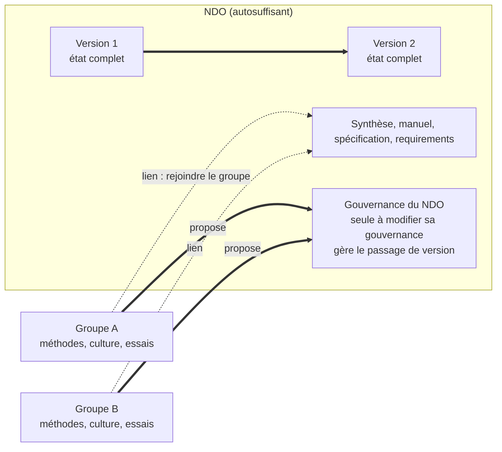

**Le développement appartient aux groupes.** Tout le travail qui va dans le développement du NDO, « on a dit que ça c'est un aspect dans les groupes » : les méthodologies de travail, de collaboration et de coordination dans le développement de nouvelles versions sont propres à chaque groupe. Un groupe a sa culture ; un groupe peut vouloir travailler, par exemple, sur certains aspects d'information du NDO, un autre sur d'autres. L'information sur la façon dont on est arrivé à la version 1, puis à la version 2, n'a pas à être portée par le NDO lui-même. C'est le prolongement direct des membranes du 20 octobre : la comptabilité et la culture de travail restent dans le groupe, le NDO reste organisation-agnostique. [P1 2 à 4]

**Le passage de version, géré par le NDO, avec des liens vers les groupes.** Quand on arrive à une version, c'est la gouvernance même du NDO qui gère la transition d'une version à l'autre. Au moment du passage, le NDO entre dans son nouvel état sans nécessairement porter toute l'information sur l'intermédiaire, mais avec des liens qui disent : nous, on travaille sur tel aspect ; nous, sur tel autre. Ces liens permettent d'aller chercher le contexte organisationnel, pour comprendre comment les décisions ont été prises, « qu'est-ce qui a été essayé, qu'est-ce qui a marché, qu'est-ce qui n'a pas marché ». Le NDO garde ainsi un fil vers son histoire sans la contenir. [P1 4 à 5]

**Combien charger le NDO.** Le souci est formulé tel quel : « Combien est-ce qu'on charge » le NDO ? La réponse avancée est de ne pas exiger que sa gouvernance porte toute l'historique, tout le travail, toute l'exposition qu'on pourrait en faire : il suffit de donner un lien de référence, comme une citation, qui dit en substance de rejoindre tel groupe pour avoir accès à tout le reste. À l'étape de revue de version, le NDO arrive quand même avec son manuel, son document de spécification, ses requirements. [P1 5 à 6]

**La synthèse, pas le détail.** L'interlocuteur confirme et précise : il y a quand même une synthèse du travail fait ailleurs dans le groupe, qui entre dans l'état du NDO et dit par exemple « la première version faisait ça », avec sa revue. « Oui, c'est ça, c'est ça. Mais, mais c'est juste une synthèse. » Ce qui ne va pas dans le NDO, ce sont tous les essais des gens, les impasses du développement, les approches qui ont échoué : « c'est des détails », la complexité propre au développement, dont la personne qui parle dit avoir l'expérience pour avoir énormément travaillé sur des projets. La ligne qui se dessine : l'état de version porte le résultat et sa synthèse, le groupe porte le chemin. [P1 5 à 7]

**L'histoire d'un projet se lit dans ses issues, ses PR et ses commits.** Une voix, vraisemblablement Soushi (inférence), répond par la pratique : le projet est géré avec les issues, les PR et le board, et l'historique des commits raconte déjà l'histoire du développement, de l'architecture et de l'autorité sur le code. C'est « vraiment intéressant » parce que la manière dont l'équipe travaille y est inscrite, et qu'une IA peut en tirer une analyse qu'aucun humain ne ferait : « il est impossible pour un humain de faire une telle analyse ». Combinée aux autres sources, vidéos, notes, discussions, « il y a énormément d'informations riches ». L'argument implicite : l'histoire détaillée n'a pas besoin d'être recopiée dans le NDO, puisqu'elle existe déjà là où le travail se fait et qu'elle devient lisible avec les bons outils. La suite du passage est inaudible. [P1 6 à 8]

**L'émergence du projet fait-elle partie du NDO ?** La discussion revient à ce qui appartient au NDO : comment le projet a été lancé et a émergé, « ça c'est ça qui fait partie » du NDO. Une question de reformulation suit, où le NDO serait essentiellement comme un dépôt qui contiendrait l'historique de ses changements (le moteur rend la phrase de façon méconnaissable, l'analogie au dépôt est une inférence). La réponse place cet historique dans le groupe : c'est la gestion du cycle de vie, une fonction très pratique au niveau du groupe, avec ses étapes de revue et de fusion, mais pas forcément au niveau des personnes et de l'histoire fine. [P1 8 à 9]

**La gestion de projet au niveau du contexte de travail.** La question de la gestion de projet revient alors, celle-là même qui avait mené au brainstorm sur le contexte de travail le 27 octobre : on aurait tendance à la mettre au niveau du contexte de travail (le *work context*, rendu « work-on-fest » par le moteur). L'objection qui la confirme : pour le même NDO, il peut y avoir plusieurs équipes, chacune avec sa propre gestion de projet. La gestion de projet ne peut donc pas être celle du NDO : elle est associée au lieu où chaque équipe travaille, avec sa propre organisation. [P1 9 à 10]

**L'analogie Git : le clone local et le fork.** L'image vient de Git et de GitHub : souvent, on fait un clone local sur sa machine pour pouvoir travailler, et l'on n'a pas forcément le droit de créer des branches sur le dépôt d'origine ni de travailler avec ses branches ; on peut pourtant avoir sa propre gestion de projet à son niveau. Il peut y avoir deux groupes de développeurs techniques qui travaillent chacun sous leur propre compte, qui ont fait chacun un fork du même dépôt, et qui ont leur propre système de gestion de projet : « C'est pas grave. » La pluralité des façons de travailler n'est pas un problème à résoudre, c'est la situation normale. [P1 9 à 11]

**Le merge passe par la gouvernance du NDO.** « On avait déjà dit ça avant » : au moment où la chose est prête, c'est comme un commit et un merge sur le NDO, qui se heurte à la gouvernance de merge du NDO. Ceux qui portent cette gouvernance appliquent leurs critères : une analyse de qualité de la chose, de sa fonctionnalité, après quoi ils décident de l'intégrer dans la distribution du NDO, c'est-à-dire de lever une nouvelle version. On retrouve la pull request du 20 octobre, vue cette fois du côté du NDO : les équipes sont libres en amont, la version est décidée en aval, par une seule instance. [P1 10 à 11]

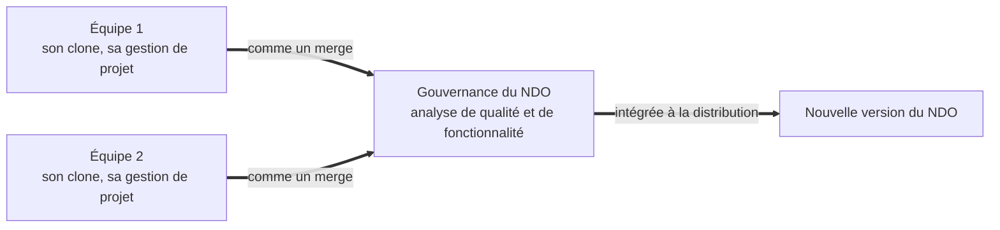

**On peut forker, mais la version officielle a sa régulation.** Le passage suivant est très abîmé par la transcription, et seule sa ligne générale se lit. Il est acceptable que les gens puissent forker ; dans Nondominium, un peu moins librement qu'ailleurs, parce qu'il y a une gouvernance autour de cela. La gestion de la version officielle passe par tout un système de régulation, et il faut éviter qu'une version non officielle se fasse passer pour elle ; en même temps, les gens gardent le choix. [P1 11 à 13]

**Forker le code ne suffit pas pour rester dans le réseau.** La thèse ressort ensuite nettement. Forker le code et forker le NDO ne sont pas la même chose : celui qui forke le code n'est pas connecté au réseau du NDO, ni au monde d'activité qui l'entoure, il est isolé. D'où le rôle de la gouvernance du NDO, « pour que le fork devienne partie du réseau même d'activités économiques ». La gouvernance peut choisir de ne pas reconnaître un fork, mais elle ne l'empêche pas d'exister : « Il faut laisser la liberté. » Le fork reconnu reste dans le réseau et garde la mobilité de ses participants, la possibilité d'y faire des plans, des tests et le reste ; le fork du code seul repart de zéro, ailleurs. [P1 13 à 15]

**L'exemple d'Ethereum, et le soft fork contre le hard fork.** L'exemple donné est Ethereum. Quand Ethereum décide d'un retour en arrière pour invalider une transaction, la décision passe, et tout le monde reste sur le même réseau. Mais quiconque forke le code d'Ethereum sort de l'écosystème : on peut forker le code et faire un nouveau réseau, mais pour rester dans le même réseau, forker le code ne suffit pas, il faut aussi les mineurs, ceux qui font tourner le réseau. La question est rapprochée de la distinction entre soft fork et hard fork : est-ce qu'on fait une version dans le réseau, ou est-ce qu'on emporte le code hors du réseau ? L'enregistrement se tait au moment de la creuser (« c'est encore une question de plus en plus de la question à laquelle... »), et le moteur ne rend plus rien jusqu'à la fin de la première partie. [P1 14 à 16]

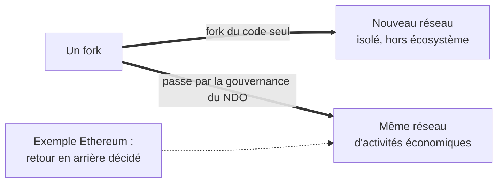

**La Sensoricadémie : l'intention.** Soushi ouvre la deuxième partie sur ce qu'il a brainstormé le week-end, l'idée d'un cursus Sensorica. Le nom est un jeu de mots provisoire, la Sensoricadémie, Sensorica et académie ; le projet est de proposer un cursus pédagogique pour enseigner tout ce qu'ils font, tout ce qu'il a lui-même appris, maintenant que du travail a été livré. Il présente directement le tableau plutôt qu'un document : une carte des modules, dont le premier parcours est « travailler avec l'IA ». [P2 0 à 1]

**Des modules en ligne, un cursus non linéaire.** Les modules seraient en ligne, pour que les gens puissent y aller à leur rythme, choisir l'ordre qu'ils veulent et naviguer librement. Soushi tient personnellement à l'idée de *non-linear curriculum* : on est comme un autodidacte, mais guidé. Quand on clique sur un thème, le tableau montre ce qui est recommandé de faire avant et ce qui vient après : « c'est une dépendance pédagogique mais elle est recommandée ». Les gens y vont avec leur intuition et leur intérêt ; au pire, la personne juge qu'elle a déjà assez de connaissances sur un sujet et ne regarde pas la vidéo, même si elle aurait pu être très intéressante. Il montre une chaîne : ce module demande celui-là avant, qui demande lui-même un autre ; on peut remonter, mais en général on fait toutes les fondations d'abord. L'idée, c'est une chaîne suggérée, pas imposée, et la liberté de tout interconnecter comme on veut tout en guidant l'utilisateur de manière pédagogique. [P2 0 à 2]

**Les séries au labo : une séquence plus définie.** À côté, des séries en présentiel au labo, forcément plus séquentielles, en petites cohortes, en petits groupes. Soushi montre en bas du tableau l'ensemble des sujets et les séries proposées. Économie et gouvernance, par exemple, serait tout le côté Open Value Network, hREA et Valueflows, gouvernance de ressources partagées, et l'étude de cas hREA, qui « vient toucher les choses en haut » parce qu'elle touche Holochain et les systèmes distribués. Les séries sont des idées de séquences qu'on pourrait faire au labo en composant un peu de tout cela ; c'est l'approche pédagogique que le tableau propose pour mixer le modulaire et le séquentiel. Chaque unité serait un cours, une unité égale une séance, et il reconnaît qu'il y en a beaucoup. [P2 2 à 4]

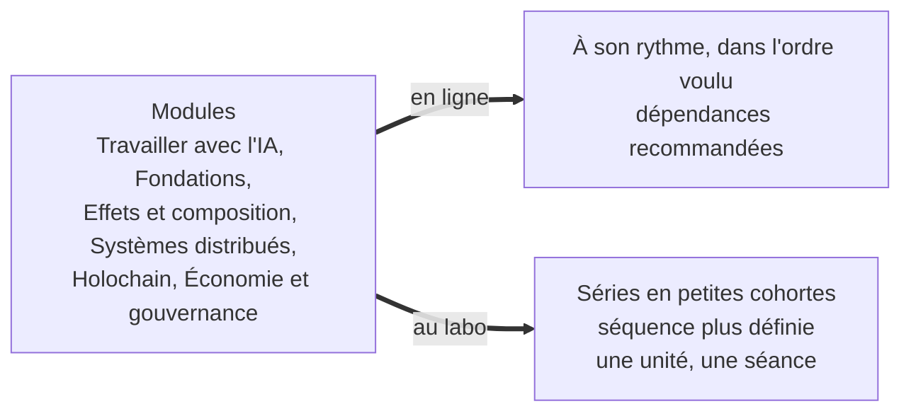

**Effets et composition, puis les fondations du code.** Ils parcourent ensemble chaque parcours. Effets et composition, « c'est toute la question mathématique derrière la programmation fonctionnelle ». Les fondations avancent dans le même sens : paradigmes de programmation, où l'on aborde la programmation fonctionnelle, bases de TypeScript, bases de Rust, les types comme ensembles, les fonctions pures, la composition et ses lois, avec la modularité et la composabilité comme « mots d'ordre ». Le but est d'aller vers les systèmes distribués, Holochain, l'économie et la gouvernance ; les fondations y sont liées et vont plus en profondeur sur la programmation fonctionnelle et la façon dont elle est utilisée, parce que ces notions mathématiques et de programmation fonctionnelle sont « vraiment important pour bien comprendre les systèmes ». L'infrastructure NixOS viendra plutôt à la fin : comment bien maîtriser tout cela pour développer efficacement. C'est le côté le plus ingénierie, pour quelqu'un qui veut travailler sur Nondominium. [P2 3 à 5]

**Pas besoin de diplôme : fondations et IA vont ensemble.** Le principe est qu'on n'a pas besoin d'un diplôme ni d'être déjà développeur, et c'est pour cela que le parcours sur l'IA est là : les fondations et le travail avec l'IA doivent aller ensemble. Sans fondations en programmation, l'IA seule ne suffit pas. Soushi prend l'exemple de Tibi lui-même : quand Tibi est arrivé avec un peu de bagage, Soushi lui a montré les bases de Rust, Tibi a fait des exercices, puis les compétences sont venues au fur et à mesure, et ensemble ils ont exploré des choses plus avancées. Si l'on a cet accompagnement et qu'on utilise bien l'IA, même sans diplôme, on intègre bien et on comprend bien. L'enjeu est de donner une pédagogie à cette trajectoire. [P2 5 à 6]

**La culture générale des systèmes distribués.** Les fondations des systèmes distribués sont présentées comme une culture générale de l'ingénierie : il s'agit de ne pas être « juste un expert blockchain » ou Holochain qui ne connaît pas les fondements des systèmes distribués. Il cite les fondements des journaux immuables et de l'event sourcing ; Tibi relève que c'est important. Puis, plus avancé et lié à la programmation fonctionnelle, les monoïdes et les semi-treillis, et à quel point ils s'appliquent aux CRDT : toute la gestion des conflits et de la cohérence à terme dans un réseau distribué, quand il n'y a pas d'autorité unique. Tibi fait remarquer que c'est quand même biaisé vers Holochain, même si c'est générique ; Soushi l'assume, parce que c'est basé sur la pile de Sensorica : on prend tout cela pour vraiment comprendre les fondations, pour voir ensuite, en arrivant à Holochain, comment c'est appliqué. Il reconnaît que c'est un peu théorique. [P2 6 à 7]

**Niveau 1, Fondations : lire et penser avant d'écrire.** Chaque parcours a trois niveaux. Le niveau 1 pourrait être ouvert à n'importe qui ; ses modules sont plus conceptuels, mais comme on y apprend à travailler et à apprendre avec l'IA, on arrive pour chacun à des devoirs du type : utilisez l'IA pour faire des expériences, explorez. On encourage le monde à explorer, on peut donner de petits exercices, mais ce n'est « pas fondamentalement pratique ». Le but, avec l'intégration de l'IA, est de développer progressivement dans les fondations « non pas l'écriture du code mais la lecture du code et la pensée critique » : maîtriser les concepts, être familier avec la lecture du code et la syntaxe, tout en se pratiquant avec l'IA à générer de petites choses qu'on est capable de lire. [P2 7 à 9]

**Niveau 2, Pratique, et niveau 3, Architecture.** Le niveau 2 est pratique : on y est rendu à spécifier avant de générer, à vérifier et réviser, à la composition, ce qui est déjà plus avancé ; avec des fondations et l'habitude de la lecture critique, on crée vraiment quelque chose avec l'IA, en continuant de cultiver sa lecture critique et sa méthodologie. Le niveau 3 est l'architecture : maintenant qu'on maîtrise tout cela, comment on monte d'un niveau, comment on organise l'ensemble de manière globale, avec une pensée plus système. Pour l'IA, l'architecture, c'est quand on délègue à des agents, qu'on évalue un agent, qu'on commence l'orchestration multi-agent. Soushi fait remarquer que le niveau 1 est surtout fait de fondations, et que les étiquettes du tableau (fondation, pratique, architecture) suivent cette progression. [P2 7 à 9]

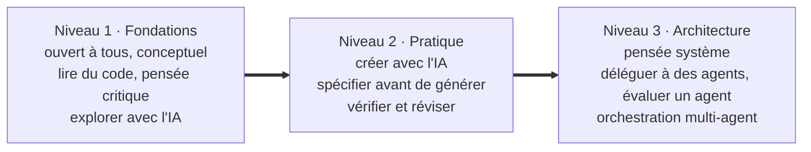

**Unison et Blood, l'horizon du parcours composition.** Le plus long terme du parcours effets et composition est un horizon des langages : Unison, qui existe déjà et est mature, et Blood, un nouveau langage qui vient d'être annoncé. Pour Soushi, « c'est l'avenir de la programmation » et cela correspond parfaitement au paradigme du cursus : comme un mélange de Rust et d'Effect, avec d'autres influences, en plus avancé encore. Ce qu'il en retient pour l'enseignement : comprendre les paradigmes de programmation et les systèmes distribués, et voir à quel point les notions introduites par ces nouveaux langages nourrissent l'ensemble. [P2 9]

**Un langage *AI first* ? Non : bon pour les deux.** Tibi demande : « c'est juste l'IA First Language ? » Soushi répond que non, et que cela rejoint son idée qu'« un bon langage est parfait pour les deux » : il ne doit être ni juste pour l'IA ni juste pour l'humain, il doit être si bon que c'est visible. Ses raisons : il est déclaratif, parce que la programmation fonctionnelle donne un modèle mental clair, facile à raisonner ; et dans son langage et son compilateur, il apporte toutes les garanties, comme Rust, pour éviter le gros des bugs. Le compilateur garantit l'absence d'une classe entière de bugs, et l'IA comme l'humain peuvent raisonner vraiment efficacement ensemble sur la logique, tout en ayant ce qu'il faut pour être fonctionnel. [P2 9 à 10]

**Ce que Blood apporte : effets algébriques, syntaxe proche de Rust.** Soushi détaille : des effets algébriques, des types algébriques, une syntaxe très proche de Rust mais sans le borrow checking, que le langage arrive à gérer en arrière-plan, de sorte que « c'est juste du rust en plus clean ». Cela reste tout aussi performant ; on peut travailler très proprement en haut niveau et descendre au bas niveau si on veut. Les notions de programmation fonctionnelle, effets algébriques et typage algébrique, y sont présentes de base, et ce sont précisément les choses qu'il veut enseigner. [P2 10 à 11]

**Comment l'enseigner : des types algébriques aux effets, en TypeScript et en Rust.** Il montre sur le tableau le chemin : introduire la notion de type algébrique, puis aller plus en détail vers les effets, qui dépendent forcément des fonctions pures, appuyés sur les bases de TypeScript, qui aident à comprendre les fonctions pures. On applique concrètement dans les deux langages, TypeScript et Rust : avec ces deux-là, on a une maîtrise très solide du langage et des notions, et du paradigme. Il reconnaît une part d'« égo de développeur » et de tribalisme dans l'idée que cela place au-dessus de la masse des développeurs, mais maintient l'argument : ce sont des paradigmes qui encouragent une autre rigueur, essentielle dans les systèmes distribués, parce qu'« un système distribué c'est très sensible », et avoir des paradigmes qui forcent la rigueur fait toute la différence, pour l'IA aussi. [P2 11 à 12]

**Le module de Sensorica dans le cursus.** On passe ensuite vers Holochain et, au niveau 3, la modularité à toutes les échelles ; Soushi fait remarquer que le tableau met les niveaux sur le côté. À la fin, on peut avoir des modules autonomes : si l'on fait des cours à Sensorica, un module juste là-dessus, en trois cours, Open Value Network, REA et Valueflows, gouverner des ressources partagées, où Nondominium est introduit. L'étude de cas hREA n'y figure pas parce qu'elle est un peu plus technique ; elle viendrait en complément, comme une étude de cas Holochain, le genre de choses qu'on mettrait sur le site web. Le tout couvre le champ de manière générale. [P2 12 à 13]

**D'où vient le cursus.** Soushi raconte l'origine : il partait de la question « comment je pourrais enseigner la programmation fonctionnelle », de l'idée qu'il existe une suite de notions intéressantes qui permet de bien comprendre la programmation, et il cherchait l'enchaînement de ces notions. Il le faisait surtout pour lui-même, en même temps que dans l'idée de transmettre ces connaissances. Puis cela s'est étendu à tout le cursus Sensorica, et il a ajouté le côté IA. [P2 13]

**Ce que le cursus résout pour Holochain.** Tibi trouve cela intéressant pour une raison précise : quand Holochain s'est lancé, son problème était de convertir des programmeurs au paradigme de Holochain. Le cursus est l'outil qui permet de faire ce pont : comment prendre des programmeurs qui faisaient des apps et du développement web 2, qui commencent à s'intéresser à la blockchain, et les amener aussi vers Holochain. Et pas juste Holochain, mais dans des contextes spécifiques, comme celui d'un cours particulier. [P2 13 à 14]

**Le jeu vidéo Sensorica comme devoir.** Tibi rattache le cursus à l'idée du jeu vidéo Sensorica, plutôt que dans le cursus de développement, dans le dernier parcours, économie et gouvernance : le devoir serait de se connecter au jeu le soir même, la classe se faisant dans le jeu. « Bon là on va loin », reconnaît-il, mais ce sont des idées. Même sans jeu vidéo, un parcours comme celui-là pourrait donner une forme de reconnaissance symbolique (le mot est mal transcrit) qui dit à la personne qu'elle comprend le développement, qu'elle peut entrer dans la structure. [P2 14 à 15]

**Le contenu viendra un module à la fois.** Tibi demande si le contenu existe déjà. Soushi répond que non, pas pour l'instant : l'idée est de planifier, de commencer à se mettre d'accord sur la structure globale, puis de faire le contenu petit à petit, sans attendre d'avoir 100 % du contenu pour commencer à le diffuser sur internet, un module à la fois, et de faire une cohorte à la fois pour tester et améliorer. [P2 15]

**L'entrepreneuriat collaboratif sur la même structure.** Tibi dit aimer beaucoup la structure et sa modularité, et demande si l'on ne pourrait pas utiliser la même structure, avec la même modularité, pour ce qu'ils avaient appelé *collaborative entrepreneurship*. C'était fait comme un cours ; Tibi voulait le transposer en expérience de *peer learning*, et il serait intéressant de le projeter sur cette structure : la façon de gérer les différents niveaux, de proposer une suite de cours courts ou d'ateliers. Soushi le place : un atelier est très pratique, donc niveau 2, ou même niveau 1 avec des exercices, mais cela reste dans un contexte de cours, pas forcément magistral, un atelier pédagogique ; « ça marche ». [P2 15 à 16]

**La continuité, et les gens qui ne sont pas programmeurs.** Tibi revient sur le parcours d'infrastructure et souligne la continuité, « très importante » : comment donner des compétences aux gens, comment les outiller. Commencer par l'IA permet d'aller chercher non seulement les programmeurs, mais des gens qui n'ont pas vraiment de compétences en programmation, jusqu'à leur faire héberger des apps et de l'infrastructure. Ce qui est plus intéressant encore, c'est le côté ouvert : « vous avez pas besoin d'être un programmeur ». Soushi confirme que c'est ce qui est fort, et qu'eux deux sont bons pour accompagner : Tibi en a l'exemple vivant, et lui aussi. [P2 20 à 21]

**Ce que l'école n'a pas enseigné, et le développeur senior opiniâtre.** Soushi dit n'avoir jamais autant appris que ces derniers temps, l'infrastructure distribuée, la programmation fonctionnelle, et « dieu merci » c'est l'IA qui le lui a enseigné ; jamais l'école ne lui a appris tout cela. Ceux qui ne viennent pas de l'école ne se sont pas fait enseigner de vieilles façons de faire et seront plus ouverts aux nouveaux paradigmes. À l'inverse, les développeurs seniors sont souvent très opiniâtres : l'un d'eux qui arrive dans un cours de programmation fonctionnelle aura des arguments techniques intelligents, « ça pourrait aller plus vite si on le ferait à comme ci comme ça », des questions légitimes, et ce n'est pas bête de faire autrement dans certains contextes. Mais il faudrait argumenter et défendre pourquoi ce paradigme est bon pour les systèmes distribués, ce qui forcerait à prendre de l'avance sur le cursus, et ces gens ne sont pas forcément en mode écoute et ouverture. Il y voit en même temps « un beau défi ». [P2 21 à 22]

**Passage privé retiré.** Une partie de la discussion portait sur un sujet sans lien avec Sensorica ni Nondominium ; elle a été retirée de cette version publique. [P2 22 à 24]

**Des séries à thème contre le dérapage.** Pour cela, des cohortes à thème : construire sur Holochain, bases de Rust, composabilité en Rust, les zomes, et uniquement le backend Holochain ; ou les systèmes distribués en général ; ou juste la composition et la programmation fonctionnelle. Des thèmes précis évitent le dérapage. On met quand même de petites bases sur l'IA : les deux premiers cours sont juste l'IA pour apprendre, prendre l'outil et apprendre avec, ce qui est vraiment bon pour une cohorte débutante. [P2 24]

**Des séries avec des prérequis différents.** Les séries peuvent aussi se distinguer par leurs prérequis : une série 100 % débutant, pour tout le monde au labo ; une série pour développeurs ou débutants avec l'IA ; une série qui vient après celle-là ou l'équivalent ; construire sur Holochain, qu'on peut compléter par les modules de composition ; et une série pour tout le monde, sans code. Il y a moyen de bien utiliser cela pour cibler les publics. Et l'idée de Tibi qu'on pourrait ajouter d'autres modules, c'est « la beauté de la modularité » : on peut en ajouter autant qu'on veut ; sur le site, les gens choisissent naturellement ceux qu'ils veulent, et c'est en proposant des séries qu'on compose au fur et à mesure le calendrier. [P2 24 à 25]

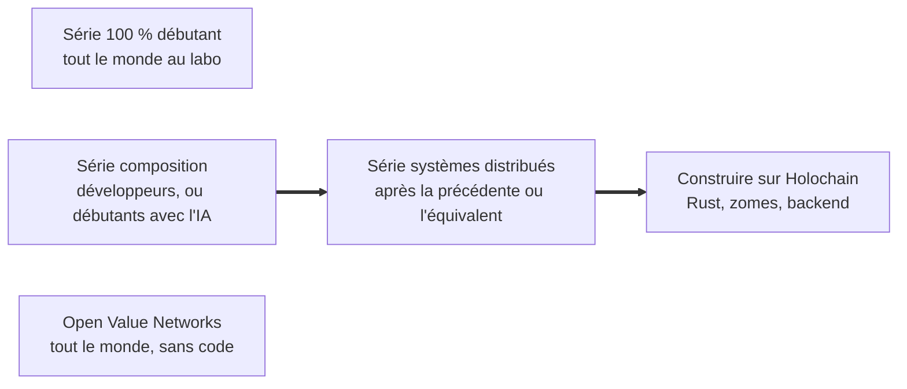

**Une plateforme d'apprentissage, des badges.** Tibi propose de mettre cela sur une plateforme d'apprentissage : on fait les vidéos, les textes, les gens les prennent en ligne, ou sur YouTube, et l'on donne des badges, comme sur Udemy. Soushi remarque qu'Udemy sert souvent plutôt à vendre des cours ; Tibi y voit justement une façon de se financer, en plus des badges. On peut faire cela à différents niveaux : mettre les cours de base sur une plateforme, puis faire des cours en personne. [P2 25 à 26]

**Trois paliers : YouTube, payant, présentiel.** Tibi structure alors la proposition : « tu peux avoir 3 niveaux ». Un niveau sur YouTube, gratuit. Un niveau payant, où les gens se forment eux-mêmes, et à la fin on peut donner un badge : « c'est très important ça ». Un niveau un peu plus cher, sur inscription (« pour la prochaine fois, ça va être next month »), qui peut être des séminaires plus en profondeur, plus pratiques mais en direct, avec mentorat et coaching, plus qu'une plateforme web. [P2 26 à 27]

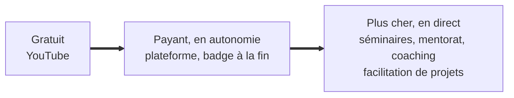

**Le facilitateur et le *peer learning*.** Tibi précise ce que le présentiel ajoute. On peut quand même avoir de l'interactivité sur les plateformes web, des forums de discussion entre étudiants et avec les professeurs ; mais en personne, l'enseignant devient le facilitateur. Si quelqu'un a un projet particulier, on lui donne de l'aide de façon très contextuelle : peut-être que quelqu'un ne veut pas bâtir un OVN, mais veut faire quelque chose pour une coop ; on est alors un facilitateur. Il y a aussi tout l'assemblage des outils de *peer learning*, apprendre les uns des autres, et peut-être des sous-groupes par cas : « il y a toute une organisation qui va pouvoir se faire ». [P2 27]

**La Sensoricadémie et AlterNef.** Soushi y retrouve son projet AlterNef : AlterNef est orienté vers l'éducation par les pairs, une « université père à père » dans la transcription, université pair à pair. La Sensoricadémie lui permet d'explorer concrètement cette notion d'éducation par les pairs. [P2 27 à 28]

**La plateforme payante tourne d'elle-même et peut financer l'OVN.** Revenant à l'idée de Tibi, Soushi note qu'une plateforme payante automatise : une fois montée, elle « coûte tout seul » d'une certaine manière, et « plein de gens font du très bon passif » avec cela. Tibi : « ça pourrait financer l'OVN ». L'autre voie est de donner un cours de trois heures dans la journée, en personne. Dans les deux cas, c'est une façon de financer l'OVN et de financer le développement. [P2 28]

**Faire payer pour éviter les bots et les trolls.** Tibi ajoute l'argument de la friction : si l'on veut donner des certificats, il est important de faire payer, « car sinon tu vas avoir des bots, des trolls » ; quand il n'y a pas un minimum de friction, les gens abusent. Quand ils doivent investir un minimum, ils sont plus motivés à finir le certificat. [P2 28 à 29]

**Le modèle AWS : le contenu gratuit, l'examen payant.** Soushi décrit un autre modèle : on peut faire le cours en entier, mais il faut payer pour faire l'examen et avoir le certificat ; souvent, tout le contenu du cours est de nature publique. C'est la certification Amazon Web Services : « tout la doc est gratuite », on a des tonnes de vidéos YouTube sur la façon d'utiliser AWS, et si l'on veut le certificat, on paie. [P2 29]

**L'objection : pas encore de demande pour certifier.** Une voix, Tibi selon toute vraisemblance (inférence), répond que dans ce cas il ne donnerait pas la certification, « parce qu'il n'y a pas un besoin » clair : les gens viennent pour gérer leurs propres projets. Il mettrait plutôt les cours sur une plateforme où l'on paie déjà pour le cours, avec la certification à la fin, mais sans faire le cours gratuit pour ceux qui ne s'intéressent pas à la certification ; il n'y a pas vraiment, « pas encore », de demande pour certifier. Le point reste ouvert. [P2 29 à 30]

**Coursera et OpenClassrooms : le certificat qui vaut quelque chose.** Soushi rappelle qu'il y a plusieurs modèles d'e-learning si l'on veut des certificats : Udemy, où l'on certifie à la fin, Coursera, ou le modèle français dont il cherche le nom, OpenClassrooms. Il raconte : le fondateur, quand il était jeune, avait fait le Site du Zéro ; à 14 ans, Soushi avait commencé la programmation et Linux grâce à lui (« c'est lui qui m'a dit c'était quoi Linux »), et le site était « bien drôle ». Puis il a fait OpenClassrooms, devenue une vraie académie officielle depuis la France, internationale, avec des cours en français et en anglais, et surtout certifiée auprès du gouvernement. Comme Coursera, elle a des systèmes de jalons. Le certificat n'y dit pas qu'on a regardé toutes les vidéos : on a fait un projet, revu par des humains, une vraie revue par les pairs et par les mentors, un projet concret négocié avec ses professeurs, avec accès au mentorat, et cette relation humaine « justifie le prix aussi ». Ils plaisantent sur les étudiants à qui l'on brancherait de l'IA derrière, et qui ne sauraient même pas que leur mentor est une IA. [P2 30 à 32]

**Le contenu ne sort pas du chapeau.** Soushi dit ce qui le rend confiant : « tout ce contenu là on ne le sort pas du chapeau ». Il faut aller un module à la fois, et l'enjeu sera surtout l'organisation : pour un gros module comme celui sur le travail avec l'IA, s'assurer que tout est cohérent dans l'ensemble du module. Mais chaque thématique en tant que telle, il se sent capable de l'enseigner en personne, et créer le contenu ne sera pas très long, parce qu'il connaît son affaire à ce niveau. [P2 31 à 32]

**Qui porte quoi.** Soushi reconnaît que c'est beaucoup lié à lui, parce que c'est l'aspect ingénierie ; mais tout l'aspect économique, « c'est ton module », dit-il à Tibi, y compris l'étude de cas hREA dans le parcours Holochain, où Tibi sera bien placé pour venir. Le reste est orienté architecture et ingénierie, mais Tibi a l'expérience de gens qui suivent un module pour d'autres intérêts que de finir avec Holochain. C'est justement l'idée des modules : ils sont découpés pour qu'on puisse les prendre séparément, et ils sont très génériques. Des gens pourraient venir à la Sensoricadémie juste pour un module, attirés parce qu'ils ont entendu dire qu'elle avait un super cours sur l'IA, sans s'intéresser au reste. [P2 32 à 33]

**À l'unité ou par abonnement : l'exemple du cours de Svelte.** Soushi distingue deux façons de vendre : les modules à l'unité, un module entier vendu une fois, avec accès permanent et mises à jour ; ou un abonnement, comme une académie qu'il connaît sans la nommer : 30 dollars par mois pour accéder à tous les cours, ou l'achat module par module. Son auteur se fait, dit-il, des dizaines de milliers de dollars par mois : quand on regarde son nombre d'étudiants et qu'on se dit que la plupart paient un abonnement, « t'abarnouche ». En plus, il a une chaîne YouTube où il fait du contenu gratuit, et ces cours gratuits donnent le goût d'aller sur sa plateforme. Soushi s'y était abonné pour compléter ses cours, et c'est là qu'il a appris Svelte. [P2 33 à 34]

**L'accès ouvert, le titre après.** Tibi confirme que tout se déplace vers ce genre de plateforme, d'autant qu'il n'y a plus la barrière d'entrée de devoir avoir la bonne cote R pour accéder à la connaissance. C'est là que c'est ciblé : on vient, c'est ouvert, on n'a pas besoin de titre pour assister au cours, le titre vient après si l'on a été un bon élève. Avec l'IA surtout, ce sont des sujets techniques complexes, mais si l'on a la volonté, la curiosité, la persévérance, comme quelqu'un qui commence un nouveau programme à l'université où ce n'est pas toujours facile, on a les outils qu'il faut, et des cours spécifiques sur la façon de bien utiliser ces outils. [P2 34 à 35]

**Les outils en plus du cours : apprendre à pêcher.** Soushi ajoute des outils complémentaires : peut-être des niceboards d'apprentissage, un petit outil que n'importe qui pourra utiliser quand il voudra pour réviser, avec toutes les références. Ce sont des add-ons : on vient au cours et l'on repart avec plein d'autres outils qui n'en font pas nécessairement partie, en montrant comment les personnaliser et jouer avec, gratuitement. Ses skills sont déjà publiés sur GitHub depuis un moment, et il pourrait les promouvoir sur X : « voici mes skills perso ». C'est un système de pensée, outiller les gens : on n'est « pas là pour leur donner du poisson », mais pour leur donner des cannes à pêche et leur apprendre à pêcher. Toutes les ressources données à la fin de chaque cours, les boards du cours pour réviser, les exercices pratiques, les participants pourront les donner à leur IA pour bien réviser. [P2 35 à 36]

**« Ok, let's go for it man ».** Tibi donne son accord sur l'ensemble. Soushi propose alors de se donner une timeline pour faire les premières cohortes en 2027, et de commencer à préparer les premiers cours ; il faudra bien choisir par quoi commencer. [P2 36]

**L'hiver, pas l'été.** Tibi pose la contrainte de saison : il faut que ce soit pendant l'hiver, parce qu'en été on est en compétition avec les activités en plein air ; en hiver, les gens cherchent plutôt des activités intérieures, et dès que l'été arrive, ces questions de cours se dissipent, parce que les gens vont à la plage, en vacances, au festival de jazz, autant de choses qui captivent. [P2 36]

**Viser le premier trimestre, réactiver les événements dès décembre.** L'idée retenue est de viser le premier trimestre : dès décembre, on réactive des événements, les événements NixOS, et Soushi rappelle qu'il en avait déjà parlé, il voulait faire des événements pour donner des cours, des événements éducatifs ; cela s'inscrit dans la même plateforme éducative, et c'est bon pendant l'hiver. On peut donc prendre le reste du mois de novembre et décembre pour commencer à préparer le site web et la plateforme. [P2 36 à 37]

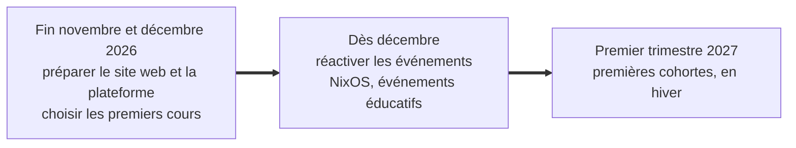

**Présenter en ligne avant le présentiel : article ou vidéo.** Avant chaque version en personne, il faudrait faire la présentation en ligne, et en ligne ce n'est pas forcément une vidéo : le format peut être un grand article (« moi j'aime ça lire »), ou les deux. La vidéo, ce ne serait pas eux seuls : elle serait faite par l'IA, avec la vraie voix off et l'explication humaine, « comme t'as faite toi » ; Soushi convient qu'il doit finir cette vidéo. L'IA est très bonne pour faire des vidéos et des animations, avec des extraits de code, pour montrer les concepts, faire des schémas animés, ajouter de petits bonus, comme ils l'avaient fait avec NotebookLM. On pourrait même générer tous les cours avec NotebookLM, mais son style ne plaît pas : cela se sent trop que c'est généré, au pire c'est un service d'appoint. Puis les monétiser, ce qui est une façon de se financer et de pouvoir amorcer leur développement. [P2 37 à 38]

**Passage privé retiré.** Une partie de la discussion portait sur un sujet sans lien avec Sensorica ni Nondominium ; elle a été retirée de cette version publique. [P2 38 à 39]

**Réécrire ses DNA en Blood, et pourquoi.** Avec Blood, Soushi se voit réécrire ses DNA, ses cells, ses zomes. Il a fait la recherche, et cela colle si bien au paradigme qu'il a commencé, pas à prototyper puisque le langage n'est pas sorti, mais à imaginer comment ce serait conçu : à quoi ressemblerait l'écriture de zomes en Blood avec un HDI, et à quel point cela ajoute des couches de sécurité. La raison principale : le code vit dans une base de données, adressé par contenu comme le DHT, et ce ne sont plus des fichiers texte. On garde des fichiers texte comme surface pour travailler, mais automatiquement le code est indexé dans une base adressée par contenu, de sorte que Git et les diffs ne fonctionnent plus pareil, c'est plus précis. [P2 39 à 40]

**L'intégrité vérifiée pendant qu'on écrit.** Dans Holochain, avec les zomes d'intégrité, le LSP et la compilation pourraient détecter pendant qu'on écrit qu'on est en train de casser l'intégrité : on renomme un truc, on change quelque chose, et le système le voit non pas juste dans le diff mais dans l'adressage sémantique du code dans la base de données. C'est comme si naturellement la base de code était indexée sémantiquement dans une base de données, par conception du langage. Les outils qu'il utilisait, des MCP qui venaient indexer la base de code pour mieux l'analyser, le langage le fait naturellement, et cela aide à tous les niveaux. [P2 40 à 41]

**Effect est une bibliothèque, Blood l'a par conception.** Le langage ajoute aussi par défaut ce que Soushi trouve dans Effect en TypeScript. Mais TypeScript est déjà une surcouche de JavaScript, et Effect une bibliothèque pour TypeScript qui doit ajouter les effets, ce qui commence à faire de la charge ; là, « c'est by design dans le langage », toute la logique des effets algébriques. Effect s'approche beaucoup de cette notion, mais ce n'est pas à 100 % des effets algébriques, alors que Blood l'est fondamentalement. Cela aide à faire des preuves formelles, et c'est pour cela que cela aide beaucoup les IA : cela donne énormément de garanties, par conception, comme du code formel. Quand il voit des gens écrire en Python ou en JavaScript natif, il se dit que c'est « le code le plus imprédictible » par conception, même quand le code est propre, quand on sait comment cela fonctionne sous le capot comparé à des systèmes infiniment plus prévisibles. [P2 41 à 42]

**Pour Holochain, la patience : des prototypes de HDK et de HDI.** Il voudrait proposer qu'on réécrive le code de Holochain en Blood, mais se reprend : il faut être patient, parce que ce sera un langage expérimental, que la syntaxe va beaucoup évoluer et que cela prendra des années. Il tentera quand même, pour s'amuser, ses propres prototypes de HDK et de HDI, tout le code de Holochain restant en Rust : faire ses liaisons, ses ponts, pour pouvoir coder des applications Holochain en Blood. [P2 42]

**Les abilities, et la programmation orientée complexité.** Ce qui l'a frappé dans la syntaxe, c'est la notion d'*ability*, comme les traits. Il a fait le lien avec la Complexity Oriented Programming : avec les effets algébriques, on définit ce qu'une fonction peut faire, les autres fonctions qu'elle peut appeler, par son contexte d'appel ; « c'est vraiment le contexte qui définit qu'est-ce qu'elle peut faire ». Cela reste des fonctions pures : on ne peut pas appeler n'importe quelle fonction, il faut que la signature dise ce qu'elle peut appeler. La programmation orientée complexité lui souffle alors la question de l'émergence : il faudrait que dans ce type de signature, on donne les conditions d'émergence, explicitement, et non ad hoc ailleurs dans le module ou le fichier. Il en tire deux pistes : faire ses propres DSL, des langages qui utilisent Effect fondamentalement, comme si on les compilait en TypeScript Effect ; ou faire un langage vraiment pensé pour la programmation orientée complexité. [P2 42 à 44]

**L'auteur de Blood, et Unison.** Tibi lui suggère de partager ce concept de programmation orientée complexité avec eux. Soushi précise qui est l'auteur : un développeur du cœur d'Effect, qui fait du Rust depuis longtemps, qu'il suit depuis un moment parce que c'est « un top tier programmer » dans le même paradigme que lui. Il l'a vu partir dans son langage, qu'il annonce inspiré de Rust, d'Effect et d'Unison, et c'est ainsi que Soushi a découvert Unison : un langage qui existe déjà, assez mature, qui a ses concepts de base de code comme base de données et d'adressage par contenu ; il ne savait pas qu'il existait, et ce langage avait déjà introduit ce paradigme. [P2 44 à 45]

**Un « Rust plus plus », à l'horizon.** Pour l'architecture distribuée, le développement d'infrastructure et d'applications distribuées, et de manière générale le travail avec l'IA, et même l'IA elle-même et le front-end, Soushi voit déjà Rust comme une forme de langage ultime avec lequel il se sentirait à l'aise de tout faire, du bas niveau au front-end au scripting ; Blood serait « rust plus plus ». Il se reprend aussitôt : ce sont des horizons, le langage n'est même pas sorti, et il sera expérimental à sa sortie. [P2 45]

**Contribuer à Blood, et le chemin vers le cœur de Holochain.** C'est quelque chose à quoi Soushi aimerait contribuer, et, comme le dit Tibi, y introduire ses concepts : ce ne serait pas une idée nouvelle pour eux, mais ce serait bon de les orienter pendant qu'ils développent, et de leur montrer le potentiel pour ce qu'il appelle sa pile compilée, très orientée architecture et infrastructure distribuées, « nous là avec Holochain ». Tibi trouve très bien qu'ils travaillent conjointement. Même chose avec l'équipe du cœur de Holochain, dont Soushi dit se rapprocher grâce à Paul et à l'outillage qu'il fait : il pourrait leur proposer des prototypes de réécriture du HDK et du HDI en Blood, sans avoir à tout réécrire, ce qui laisserait les gens écrire leurs propres applications en Blood et donnerait une idée de ce que fait le langage ; et si cela les encourage, réécrire d'autres parties du cœur, Holochain étant si modulaire qu'on pourrait réécrire une crate à la fois, selon les liaisons avec Rust, dont il ne doute pas qu'elles seront bonnes. [P2 45 à 46]

**WebAssembly comme condition.** Une condition est posée : il faut que ce soit un langage qui vise fondamentalement WebAssembly, « c'est super important ça ». Si l'auteur n'a pas prévu de cibler WebAssembly dès le début, « eh bah je vais t'aider ». Soushi conclut que cela fait plein d'idées nouvelles sur la façon dont ils pourraient potentiellement contribuer, et demande à SoushAI de s'en souvenir (« slash remember »). [P2 46 à 47]

**Les principes du cursus.** Pour conclure le cursus avant de passer à l'étape suivante, Soushi reprend les principes du tableau, des concepts dont il a déjà parlé à Tibi : modularité et composabilité d'abord ; les concepts et la lecture de code avant l'écriture, la lecture critique avec l'IA avant de faire concrètement des projets ; ouvert aux autodidactes curieux ; Rust et TypeScript pour le travail concret ; les idées de l'humain d'abord, l'IA en option, qui est aussi un des principes de LifeOS, dont le cursus essaie de s'inspirer. [P2 47 à 48]

**La forme d'un module, et la preuve.** Chaque module a la même forme : un concept, une lecture guidée, la pratique avec l'IA, une revue critique, où l'on apprend à réviser du code généré, et la preuve que le tableau propose : chaque module finit par un artefact vérifiable. Soushi l'a vu sur certaines plateformes : à la fin de chaque module, l'exercice est une suite de tests à faire passer ; on doit écrire le code, on peut le faire avec l'IA, qui va le réussir du premier coup (« one-shotter »), mais il faut ensuite l'analyser et l'optimiser. [P2 48 à 49]

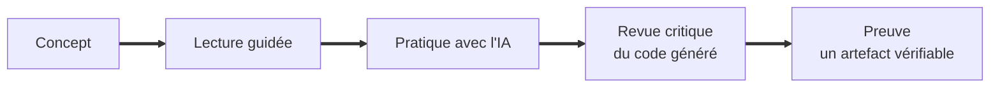

**Les principes LifeOS du volet IA.** Soushi lit rapidement les principes LifeOS du volet IA : la direction est le goulot, le goulot de l'IA est la direction et non l'exécution, l'essentiel est de capter l'intention ; terminé s'écrit en critères vérifiables, d'où toute la question de vérifier systématiquement et d'articuler l'état idéal (*ideal state articulation*) ; la vérification est la moitié du travail ; l'état idéal plutôt que la procédure ; dépenser ce que la tâche mérite ; corriger le système, pas ses notes. [P2 48 à 49]

**Le contenu externe est une donnée : l'injection de prompt et les surfaces.** Le principe suivant concerne la sécurité : quand l'IA voit du contenu externe, elle l'interprète toujours comme une donnée et non comme une instruction, ce qui évite de se faire détourner ; « c'est comment tu te protèges du prompt injection ». On définit donc clairement quelles sont les surfaces. Soushi l'illustre par sa propre pratique : son assistant lui fait remarquer qu'il ne lui a pas dit une chose dans le terminal mais ailleurs, parce que « c'est vraiment la surface qui définit si c'est bien moi ou pas », et donc si l'instruction doit être suivie. Il reste des choses à clarifier entre le chat du terminal, les chats des niceboards, le système de permission de merge qu'il a créé : la provenance de la donnée, vient-elle vraiment de l'humain, de l'utilisateur, ou du site qu'il a scanné. C'est intégré, et les hooks (inférence) resserrent dès qu'ils voient que cela dépasse. [P2 49 à 50]

**Divulgation minimale, et souveraineté.** Dernier principe lu : la divulgation minimale, n'envoyer aux fournisseurs que ce dont le modèle a besoin pour bien répondre. Les questions de confidentialité explosent, et idéalement il faut faire cela de manière souveraine ; il y a tout un chapitre du module sur la souveraineté, l'IA et les communs. Il passe ensuite en revue ce que la discussion du tableau a fait remonter, dont les effets algébriques, et les décisions qui restent à prendre. [P2 50 à 51]

**Le nom : de l'académie du P2P à la Sensoricadémie.** Soushi propose de partager le board avec Tibi, puis revient au nom. Les premières idées s'appelaient l'académie du P2P (inférence) ; ensuite, le cursus ouvert Sensorica, l'idée de base, plus générique. Il ajoute une charge contre la blockchain : les gens auraient peut-être envie de faire de la blockchain, mais ce n'est pas du vrai pair à pair, « fondamentalement c'est centralisé » ; c'est une technologie intéressante, mais ils ont fait l'erreur de se dire pair à pair et de centraliser, et pour lui cela ne l'a jamais été. Reconnaissant que le cursus ouvert serait peut-être trop générique, il revient à la Sensoricadémie : une marque qui dit d'où elle vient, et un jeu de mots qui marche en français. Ils essaient la forme anglaise, et Tibi demande de mettre le A en majuscule. La fin, mal transcrite, glisse vers le travail sur la licence de Nondominium, et Soushi clôt : « je pense qu'on a fait le tour », on peut changer de discussion. [P2 51 à 53]

**Le tableau, une obligation de la licence.** Soushi ouvre la troisième partie sur les tableaux de contributions pour la v0.1 de Nondominium et passe la parole à Tibi. Tibi pose le cadre : le tableau est lié à la licence de Nondominium, qui exige la propagation des contributions passées, celles qui ont servi à écrire et développer Nondominium. Il existe aujourd'hui sur une surface web 2, une feuille Google Sheets, et il insiste qu'il ne s'agit pas d'une image figée : « Il est toujours à jour le PiChart », parce que c'est un lien vers la feuille vivante, pas une photo. Il croit qu'un lien existe déjà sur GitHub, à côté de la licence. Soushi propose de l'ajouter même s'il n'était pas à jour, puis vérifie avec SoushAI, qui ne trouve aucun lien (voir Mises à jour). [P3 0 à 4]

**Un onglet sur GitHub, et un emplacement dans le gabarit.** Soushi commence par la solution la plus simple : mettre l'adresse dans un fichier à côté de `LICENSE.md`. Il montre l'interface de GitHub : dès qu'on crée un fichier de licence, un onglet apparaît à côté du README, et il y en avait un troisième entre les deux ; on pourrait mettre le lien là. Mais la question touche le design de la licence elle-même : il faudrait, dans le gabarit de la licence, une place qui lie clairement au tableau, un emplacement réservé pour sa référence. « C'est pas juste une petite référence noyée en bas » : on peut la mettre vers la fin, mais il faut rendre explicite que c'est le lien vers le tableau, puisque la licence le mentionne partout et qu'il faut faire l'association. [P3 3 à 5]

**Une licence avec un lien est-elle encore une licence ?** La question suivante est de droit, et Soushi la formule : « est-ce qu'on a le droit de créer une licence avec un lien comme ça » ? Et « est-ce que si le lien change est-ce que c'est un changement de licence », ou faut-il mettre le lien dans un fichier à côté ? Le fond est que « la licence c'est quelque chose de statique », censée être reproduite telle quelle d'un projet à l'autre ; des emplacements à remplir peuvent donc être problématiques, et le tableau a plutôt l'allure d'une annexe à la licence. [P3 5 à 6]

**La release est une photo, mais il faut les données brutes.** L'interlocuteur répond par le moment de la release : « Oui donc tout la release c'est une photo. » Un instantané au moment de la release, donc ce n'est pas grave que le tableau joint soit figé à cette date. Mais la photo seule ne suffit pas : il faut avoir les données brutes quand même. [P3 6]

**L'idée : laisser la licence telle quelle et ajouter un fichier.** « Ah j'ai une idée. » On laisse la licence telle quelle, quitte à l'améliorer plus tard, et l'on ajoute simplement un fichier à côté, par exemple `PIECHART.md`, comme un document dans le code, à la racine du dépôt. C'est ce que SoushAI venait justement de proposer, remarque Soushi. L'objection, qu'il y a déjà un `LICENSE.md` à la racine, tombe aussitôt : la licence, « il faut qu'il reste statique », c'est elle qui définit les règles et elle n'a pas à porter d'emplacement à remplir ; l'important est que le tableau soit à côté. Même si la licence ne pointe pas directement vers une adresse, elle dit que le tableau est dans le fichier dédié de ce dépôt, « et du coup ça suffit ». [P3 6 à 7]

**Un fichier standard, et une licence qui en fixe la structure.** Cela devient un standard : tous les dépôts qui utilisent la licence doivent venir accompagnés de ce fichier, « c'est standardifié ». La licence reste statique, et le fichier markdown peut contenir plusieurs choses, « pas juste un lien brut comme ça on peut faire un vrai beau fichier markdown ». La licence pourrait même définir la structure que ce fichier doit prendre, les règles de cette preuve de tableau ; et quelqu'un remarque que c'est déjà là, ce que les Corrections confirment. [P3 7 à 8]

**Les données brutes, pas une capture à déchiffrer.** Le fichier doit contenir les données de manière brute, pas seulement une image ; une image peut être utile en complément, et « on l'a justement ». Il faudra qu'il suive les lignes directrices et représente bien les preuves, que ce soit directement dans le markdown ou sous forme structurée à côté : les données doivent être accessibles « en brut et non juste un screenshot à décrypter », parce qu'ainsi « on peut les parser on peut les analyser on peut les copier coller ». La capture d'écran n'est pas une mauvaise idée pour autant, comme le logo qui est un fichier à côté ; elle peut s'afficher avec la donnée, puisqu'il y a peu de données : le nombre de contributeurs, avec un chiffre chacun. [P3 8 à 9]

**Trois pièces, et l'en-tête YAML.** Soushi assemble les pièces. La capture, « ça c'est le côté humain » ; un JSON, par exemple, pour la version structurée des données ; et le fichier `.md` qui assemble les deux en suivant la structure, qui s'assure que tout est là et qui donne les métadonnées : pour quelle release, le nom du NDO, la date. Ce qui est bien, c'est qu'un fichier markdown peut porter un en-tête YAML, des données structurées comme du JSON, avec objets, listes et booléens ; le fichier est donc à la fois structuré et lisible pour les humains. Il conclut : « ça c'est la le pie chart lui même l'objet lui-même », la façon dont on le représente dans le code ; reste le second point, la redevance aux dépendances. [P3 9 à 10]

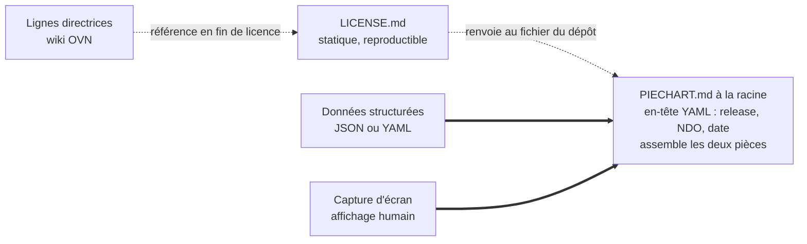

**Les lignes directrices du tableau.** Avant de passer à la suite, Soushi tient à clarifier quel document fait référence pour la forme du tableau : à la fin de la licence, la dernière référence, « contribution pie chart guide line », un lien vers le wiki OVN. Il voulait juste s'assurer que ce soit « clair clair ». [P3 10]

**La redevance aux dépendances : quel critère ?** Tibi ouvre le second point : pour compléter cet objet qu'est le tableau, il va falloir donner une redevance aux dépendances, et la question est le critère qu'on se donne. Sa proposition : prendre la première couche de dépendances, Holochain, hREA, Valueflows. On ne prend pas Rust ni les autres affaires, parce que c'est déjà un deuxième niveau ; la première couche, ce sont les dépendances que Nondominium utilise directement. [P3 10 à 11]

**Chacun invite le niveau suivant.** La logique est celle de l'invitation : à qui lance-t-on l'invitation ? À la première couche, et Holochain, s'il le veut, pourra ajouter Rust ; « chacun va être responsable d'ajouter s'il le veut d'inviter le niveau suivant ». Holochain pourrait de même inviter Iroh (inférence), le protocole pair à pair qu'il utilise. Le critère est donc clair : on invite Holochain, et les autres peuvent venir avec leurs propres dépendances ; Nondominium ne se préoccupe que de la première couche, parce que c'est elle que la redevance impacte directement. [P3 11]

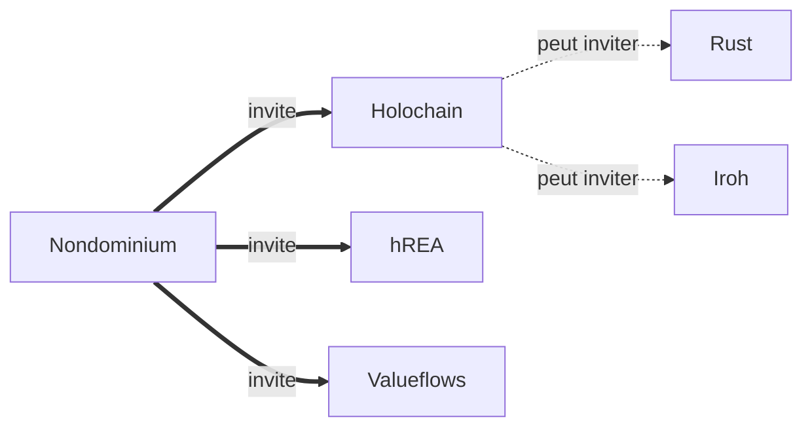

**Pourquoi ne pas inviter toutes les sous-dépendances.** L'argument contre l'invitation en profondeur est posé du point de vue de Holochain : si Nondominium invite Holochain et toutes ses sous-dépendances d'un coup, Holochain a déjà, dès son arrivée, des gens vers qui ses bénéfices potentiels vont ruisseler, sans qu'on l'ait même consulté sur le fait qu'il a ces dépendances, et alors que ces dépendances ne sont même pas présentes. [P3 11 à 12]

**Pas de ruissellement sans inscription, et la question des NDO morts.** La réponse est le consentement : les dépendances ne recevront rien tant qu'elles ne sont pas officiellement inscrites ; les gens doivent venir s'inscrire eux-mêmes, il faut « avoir leur consentement ». Sinon, on les représente quand même, mais ce seront des NDO morts, inactifs, sans personne pour les représenter : un NDO avec aucun agent dedans sauf ceux qui l'ont initialisé, « ça sert à grand chose ». Une voix nuance : ce n'est pas grave, et « symboliquement ça reste », un emplacement en attendant. Le point n'est pas tranché. [P3 11 à 12]

**Dresser la liste avec l'IA.** Peut-on obtenir automatiquement, avec l'IA, la liste des dépendances de premier niveau ? Soushi pense que oui : on peut faire des scans et des analyses, et rien qu'au niveau de la base de code, `Cargo.toml` et `package.json` sont les manifestes qui contiennent toutes les dépendances logicielles ; à partir de là, on voit les dépendances logicielles. [P3 12 à 13]

**À quel grain : un NDO par bibliothèque, ou un parent par projet.** Reste le découpage : chaque bibliothèque est-elle un NDO en soi ? Holochain, ce n'est pas juste Holochain : il y a le HDK, le HDI, le client, Sweettest (inférence), Holonix, autant de sous-composants. Fait-on un seul NDO parent pour Holochain, ou le découpe-t-on ? L'interlocuteur relève que c'est un paquet que l'on installe d'un bloc quand on se lance dans Holochain, depuis une source qui est à eux. La réponse qui se dégage s'appuie sur la composabilité du NDO, que l'interface montre déjà : on fait le NDO parent, on invite Holochain, et Holochain pourra venir faire lui-même la composabilité de son NDO, ajouter par des hard links des composants pour ses crates et tout ce qu'il expose. Nondominium n'a qu'à inviter le parent. [P3 13 à 14]

**Rust est aussi notre dépendance.** Soushi ajoute une remarque qui déplace le critère : Rust est une dépendance de Holochain, mais Nondominium code aussi en Rust, et c'est Rust qui lui fournit son outillage. De même Nix : Holochain l'utilise par Holonix, mais Nondominium l'utilise aussi. [P3 14]

**Nix et la CI : la mise à jour de GitHub du 11 novembre.** Soushi raconte qu'il s'apprête à réécrire toutes ses CI : elles tournent sur Ubuntu, ce qu'on ne peut pas changer puisque c'est ce que fournissent les runners de GitHub, mais au moins c'est Nix qui gérera la CI, ce qui la rend reproductible malgré tout et beaucoup plus stable. « ça a pété » récemment : GitHub a fait le 11 novembre une mise à jour qui casse beaucoup de CI, un gros passage par défaut d'Ubuntu 24 à Ubuntu 26, et comme leurs CI sont sur l'image par défaut, il se peut qu'elles soient rouges ; il faut alors mettre à jour ses propres paquets. Les Corrections montrent que les CI de Nondominium sont restées vertes. [P3 14 à 15]

**Faire la liste d'abord, puis décider.** Tibi, selon toute vraisemblance (inférence), recentre : « faisons la liste d'abord », puis on décidera, en relisant ce que la licence dit exactement. Soushi garde l'idée que Nondominium a lui aussi ces dépendances directes et devrait peut-être les représenter, Nix étant très utilisé pour l'infrastructure ; ce que dit la licence, selon lui, c'est qu'il faut partager les bénéfices avec elles. La suite est inaudible pendant près de deux minutes. [P3 15 à 17]

**La pause.** L'enregistrement reprend sur Soushi qui s'excuse : il va lancer la transcription de la deuxième partie de la rencontre pendant que Tibi cherche quelque chose, quitte à mettre en pause ou à prendre une pause. Il conclut que, sur les tableaux de contributions, ils ont « quand même cumulé pas mal d'idées » avec cet enregistrement pour reprendre plus tard. [P3 17 à 18]

## Décisions

- **La gestion de projet vit au niveau du contexte de travail, pas dans le NDO**, parce qu'un même NDO peut avoir plusieurs équipes avec chacune sa gestion de projet ; le NDO porte une synthèse et des liens vers les groupes. [P1 3 à 6, 8 à 10]
- **Le cursus de Sensorica est lancé** : Tibi valide la structure présentée (« ok, let's go for it man »). [P2 36]
- **La structure : des modules en ligne non linéaires sur trois niveaux, et des séries en présentiel en petites cohortes au labo.** Le contenu se fait un module à la fois, sans attendre d'avoir tout le contenu, une cohorte à la fois pour tester. [P2 0 à 3, 7 à 9, 15]
- **Premières cohortes au premier trimestre 2027, en hiver**, avec la fin novembre et décembre pour préparer le site web et la plateforme, et la réactivation des événements dès décembre. [P2 36 à 37]
- **Le module d'infrastructure NixOS entre dans le parcours Holochain**, ajouté pendant la séance (module H4 du tableau). [P2 16 à 18]
- **Le module économie et gouvernance revient à Tibi**, l'ingénierie à Soushi ; proposé par Soushi, pas contesté. [P2 32]
- **`LICENSE.md` reste statique ; le tableau de contributions vit dans un fichier distinct à la racine du dépôt**, avec ses données brutes structurées, un affichage humain et les métadonnées de la release (release, nom du NDO, date). [P3 6 à 10]
- **Les lignes directrices du tableau sont celles du wiki OVN**, liées en dernière référence de la licence. [P3 10]
- **La redevance aux dépendances ne vise que la première couche** (Holochain, hREA, Valueflows), invitée à s'inscrire elle-même, chacune libre d'inviter la suivante ; rien ne ruisselle sans inscription. [P3 10 à 12]
- **Holochain est invité comme un seul NDO parent**, qu'il pourra découper lui-même par la composabilité des NDO. [P3 13 à 14]
- **On dresse la liste des dépendances avant de décider le reste.** [P3 15]

## Discuté, non tranché

- **Combien d'histoire le NDO porte-t-il.** Une synthèse et des liens vers les groupes semblent suffire, mais la frontière entre ce qui va dans l'état de la version et ce qui reste dans les groupes n'est pas fixée. [P1 3 à 6]
- **Fork du code contre fork dans le réseau, soft fork contre hard fork.** La thèse est posée (la gouvernance du NDO garde le fork dans le réseau, le code seul l'isole), la suite n'est pas dans la transcription. [P1 13 à 16]
- **La certification : payer l'examen, payer le cours certifiant, ou pas de certification pour l'instant.** Tibi veut une friction pour décourager bots et trolls ; Soushi décrit le modèle AWS et le certificat sur projet revu par des humains ; une voix doute qu'il y ait déjà une demande. [P2 28 à 32]
- **Vendre à l'unité ou par abonnement**, et sur quelle plateforme (Udemy, Coursera, OpenClassrooms comme modèles, ou une plateforme propre). [P2 25 à 26, 30 à 34]
- **L'entrepreneuriat collaboratif projeté sur la même structure**, en ateliers de niveau 1 ou 2. [P2 15 à 16]
- **Le nom définitif.** La Sensoricadémie est présentée comme nom de travail, avec un A majuscule à placer et sa forme anglaise à trouver. [P2 0, 51 à 53]
- **Représenter aussi les dépendances directes de Nondominium (Rust, Nix).** [P3 14 à 15]
- **Créer des NDO d'attente pour les dépendances pas encore inscrites**, ou s'en abstenir puisqu'ils seraient inactifs. [P3 11 à 12]
- **Proposer des prototypes de HDK et de HDI en Blood au cœur de Holochain, et partager la programmation orientée complexité avec les auteurs de Blood.** À l'état d'intention, le langage n'étant pas publié. [P2 42 à 47]

## Actions

- **Soushi :** partager le tableau du cursus avec Tibi. [P2 51]
- [x] **Soushi :** ajouter au parcours Holochain le module sur l'infrastructure et NixOS (fait pendant la séance, module H4 du tableau). [P2 16 à 18]
- **Soushi :** préparer le site web et la plateforme de la Sensoricadémie d'ici la fin décembre, et choisir avec Tibi les premiers cours pour une cohorte au premier trimestre 2027. [P2 36 à 37]
- **Soushi :** réactiver dès décembre les événements au labo (NixOS, événements éducatifs). [P2 36 à 37]
- **Tibi :** porter le module économie et gouvernance du cursus, y compris l'étude de cas hREA. [P2 32]
- **Tibi :** voir comment projeter le cours d'entrepreneuriat collaboratif sur la structure du cursus. [P2 15 à 16]
- **Soushi :** finir la vidéo dont il est question (la voix off sur une animation faite avec l'IA). [P2 37]
- **Soushi :** garder en mémoire l'idée de prototypes de HDK et de HDI en Blood et la contribution possible à Blood (« slash remember »). [P2 45 à 47]
- **Tibi :** donner l'adresse de la feuille Google Sheets du tableau de contributions de Nondominium, que SoushAI n'a trouvée nulle part. [P3 0 à 4]
- **Soushi :** créer à la racine du dépôt Nondominium le fichier du tableau de contributions à côté de `LICENSE.md` : en-tête YAML avec la release, le nom du NDO et la date, données brutes structurées, capture d'écran en complément, selon les lignes directrices du wiki OVN. [P3 6 à 10]
- **Soushi :** dresser la liste des dépendances de premier niveau en scannant `Cargo.toml` et `package.json` avec l'IA, en y notant Rust et Nix comme dépendances directes à discuter. [P3 12 à 15]
- **Soushi et Tibi :** reprendre la discussion sur le tableau et la redevance aux dépendances une fois la liste faite. [P3 15, 18]

## En suspens

- **Les 39 minutes non transcrites de la première partie** [P1 16 à 55] : silence ou son inaudible, à vérifier à l'écoute si la suite de la discussion sur le fork compte.
- **L'adresse du tableau de contributions de Sensorica** dans Google Sheets, et s'il couvre Nondominium seul ou le réseau.
- **Si une issue doit suivre le tableau de contributions dans le jalon v0.1.0**, qui n'en a aucune (voir Corrections).
- **Le nom et la plateforme de l'académie** à 30 dollars par mois où Soushi a appris Svelte, cités sans être nommés.
- **Qui est Paul**, par qui Soushi se rapproche du cœur de Holochain ; le nom est dit sans autre précision.
- **Le mot mal transcrit de la première partie, « l'autocomplicateur »**, qui désigne une pièce de l'architecture du NDO.

## Corrections après la rencontre

- **La licence définit déjà le tableau comme un fichier qui accompagne l'œuvre.** `LICENSE.md` de Nondominium (« OVN LICENSE FOR DIGITAL RESOURCES v1.0 ») définit la « Contribution Pie-Chart » comme « a file accompanying the Work » (ligne 14) et exige de l'inclure avec la licence dans toutes les copies (ligne 24) ; la décision d'un fichier distinct suit donc la lettre de la licence sans la modifier. La même licence fixe des parts minimales de 0,5 % et de 2 % des bénéfices matériels selon les cas (lignes 36 et 43), et sa dernière référence est bien « Contribution Pie-Chart guidelines: https://ovn.world/index.php?title=OVN_license » (ligne 74).
- **Aucun tableau ni aucune issue de tableau, confirmé.** Le contenu du design system ne mentionne le tableau que dans les journaux de rencontre, et une recherche « pie chart » dans les issues de `Sensorica/nondominium` ne renvoie rien ; les 8 issues ouvertes du jalon « v0.1.0 Moss pilot » (#121, #122, #123, #124, #125, #127, #147, #166) n'en parlent pas.
- **Les CI de Nondominium ne sont pas rouges.** Les dernières exécutions sur `Sensorica/nondominium` sont vertes : Build et Lint le 13 novembre à 16 h 39, et Lint le 17 novembre à 17 h 40, Build étant alors en cours ; tous les workflows tournent sur `ubuntu-latest`. Le changement d'image du 11 novembre n'a pas été vérifié ici.
- **Blood n'est pas publié.** Le tableau du cursus le note déjà (module X1, « Horizons : Unison et Blood » : « Blood annoncé mais non publié »), ce qui concorde avec Soushi à [P2 39 à 42].
