# Nondominium, Journal of the Lab session with Tibi

**Date:** Tuesday, November 17, 2026 (at the Sensorica Lab, recorded on a phone in three parts: P1 from 3:09 p.m. to 4:04 p.m., 55 min; P2 from 4:06 p.m. to 4:59 p.m., 53 min; P3 from 5:00 p.m. to 5:18 p.m., 18 min; 2 h 06 recorded, of which about 1 h 27 transcribed)

**Attendees:** Soushi (Sacha Pignot, lead developer of Nondominium), Tibi (Tiberius Brastaviceanu, co-founder of Sensorica). Soushi opens the second and third parts by naming them ("c'est la deuxième partie de la rencontre avec Tibi du 17 novembre au labo" (this is the second part of the meeting with Tibi on November 17 at the lab) [P2 0], "troisième partie de la rencontre au labo du 17 avec Tibi" (third part of the meeting at the lab on the 17th with Tibi) [P3 0]). SoushAI speaks on screen in the third part, when Soushi asks it where the contributions table is [P3 1 to 4]. The transcript comes from the local engine without speaker separation; who says what is reconstructed from the content (the presentation of the curriculum, Blood, Nix and the CI come from Soushi; the idea of collaborative entrepreneurship, the three tiers free, paid and in person, the winter season and the question of the royalty to dependencies come from Tibi), and remains an inference. Where the voice cannot be attributed, the journal says so.

**Context:** Follows the Lab session of October 20 and the Moss brainstorm of October 27. The GitHub milestone "v0.1.0 Moss pilot" is dated December 15, and the v0.1.0 release board was published the same day in the design system (PR #29). The second part presents the curriculum board Soushi prepared over the weekend, whose module names are used here to correct the transcript. The third takes up a requirement set on October 13: the NDO license requires a contributions table, and Tibi wanted to link Sensorica's for v0.1. **The first part is very poorly transcribed**: speech in it is often choppy, and the engine renders nothing after [P1 16] until the end of the file at [P1 55]; those 39 minutes are absent from this journal, cause unknown (silence, a pause or inaudible sound). Misheard proper nouns, corrected here: "Sonsorica", "sans surica", "censurica", "surica" become Sensorica, and "c'est une suricat" refers to the Sensorica video game imagined earlier [P2 14 to 15]; "sensoricadémie" becomes the Sensoricadémie; "holo chaine", "lot chaine", "au lot chaine", "l'autre chaîne", "RolloChain" become Holochain; "nixOS", "NYXOS", "nos viennes" become NixOS or nixos-holochain depending on the context; "hra", "ria", "Shreya", "angéria" become hREA; "endominion", "non dominium", "notre dominium", "non-dominium", "endroïneum" become Nondominium; "bloud", "blood", "Bluetooth" become Blood, the announced language; "unition", "unisson" become Unison; "life os" becomes LifeOS; "ray turc", "les turcs" refer to RaiTurk (inference); "alternave" becomes AlterNef; "OBL" is probably OVN; "notebook LN" becomes NotebookLM; "Wren Starme" becomes "brainstormé" (brainstormed); "l'IAI", "les ailes", "les haïs", "l'éaille" become AI; "indio", "endio", "édio", "idiot" and probably "mignon" become NDO (inference for "mignon"); "zone", "ome", "selles" become zome and cells; "hétérium" becomes Ethereum; "soft port versus hard port" becomes soft fork versus hard fork; "comic-merge", "issues d'EPR" become commit, merge, issues and PR; "Pierre-Gleny" becomes *peer learning* (inference); "le pitou pi wiki", "fondation wiki" refer to the P2P Foundation wiki (inference) and "l'académie du pitou puce" to the P2P academy (inference); "le zéro du web" becomes the Site du Zéro and "Open Classroom" OpenClassrooms; "cote Z, cote R" refers to the R score; "les Ous" refers to the hooks (inference); "héro" refers to Iroh, the peer-to-peer networking library (inference); "hollownix" becomes Holonix; "suite est" refers to Sweettest (inference); "cargo tolm" becomes `Cargo.toml` and "le paquet de jizan" `package.json`; "reneurs", "sias" become the runners and the CI; "PiChart", "pie chart" refer to the contributions table, the "Contribution Pie-Chart" of `LICENSE.md`. Three recordings, so three clocks: the brackets give the part and the minute within its file, `[P1 12]`, `[P2 34 to 36]`, `[P3 5]`. This is an English translation; the original journal is in French.

## TL;DR

The session covered three topics. The self-sufficient NDO: it owns its state, its code and its governance, each version keeps a complete state of it, the detail of the work and the project management stay in the groups and contexts of work, and forking the code isolates from the network whereas going through the NDO's governance keeps the fork in it. The Sensoricadémie, Sensorica's open curriculum: non-linear online modules on three levels, in-person series at the lab, modules in five steps ending with a verifiable artifact, an AI strand built on the LifeOS principles; Tibi approved it and proposed three tiers (free, paid with a badge, seminars with mentoring) to fund the OVN, with a first cohort in the first quarter of 2027; Soushi tied Blood, Unison and an HDK in Blood to it. The v0.1 contributions table: `LICENSE.md` stays static, a separate file at the root carries the table and its raw data, and the royalty targets only first-level dependencies (Holochain, hREA, Valueflows), invited to register themselves.

## Since last meeting

Actions from October 27, read against the repositories.

- [x] **Soushi:** publish the October 27 summary. Done: design system PR #24, October 28.
- **Soushi:** board of the Moss release plan and stages of the V. Partly: `/brainstorms` (#25) and `/workflow` (#26) on October 28; requirements #171 and ADR #172 (contexts of work in the group's DHT) on November 4.
- **Soushi:** packaging of the first release. In progress: Moss tool #180 to #182 merged on November 4; v0.1.0 milestone, 22 closed, 8 open (#121, #122, #166).
- [x] **Soushi:** development flow visible on the design system. Done: #25, #26, and the release board #29 on November 17.
- **Tibi:** feedback on the October 27 summary and board. Unknown.
- [x] **SoushAI:** the term for an organization of organizations. Done on October 27.

## Updates

**The infrastructure module added during the session.** While going through the Holochain track, Soushi adds a module on infrastructure through a comment on the board: teaching NixOS to host hApps. The board keeps a record of it (module H4, "Héberger des hApps : l'infrastructure" (Hosting hApps: the infrastructure), added on November 17). He justifies NixOS's place by its pedagogy: it is declarative, "tu n'as rien qu'à lire les fichiers et tout est là" (you just have to read the files and everything is there), one reading is enough to understand how a module's infrastructure is configured; and it fits with the rest of the curriculum, since it is functional programming and content addressing, like Holochain. At the end of the economics track, Nondominium itself can be shown. [P2 16 to 18]

**nixos-holochain, pending its official release.** Soushi's NixOS setup for Holochain could become an official Holochain tool. Lacking an official release, he slips the link in here and there without insisting; the release will come tied to the official 1.0 version of the skill, and will be used at the lab with concrete applications: their own nodes, Nondominium, the P2P Foundation wiki (inference) and RaiTurk's project, which he is waiting to hear about. He recalls that RaiTurk (inference) had organized a small 30-day hackathon, "show me your app", on how anyone can use AI to make Holochain applications, with a few participants, and that his skill had been used there: things are quietly getting going. [P2 18 to 20]

**The contributions table is linked nowhere.** Asked by Soushi, SoushAI answers that no link to the table exists, neither in the Nondominium repository nor in the design system: `LICENSE.md` requires a table attached to every copy, but the only link it gives points to the general rules of the license on OVN World; the October 13 and 20 journals say it is Sensorica's table in Google Sheets and that Tibi wanted to link it for v0.1, without giving its address; two Google Sheets links in memory are tied to nothing concerning Nondominium, and SoushAI refuses to present them as the table. [P3 1 to 4]

## Discussion

**The NDO is sufficient unto itself: what it owns.** The first part opens in the middle of a presentation; the voice cannot be identified with certainty, and the recap of the NDO's architecture as well as the Ethereum example further on point to Tibi (inference). The starting point is the very content of the NDO: it carries its governance and its data within itself, "les trois" (the three) elements that constitute it being mentioned without the transcript allowing the third to be named with certainty. Next comes the question of storage: how the content is ensured, on which zome, which storage, through a piece of the architecture that the engine renders as "l'autocomplicateur" (the coordinator or the operator, without it being possible to decide). [P1 0 to 1]

**Only governance modifies governance.** The presentation insists on a distinction: governance is not managed by that piece of the architecture. "La gouvernance, elle est seule" (governance alone) has the right to modify or evolve the NDO's governance on the platform; no other layer, no application, no group rewrites it from outside. An "système d'intérêts" (system of interests) is mentioned right after, in connection with a zome (a passage where the engine hesitates, "phase 10, zone"), without anything more being said about it. This autonomy is the condition for everything that follows: if the NDO alone governs its own governance, then it is up to it, and not to the groups that work on it, to decide what becomes a new version. [P1 1 to 2]

**Self-sufficient: the state, the code, the specification.** The NDO "possède son état, il possède son code" (owns its state, it owns its code), and all the information needed for its function: its description, its specification and, for hardware, the manufacturing documentation, as well as the documentation of how its governance works, contained in the NDO. The formula retained is that the NDO must be self-sufficient ("certes sufficient" in the transcript): someone who finds it does not have to look elsewhere for what is needed to understand it, reproduce it or use it. [P1 1 to 2]

**Versions, each a complete state.** NDOs also have a life cycle, they evolve, and their versions are encapsulated in the NDO itself. Version 1 has its complete state, version 2 also has its complete state, so that the history of these states is kept; each state "c'est une photo" (is a photo) of the complete state of the NDO at that moment. The model is therefore a series of complete snapshots rather than a change log: one can go back to any version without replaying the history that leads to it. [P1 2 to 3]

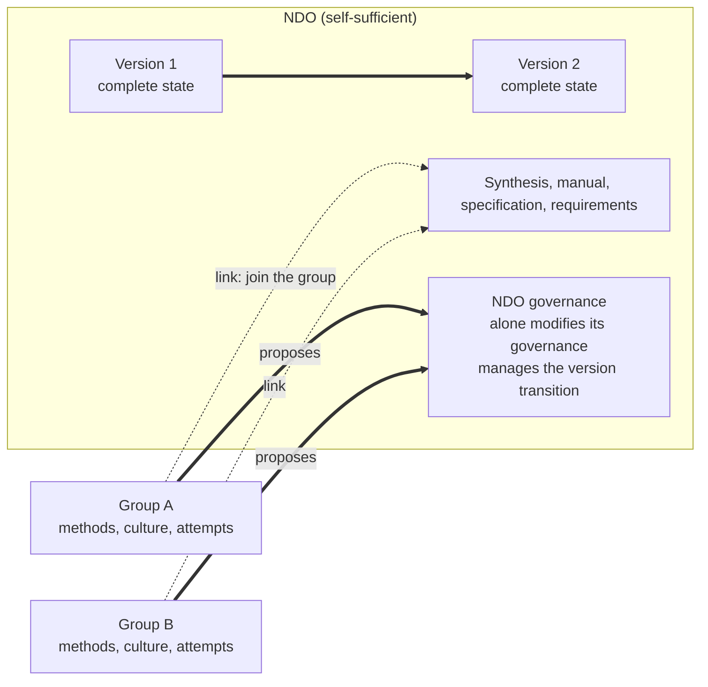

**Development belongs to the groups.** All the work that goes into developing the NDO, "on a dit que ça c'est un aspect dans les groupes" (we said that this is an aspect within the groups): the methodologies of work, collaboration and coordination in developing new versions are specific to each group. A group has its culture; one group may want to work, for example, on certain informational aspects of the NDO, another on others. The information on how version 1, then version 2, was reached does not have to be carried by the NDO itself. This is the direct extension of the October 20 membranes: accounting and work culture stay in the group, the NDO stays organization-agnostic. [P1 2 to 4]

**The version transition, managed by the NDO, with links to the groups.** When a version is reached, it is the NDO's own governance that manages the transition from one version to the next. At the moment of transition, the NDO enters its new state without necessarily carrying all the information about the intermediate steps, but with links that say: we work on this aspect; we, on that other one. These links make it possible to go and find the organizational context, to understand how the decisions were made, "qu'est-ce qui a été essayé, qu'est-ce qui a marché, qu'est-ce qui n'a pas marché" (what was tried, what worked, what didn't work). The NDO thus keeps a thread to its history without containing it. [P1 4 to 5]

**How much to load the NDO.** The concern is stated as such: "Combien est-ce qu'on charge" (how much do we load) the NDO? The answer put forward is not to require its governance to carry the whole history, all the work, all the exposition one could make of it: it is enough to give a reference link, like a citation, which says in substance to join such a group to have access to all the rest. At the version review stage, the NDO still arrives with its manual, its specification document, its requirements. [P1 5 to 6]

**The synthesis, not the detail.** The other speaker confirms and clarifies: there is still a synthesis of the work done elsewhere in the group, which enters the NDO's state and says for example "la première version faisait ça" (the first version did this), with its review. "Oui, c'est ça, c'est ça. Mais, mais c'est juste une synthèse." (Yes, that's it, that's it. But, but it's just a synthesis.) What does not go into the NDO are all the people's attempts, the dead ends of development, the approaches that failed: "c'est des détails" (those are details), the complexity proper to development, of which the person speaking says they have experience from having worked a great deal on projects. The line taking shape: the version state carries the result and its synthesis, the group carries the path. [P1 5 to 7]

**A project's history is read in its issues, PRs and commits.** A voice, probably Soushi (inference), answers from practice: the project is managed with issues, PRs and the board, and the commit history already tells the story of the development, of the architecture and of authority over the code. It is "vraiment intéressant" (really interesting) because the way the team works is inscribed there, and an AI can draw from it an analysis no human would make: "il est impossible pour un humain de faire une telle analyse" (it is impossible for a human to make such an analysis). Combined with the other sources, videos, notes, discussions, "il y a énormément d'informations riches" (there is an enormous amount of rich information). The implicit argument: the detailed history does not need to be copied into the NDO, since it already exists where the work is done and becomes readable with the right tools. The rest of the passage is inaudible. [P1 6 to 8]

**Is the project's emergence part of the NDO?** The discussion returns to what belongs to the NDO: how the project was launched and emerged, "ça c'est ça qui fait partie" (that is what is part of) the NDO. A rephrasing question follows, in which the NDO would essentially be like a repository containing the history of its changes (the engine renders the sentence unrecognizably, the repository analogy is an inference). The answer places that history in the group: it is life cycle management, a very practical function at the group level, with its review and merge steps, but not necessarily at the level of people and fine-grained history. [P1 8 to 9]

**Project management at the level of the context of work.** The question of project management then comes back, the very one that had led to the brainstorm on the context of work on October 27: one would tend to put it at the level of the context of work (the *work context*, rendered "work-on-fest" by the engine). The objection that confirms it: for the same NDO, there can be several teams, each with its own project management. Project management therefore cannot be the NDO's: it is associated with the place where each team works, with its own organization. [P1 9 to 10]

**The Git analogy: the local clone and the fork.** The image comes from Git and GitHub: often, one makes a local clone on one's machine to be able to work, and one does not necessarily have the right to create branches on the original repository or to work with its branches; yet one can have one's own project management at one's own level. There can be two groups of technical developers each working under their own account, each having made a fork of the same repository, and each having their own project management system: "C'est pas grave." (It doesn't matter.) The plurality of ways of working is not a problem to solve, it is the normal situation. [P1 9 to 11]

**The merge goes through the NDO's governance.** "On avait déjà dit ça avant" (we had already said that before): when the thing is ready, it is like a commit and a merge on the NDO, which runs up against the NDO's merge governance. Those who hold that governance apply their criteria: an analysis of the quality of the thing, of its functionality, after which they decide to integrate it into the NDO's distribution, that is, to cut a new version. This is the pull request of October 20, seen this time from the NDO's side: the teams are free upstream, the version is decided downstream, by a single body. [P1 10 to 11]

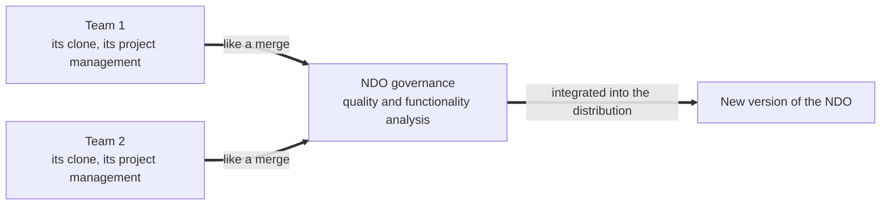

**One can fork, but the official version has its regulation.** The next passage is badly damaged by the transcription, and only its general line can be read. It is acceptable that people can fork; in Nondominium, a little less freely than elsewhere, because there is governance around it. Management of the official version goes through a whole system of regulation, and an unofficial version must be prevented from passing itself off as it; at the same time, people keep the choice. [P1 11 to 13]

**Forking the code is not enough to stay in the network.** The thesis then comes out clearly. Forking the code and forking the NDO are not the same thing: whoever forks the code is not connected to the NDO's network, nor to the world of activity around it, they are isolated. Hence the role of the NDO's governance, "pour que le fork devienne partie du réseau même d'activités économiques" (so that the fork becomes part of the very network of economic activities). Governance can choose not to recognize a fork, but it does not prevent it from existing: "Il faut laisser la liberté." (Freedom must be left.) The recognized fork stays in the network and keeps the mobility of its participants, the possibility of making plans, tests and the rest there; the fork of the code alone starts from zero, elsewhere. [P1 13 to 15]

**The Ethereum example, and soft fork versus hard fork.** The example given is Ethereum. When Ethereum decides on a rollback to invalidate a transaction, the decision goes through, and everyone stays on the same network. But anyone who forks Ethereum's code leaves the ecosystem: one can fork the code and make a new network, but to stay in the same network, forking the code is not enough, one also needs the miners, those who run the network. The question is likened to the distinction between soft fork and hard fork: does one make a version within the network, or does one take the code out of the network? The recording goes silent just as it is about to dig into it ("c'est encore une question de plus en plus de la question à laquelle..." (it's still a question more and more of the question to which...)), and the engine renders nothing more until the end of the first part. [P1 14 to 16]

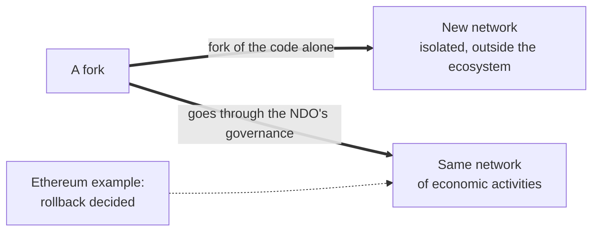

**The Sensoricadémie: the intention.** Soushi opens the second part with what he brainstormed over the weekend, the idea of a Sensorica curriculum. The name is a provisional pun, the Sensoricadémie, Sensorica and académie (academy); the project is to offer a teaching curriculum to teach everything they do, everything he himself has learned, now that work has been delivered. He presents the board directly rather than a document: a map of the modules, whose first track is "travailler avec l'IA" (working with AI). [P2 0 to 1]

**Online modules, a non-linear curriculum.** The modules would be online, so that people can go at their own pace, choose the order they want and navigate freely. Soushi personally holds to the idea of a *non-linear curriculum*: you are like a self-taught learner, but guided. When you click on a topic, the board shows what is recommended to do before and what comes after: "c'est une dépendance pédagogique mais elle est recommandée" (it's a pedagogical dependency but it is recommended). People go with their intuition and their interest; at worst, the person judges that they already know enough about a subject and does not watch the video, even though it might have been very interesting. He shows a chain: this module asks for that one first, which itself asks for another; you can go back up, but in general you do all the foundations first. The idea is a suggested chain, not an imposed one, and the freedom to interconnect everything as you like while guiding the user pedagogically. [P2 0 to 2]

**The series at the lab: a more defined sequence.** Alongside, in-person series at the lab, necessarily more sequential, in small cohorts, in small groups. At the bottom of the board Soushi shows the full set of subjects and the proposed series. Economics and governance, for example, would be the whole Open Value Network side, hREA and Valueflows, governance of shared resources, and the hREA case study, which "vient toucher les choses en haut" (reaches up to the things at the top) because it touches Holochain and distributed systems. The series are ideas for sequences that could be run at the lab by composing a bit of all this; it is the pedagogical approach the board proposes to mix the modular and the sequential. Each unit would be a class, one unit equals one session, and he acknowledges there are a lot of them. [P2 2 to 4]

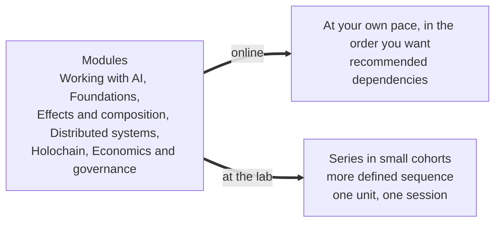

**Effects and composition, then the foundations of code.** They go through each track together. Effects and composition, "c'est toute la question mathématique derrière la programmation fonctionnelle" (it's the whole mathematical question behind functional programming). The foundations move in the same direction: programming paradigms, where functional programming is approached, TypeScript basics, Rust basics, types as sets, pure functions, composition and its laws, with modularity and composability as "mots d'ordre" (watchwords). The goal is to move toward distributed systems, Holochain, economics and governance; the foundations are tied to them and go deeper into functional programming and how it is used, because these mathematical and functional programming notions are "vraiment important pour bien comprendre les systèmes" (really important to understand systems well). NixOS infrastructure will come rather at the end: how to master all this to develop efficiently. It is the most engineering side, for someone who wants to work on Nondominium. [P2 3 to 5]

**No degree needed: foundations and AI go together.** The principle is that you need neither a degree nor to already be a developer, and that is why the AI track is there: foundations and working with AI must go together. Without programming foundations, AI alone is not enough. Soushi takes Tibi himself as an example: when Tibi arrived with a bit of background, Soushi showed him the basics of Rust, Tibi did exercises, then the skills came along the way, and together they explored more advanced things. If you have this support and use AI well, even without a degree, you take it in well and understand it well. The challenge is to give a pedagogy to this trajectory. [P2 5 to 6]

**The general culture of distributed systems.** The foundations of distributed systems are presented as a general engineering culture: the point is not to be "juste un expert blockchain" (just a blockchain expert) or Holochain expert who does not know the fundamentals of distributed systems. He cites the fundamentals of immutable logs and event sourcing; Tibi notes that this is important. Then, more advanced and tied to functional programming, monoids and semilattices, and how far they apply to CRDTs: all the handling of conflicts and eventual consistency in a distributed network, when there is no single authority. Tibi remarks that it is still biased toward Holochain, even if it is generic; Soushi owns it, because it is based on Sensorica's stack: you take all this to really understand the foundations, so as to see afterwards, when you reach Holochain, how it is applied. He acknowledges that it is a bit theoretical. [P2 6 to 7]

**Level 1, Foundations: read and think before writing.** Each track has three levels. Level 1 could be open to anyone; its modules are more conceptual, but since you learn there to work and learn with AI, each one leads to assignments of the kind: use AI to run experiments, explore. People are encouraged to explore, small exercises can be given, but it is "pas fondamentalement pratique" (not fundamentally practical). The goal, with the integration of AI, is to develop progressively in the foundations "non pas l'écriture du code mais la lecture du code et la pensée critique" (not writing code but reading code and critical thinking): mastering the concepts, being familiar with reading code and syntax, while practicing with AI to generate small things you are able to read. [P2 7 to 9]

**Level 2, Practice, and level 3, Architecture.** Level 2 is practical: by then you are specifying before generating, verifying and reviewing, composing, which is already more advanced; with foundations and the habit of critical reading, you really create something with AI, while continuing to cultivate your critical reading and your methodology. Level 3 is architecture: now that you master all this, how do you go up a level, how do you organize the whole globally, with more systems thinking. For AI, architecture is when you delegate to agents, evaluate an agent, start multi-agent orchestration. Soushi remarks that level 1 is mostly made of foundations, and that the board's labels (foundation, practice, architecture) follow this progression. [P2 7 to 9]

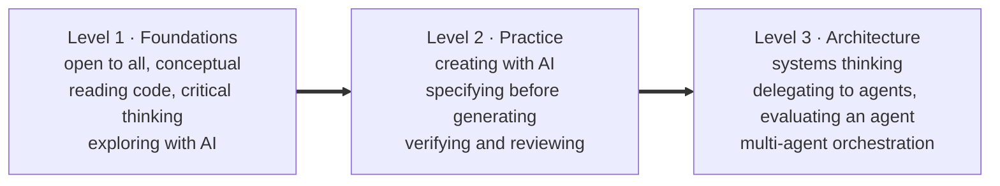

**Unison and Blood, the horizon of the composition track.** The longest term of the effects and composition track is a horizon of languages: Unison, which already exists and is mature, and Blood, a new language that has just been announced. For Soushi, "c'est l'avenir de la programmation" (it's the future of programming) and it fits the curriculum's paradigm perfectly: like a mix of Rust and Effect, with other influences, more advanced still. What he takes from it for teaching: understanding programming paradigms and distributed systems, and seeing how much the notions introduced by these new languages feed the whole. [P2 9]

**An *AI first* language? No: good for both.** Tibi asks: "c'est juste l'IA First Language ?" (it's just the AI First Language?) Soushi answers no, and that it joins his idea that "un bon langage est parfait pour les deux" (a good language is perfect for both): it must be neither just for AI nor just for humans, it must be so good that it shows. His reasons: it is declarative, because functional programming gives a clear mental model, easy to reason about; and in its language and its compiler, it brings all the guarantees, like Rust, to avoid most bugs. The compiler guarantees the absence of an entire class of bugs, and AI and humans alike can reason really efficiently together about the logic, while having what it takes to be functional. [P2 9 to 10]

**What Blood brings: algebraic effects, a syntax close to Rust.** Soushi goes into detail: algebraic effects, algebraic types, a syntax very close to Rust but without borrow checking, which the language manages to handle in the background, so that "c'est juste du rust en plus clean" (it's just Rust, but cleaner). It stays just as performant; you can work very cleanly at a high level and go down to the low level if you want. The functional programming notions, algebraic effects and algebraic typing, are built in, and these are precisely the things he wants to teach. [P2 10 to 11]

**How to teach it: from algebraic types to effects, in TypeScript and in Rust.** He shows the path on the board: introduce the notion of algebraic type, then go into more detail toward effects, which necessarily depend on pure functions, backed by the TypeScript basics, which help to understand pure functions. You apply it concretely in both languages, TypeScript and Rust: with these two, you have a very solid mastery of the language and the notions, and of the paradigm. He acknowledges a share of "égo de développeur" (developer ego) and tribalism in the idea that this places you above the mass of developers, but holds to the argument: these are paradigms that encourage a different rigor, essential in distributed systems, because "un système distribué c'est très sensible" (a distributed system is very sensitive), and having paradigms that force rigor makes all the difference, for AI too. [P2 11 to 12]

**Sensorica's module in the curriculum.** Next comes Holochain and, at level 3, modularity at every scale; Soushi remarks that the board puts the levels on the side. At the end, you can have standalone modules: if you give classes at Sensorica, a module just on that, in three classes, Open Value Network, REA and Valueflows, governing shared resources, where Nondominium is introduced. The hREA case study is not in it because it is a bit more technical; it would come as a complement, as a Holochain case study, the kind of thing you would put on the website. The whole covers the field in a general way. [P2 12 to 13]

**Where the curriculum comes from.** Soushi tells the origin: he started from the question "comment je pourrais enseigner la programmation fonctionnelle" (how could I teach functional programming), from the idea that there is a sequence of interesting notions that lets you understand programming well, and he was looking for the chain of these notions. He was doing it mostly for himself, while also thinking of passing this knowledge on. Then it extended to the whole Sensorica curriculum, and he added the AI side. [P2 13]

**What the curriculum solves for Holochain.** Tibi finds it interesting for a precise reason: when Holochain launched, its problem was converting programmers to the Holochain paradigm. The curriculum is the tool that builds that bridge: how to take programmers who were making apps and doing web 2 development, who are starting to take an interest in blockchain, and bring them toward Holochain as well. And not just Holochain, but in specific contexts, such as that of a particular class. [P2 13 to 14]

**The Sensorica video game as homework.** Tibi ties the curriculum to the idea of the Sensorica video game, not in the development curriculum but in the last track, economics and governance: the homework would be to log into the game that same evening, the class taking place in the game. "Bon là on va loin" (okay, now we're going far), he admits, but these are ideas. Even without a video game, a track like this one could give a form of symbolic recognition (the word is badly transcribed) that tells the person they understand development, that they can enter the structure. [P2 14 to 15]

**The content will come one module at a time.** Tibi asks whether the content already exists. Soushi answers no, not for now: the idea is to plan, to start agreeing on the overall structure, then to make the content little by little, without waiting to have 100% of the content before starting to put it out on the internet, one module at a time, and to run one cohort at a time to test and improve. [P2 15]

**Collaborative entrepreneurship on the same structure.** Tibi says he really likes the structure and its modularity, and asks whether the same structure, with the same modularity, could be used for what they had called *collaborative entrepreneurship*. It was done as a class; Tibi wanted to turn it into a *peer learning* experience, and it would be interesting to project it onto this structure: the way to handle the different levels, to offer a sequence of short classes or workshops. Soushi places it: a workshop is very practical, so level 2, or even level 1 with exercises, but it stays within a class context, not necessarily a lecture, a teaching workshop; "ça marche" (that works). [P2 15 to 16]

**Continuity, and people who are not programmers.** Tibi comes back to the infrastructure track and stresses continuity, "très importante" (very important): how to give people skills, how to equip them. Starting with AI makes it possible to reach not only programmers, but people who do not really have programming skills, all the way to having them host apps and infrastructure. What is more interesting still is the open side: "vous avez pas besoin d'être un programmeur" (you don't need to be a programmer). Soushi confirms that this is what is strong, and that the two of them are good at accompanying people: Tibi is a living example of it, and so is he. [P2 20 to 21]

**What school did not teach, and the opinionated senior developer.** Soushi says he has never learned as much as lately, distributed infrastructure, functional programming, and "dieu merci" (thank God) it was AI that taught him; school never taught him any of it. Those who do not come from school have not been taught old ways of doing things and will be more open to new paradigms. Conversely, senior developers are often very opinionated: one of them who arrives in a functional programming class will have intelligent technical arguments, "ça pourrait aller plus vite si on le ferait à comme ci comme ça" (it could go faster if we did it this way or that way), legitimate questions, and it is not stupid to do things differently in some contexts. But you would have to argue and defend why this paradigm is good for distributed systems, which would force you to get ahead of the curriculum, and these people are not necessarily in a listening and open mode. At the same time he sees it as "un beau défi" (a fine challenge). [P2 21 to 22]

**Private passage removed.** Part of the discussion was about a topic unrelated to Sensorica or Nondominium; it has been removed from this public version. [P2 22 to 24]

**Themed series against drift.** For that, themed cohorts: building on Holochain, Rust basics, composability in Rust, zomes, and only the Holochain backend; or distributed systems in general; or just composition and functional programming. Precise themes prevent drift. You still put in small AI basics: the first two classes are just AI for learning, taking up the tool and learning with it, which is really good for a beginner cohort. [P2 24]

**Series with different prerequisites.** The series can also be distinguished by their prerequisites: a 100% beginner series, for everyone at the lab; a series for developers or beginners with AI; a series that comes after that one or the equivalent; building on Holochain, which can be complemented by the composition modules; and a series for everyone, with no code. There is a way to use this well to target audiences. And Tibi's idea that other modules could be added is "la beauté de la modularité" (the beauty of modularity): you can add as many as you want; on the site, people naturally choose the ones they want, and it is by offering series that the calendar is composed as you go. [P2 24 to 25]

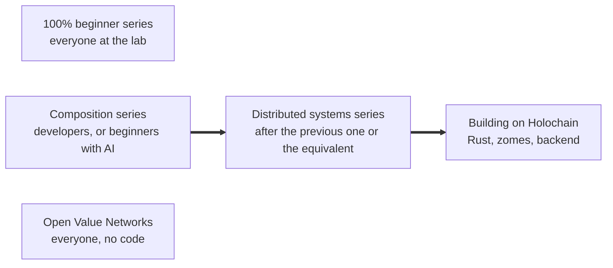

**A learning platform, badges.** Tibi proposes putting this on a learning platform: you make the videos, the texts, people take them online, or on YouTube, and you give badges, as on Udemy. Soushi remarks that Udemy is often used rather to sell classes; Tibi sees in it precisely a way to fund themselves, in addition to the badges. This can be done at different levels: put the basic classes on a platform, then give classes in person. [P2 25 to 26]

**Three tiers: YouTube, paid, in person.** Tibi then structures the proposal: "tu peux avoir 3 niveaux" (you can have 3 levels). A level on YouTube, free. A paid level, where people train themselves, and at the end a badge can be given: "c'est très important ça" (that's very important). A somewhat more expensive level, by registration ("pour la prochaine fois, ça va être next month", for next time, it'll be next month), which can be more in-depth seminars, more practical but live, with mentoring and coaching, more than a web platform. [P2 26 to 27]

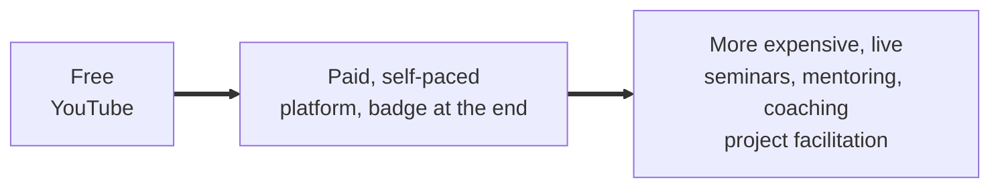

**The facilitator and *peer learning*.** Tibi spells out what in-person adds. You can still have interactivity on web platforms, discussion forums between students and with the teachers; but in person, the teacher becomes the facilitator. If someone has a particular project, they get help in a very contextual way: maybe someone does not want to build an OVN, but wants to do something for a co-op; you are then a facilitator. There is also the whole assembly of *peer learning* tools, learning from one another, and perhaps subgroups by case: "il y a toute une organisation qui va pouvoir se faire" (there's a whole organization that can be set up). [P2 27]

**The Sensoricadémie and AlterNef.** Soushi finds in it his AlterNef project: AlterNef is oriented toward peer education, a "université père à père" (a misheard "peer-to-peer university") in the transcript, a peer-to-peer university. The Sensoricadémie lets him explore this notion of peer education concretely. [P2 27 to 28]

**The paid platform runs by itself and can fund the OVN.** Coming back to Tibi's idea, Soushi notes that a paid platform automates: once set up, it "coûte tout seul" (runs on its own, as transcribed) in a certain way, and "plein de gens font du très bon passif" (lots of people make very good passive income) with it. Tibi: "ça pourrait financer l'OVN" (that could fund the OVN). The other way is to give a three-hour class during the day, in person. Either way, it is a way to fund the OVN and to fund development. [P2 28]

**Charging to keep out bots and trolls.** Tibi adds the friction argument: if you want to give certificates, it is important to charge, "car sinon tu vas avoir des bots, des trolls" (because otherwise you'll get bots, trolls); when there is not a minimum of friction, people abuse it. When they have to invest a minimum, they are more motivated to finish the certificate. [P2 28 to 29]

**The AWS model: free content, paid exam.** Soushi describes another model: you can take the whole course, but you have to pay to take the exam and get the certificate; often, all the course content is public in nature. That is the Amazon Web Services certification: "tout la doc est gratuite" (all the docs are free), there are tons of YouTube videos on how to use AWS, and if you want the certificate, you pay. [P2 29]

**The objection: no demand for certification yet.** A voice, Tibi in all likelihood (inference), answers that in that case he would not give the certification, "parce qu'il n'y a pas un besoin" (because there isn't a need) that is clear: people come to manage their own projects. He would rather put the classes on a platform where you already pay for the class, with the certification at the end, but without making the class free for those who are not interested in certification; there is not really, "pas encore" (not yet), any demand for certification. The point remains open. [P2 29 to 30]

**Coursera and OpenClassrooms: the certificate that is worth something.** Soushi recalls that there are several e-learning models if you want certificates: Udemy, where you certify at the end, Coursera, or the French model whose name he is looking for, OpenClassrooms. He tells the story: the founder, when he was young, had made the Site du Zéro; at 14, Soushi had started programming and Linux thanks to him ("c'est lui qui m'a dit c'était quoi Linux", he's the one who told me what Linux was), and the site was "bien drôle" (really funny). Then he made OpenClassrooms, which became a real official academy from France, international, with classes in French and English, and above all certified with the government. Like Coursera, it has milestone systems. The certificate there does not say you watched all the videos: you did a project, reviewed by humans, a real review by peers and mentors, a concrete project negotiated with your teachers, with access to mentoring, and this human relationship "justifie le prix aussi" (justifies the price too). They joke about students to whom AI would be plugged in behind the scenes, and who would not even know their mentor is an AI. [P2 30 to 32]

**The content is not pulled out of a hat.** Soushi says what makes him confident: "tout ce contenu là on ne le sort pas du chapeau" (all this content, we're not pulling it out of a hat). You have to go one module at a time, and the challenge will mostly be organization: for a big module like the one on working with AI, making sure everything is consistent across the whole module. But each topic as such, he feels able to teach in person, and creating the content will not take very long, because he knows his stuff at that level. [P2 31 to 32]

**Who carries what.** Soushi acknowledges that much of it is tied to him, because it is the engineering side; but the whole economic side, "c'est ton module" (that's your module), he tells Tibi, including the hREA case study in the Holochain track, where Tibi will be well placed to come in. The rest is oriented toward architecture and engineering, but Tibi has experience with people who take a module for interests other than ending up with Holochain. That is precisely the idea of the modules: they are cut so they can be taken separately, and they are very generic. People could come to the Sensoricadémie just for one module, drawn because they heard it had a great course on AI, without caring about the rest. [P2 32 to 33]

**Per unit or by subscription: the example of the Svelte course.** Soushi distinguishes two ways of selling: modules per unit, a whole module sold once, with permanent access and updates; or a subscription, like an academy he knows without naming it: 30 dollars a month for access to all the courses, or buying module by module. Its author makes, he says, tens of thousands of dollars a month: when you look at his number of students and figure most of them pay a subscription, "t'abarnouche" (wow, you're floored). On top of that, he has a YouTube channel where he makes free content, and these free courses give people a taste for going to his platform. Soushi had subscribed to it to supplement his courses, and that is where he learned Svelte. [P2 33 to 34]

**Open access, the title afterwards.** Tibi confirms that everything is moving toward this kind of platform, all the more since there is no longer the entry barrier of needing the right R score to access knowledge. That is where it is aimed: you come, it is open, you do not need a title to attend the course, the title comes afterwards if you were a good student. With AI above all, these are complex technical subjects, but if you have the will, the curiosity, the perseverance, like someone starting a new program at university where it is not always easy, you have the tools you need, and specific courses on how to use these tools well. [P2 34 to 35]

**Tools on top of the course: learning to fish.** Soushi adds complementary tools: perhaps learning niceboards, a small tool anyone can use whenever they want to review, with all the references. These are add-ons: you come to the course and leave with plenty of other tools that are not necessarily part of it, with a demonstration of how to customize them and play with them, for free. His skills have been published on GitHub for a while already, and he could promote them on X: "voici mes skills perso" (here are my personal skills). It is a system of thought, equipping people: we are "pas là pour leur donner du poisson" (not there to give them fish), but to give them fishing rods and teach them to fish. All the resources given at the end of each course, the course boards for review, the practical exercises, participants will be able to give to their AI to review well. [P2 35 to 36]

**"Ok, let's go for it man".** Tibi agrees to the whole. Soushi then proposes setting a timeline to run the first cohorts in 2027, and to start preparing the first courses; they will have to choose carefully where to begin. [P2 36]

**Winter, not summer.** Tibi sets the seasonal constraint: it has to be during the winter, because in summer you are competing with outdoor activities; in winter, people tend to look for indoor activities, and as soon as summer arrives, these questions of courses dissipate, because people go to the beach, on vacation, to the jazz festival, so many things that captivate. [P2 36]

**Aim for the first quarter, revive the events from December.** The idea retained is to aim for the first quarter: from December, the events are revived, the NixOS events, and Soushi recalls that he had already talked about it, he wanted to hold events to give courses, educational events; this fits into the same educational platform, and it is good during the winter. So the rest of November and December can be used to start preparing the website and the platform. [P2 36 to 37]

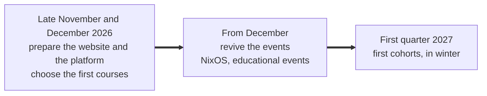

**Present online before in person: article or video.** Before each in-person version, the presentation should be made online, and online is not necessarily a video: the format can be a long article ("moi j'aime ça lire" (me, I like reading)), or both. The video would not be them alone: it would be made by AI, with the real voice-over and the human explanation, "comme t'as faite toi" (like the one you made); Soushi agrees he has to finish that video. AI is very good at making videos and animations, with code excerpts, to show the concepts, make animated diagrams, add little bonuses, as they had done with NotebookLM. All the courses could even be generated with NotebookLM, but its style is not to their liking: you can feel too much that it is generated; at worst it is a backup service. Then monetize them, which is a way to fund themselves and to be able to bootstrap their development. [P2 37 to 38]

**Private passage removed.** Part of the discussion was about a topic unrelated to Sensorica or Nondominium; it has been removed from this public version. [P2 38 to 39]

**Rewriting his DNAs in Blood, and why.** With Blood, Soushi sees himself rewriting his DNAs, his cells, his zomes. He has done the research, and it fits the paradigm so well that he has started, not prototyping since the language is not out, but imagining how it would be designed: what writing zomes in Blood with an HDI would look like, and how much it adds layers of security. The main reason: the code lives in a database, content-addressed like the DHT, and it is no longer text files. Text files are kept as a surface to work on, but the code is automatically indexed in a content-addressed database, so that Git and diffs no longer work the same way; it is more precise. [P2 39 to 40]

**Integrity checked while you write.** In Holochain, with the integrity zomes, the LSP and the compiler could detect while you write that you are breaking integrity: you rename something, you change something, and the system sees it not just in the diff but in the semantic addressing of the code in the database. It is as if the codebase were naturally indexed semantically in a database, by the design of the language. The tools he used, MCPs that indexed the codebase to analyze it better, the language does naturally, and that helps at every level. [P2 40 to 41]

**Effect is a library, Blood has it by design.** The language also adds by default what Soushi finds in Effect in TypeScript. But TypeScript is already a layer on top of JavaScript, and Effect a library for TypeScript that has to add the effects, which starts to make a load; here, "c'est by design dans le langage" (it's by design in the language), the whole logic of algebraic effects. Effect comes very close to this notion, but it is not 100% algebraic effects, whereas Blood is fundamentally. This helps with formal proofs, and that is why it helps AIs a lot: it gives an enormous amount of guarantees, by design, like formal code. When he sees people writing in Python or native JavaScript, he thinks it is "le code le plus imprédictible" (the most unpredictable code) by design, even when the code is clean, when you know how it works under the hood compared with infinitely more predictable systems. [P2 41 to 42]

**For Holochain, patience: HDK and HDI prototypes.** He would like to propose rewriting Holochain's code in Blood, but checks himself: one has to be patient, because it will be an experimental language, the syntax will change a lot and it will take years. He will still try, for fun, his own HDK and HDI prototypes, with all of Holochain's code staying in Rust: making his bindings, his bridges, so as to be able to code Holochain applications in Blood. [P2 42]

**Abilities, and complexity oriented programming.** What struck him in the syntax is the notion of *ability*, like traits. He made the link with Complexity Oriented Programming: with algebraic effects, you define what a function can do, the other functions it can call, through its calling context; "c'est vraiment le contexte qui définit qu'est-ce qu'elle peut faire" (it's really the context that defines what it can do). These remain pure functions: you cannot call just any function, the signature has to say what it can call. Complexity oriented programming then prompts in him the question of emergence: in this kind of signature, the conditions of emergence should be given, explicitly, and not ad hoc elsewhere in the module or the file. He draws two leads from it: making his own DSLs, languages that use Effect fundamentally, as if they were compiled to TypeScript Effect; or making a language truly designed for complexity oriented programming. [P2 42 to 44]

**The author of Blood, and Unison.** Tibi suggests he share this concept of complexity oriented programming with them. Soushi specifies who the author is: a developer on the Effect core, who has been doing Rust for a long time, whom he has followed for a while because he is "un top tier programmer" (a top tier programmer) in the same paradigm as him. He saw him set off on his language, which he announces as inspired by Rust, Effect and Unison, and that is how Soushi discovered Unison: a language that already exists, fairly mature, which has its concepts of the codebase as a database and of content addressing; he did not know it existed, and this language had already introduced the paradigm. [P2 44 to 45]

**A "Rust plus plus", on the horizon.** For distributed architecture, the development of distributed infrastructure and applications, and in general working with AI, and even AI itself and the front end, Soushi already sees Rust as a form of ultimate language with which he would feel comfortable doing everything, from low level to front end to scripting; Blood would be "rust plus plus". He checks himself at once: these are horizons, the language is not even out, and it will be experimental when it comes out. [P2 45]

**Contributing to Blood, and the path to the Holochain core.** It is something Soushi would like to contribute to, and, as Tibi says, to bring his concepts into: it would not be a new idea for them, but it would be good to steer them while they develop, and to show them the potential for what he calls his compiled stack, strongly oriented toward distributed architecture and infrastructure, "nous là avec Holochain" (us, here, with Holochain). Tibi finds it very good that they work together. The same with the Holochain core team, which Soushi says he is getting closer to thanks to Paul and the tooling he makes: he could offer them prototypes of a rewrite of the HDK and HDI in Blood, without having to rewrite everything, which would let people write their own applications in Blood and give an idea of what the language does; and if that encourages them, rewrite other parts of the core, Holochain being so modular that it could be rewritten one crate at a time, depending on the bindings with Rust, which he has no doubt will be good. [P2 45 to 46]

**WebAssembly as a condition.** A condition is set: it has to be a language that fundamentally targets WebAssembly, "c'est super important ça" (that's super important). If the author has not planned to target WebAssembly from the start, "eh bah je vais t'aider" (well then, I'll help you). Soushi concludes that this gives plenty of new ideas about how they could potentially contribute, and asks SoushAI to remember it ("slash remember"). [P2 46 to 47]

**The principles of the curriculum.** To wrap up the curriculum before moving on to the next step, Soushi goes back over the principles on the board, concepts he has already talked about with Tibi: modularity and composability first; concepts and reading code before writing, critical reading with AI before doing concrete projects; open to curious self-learners; Rust and TypeScript for concrete work; human ideas first, AI optional, which is also one of the principles of LifeOS, which the curriculum tries to draw on. [P2 47 to 48]

**The shape of a module, and the proof.** Every module has the same shape: a concept, a guided reading, practice with AI, a critical review, where you learn to review generated code, and the proof the board proposes: every module ends with a verifiable artifact. Soushi has seen it on some platforms: at the end of each module, the exercise is a test suite to make pass; you have to write the code, you can do it with AI, which will get it right the first time ("one-shotter"), but you then have to analyze it and optimize it. [P2 48 to 49]

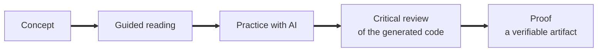

**The LifeOS principles of the AI track.** Soushi quickly reads the LifeOS principles of the AI track: direction is the bottleneck, AI's bottleneck is direction and not execution, the essential thing is to capture intent; done is written as verifiable criteria, hence the whole question of verifying systematically and of articulating the ideal state (*ideal state articulation*); verification is half the work; the ideal state rather than the procedure; spend what the task deserves; fix the system, not your notes. [P2 48 to 49]

**External content is data: prompt injection and surfaces.** The next principle concerns security: when the AI sees external content, it always interprets it as data and not as an instruction, which avoids being hijacked; "c'est comment tu te protèges du prompt injection" (that's how you protect yourself from prompt injection). So you clearly define what the surfaces are. Soushi illustrates it with his own practice: his assistant points out to him that he did not tell it something in the terminal but elsewhere, because "c'est vraiment la surface qui définit si c'est bien moi ou pas" (it's really the surface that defines whether it's really me or not), and therefore whether the instruction should be followed. Things remain to be clarified between the terminal chat, the niceboard chats, the merge permission system he created: the provenance of the data, does it really come from the human, from the user, or from the site it scanned. It is built in, and the hooks (inference) tighten as soon as they see it overstep. [P2 49 to 50]

**Minimal disclosure, and sovereignty.** Last principle read: minimal disclosure, sending providers only what the model needs to answer well. Privacy questions are exploding, and ideally this should be done in a sovereign way; there is a whole chapter of the module on sovereignty, AI and the commons. He then goes over what the discussion of the board brought up, including algebraic effects, and the decisions that remain to be made. [P2 50 to 51]

**The name: from the P2P academy to the Sensoricadémie.** Soushi proposes sharing the board with Tibi, then comes back to the name. The first ideas were called the P2P academy (inference); then the Sensorica open curriculum, the basic idea, more generic. He adds a charge against blockchain: people might want to do blockchain, but it is not real peer to peer, "fondamentalement c'est centralisé" (fundamentally it's centralized); it is an interesting technology, but they made the mistake of calling themselves peer to peer and centralizing, and for him it never was. Acknowledging that the open curriculum might be too generic, he comes back to the Sensoricadémie: a brand that says where it comes from, and a pun that works in French. They try the English form, and Tibi asks for the A to be capitalized. The end, poorly transcribed, drifts toward the work on Nondominium's license, and Soushi closes: "je pense qu'on a fait le tour" (I think we've covered it), they can change the subject. [P2 51 to 53]

**The table, an obligation of the license.** Soushi opens the third part on the contributions tables for Nondominium's v0.1 and hands over to Tibi. Tibi sets the frame: the table is tied to Nondominium's license, which requires the propagation of past contributions, those that went into writing and developing Nondominium. It exists today on a web 2 surface, a Google Sheets spreadsheet, and he insists that it is not a frozen image: "Il est toujours à jour le PiChart" (the PiChart is always up to date), because it is a link to the living sheet, not a photo. He believes a link already exists on GitHub, next to the license. Soushi proposes adding it even if it were not up to date, then checks with SoushAI, which finds no link (see Updates). [P3 0 to 4]

**A tab on GitHub, and a slot in the template.** Soushi starts with the simplest solution: putting the address in a file next to `LICENSE.md`. He shows GitHub's interface: as soon as you create a license file, a tab appears next to the README, and there was a third one between the two; the link could go there. But the question touches the design of the license itself: the license template would need a place that clearly links to the table, a slot reserved for its reference. "C'est pas juste une petite référence noyée en bas" (it's not just a little reference buried at the bottom): it can go toward the end, but it has to be made explicit that it is the link to the table, since the license mentions it everywhere and the association has to be made. [P3 3 to 5]

**Is a license with a link still a license?** The next question is a legal one, and Soushi puts it: "est-ce qu'on a le droit de créer une licence avec un lien comme ça" (are we allowed to create a license with a link like that)? And "est-ce que si le lien change est-ce que c'est un changement de licence" (if the link changes, is that a change of license), or should the link go in a file alongside? The substance is that "la licence c'est quelque chose de statique" (the license is something static), meant to be reproduced as is from one project to another; slots to fill in can therefore be problematic, and the table looks more like an appendix to the license. [P3 5 to 6]

**The release is a photo, but the raw data is needed.** The other speaker answers with the moment of the release: "Oui donc tout la release c'est une photo." (Yes, so the whole release is a photo.) A snapshot at the moment of the release, so it does not matter that the attached table is frozen at that date. But the photo alone is not enough: the raw data is needed all the same. [P3 6]

**The idea: leave the license as it is and add a file.** "Ah j'ai une idée." (Ah, I have an idea.) The license is left as it is, to be improved later if need be, and a file is simply added alongside, for example `PIECHART.md`, as a document in the code, at the root of the repository. That is exactly what SoushAI had just proposed, Soushi notes. The objection, that there is already a `LICENSE.md` at the root, falls at once: the license "il faut qu'il reste statique" (has to stay static), it is what defines the rules and it does not have to carry a slot to fill in; what matters is that the table is alongside. Even if the license does not point directly to an address, it says the table is in the dedicated file of this repository, "et du coup ça suffit" (and so that's enough). [P3 6 to 7]

**A standard file, and a license that sets its structure.** It becomes a standard: every repository that uses the license must come with this file, "c'est standardifié" (it's standardified). The license stays static, and the markdown file can contain several things, "pas juste un lien brut comme ça on peut faire un vrai beau fichier markdown" (not just a raw link, that way we can make a really nice markdown file). The license could even define the structure this file must take, the rules of this table proof; and someone notes that it is already there, which the Corrections confirm. [P3 7 to 8]

**The raw data, not a screenshot to decipher.** The file must contain the data in raw form, not only an image; an image can be useful as a complement, and "on l'a justement" (we have it, as it happens). It will have to follow the guidelines and properly represent the evidence, whether directly in the markdown or in structured form alongside: the data must be accessible "en brut et non juste un screenshot à décrypter" (raw and not just a screenshot to decipher), because that way "on peut les parser on peut les analyser on peut les copier coller" (we can parse them, we can analyze them, we can copy and paste them). The screenshot is not a bad idea for all that, like the logo, which is a file alongside; it can be displayed with the data, since there is little data: the number of contributors, with a figure for each. [P3 8 to 9]

**Three pieces, and the YAML header.** Soushi assembles the pieces. The screenshot, "ça c'est le côté humain" (that's the human side); a JSON, for example, for the structured version of the data; and the `.md` file that assembles the two following the structure, makes sure everything is there and gives the metadata: for which release, the name of the NDO, the date. What is good is that a markdown file can carry a YAML header, structured data like JSON, with objects, lists and booleans; the file is thus both structured and readable for humans. He concludes: "ça c'est la le pie chart lui même l'objet lui-même" (that's the pie chart itself, the object itself), the way it is represented in the code; the second point remains, the royalty to dependencies. [P3 9 to 10]

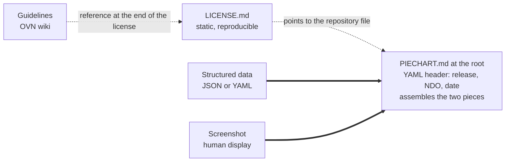

**The guidelines of the table.** Before moving on, Soushi wants to clarify which document is the reference for the form of the table: at the end of the license, the last reference, "contribution pie chart guide line", a link to the OVN wiki. He just wanted to make sure it was "clair clair" (really clear). [P3 10]

**The royalty to dependencies: which criterion?** Tibi opens the second point: to complete this object that is the table, a royalty will have to go to the dependencies, and the question is which criterion to adopt. His proposal: take the first layer of dependencies, Holochain, hREA, Valueflows. Rust and the other things are left out, because they are already a second level; the first layer is the dependencies Nondominium uses directly. [P3 10 to 11]

**Each one invites the next level.** The logic is one of invitation: to whom is the invitation sent? To the first layer, and Holochain, if it wants, can add Rust; "chacun va être responsable d'ajouter s'il le veut d'inviter le niveau suivant" (each one will be responsible for adding, if it wants, for inviting the next level). Holochain could likewise invite Iroh (inference), the peer-to-peer protocol it uses. The criterion is therefore clear: Holochain is invited, and the others can come with their own dependencies; Nondominium only concerns itself with the first layer, because that is the layer the royalty directly affects. [P3 11]

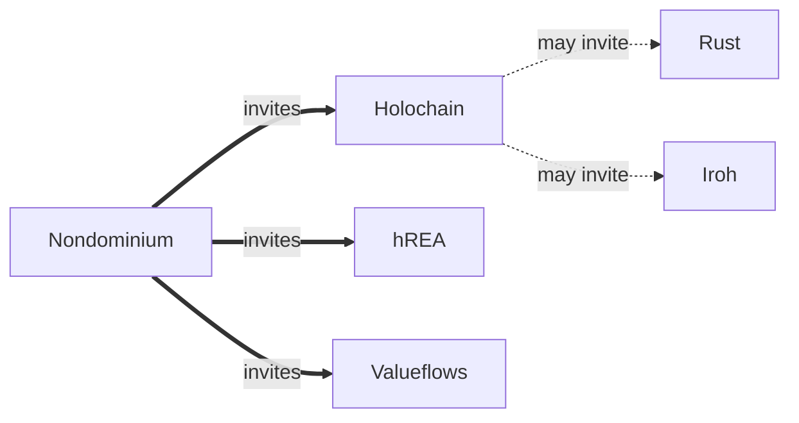

**Why not invite all the sub-dependencies.** The argument against inviting in depth is made from Holochain's point of view: if Nondominium invites Holochain and all its sub-dependencies at once, Holochain already has, from the moment it arrives, people toward whom its potential benefits will cascade, without anyone even having consulted it on the fact that it has these dependencies, and while these dependencies are not even present. [P3 11 to 12]

**No cascade without registration, and the question of dead NDOs.** The answer is consent: the dependencies will receive nothing until they are officially registered; people have to come and register themselves, one must "avoir leur consentement" (have their consent). Otherwise, they are represented anyway, but they will be dead NDOs, inactive, with no one to represent them: an NDO with no agent in it except those who initialized it, "ça sert à grand chose" (that doesn't serve much purpose). A voice qualifies this: it doesn't matter, and "symboliquement ça reste" (symbolically it remains), a placeholder in the meantime. The point is not settled. [P3 11 to 12]

**Drawing up the list with AI.** Can the list of first-level dependencies be obtained automatically, with AI? Soushi thinks so: scans and analyses can be run, and at the level of the codebase alone, `Cargo.toml` and `package.json` are the manifests that contain all the software dependencies; from there, the software dependencies are visible. [P3 12 to 13]

**At what grain: one NDO per library, or one parent per project.** The breakdown remains: is each library an NDO in itself? Holochain is not just Holochain: there is the HDK, the HDI, the client, Sweettest (inference), Holonix, so many sub-components. Does one make a single parent NDO for Holochain, or split it up? The other speaker notes that it is a package installed in one block when one starts with Holochain, from a source that is theirs. The answer that emerges rests on the NDO's composability, which the interface already shows: one makes the parent NDO, invites Holochain, and Holochain can come and do the composability of its NDO itself, adding through hard links components for its crates and everything it exposes. Nondominium only has to invite the parent. [P3 13 to 14]

**Rust is our dependency too.** Soushi adds a remark that shifts the criterion: Rust is a dependency of Holochain, but Nondominium also codes in Rust, and it is Rust that provides its tooling. Likewise Nix: Holochain uses it through Holonix, but Nondominium uses it too. [P3 14]

**Nix and CI: GitHub's November 11 update.** Soushi says he is about to rewrite all his CI: it runs on Ubuntu, which cannot be changed since that is what GitHub's runners provide, but at least Nix will manage the CI, which makes it reproducible all the same and much more stable. "ça a pété" (it broke) recently: on November 11 GitHub made an update that breaks a lot of CI, a big default switch from Ubuntu 24 to Ubuntu 26, and since their CI is on the default image, it may be red; one then has to update one's own packages. The Corrections show that Nondominium's CI stayed green. [P3 14 to 15]

**Make the list first, then decide.** Tibi, in all likelihood (inference), refocuses: "faisons la liste d'abord" (let's make the list first), then we will decide, rereading what the license says exactly. Soushi holds to the idea that Nondominium also has these direct dependencies and should perhaps represent them, Nix being widely used for infrastructure; what the license says, in his view, is that the benefits must be shared with them. What follows is inaudible for almost two minutes. [P3 15 to 17]

**The break.** The recording resumes on Soushi apologizing: he is going to start the transcription of the second part of the meeting while Tibi looks for something, even if it means pausing or taking a break. He concludes that, on the contributions tables, they have "quand même cumulé pas mal d'idées" (still gathered quite a few ideas) with this recording, to pick up later. [P3 17 to 18]

## Decisions

- **Project management lives at the level of the context of work, not in the NDO**, because the same NDO can have several teams, each with its own project management; the NDO carries a synthesis and links to the groups. [P1 3 to 6, 8 to 10]
- **Sensorica's curriculum is launched**: Tibi approves the structure presented ("ok, let's go for it man"). [P2 36]
- **The structure: non-linear online modules on three levels, and in-person series in small cohorts at the lab.** The content is made one module at a time, without waiting to have all the content, one cohort at a time to test. [P2 0 to 3, 7 to 9, 15]
- **First cohorts in the first quarter of 2027, in winter**, with the end of November and December to prepare the website and the platform, and the reactivation of events from December. [P2 36 to 37]
- **The NixOS infrastructure module joins the Holochain track**, added during the session (module H4 of the board). [P2 16 to 18]
- **The economics and governance module goes to Tibi**, engineering to Soushi; proposed by Soushi, not contested. [P2 32]
- **`LICENSE.md` stays static; the contributions table lives in a separate file at the root of the repository**, with its structured raw data, a human display and the release metadata (release, NDO name, date). [P3 6 to 10]
- **The table's guidelines are those of the OVN wiki**, linked as the license's last reference. [P3 10]
- **The royalty to dependencies only targets the first layer** (Holochain, hREA, Valueflows), invited to register itself, each free to invite the next; nothing cascades without registration. [P3 10 to 12]
- **Holochain is invited as a single parent NDO**, which it can split up itself through NDO composability. [P3 13 to 14]
- **The list of dependencies is drawn up before deciding the rest.** [P3 15]

## Discussed, not decided

- **How much history the NDO carries.** A synthesis and links to the groups seem to suffice, but the boundary between what goes into the version's state and what stays in the groups is not fixed. [P1 3 to 6]
- **Code fork versus fork within the network, soft fork versus hard fork.** The thesis is stated (the NDO's governance keeps the fork in the network, the code alone isolates it), the rest is not in the transcript. [P1 13 to 16]
- **Certification: pay for the exam, pay for the certifying course, or no certification for now.** Tibi wants friction to discourage bots and trolls; Soushi describes the AWS model and the certificate based on a project reviewed by humans; a voice doubts there is any demand yet. [P2 28 to 32]
- **Selling per unit or by subscription**, and on which platform (Udemy, Coursera, OpenClassrooms as models, or a platform of their own). [P2 25 to 26, 30 to 34]
- **Collaborative entrepreneurship projected onto the same structure**, as level 1 or 2 workshops. [P2 15 to 16]
- **The final name.** The Sensoricadémie is presented as a working name, with a capital A to place and its English form to find. [P2 0, 51 to 53]
- **Also representing Nondominium's direct dependencies (Rust, Nix).** [P3 14 to 15]
- **Creating placeholder NDOs for dependencies not yet registered**, or refraining since they would be inactive. [P3 11 to 12]
- **Proposing HDK and HDI prototypes in Blood to the Holochain core, and sharing complexity-oriented programming with Blood's authors.** At the stage of intention, the language not being published. [P2 42 to 47]

## Actions

- **Soushi:** share the curriculum board with Tibi. [P2 51]
- [x] **Soushi:** add to the Holochain track the module on infrastructure and NixOS (done during the session, module H4 of the board). [P2 16 to 18]
- **Soushi:** prepare the Sensoricadémie's website and platform by the end of December, and choose with Tibi the first courses for a cohort in the first quarter of 2027. [P2 36 to 37]
- **Soushi:** reactivate the events at the lab from December (NixOS, educational events). [P2 36 to 37]
- **Tibi:** carry the curriculum's economics and governance module, including the hREA case study. [P2 32]
- **Tibi:** see how to project the collaborative entrepreneurship course onto the curriculum's structure. [P2 15 to 16]
- **Soushi:** finish the video in question (the voiceover on an animation made with AI). [P2 37]
- **Soushi:** keep in memory the idea of HDK and HDI prototypes in Blood and the possible contribution to Blood ("slash remember"). [P2 45 to 47]
- **Tibi:** give the address of the Google Sheets spreadsheet of Nondominium's contributions table, which SoushAI found nowhere. [P3 0 to 4]
- **Soushi:** create at the root of the Nondominium repository the contributions table file next to `LICENSE.md`: YAML header with the release, the NDO name and the date, structured raw data, a screenshot as a complement, following the OVN wiki guidelines. [P3 6 to 10]
- **Soushi:** draw up the list of first-level dependencies by scanning `Cargo.toml` and `package.json` with AI, noting Rust and Nix as direct dependencies to discuss. [P3 12 to 15]
- **Soushi and Tibi:** resume the discussion on the table and the royalty to dependencies once the list is made. [P3 15, 18]

## Outstanding

- **The 39 untranscribed minutes of the first part** [P1 16 to 55]: silence or inaudible sound, to be checked by listening if the rest of the discussion on the fork matters.
- **The address of Sensorica's contributions table** in Google Sheets, and whether it covers Nondominium alone or the network.
- **Whether an issue should track the contributions table in the v0.1.0 milestone**, which has none (see Corrections).
- **The name and platform of the academy** at 30 dollars a month where Soushi learned Svelte, cited without being named.
- **Who Paul is**, through whom Soushi is getting closer to the Holochain core; the name is said without further detail.
- **The mistranscribed word from the first part, "l'autocomplicateur"**, which refers to a piece of the NDO's architecture.

## Corrections after the meeting

- **The license already defines the table as a file accompanying the work.** Nondominium's `LICENSE.md` ("OVN LICENSE FOR DIGITAL RESOURCES v1.0") defines the "Contribution Pie-Chart" as "a file accompanying the Work" (line 14) and requires it to be included with the license in all copies (line 24); the decision of a separate file therefore follows the letter of the license without modifying it. The same license sets minimum shares of 0.5% and 2% of material benefits depending on the case (lines 36 and 43), and its last reference is indeed "Contribution Pie-Chart guidelines: https://ovn.world/index.php?title=OVN_license" (line 74).
- **No table and no table issue, confirmed.** The design system's content mentions the table only in the meeting journals, and a search for "pie chart" in the issues of `Sensorica/nondominium` returns nothing; the 8 open issues of the "v0.1.0 Moss pilot" milestone (#121, #122, #123, #124, #125, #127, #147, #166) do not mention it.
- **Nondominium's CI is not red.** The latest runs on `Sensorica/nondominium` are green: Build and Lint on November 13 at 4:39 p.m., and Lint on November 17 at 5:40 p.m., Build then being in progress; all workflows run on `ubuntu-latest`. The image change of November 11 was not checked here.
- **Blood is not published.** The curriculum board already notes it (module X1, "Horizons: Unison et Blood" (Horizons: Unison and Blood): "Blood annoncé mais non publié" (Blood announced but not published)), which agrees with Soushi at [P2 39 to 42].
