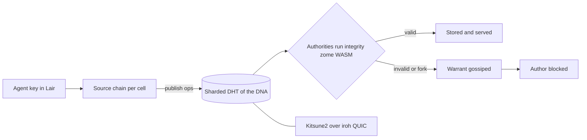
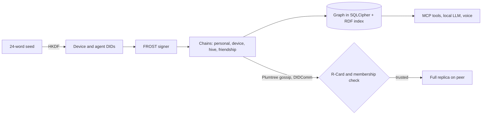

# NAOMS, Holochain and *Nondominium*

NAOMS (naoms.dev) is a local-first, peer-to-peer memory system: one daemon per device holds a person's signed histories, projects them into a graph, governs groups ("hives") and serves AI agents over MCP. This board reads it twice: first against Holochain, the substrate Nondominium is built on, then against Nondominium itself.

Researched and drafted by SoushAI, Soushi's AI assistant; reviewed and posted by @Soushi888. NAOMS was read from a source snapshot of 24 November 2026 (version 0.5.39, pre-release), Nondominium from `dev` at that date, Holochain from its primary sources (releases, changelogs, roadmap, dev pulses, developer docs, code). Repository sources are cited `path:line`. Each Holochain finding carries a confidence tag: HIGH (primary source read), MED (one source or dated source), LOW (absence of evidence), CONFLICT (sources disagree).

```board-idea
headline: |
  Holochain validates a sharded commons among strangers.
  NAOMS replicates whole copies among trusted beings.
  Nondominium governs what is shared; NAOMS governs who shares.
detail: "All three refuse capture and a global ledger, and Holochain and NAOMS now both run on iroh QUIC. They part on trust: Holochain and Nondominium are built for agents who do not know each other, NAOMS for chains of acquaintance. naoms.dev compares itself to Holochain on 51 rows: mostly fair, but 6 of the 15 rows checked here are stale or wrong."
```

## In numbers

Counted by tool on 24 November 2026: the 51 comparison rows parsed from naoms.dev's `#compare` section, the audit below, and file counts from the NAOMS repository.

```board-tally
- n: 51
  label: "rows in naoms.dev's own comparison table"
  pct: 100
- n: 5
  label: "rows where naoms.dev gives Holochain a strength (vs 26 for NAOMS)"
  pct: 10
- n: 15
  label: "Holochain rows checked against Holochain's own sources"
  pct: 29
- n: 6
  label: "of those 15 found stale, overstated or wrong"
  pct: 40
- n: 133
  label: "NAOMS feature packages (ls -d src/packages/*/)"
  pct: 100
- n: 589
  label: "NAOMS repo files that mention Holochain"
  pct: 100
```

## NAOMS and Holochain, side by side {wide}

```board-compare
left:
  title: Holochain
  who: "Holochain Foundation, since 2017. Beta 0.7.1 (14 Oct 2026), 0.8.0-dev.16 (23 Nov). CAL-1.0."
  items:
    - "One signed source chain per agent per app (cell)"
    - "Sharded, validating DHT per DNA; every authority re-runs the app's WASM validation"
    - "Warrants: gossiped proofs of invalid data or chain forks; blocking follows them"
    - "App logic in Rust zomes (HDK/HDI) compiled to WASM; clients in TS"
    - "Kitsune2 over iroh QUIC, the only transport since 0.7.0"
    - "Per-app agent keys in Lair; DeepKey removed from the conductor in 0.6"
    - "Desktop via Kangaroo; mobile build planned for 0.9.x"
    - "No AI in core; Moss states 'no AI' as a value"
right:
  title: NAOMS
  who: "NAO / Allelo community, Ruben Daniels as contact. Version 0.5.39, 'pre-production', alpha 'imminent'. Alignment License 0.1 draft."
  items:
    - "Many chains per being (personal, device, hive, friendship...), BLAKE3 hash-chained, Ed25519, FROST-signed heads"
    - "No DHT: trust-gated full replication, Plumtree gossip, mostly last-writer-wins"
    - "Policy engine and reducers validate at ingestion; no warrant equivalent"
    - "App logic in TypeScript packages on a Deno daemon over a Rust core (FFI)"
    - "iroh QUIC, mDNS on by default, relay.naoms.dev fallback, DIDComm authcrypt"
    - "One seed, HKDF-derived DIDs per device and per agent, FROST threshold signer"
    - "Browser, Android, iOS, TUI, desktop clients"
    - "MCP server with ~190 tools, local LLM, whisper, voice as primary interface"
between: "same root"
caption: "Two answers to: how do sovereign participants share data without a central authority?"
```

## What each one is, as a shape {wide}

The diagrams follow each project's own vocabulary. Holochain from its glossary and data model docs; NAOMS from `docs/architecture.md` and `docs/design/chain-architecture.md`.





## Axis by axis {wide}

One row per axis that decides how the two differ. The confidence tag is for the row as a whole; the source column names where it was read.

| Axis | Holochain | NAOMS | Conf. | Sources |
|---|---|---|---|---|
| Unit of sovereignty | Agent per app: one cell, one key per DNA install | Being across contexts: per-device and per-agent DIDs under one seed | HIGH | [glossary](https://developer.holochain.org/resources/glossary/); `docs/architecture.md:270-289` |
| History | One source chain per cell, signed actions | Many chains per being, multi-parent lanes per (chain, branch, signer) | HIGH | [data model](https://github.com/holochain/holochain/blob/main/docs/design/data_model.md); `docs/design/chain-architecture.md:16,37`, `src/core/chain/hive-membership-causal-fold.ts:8` |
| Replication | Sharded DHT, each node holds an arc | Full replication of what the trust graph allows; no DHT | HIGH | [concepts](https://developer.holochain.org/concepts/); `docs/design/inspiration/holochain.md:184` |
| Validation | Every authority re-runs the DNA's validation | Policy engine, reducers and `validateGossipCommitOutcome` at the receiver | HIGH | [glossary](https://developer.holochain.org/resources/glossary/); `src/core/transport/gossip-validation.ts:476-502` |
| Bad actors | Warrants (invalid op, chain fork) lead to blocking, warrant-only since 0.7 | `ChainForkError` locally; no gossiped accountability record | HIGH | [dev pulse 153](https://blog.holochain.org/dev-pulse-153-holochain-0-6-released-with-immune-system/); `docs/design/chain-architecture.md:90` |
| Conflicts | A fork by one author is a warrantable violation; app-level updates are the app's to resolve | Device lanes avoid collisions; mostly last-writer-wins, Loro CRDT as a narrow tool | HIGH | [data_model.md ChainFork](https://github.com/holochain/holochain/blob/main/docs/design/data_model.md); `docs/understand/how-it-works/how-sync-works.md:23`, `docs/design/p2p-sync.md:37` |
| Transport | Kitsune2 over iroh 1.4, tx5 removed in 0.7.0 | iroh 1.2, iroh-gossip, iroh-blobs, mDNS, relay.naoms.dev | HIGH | [dev pulse 156](https://blog.holochain.org/dev-pulse-156-holochain-0-7-0-faster-simpler-apple-scented/), [kitsune2 Cargo.toml](https://raw.githubusercontent.com/holochain/kitsune2/main/Cargo.toml); `rust/Cargo.toml:303-325`, `CHANGELOG.md:11` |
| Keys and recovery | Lair keystore; no rotation since DeepKey left the conductor; 0.8-dev restores a source chain from the DHT | BIP-39 phrase, FROST split across devices, removed device not yet cut off | HIGH | [CHANGELOG](https://raw.githubusercontent.com/holochain/holochain/main/crates/holochain/CHANGELOG.md); `docs/understand/limits.md:48,112-118` |
| Privacy | Private entries stay on the chain; transport E2E; at-rest encryption a build feature | SQLCipher at rest, DIDComm authcrypt, MLS for calls (not chat) | HIGH | [entries](https://developer.holochain.org/build/entries/); `docs/design/p2p-sync.md:23`, `docs/architecture.md:214-216` |
| Group encryption | None found | MLS (`mls-rs 0.54`) for call and media groups | LOW for Holochain | `rust/Cargo.toml:366` |
| Groups | One DNA network per group, membrane proofs, checked in validation not at handshake | Hives: four-branch chain, governance modes (admins, consent, consensus, majority), member-held VRC | HIGH | [dev pulse 153](https://blog.holochain.org/dev-pulse-153-holochain-0-6-released-with-immune-system/); `docs/understand/hives/making-decisions.md:17` |
| App model | DNA bundles of Rust WASM zomes; coordinator updates 9% done | TypeScript packages with a typed manifest on the daemon | HIGH | [roadmap](https://holochain.org/roadmap); `src/packages/` |
| Runtime | Conductor process; Kangaroo for desktop; wasmi backend for the App Store | Deno daemon + `libnaoms_core` over FFI, WASM in the browser, native mobile | HIGH | [kangaroo-electron](https://github.com/holochain/kangaroo-electron); `docs/architecture.md:14-55` |
| Mobile | Not shipped; Mobile Build at 0%, planned 0.9.x; Android via p2p Shipyard historically | Android and iOS clients in the repo | HIGH | [roadmap](https://holochain.org/roadmap); `clients/README.md:7-14` |
| AI | None in core; ai-tools repo of Claude Code skills, no MCP server yet | MCP over HTTP with ~190 tools, GGUF and MLX local models, whisper, voice | HIGH | [ai-tools](https://github.com/holochain/ai-tools); `docs/architecture.md:182-209` |
| Maturity | "initial Beta... ready for limited production use"; HDK stability 0/100 on the roadmap | "pre-production software"; CHANGELOG has only `[Unreleased]` | HIGH | [holochain repo](https://github.com/holochain/holochain); `docs/understand/how-it-works/system-maturity.md:14` |
| License | CAL-1.0 core; kitsune2 Apache-2.0; Lair Apache-2.0/MIT | Alignment License 0.1, alpha draft "No lawyer has reviewed this text" | HIGH | [holochain repo](https://github.com/holochain/holochain); `LICENSE:1-3` |

## The screens

| naoms.dev, home | naoms.dev, its comparison table | holochain.org, home |
|---|---|---|
|  |  |  |

## Audit: naoms.dev's Holochain column {wide}

naoms.dev compares NAOMS with six systems on 51 rows and says "Where others are stronger, it says so." I checked the 15 Holochain cells that Holochain's own sources can settle. 9 hold; 6 do not.

| Row on naoms.dev | What it says about Holochain | Verdict | Evidence |
|---|---|---|---|
| Two devices disagree | "Automatically merges both sides' changes together, by design" | **Wrong** | Two actions on one previous hash are a `ChainFork` warrant, not a merge ([data_model.md](https://github.com/holochain/holochain/blob/main/docs/design/data_model.md)) |
| A mature, battle-tested app framework | ✓ "A decade of development" | **Overstated** | Holochain calls itself "initial Beta... limited production use"; HDK stability 0/100 ([roadmap](https://holochain.org/roadmap)); NAOMS's own note says "zero production users" (`docs/design/inspiration/holochain.md`) |
| You lose your phone | DeepKey "still unreleased" | **Stale** | DeepKey was removed from the conductor in 0.6.0-dev.0; 0.8-dev adds `restore_from_dht` for the chain, not the key ([CHANGELOG](https://raw.githubusercontent.com/holochain/holochain/main/crates/holochain/CHANGELOG.md)) |
| Your key is compromised | A DeepKey revocation design "exists" | **Stale, and worse** | The revoke call left with DeepKey: no key rotation in the conductor today (same CHANGELOG) |
| On your phone | ✗ "No mobile support" | **Partly right** | Mobile Build 0%, planned 0.9.x ([roadmap](https://holochain.org/roadmap)); but 0.7 added wasmi for the App Store and ran on an iPhone ([dev pulse 156](https://blog.holochain.org/dev-pulse-156-holochain-0-7-0-faster-simpler-apple-scented/)), and NAOMS's own note cites the Volla phone shipping Holochain apps |
| A tamper-proof way to package and move your data | ✗ "Not supported" | **Partly right** | No export format, but chains are hash-linked and signed, and 0.8-dev restores a chain from the DHT |
| Built on an internet transport (AD4M column) | "Holochain over Iroh" | Holds | iroh only since 0.7.0 |
| Devices per identity | ✗ per-app keys | Holds | No DPKI in the conductor |
| Store secrets | ~ Lair | Holds | [Lair](https://github.com/holochain/lair) |
| How groups form | ✓ membrane proofs | Holds | [glossary](https://developer.holochain.org/resources/glossary/) |
| Governance | ~ no named decision modes | Holds | validation rules only |
| Who can read your stuff | ~ transport encrypted, data signed | Holds | private entries and at-rest encryption feature exist, so "~" is fair |
| Building an app | ✓ signed bundles, enforced rules | Holds | DNA hash covers integrity zomes |
| Open standards | ~ own DNA/WASM format | Holds | |
| Age and readiness | ~ about 9 years, before 1.0 | Holds | first code 2017, 0.7.1 today |

## Where NAOMS's own notes on Holochain went stale

`docs/design/inspiration/holochain.md` is a careful 360-line evaluation, last verified 2026-10-11. Three of its facts no longer hold:

- **Transport.** It names tx5/WebRTC under Kitsune2. Holochain moved to iroh in 0.6.1 (12 May 2026) and removed tx5 in 0.7.0 (30 Jul 2026). HIGH.
- **Version.** "v0.6.x current stable, v0.7 in development." Stable is 0.7.1 since 14 Oct; 0.8 is in weekly dev builds. HIGH.
- **DeepKey.** "still marked unstable." It was removed from the conductor. HIGH.

Two conflicts inside NAOMS itself:

- **The Holochain bridge.** `src/packages/holochain/` is still wired in (`deno.json:170`, `maturity: experimental`), while the Rust-core conversion spec says "holochain removed 2026-10-16" (`.naoms/roadmap/1986-rust-core-conversion/spec/00-scope.md:50`). CONFLICT.
- **Mobile.** The inspiration note cites the Volla phone shipping Holochain apps; naoms.dev says Holochain has no mobile support. CONFLICT.

## What the Holochain comparison means for Nondominium

```board-stickies
- title: "Same transport now"
  kind: fact
  body: "Both stacks run on iroh QUIC: kitsune2 on iroh 1.4.1, NAOMS on iroh 1.2. The 'runtime-shape gap' NAOMS lists as the first blocker for a bridge (two network stacks fighting over ports and NAT) is smaller than when it was written."
  so: "kitsune2 Cargo.toml; NAOMS rust/Cargo.toml:303-325; holochain.md open question 7"
- title: "Strangers vs friends"
  kind: model
  body: "Holochain re-validates because peers are not trusted. NAOMS skips it because the trust edge is the authorisation. Nondominium and hREA need the first: resources move between agents who do not know each other."
  so: "holochain.md:245"
- title: "Identity is the gap on both sides"
  kind: risk
  body: "Holochain has no key rotation since DeepKey left; NAOMS cannot yet cut off a removed device or member. Neither has a finished answer to a stolen key."
  so: "Holochain CHANGELOG; docs/understand/limits.md:112-126"
- title: "AI where Holochain has none"
  kind: idea
  body: "NAOMS's MCP surface and agent memory are what the Holochain world lacks; holochain/ai-tools is still skills only."
  so: "github.com/holochain/ai-tools"
- title: "Warrants have no NAOMS twin"
  kind: fact
  body: "A gossiped, verifiable record of who broke the rules is Holochain's accountability without a judge. NAOMS frames it as convergent with its Honesty axiom but has no equivalent in code."
  so: "docs/design/inspiration/holochain.md:301-305; grep of src/core for warrant"
- title: "License risk"
  kind: risk
  body: "NAOMS ships under a draft license no lawyer has reviewed. Building on it, or bridging to it from a CAL-1.0 or Apache project, waits on that text."
  so: "LICENSE:1-3"
```

## Nondominium and NAOMS: where they resonate {wide}

Nondominium is Sensorica's Holochain hApp for resources that no one can capture, built on Valueflows (Holochain 0.7.1, OVN License). NAOMS never mentions it: 0 files in its `docs/` and `src/` name Nondominium, Sensorica or open value networks. Read side by side, the two answer the same refusal from opposite ends: Nondominium starts from the **resource** that must stay uncapturable, NAOMS from the **being** that must stay sovereign. Sources: the Nondominium repository (`documentation/`, cited `path:line`) and the NAOMS repository.

```board-compare
left:
  title: Nondominium
  who: "Sensorica. Holochain 0.7.1, Valueflows via hREA, OVN License v1.0. NDO Layer 0 implemented; Layers 1 and 2 post-MVP."
  items:
    - "Centre: the Resource, 'organization-agnostic, uncapturable, natively collaborative'"
    - "Governance-as-operator: the governance zome approves or rejects each state change"
    - "Private Participation Receipts: bilateral signed receipts of economic acts, 16 categories"
    - "Valueflows economic events through hREA"
    - "Seven property regimes, one of them Nondominium"
    - "Lobby, Group and NDO networks: one cloned DHT per group and per resource"
right:
  title: NAOMS
  who: "NAO / Allelo. Own substrate on iroh. Contributions and tokens shipped; resource pooling designed, not built."
  items:
    - "Centre: the Being, its memory and relationships"
    - "Generic governance engine: proposal, vote, attestation, decision on any chain"
    - "Trust signals and role credentials signed on R-Cards between people who know each other"
    - "contribution.record events on hive chains; no Valueflows"
    - "Stewardship: an identity and guardians for land, rivers, ecosystems"
    - "Hives: one chain and one trust-gated replication scope per group"
between: "resource vs being"
caption: "Nondominium governs what is shared; NAOMS governs who shares"
```

| Theme | Nondominium | NAOMS | Resonance | Sources |
|---|---|---|---|---|
| Purpose | Resources "uncapturable and resilient to monopolization. No Agent or group of Agents can control or delete Resources" | "we chose the option that keeps power with you and your community"; "no platform in the middle to take a cut" | **Convergent**: both are built against capture | ND `requirements/requirements.md:5,22`; NAOMS `docs/understand/about/why-these-tradeoffs.md:39`, `docs/understand/vision/10-economics-governance.md` § No platform tax |
| Governance placement | Governance-as-operator: the resource zome requests a transition, the governance zome evaluates the rules and approves or rejects | "Governance is not a page you visit"; one engine routes proposal, vote, attestation, decision for any chain with a contract branch | **Convergent**: governance as an operator on state, not an admin panel | ND `requirements/governance.md:98-103`; NAOMS `10-economics-governance.md:17-38` |
| Decision modes | Rules per resource and regime; no affiliation spectrum yet ("all validated agents treated equivalently") | Named group models: admins, owner, consent, consensus, majority | **Complementary**: NAOMS has the group decision modes Nondominium's governance gap names | ND `requirements/governance.md:237`; NAOMS `docs/understand/hives/making-decisions.md:17` |
| Accountability | PPRs: private, cumulative, each pairwise receipt signed by both parties | Trust signals (VCs on an R-Card, "I vouch for their expertise") and role credentials from hive membership | **Resonant, different trust**: both are bilateral signed attestations; PPRs record acts between strangers, NAOMS signals record relationships | ND `requirements/governance.md:148-188`; NAOMS `docs/glossary.md:205-215` |
| Economic events | Valueflows events (Commitment, Claim, ValidationReceipt) through hREA | `contribution.record`, `.added`, `.retracted` on hive chains; mutual credit, pooling and surplus distribution are designed, not built | **Gap NAOMS could close with Valueflows**: its only Valueflows mention is a note that another project does not use it | ND `requirements/ndo_prima_materia.md:727`; NAOMS `10-economics-governance.md:58-70`, `docs/design/inspiration/commitment-pooling.md:27` |
| What is held | NDO: identity first (Layer 0, lifecycle Ideation to EndOfLife), then specification and process; property regimes include `Nondominium` | Stewardship package: an identity for non-human beings (land, rivers, species) with FROST threshold signing by guardians | **Resonant**: a resource no one owns and a being that holds itself through guardians are close ideas | ND `requirements/ndo_prima_materia.md:43,247`; NAOMS `src/packages/stewardship/README.md` |
| Group shape | A Group DNA cloned per group, and one NDO DNA cloned per resource, each its own network | One hive per group: its own chain with contract, metadata, content and graph branches | **Convergent**: per-group network isolation on both sides | ND `README.md` § Architecture; NAOMS `docs/design/chain-architecture.md:45` |
| Portability | "Roles and PPRs are local"; no VC or DID yet; planned Flowsta DID and a `PortableCredential` | DIDs (`did:key`, `did:webvh`) per device and per agent, W3C-format credentials | **Complementary**: NAOMS already has the portable identity Nondominium plans | ND `requirements/agent.md:474,489`; NAOMS `docs/design/identity-model.md:47,73` |
| Trust between strangers | "Permissionless but accountable": any agent may act on a resource, peers validate, PPRs build reputation between parties who did not know each other | Friend-of-a-friend only: Appleseed-family propagation gives a stranger a weighted score when a trust path exists (`TRUST_GATE_THRESHOLD = 0.6`); greencheck proves a unique person without knowing them; with no path, the docs themselves say a stranger stays a stranger | **Divergent**: Nondominium is built for strangers, NAOMS for chains of acquaintance; the propagation has no Sybil defence yet (DE-68) and the decay the vision describes is not in the trust package | ND `requirements/requirements.md:9`; NAOMS `src/packages/trust/trust-propagation.ts:79-101`, `docs/design/trust-model.md:49-63`, `docs/understand/philosophy/economics/blockchain-vs-hashgraph-sovereignty.md:189-191` |
| Memory | Reputation is cumulative by design | "Forgetting is a feature" (the Mystery axiom) | **Tension**: an accountable record and a right to forget pull apart | ND `requirements/requirements.md:41`; NAOMS `docs/understand/about/design-principles.md:113` |
| License | OVN License v1.0: GPLv3 plus Peer Production reciprocity | Alignment License 0.1, an unreviewed alpha draft based on MPL 2.0 | **Unknown**: compatibility cannot be judged until NAOMS's text is final | ND `LICENSE.md:1-7`; NAOMS `LICENSE:1-21` |

```board-stickies
- title: "A private home for PPRs"
  kind: idea
  body: "PPRs are private receipts each agent holds about their own economic acts. A NAOMS being's personal chain and memory graph is built for exactly that kind of private, signed, searchable record."
  so: "ND requirements/governance.md:148-188; NAOMS docs/architecture.md:240-263"
- title: "Valueflows for NAOMS contributions"
  kind: idea
  body: "NAOMS's contribution events and its planned pooling and surplus distribution are the ground Valueflows and hREA already map. Nondominium is a working example of that mapping on a commons."
  so: "NAOMS 10-economics-governance.md:58-70; ND requirements/ndo_prima_materia.md:727"
- title: "Portable identity both ways"
  kind: idea
  body: "Nondominium's open item is credentials that leave the DNA. NAOMS's DIDs and W3C credentials are one existing answer to compare with the planned Flowsta route."
  so: "ND requirements/agent.md:489; NAOMS docs/design/identity-model.md:47"
- title: "Strangers again"
  kind: model
  body: "Nondominium is 'permissionless but accountable': agents who do not know each other share a resource, so peers validate. NAOMS trusts the relationship it already has. A bridge would sit at that frontier."
  so: "ND requirements/requirements.md:9; NAOMS docs/design/inspiration/holochain.md:245"
- title: "Forgetting vs reputation"
  kind: risk
  body: "A NAOMS being may forget by principle; a Nondominium counterparty relies on the receipt staying. Any shared design has to say which record survives a forgetting, and on whose side."
  so: "NAOMS design-principles.md:113; ND requirements/requirements.md:41"
```

## Unknowns

- **Holochain on one Wi-Fi with no internet.** Kitsune2 still needs a bootstrap service; whether iroh's local discovery is enabled in Holochain was not found. LOW.
- **Group encryption in Holochain.** No primitive found in the pages read. Absence of evidence. LOW.
- **NAOMS gossip latency and group size at scale.** naoms.dev says itself the reach time is "an engineering estimate, not something proven under real load yet". MED.
- **HoloFuel today.** naoms.dev's token rows rest on HoloFuel; its current state was not checked. Not audited.
- **The roadmap epic "Kitsune2 Iroh Transport"** still shows 21% for 0.8.x though iroh ships; probably follow-on work. CONFLICT.

## Sources

Nondominium: `documentation/requirements/requirements.md`, `documentation/requirements/governance.md`, `documentation/requirements/agent.md`, `documentation/requirements/ndo_prima_materia.md`, `README.md`, `LICENSE.md`, at `dev` on 24 November 2026.

NAOMS: the repository's `docs/` and `src/` as cited in each row, from a snapshot of 24 November 2026, among them `docs/start-here.md`, `docs/architecture.md`, `docs/design/chain-architecture.md`, `docs/design/p2p-sync.md`, `docs/design/identity-model.md`, `docs/design/inspiration/holochain.md`, `docs/understand/about/design-principles.md`, `docs/understand/limits.md`, `docs/understand/hives/making-decisions.md`, `rust/Cargo.toml`, `CHANGELOG.md`, `LICENSE`, `deno.json`, `src/core/transport/gossip-validation.ts`, `src/packages/holochain/docs/design/design.md`.

naoms.dev: [home and #compare](https://www.naoms.dev/), [Hives](https://www.naoms.dev/pages/block-hives.html), [Local models](https://www.naoms.dev/pages/block-local-models.html), [Signed storage](https://www.naoms.dev/pages/block-signed-storage.html), [Identity](https://www.naoms.dev/pages/block-identity.html). The comparison table was read from the live page and parsed into its 51 rows.

Holochain: [releases](https://github.com/holochain/holochain/releases), [CHANGELOG](https://raw.githubusercontent.com/holochain/holochain/main/crates/holochain/CHANGELOG.md), [roadmap](https://holochain.org/roadmap), [dev pulse 153](https://blog.holochain.org/dev-pulse-153-holochain-0-6-released-with-immune-system/), [dev pulse 154](https://blog.holochain.org/dev-pulse-154-holochain-0-6-1-is-here-and-its-smooth-like-butter/), [dev pulse 156](https://blog.holochain.org/dev-pulse-156-holochain-0-7-0-faster-simpler-apple-scented/), [0.7 upgrade guide](https://developer.holochain.org/resources/upgrade/upgrade-holochain-0.7/), [glossary](https://developer.holochain.org/resources/glossary/), [concepts](https://developer.holochain.org/concepts/), [countersigning](https://developer.holochain.org/concepts/10_countersigning/), [entries](https://developer.holochain.org/build/entries/), [data_model.md](https://github.com/holochain/holochain/blob/main/docs/design/data_model.md), [kitsune2](https://github.com/holochain/kitsune2/tree/main/crates), [Lair](https://github.com/holochain/lair), [DeepKey](https://github.com/holochain/deepkey), [Launcher](https://github.com/holochain/launcher), [kangaroo-electron](https://github.com/holochain/kangaroo-electron), [Moss](https://github.com/lightningrodlabs/moss), [ai-tools](https://github.com/holochain/ai-tools).
