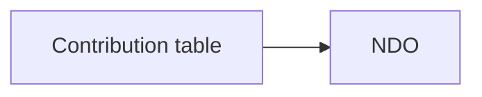

# Meetings

`/meetings` lists the resume of every Sensorica/Nondominium meeting, newest first. Each one opens at `/meetings/<slug>` as a Meeting Niceboard: the journal read as a page, with the interaction around it.

## Adding a meeting

Drop the journal into `content/meetings/` as `YYYY-MM-DD-<kind>.md`, where kind is `lab` (a meeting at the Sensorica lab), `dev` or `team`, and set the same `kind:` in its frontmatter. The build picks it up; nothing else to register. Labels for the kinds live in `src/lib/meetings/labels.ts`; an unknown kind still renders, under the generic label "Meeting". With no journals the list shows its empty message.

The journal is the markdown the Transcribe workflow writes after a call, in English or French. Its shape is fixed: frontmatter, `# Title`, the date, attendees and context lines, then TL;DR, updates, discussion, decisions, discussed-not-decided, actions, outstanding and corrections sections. Older journals vary (wrapped lines, `###` subsections, numbered lists, an actions table) and still render: anything the parser does not recognise is shown as prose, so no text is dropped.

| | English | French |
|---|---|---|
| header lines | `**Date:**`, `**Attendees:**`, `**Context:**` | `**Date :**`, `**Participants :**`, `**Contexte :**` |
| sections | `## TL;DR`, `## Since last meeting`, `## Updates`, `## Discussion`, `## Decisions`, `## Discussed, not decided`, `## Actions`, `## Outstanding`, `## Corrections after the meeting` | `## TL;DR`, `## Depuis la dernière rencontre`, `## Mises à jour` / `## Nouvelles`, `## Discussion`, `## Décisions`, `## Discuté, non décidé` / `non tranché`, `## Actions`, `## En suspens`, `## Corrections après la rencontre` |
| minute marks | `[62 to 67m]`, `[62m]` | `[62 à 67]`, `[62]` |
| length and breaks | `(1h 52m, ... break at 39 to 44m)` | `(1 h 47, ... pause de 80 à 84)` |

### What may be published

A journal committed here is published with the site, so treat it as public. It covers Sensorica and Nondominium only.

- Strip anything about other projects (hAppenings, Requests & Offers, EvoluData and the like) before the journal goes in `content/meetings/`, whether it is a paragraph, a bullet or a clause. Keep what the Nondominium work needs to be understood.
- No local machine path. Remove the `source:` and `recording:` frontmatter lines when they point at a file on someone's disk.
- No credentials, private addresses or anything a participant asked to keep off the record.

## What the page does with it

| Journal part | On the page |
|---|---|
| the date line with a length and breaks | the meeting's length and its breaks, for the timeline |
| a paragraph opening with `**Lead.**` and ending with `[62 to 67m]` | an entry with its title, minute chips, a block on the timeline, and a comment button |
| `## Decisions` bullets | cards to agree with or question |
| `## Discussed, not decided` bullets | cards with a note field |
| `## Actions` bullets `**Owner:** action [m]`, or a table `Owner, Action, Ref` | checklists grouped by owner, with a filter |
| `## Outstanding`, `## Corrections after the meeting` | commentable cards |
| a ` ```mermaid ` block | a numbered, captioned figure that opens in a zoomable view |

### Diagrams

A fenced `mermaid` block in any section is drawn as a diagram. A `%% caption:` line inside it names the figure; figures are numbered in the order they appear.

````markdown

````

The diagram is drawn in the browser by the `mermaid` package, loaded only on a page that has one, in the colours of the site's tokens and redrawn when the theme changes. Click the figure, or "zoom", for a full-screen view: `+`, `-` and `0` (or Ctrl and the wheel) zoom, Esc closes. Until it is drawn, or if the source has an error, the figure shows the source and the error.

## Comments and answers

Comments use the site's drawer (`src/lib/comments/`): one GitHub Discussion per meeting, keyed `meeting:<slug>`. The 💬 button on a paragraph, decision or card opens the drawer with the comment already pointing at it. Once posted, the comment carries the paragraph's id (`<!-- ds-about ... -->`, `about.ts`) and, when the paragraph has one, its first minute (`timecode.ts`), so everyone sees a count beside that paragraph. In the drawer, the "on ..." line scrolls to the paragraph and the minute line shows the paragraph covering it; on github.com, the minute link (`/meetings/<slug>#t=3720`) opens the page there.

Ticks, reactions and notes stay in the reader's browser (`ds-meeting:<slug>:v1` in localStorage). **copy my answers**, or Ctrl+Shift+Enter, puts only what the reader changed on the clipboard as markdown, headed with the name typed in "reading as", ready to paste back to whoever keeps the record.

## Follow-up: done actions and settled questions

Two places say an action is done or an open question is settled, and the page shows either.

- **On the page, shared.** Signed in through the comments drawer, ticking an action or pressing **settle** on an open question writes your follow-up mark on the meeting's Discussion: one hidden comment per reader (`<!-- ds-follow {...} -->`, `src/lib/comments/follow.ts`), updated in place and kept out of the comment list and its count. Everyone sees the latest state of each item and, on hover, who changed it and when. Signed out, ticks stay in your browser and the rail says so. Answer a question with 💬 so the answer is pinned beside it.
- **In the journal, on the record.** `- [x]` in front of an action or an open question (or `[x]` at the start of an actions-table cell) marks it done for good; the page shows it ticked and locked.

A page mark is keyed by the item's position in its section (`actions-3`), so an edit to a published journal ticks and appends, and never reorders or deletes action or question bullets. A new item goes at the end of its section.

## Recordings

Not on the site. A recording runs tens of megabytes and a static asset is capped, so audio would need a low-bitrate re-encode or a bucket behind the same access gate. The minute chips are already there for a player to seek.
